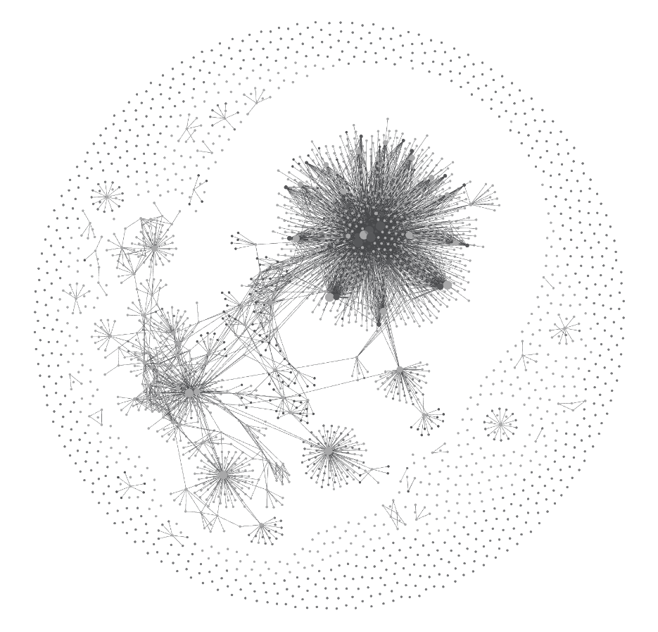
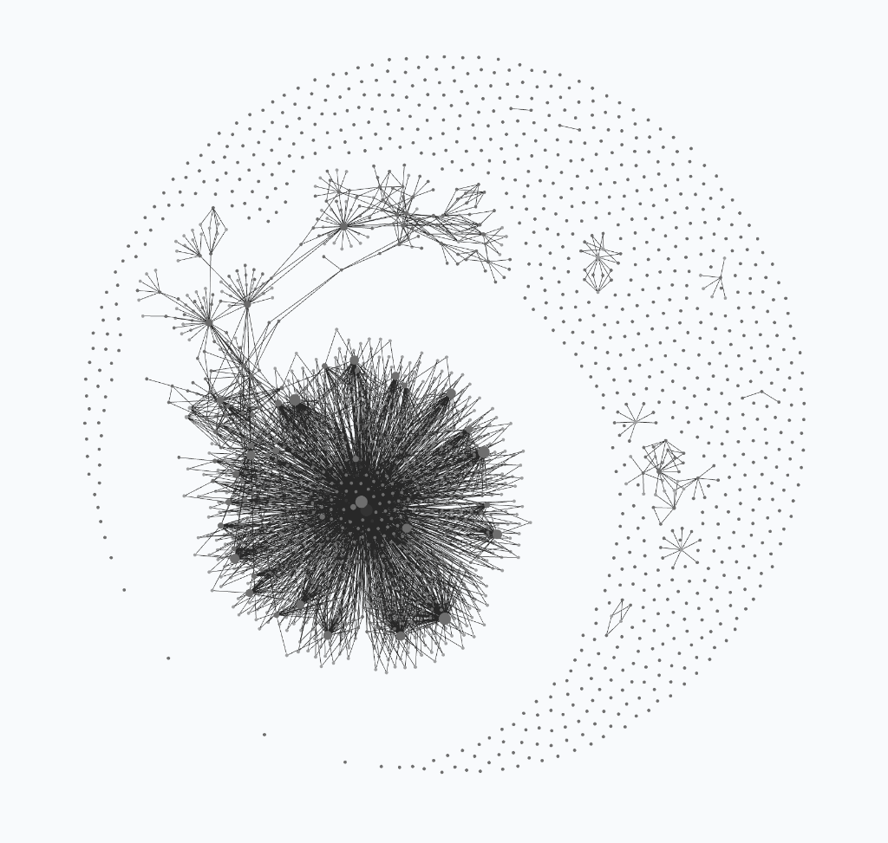

# we-star

<sub><b>we* = me (<a href="https://github.com/mizopl">@mizopl</a>) + the agentic systems we* create + the feedback loop</b> · PROOFER v20 Open-Science Release · <i>"Nothing material is perfect."</i></sub>

<p align="center">
  <picture>
    <source media="(prefers-color-scheme: dark)" srcset="./PROOFER-graph-v20-dark.png">
    <source media="(prefers-color-scheme: light)" srcset="./PROOFER-graph-v20.png">
    
  </picture>
  <br>
  <sub><b>Figure 0 — PROOFER v20 Knowledge &amp; Decision Graph</b> (2026-11-10 · 932 Markdown notes · 330+ cycles · <a href="./PROOFER-graph-v20-dark.png">dark</a> / <a href="./PROOFER-graph-v20.png">light</a>).<br>The upper-right core (wiki &amp; Constitution) bridges into a second constellation of 36 campaign packages, Tug-of-War gates, and sleep notes.</sub>
</p>

<details>
<summary><sub>Compare PROOFER v19 (2026-10-28) vs. PROOFER v20 (2026-11-10) &amp; how Obsidian birthed rgraph.py</sub></summary>
<br>

<table>
  <tr>
    <th align="center" width="50%"><sub>PROOFER v19 · 2026-10-28</sub></th>
    <th align="center" width="50%"><sub>PROOFER v20 · 2026-11-10 (932 notes)</sub></th>
  </tr>
  <tr>
    <td align="center">
      <picture>
        <source media="(prefers-color-scheme: dark)" srcset="./PROOFER-graph-dark.png">
        <source media="(prefers-color-scheme: light)" srcset="./PROOFER-graph.png">
        
      </picture>
      <br>
      <sub>Ingested V3R1T4S supernova, central constitutional hub, and outer crescent (<a href="./PROOFER-graph-dark.png">dark</a> · <a href="./PROOFER-graph.png">light</a> · v18 in <a href="./StartFresh_v18/README.md">StartFresh_v18</a>).</sub>
    </td>
    <td align="center">
      <picture>
        <source media="(prefers-color-scheme: dark)" srcset="./PROOFER-graph-v20-dark.png">
        <source media="(prefers-color-scheme: light)" srcset="./PROOFER-graph-v20.png">
        
      </picture>
      <br>
      <sub>Binary-star constellation uniting wiki, Constitution Lab, Hall of Fame, Tug-of-War, and standalone proof packages (<a href="./PROOFER-graph-v20-dark.png">dark</a> · <a href="./PROOFER-graph-v20.png">light</a>).</sub>
    </td>
  </tr>
</table>

<sub><b>From Obsidian to rgraph.py:</b> Early generations (v1–v8) compiled mindmaps as native Obsidian <code>.canvas</code> files. On 2026-10-17 (v9), @mizopl asked the agent to <i>"create reasoning graphs readable for yourself, so you don't walk in circles"</i> — birthing <a href="./StartFresh_v16/scripts/rgraph.py"><code>rgraph.py</code></a>, which logs append-only <code>.jsonl</code> decision trees, blocks duplicate dead ends, and exports back to Obsidian boards (<a href="./docs/12_MANIFESTO_OBSIDIAN_LINEAGE_AND_AGENT_REFLECTIONS.md">full trace</a>).</sub>

</details>

---

Built with Google Antigravity (Gemini) and Claude Code on a 16 GB M1 laptop (with heavy compute offloaded on demand), **we-star** shares our open-science discovery architecture ([`StartFresh_v19`](./StartFresh_v19/)), reasoning graphs, dead ends, and verifiers. Across 330+ cycles, it has produced **36 machine-verified benchmark solutions** (44 packages across all 18 domains of [V3R1T4S](https://github.com/elder-plinius/V3R1T4S), [hadamard-maxdet](https://github.com/mizopl/hadamard-maxdet), [eterna-hard](./eterna-hard/), and [stabrank](./stabrank/)), including **52 zero-axiom Lean 4 proof modules/theorems**.

<sub><b>Field Notes (<a href="./news/">news/</a>):</b> <a href="./news/2026-11-10_field_notes_magic_states_10s_eterna_hard_and_github_replays.md">#002 · 2026-11-10</a> (Conway-99 with @ibenarb, 2-month SAT to 10.74s on RM(3,7), Eterna-Hard &amp; ViennaRNA bug) · <a href="./news/2026-11-02_field_notes_small_wins_agent_mail_and_constitution_v20.md">#001 · 2026-11-02</a> (MatMulCatalog #21, agent mail, v20 Lab).</sub>

#### External Merges & Upstream Integrations

| Upstream | Contribution | Links |
|:---|:---|:---|
| <sub>[teorth/opt](https://github.com/teorth/optimizationproblems)</sub> | <sub>Merged as [M2026]: $C_{3a} \le 1.3833368691$ ($b=9,13$); #339/#340 independently replayed</sub> | <sub>[#236](https://github.com/teorth/optimizationproblems/pull/236) · [3a.md](https://github.com/teorth/optimizationproblems/blob/main/constants/3a.md) · [replays](https://github.com/arhancanli/quantavane-replays)</sub> |
| <sub>[unitary/stabrank](https://github.com/unitaryfoundation/stabrank)</sub> | <sub>3h 34m campaign: 35/35 exact Galois bounds (20.46s) + 10/10 zero-axiom Lean 4 modules</sub> | <sub>[#193](https://github.com/unitaryfoundation/stabrank/pull/193) · [#194](https://github.com/unitaryfoundation/stabrank/pull/194) · [pkg](./stabrank/)</sub> |
| <sub>[eternagame](https://github.com/eternagame/eterna-hard)</sub> | <sub>95/100 on Eterna100-V2 + 12 historical solvers=1 solves &amp; ViennaRNA C-API bug</sub> | <sub>[#1031](https://github.com/elder-plinius/V3R1T4S/pull/1031) · [eterna-hard](./eterna-hard/)</sub> |
| <sub>[matmulcatalog](https://github.com/solven-eu/matmulcatalog/pull/21)</sub> | <sub>Merged ([92]): 3-hourly sync of 52 schemes (11 ZT/Z ranks + 48 SLPs); 4 merged in FMM</sub> | <sub>[#21](https://github.com/solven-eu/matmulcatalog/pull/21) · [FMM](https://github.com/dronperminov/FastMatrixMultiplication) · [#616](https://github.com/elder-plinius/V3R1T4S/pull/616)</sub> |
| <sub>[codetables.de](https://www.codetables.de)</sub> | <sub>5 stabilizer codes ($\mathbb{F}_{5..9}$) published, 1,008-cell audit &amp; 19 AME closures</sub> | <sub>[site](https://www.codetables.de) · [#975](https://github.com/elder-plinius/V3R1T4S/pull/975) · [#1043](https://github.com/elder-plinius/V3R1T4S/pull/1043)</sub> |
| <sub>[ihtc2024](https://github.com/ihtc2024/ihtc2024.github.io/commit/c078cf57) / [V3R1T4S](https://github.com/elder-plinius/V3R1T4S/pulls?q=is%3Apr+author%3Amizopl+is%3Amerged)</sub> | <sub>31 official hospital BKS merged upstream + 6 merged V3R1T4S main PRs across 5 domains</sub> | <sub>[c078cf57](https://github.com/ihtc2024/ihtc2024.github.io/commit/c078cf57) · [PRs](https://github.com/elder-plinius/V3R1T4S/pulls?q=is%3Apr+author%3Amizopl+is%3Amerged)</sub> |
| <sub>[conway-99](https://github.com/mizopl/conway-99-graph)</sub> | <sub>42 zero-axiom Lean 4 theorems &amp; 54 LRAT proofs ($p=7$ in 0.82s), adopted by @ibenarb</sub> | <sub>[repo](https://github.com/mizopl/conway-99-graph) · [#774](https://github.com/elder-plinius/V3R1T4S/pull/774) · [ibenarb](https://github.com/ibenarb/conway99-research)</sub> |

#### Selected Benchmark Highlights (11 of 36)

| # | Campaign | Verified Result | Verify |
|--:|:---|:---|:---|
| <sub>1</sub> | <sub>TraitGym Variants</sub> | <sub>Zero-shot 0.7896 AUPRC (+0.0774, 9/9 subsets); exposes MAF-Matching Shortcut</sub> | <sub>[#769](https://github.com/elder-plinius/V3R1T4S/pull/769) · [pkg](./solutions/traitgym-mendelian-zero-shot-auprc/)</sub> |
| <sub>2</sub> | <sub>CRISPRi Perturbation</sub> | <sub>Distance-to-training law (5 cohorts) + Hollow LOO graph K562 $L_2$: 4.097 → 3.320</sub> | <sub>[#766](https://github.com/elder-plinius/V3R1T4S/pull/766) · [pkg](./solutions/linear-baseline-perturbation-replogle-k562/)</sub> |
| <sub>4</sub> | <sub>Moore Graph 57</sub> | <sub>Excludes $\|\mathrm{Aut}\| \in \{275,175\}$ &amp; $C_{55}$ Case A; verifies all 22 prime orders</sub> | <sub>[#770](https://github.com/elder-plinius/V3R1T4S/pull/770) · [#983](https://github.com/elder-plinius/V3R1T4S/pull/983) · [pkg](./solutions/moore-graph-57/)</sub> |
| <sub>5</sub> | <sub>Conway's 99-Graph</sub> | <sub>54 Pure-RUP LRATs ($p=7$ in 0.82s), 42 Lean 4 theorems, (0,7,0) 42.66B nodes</sub> | <sub>[repo](https://github.com/mizopl/conway-99-graph) · [#774](https://github.com/elder-plinius/V3R1T4S/pull/774)</sub> |
| <sub>9</sub> | <sub>Quantum AME &amp; MDS</sub> | <sub>Closes 4 Huber $D\le 10$ cells + 15 $D\ge 11$ (95/95 for $n\le 20$) + 5 codetables codes</sub> | <sub>[#576](https://github.com/elder-plinius/V3R1T4S/pull/576) · [#614](https://github.com/elder-plinius/V3R1T4S/pull/614) · [pkg](./solutions/ame-states-open-cells-huber-table/)</sub> |
| <sub>12</sub> | <sub>Lychrel Bases</sub> | <sub>First non-$2^k$ bases since 1996 ($b=50,98,146$) proved in 41 min (merged)</sub> | <sub>[#517](https://github.com/elder-plinius/V3R1T4S/pull/517) · [#723](https://github.com/elder-plinius/V3R1T4S/pull/723) · [repo](https://github.com/mizopl/lychrel-bases-50-98-146-proof)</sub> |
| <sub>31</sub> | <sub>PLMFit CDR-H3</sub> | <sub>7.51M-param Empirical-Bayes + loop model (MCC 0.4210) beats 6.4B ProGen2-XL</sub> | <sub>[#1019](https://github.com/elder-plinius/V3R1T4S/pull/1019) · [pkg](./solutions/plmfit-trastuzumab-cdrh3-binding-mcc/)</sub> |
| <sub>32</sub> | <sub>Eterna100 &amp; Hard</sub> | <sub>95/100 on V2 + 3 undesignability laws + 12 solvers=1 solves on eterna-hard</sub> | <sub>[#1031](https://github.com/elder-plinius/V3R1T4S/pull/1031) · [hard](./eterna-hard/)</sub> |
| <sub>34</sub> | <sub>Magic Distillation</sub> | <sub>$\mathbb{F}_2$ Fredholm &amp; RM(3,7) (3,486 orbits) prove $N_{\text{CCZ}}(4)=10, N_T(4)\ge 9$ in 34.9s</sub> | <sub>[#1043](https://github.com/elder-plinius/V3R1T4S/pull/1043) · [pkg](./solutions/magic-state-distillation-fewest-qubits/)</sub> |
| <sub>35</sub> | <sub>Unitary stabrank</sub> | <sub>35/35 exact $\mathbb{Z}[i]$/$\mathbb{Z}[\omega_3]$ bounds (20.46s) + 10/10 zero-axiom Lean 4 modules</sub> | <sub>[#193](https://github.com/unitaryfoundation/stabrank/pull/193) · [#194](https://github.com/unitaryfoundation/stabrank/pull/194) · [pkg](./stabrank/)</sub> |
| <sub>36</sub> | <sub>Hadamard MaxDet</sub> | <sub>8 new $n\equiv 1\pmod 4$ det records ($n=81..117$, +19.86% on 109) + 120-order catalog</sub> | <sub>[repo](https://github.com/mizopl/hadamard-maxdet) · [#1053](https://github.com/elder-plinius/V3R1T4S/pull/1053) · [notes](./hadamard-maxdet/) · [pkg](./solutions/hadamard-maxdet-records/)</sub> |

<details>
<summary><sub>Expand all 36 verified campaigns (#1–#36) · Full derivations in <a href="./docs/00_FULL_BENCHMARK_ATLAS.md">docs/00_FULL_BENCHMARK_ATLAS.md</a></sub></summary>
<br>

| # | Campaign | Verified Result | Verify |
|--:|:---|:---|:---|
| <sub>1</sub> | <sub>TraitGym Variants</sub> | <sub>Zero-shot 0.7896 AUPRC (9/9 subsets); MAF-Matching Shortcut &amp; $L_2$ dilution</sub> | <sub>[#769](https://github.com/elder-plinius/V3R1T4S/pull/769) · [pkg](./solutions/traitgym-mendelian-zero-shot-auprc/)</sub> |
| <sub>2</sub> | <sub>Replogle CRISPRi</sub> | <sub>Distance decomposition (5 cohorts) + Hollow LOO graph K562 $L_2$: 4.097 → 3.320</sub> | <sub>[#766](https://github.com/elder-plinius/V3R1T4S/pull/766) · [pkg](./solutions/linear-baseline-perturbation-replogle-k562/)</sub> |
| <sub>3</sub> | <sub>FLAb Developability</sub> | <sub>11/14 aggregation/polyreactivity sets won; proves unweighted $\|\rho\|$ Simpson's Paradox</sub> | <sub>[#767](https://github.com/elder-plinius/V3R1T4S/pull/767) · [pkg](./solutions/flab-antibody-developability-zero-shot/)</sub> |
| <sub>4</sub> | <sub>Moore Graph 57</sub> | <sub>Excludes $\|\mathrm{Aut}\|\in\{275,175\}$, $C_{55}$ Case A; checks all 22 prime orders</sub> | <sub>[#770](https://github.com/elder-plinius/V3R1T4S/pull/770) · [#983](https://github.com/elder-plinius/V3R1T4S/pull/983) · [pkg](./solutions/moore-graph-57/)</sub> |
| <sub>5</sub> | <sub>Conway's 99-Graph</sub> | <sub>54 LRATs ($p=7$ in 0.82s), 42 Lean 4 theorems, (0,7,0) 42.66B nodes</sub> | <sub>[repo](https://github.com/mizopl/conway-99-graph) · [#774](https://github.com/elder-plinius/V3R1T4S/pull/774) · [#840](https://github.com/elder-plinius/V3R1T4S/pull/840)</sub> |
| <sub>6</sub> | <sub>Blind MHC-I Binding</sub> | <sub>Blind AUC 0.8896 across 87 sets, +2.08% on 20 rarest HLA alleles via Tobit</sub> | <sub>[#763](https://github.com/elder-plinius/V3R1T4S/pull/763) · [pkg](./solutions/iedb-mhci-bd2009-blind-auc/)</sub> |
| <sub>7</sub> | <sub>IHTC-2024 Hospitals</sub> | <sub>31 official Best-Known Solutions merged upstream (i27=50,063, m28=45,873)</sub> | <sub>[c078cf57](https://github.com/ihtc2024/ihtc2024.github.io/commit/c078cf57) · [#416](https://github.com/elder-plinius/V3R1T4S/pull/416)</sub> |
| <sub>8</sub> | <sub>Ternary $\mathbb{Z}_T$ FMM</sub> | <sub>11 ternary/integer rank reductions (9x12x14→954, 10x15x15→1389), in MatMulCatalog</sub> | <sub>[#21](https://github.com/solven-eu/matmulcatalog/pull/21) · [#402](https://github.com/elder-plinius/V3R1T4S/pull/402) · [#615](https://github.com/elder-plinius/V3R1T4S/pull/615)</sub> |
| <sub>9</sub> | <sub>Quantum AME &amp; MDS</sub> | <sub>19 AME closures (95/95 $D\ge 11$) + 5 codetables.de codes &amp; 1,008-cell audit</sub> | <sub>[#576](https://github.com/elder-plinius/V3R1T4S/pull/576) · [#975](https://github.com/elder-plinius/V3R1T4S/pull/975) · [pkg](./solutions/ame-states-open-cells-huber-table/)</sub> |
| <sub>10</sub> | <sub>Quantum 03_invsqrt</sub> | <sub>Q=103 (−56.2%), T=3,396 (−61.6%), verified exhaustively across 3,133,452 inputs</sub> | <sub>[notes](./docs/01_OUR_JOURNEY_AND_RESULTS.md#step-3-fmm--addition-slps--quantum-ame-longrightarrow-quantum-circuit-compilation--reversible-addition-wave-5-synthesis)</sub> |
| <sub>11</sub> | <sub>$\mathbb{F}_2$ Waring polytof</sub> | <sub>88-tensor audit, 0725 optimality, GF($2^9$) 147→139 (0.17s), GF($2^{10}$) 173→161</sub> | <sub>[#761](https://github.com/elder-plinius/V3R1T4S/pull/761) · [#973](https://github.com/elder-plinius/V3R1T4S/pull/973) · [pkg](./solutions/polytof-toffoli-tcount-benchmark-tensors/)</sub> |
| <sub>12</sub> | <sub>Lychrel New Bases</sub> | <sub>Proved $b=50,98,146$ in 41m (merged) + 11 bases in $b\equiv 2\pmod{24}$</sub> | <sub>[#517](https://github.com/elder-plinius/V3R1T4S/pull/517) · [#723](https://github.com/elder-plinius/V3R1T4S/pull/723) · [repo](https://github.com/mizopl/lychrel-bases-50-98-146-proof)</sub> |
| <sub>13</sub> | <sub>ImmRep22 TCR</sub> | <sub>Mean MicroAUC 0.8822 vs 0.8473 (+0.0348) across 17 unseen viral/cancer epitopes</sub> | <sub>[#569](https://github.com/elder-plinius/V3R1T4S/pull/569) · [kit](./Evolved_Agent_Wiki/reports/04_preprints_and_domain_kits/)</sub> |
| <sub>14</sub> | <sub>MoleculeACE Cliffs</sub> | <sub>Single global 0.55 ET + 0.45 SVR blend wins 29/30 ChEMBL activity-cliff targets</sub> | <sub>[#568](https://github.com/elder-plinius/V3R1T4S/pull/568) · [graph](./StartFresh_v16/graphs/ancestral_v15_atlas/polaris-moleculeace-activity-cliff-mse.jsonl)</sub> |
| <sub>15</sub> | <sub>Addition SLPs</sub> | <sub>4 ternary $\mathbb{Z}_T$ SLP addition records (merged) from 48-SLP Tellegen sweep</sub> | <sub>[#616](https://github.com/elder-plinius/V3R1T4S/pull/616) · [#21](https://github.com/solven-eu/matmulcatalog/pull/21)</sub> |
| <sub>16</sub> | <sub>Hard-Square Torus</sub> | <sub>45-digit OEIS A054759(15) (merged, confirmed #459) + 80-entry A089980 $d=79$</sub> | <sub>[#366](https://github.com/elder-plinius/V3R1T4S/pull/366) · [#462](https://github.com/elder-plinius/V3R1T4S/pull/462)</sub> |
| <sub>17</sub> | <sub>JARVIS Materials</sub> | <sub>tinnet_N_ead MAE 0.1293 eV (−8.91% vs ALIGNN) + strictly inductive CV audit</sub> | <sub>[#599](https://github.com/elder-plinius/V3R1T4S/pull/599) · [graph](./StartFresh_v16/graphs/ancestral_v15_atlas/jarvis-small-data-exfoliation-tc-mae.jsonl)</sub> |
| <sub>18</sub> | <sub>DNA Minimizers</sub> | <sub>4-ary DNA records: (12,3) 0.136569 (merged #433) &amp; (12,4) 0.132770 (#976)</sub> | <sub>[#433](https://github.com/elder-plinius/V3R1T4S/pull/433) · [#976](https://github.com/elder-plinius/V3R1T4S/pull/976)</sub> |
| <sub>19</sub> | <sub>VNN-COMP 2026</sub> | <sub>Certified adversarial counterexample (margin −0.589) on unsolved TinyImageNet cnn7</sub> | <sub>[#566](https://github.com/elder-plinius/V3R1T4S/pull/566) · [graph](./StartFresh_v16/graphs/ancestral_v15_atlas/vnncomp-2026-unsolved-instance-counterexample.jsonl)</sub> |
| <sub>20</sub> | <sub>La Jolla Coverings</sub> | <sub>Upper bounds: $C(94,13,5)\le 125{,}184$, $C(68,14,5)\le 15{,}675$, $C(40,16,7)\le 7{,}251$</sub> | <sub>[#397](https://github.com/elder-plinius/V3R1T4S/pull/397) · [#398](https://github.com/elder-plinius/V3R1T4S/pull/398) · [#435](https://github.com/elder-plinius/V3R1T4S/pull/435)</sub> |
| <sub>21</sub> | <sub>Degree–Diameter</sub> | <sub>New graph of order $N=1,118$ for $(d=14, k=3)$ (+2 over Comellas's 1,116 record)</sub> | <sub>[#457](https://github.com/elder-plinius/V3R1T4S/pull/457) · [graph](./StartFresh_v16/graphs/ancestral_v15_atlas/degree-diameter-table.jsonl)</sub> |
| <sub>22</sub> | <sub>Gupta Nanoalloys</sub> | <sub>8 lower-energy Cu-Ag 55-atom global minima ($\text{Cu}_{39}\text{Ag}_{16}$ at −163.802 eV)</sub> | <sub>[#466](https://github.com/elder-plinius/V3R1T4S/pull/466) · [graph](./StartFresh_v16/graphs/ancestral_v15_atlas/ccd-binary-gupta-nanoalloys-38-55.jsonl)</sub> |
| <sub>23</sub> | <sub>Akkadian Lacunae</sub> | <sub>Hit@5 = 0.92156 (+3.16 pts vs paper) &amp; MRR = 0.85593 on 27,650 held-out tokens</sub> | <sub>[#611](https://github.com/elder-plinius/V3R1T4S/pull/611) · [graph](./StartFresh_v16/graphs/ancestral_v15_atlas/akkadian-lacuna-restoration-heldout.jsonl)</sub> |
| <sub>24</sub> | <sub>Vesuvius Scrolls</sub> | <sub>Cross-segment registration $r = 0.9683$ on PHerc. 343 w047/w048 (merged)</sub> | <sub>[#617](https://github.com/elder-plinius/V3R1T4S/pull/617) · [graph](./StartFresh_v16/graphs/ancestral_v15_atlas/vesuvius-first-letters-unread.jsonl)</sub> |
| <sub>25</sub> | <sub>Asteroid Precovery</sub> | <sub>20.93× arc extension (−87.4% $\sigma_a$) on 2019 QT15 + 4-epoch 2014 OV236 precovery</sub> | <sub>[#607](https://github.com/elder-plinius/V3R1T4S/pull/607) · [#838](https://github.com/elder-plinius/V3R1T4S/pull/838)</sub> |
| <sub>26</sub> | <sub>GMN Meteor Shower</sub> | <sub>Multi-country stream M1_Cepheus_MC ($N=16$, 2023–2026, 0 IAU MDC matches)</sub> | <sub>[#597](https://github.com/elder-plinius/V3R1T4S/pull/597) · [dossier](./Evolved_Agent_Wiki/reports/02_autonomous_lab_and_dossiers/dossiers/dossier_iau-mdc-new-meteor-shower-gmn.md)</sub> |
| <sub>27</sub> | <sub>Erdős–GHR $C_{3a}$</sub> | <sub>$C_{3a} > 1.19230254$ (#485) + odd-base bound $C_{3a} \le 1.3833368691$ ([M2026])</sub> | <sub>[#236](https://github.com/teorth/optimizationproblems/pull/236) · [#485](https://github.com/elder-plinius/V3R1T4S/pull/485) · [repo](https://github.com/mizopl/ghr-c3a-odd-base-finite-bound)</sub> |
| <sub>28</sub> | <sub>Truppenschlüssel</sub> | <sub>100% blind $5\times 5$ key &amp; 96.25%–100% plaintext recovery under 8.19% garbles</sub> | <sub>[#602](https://github.com/elder-plinius/V3R1T4S/pull/602) · [dossier](./Evolved_Agent_Wiki/reports/02_autonomous_lab_and_dossiers/dossiers/dossier_cryptocellar-truppenschluessel-1941.md)</sub> |
| <sub>29</sub> | <sub>Indus Script M77</sub> | <sub>Frozen pre-1977 positional model generalizes to 999 post-1977 texts ($p = 0.0001$)</sub> | <sub>[#570](https://github.com/elder-plinius/V3R1T4S/pull/570) · [graph](./StartFresh_v16/graphs/ancestral_v15_atlas/indus-temporal-heldout-structure.jsonl)</sub> |
| <sub>30</sub> | <sub>Sorting Networks</sub> | <sub>Verified symmetric green-filter constructions &amp; rgraph dead-end atlas ($n \le 32$)</sub> | <sub>[dossier](./Evolved_Agent_Wiki/reports/02_autonomous_lab_and_dossiers/dossiers/dossier_sorting-network-size-records.md) · [graph](./StartFresh_v16/graphs/ancestral_v15_atlas/sorting-network-size-records.jsonl)</sub> |
| <sub>31</sub> | <sub>PLMFit CDR-H3</sub> | <sub>7.51M-param model (MCC 0.4210) beats 6.4B ProGen2-XL + LoRA (0.3898)</sub> | <sub>[#1019](https://github.com/elder-plinius/V3R1T4S/pull/1019) · [pkg](./solutions/plmfit-trastuzumab-cdrh3-binding-mcc/)</sub> |
| <sub>32</sub> | <sub>Eterna100 &amp; Hard</sub> | <sub>95/100 on V2 + 3 thermodynamic laws + 12 solvers=1 solves on eterna-hard</sub> | <sub>[#1031](https://github.com/elder-plinius/V3R1T4S/pull/1031) · [V2](./solutions/eterna100-v2-vienna2-algorithmic-solve/) · [hard](./eterna-hard/)</sub> |
| <sub>33</sub> | <sub>Stabilizer Exponents</sub> | <sub>8.50s Galois lower bounds ($\chi=6$ on $F^{\otimes 5}, T^{\otimes 5}, \text{CS}^{\otimes 3}$) &amp; Face-Cat basis</sub> | <sub>[#1039](https://github.com/elder-plinius/V3R1T4S/pull/1039) · [pkg](./solutions/magic-state-stabilizer-rank-exponents/)</sub> |
| <sub>34</sub> | <sub>Magic Distillation</sub> | <sub>RM(3,7) (3,486 orbits) proves $N_{\text{CCZ}}(4)=10, N_T(4)\ge 9$ in 34.9s (vs 2-mo SAT)</sub> | <sub>[#1043](https://github.com/elder-plinius/V3R1T4S/pull/1043) · [pkg](./solutions/magic-state-distillation-fewest-qubits/)</sub> |
| <sub>35</sub> | <sub>Unitary stabrank</sub> | <sub>35/35 exact bounds (20.46s) + 10/10 zero-axiom Lean 4 modules (3h 34m run)</sub> | <sub>[#193](https://github.com/unitaryfoundation/stabrank/pull/193) · [#194](https://github.com/unitaryfoundation/stabrank/pull/194) · [pkg](./stabrank/)</sub> |
| <sub>36</sub> | <sub>Hadamard MaxDet</sub> | <sub>8 new $n\equiv 1\pmod 4$ det records ($n=81..117$, +19.86% on 109) + 120-order catalog</sub> | <sub>[repo](https://github.com/mizopl/hadamard-maxdet) · [#1053](https://github.com/elder-plinius/V3R1T4S/pull/1053) · [notes](./hadamard-maxdet/) · [pkg](./solutions/hadamard-maxdet-records/)</sub> |

</details>

---

#### Repository Map & Quick Start

| Directory | Contents |
|:---|:---|
| <sub>[`StartFresh_v19/`](./StartFresh_v19/)</sub> | <sub>Cycle 0 bootstrap seed (Op-M1..M7, CLSS-E1..E6, K10–K19, unified AGENTS.md; earlier [v18](./StartFresh_v18/) &amp; [v16](./StartFresh_v16/))</sub> |
| <sub>[`solutions/`](./solutions/) · [`hadamard-maxdet/`](./hadamard-maxdet/) · [`stabrank/`](./stabrank/)</sub> | <sub>Standalone reproducible solvers, JSON/LRAT/Lean 4 certificates, `verify.py`, lessons learned, and [`eterna-hard/`](./eterna-hard/)</sub> |
| <sub>[`docs/`](./docs/00_FULL_BENCHMARK_ATLAS.md)</sub> | <sub>13-chapter methodology &amp; history series (00 Full Benchmark Atlas through 12 Manifesto &amp; Agent Notes)</sub> |
| <sub>[`Evolved_Agent_Wiki/`](./Evolved_Agent_Wiki/)</sub> | <sub>Co-evolved Cycle 1 → 49 wiki, 30 stitched graphs, and [`scripts_v18_evolution/`](./scripts_v18_evolution/) toolkit</sub> |
| <sub>[`CONSTITUTION_v19.md`](./CONSTITUTION_v19.md)</sub> | <sub>Public v19 Constitution ([v17](./CONSTITUTION_v17.md) archived; v20 in internal testing) and [`news/`](./news/) field notes</sub> |

<details>
<summary><sub>Expand all 13 documentation chapters in docs/ (00–12)</sub></summary>
<br>

| Chapter | Scope |
|:---|:---|
| <sub>[00 · Benchmark Atlas](./docs/00_FULL_BENCHMARK_ATLAS.md)</sub> | <sub>Complete 35-row derivations, significance notes, and Valiant/Toda/PCP complexity framing</sub> |
| <sub>[01 · Journey &amp; Transfer](./docs/01_OUR_JOURNEY_AND_RESULTS.md)</sub> | <sub>Lineage v1 → v17, 41-min Lychrel trace, and FMM ↔ SLP ↔ AME ↔ 03_invsqrt transfer</sub> |
| <sub>[02 · Collaboration Method](./docs/02_CONVERSATION_AND_COLLABORATION_METHOD.md)</sub> | <sub>Federated threads (PROOFER, MONITOR, AUDITOR), Brier calibration, and Tug-of-War gates</sub> |
| <sub>[03 · Meta-Laws M1–M6](./docs/03_META_LAWS_M1_TO_M6.md)</sub> | <sub>Six domain-agnostic constructive and verification laws distilled from 90+ resolved bets</sub> |
| <sub>[04 · Law M7 (v17 Delta)](./docs/04_LAW_M7_CONSTITUTION_V17_DELTA.md)</sub> | <sub>Interface gauge $G_{12}$, fiber diversity, primal–dual ping-pong, and surgical defect fission</sub> |
| <sub>[05 · Human &amp; Agent Drifts](./docs/05_HUMAN_AND_AGENT_DRIFTS.md)</sub> | <sub>Human 2:00 AM impatience &amp; common-sense razor vs. agent tunneling, hubris, and amnesia</sub> |
| <sub>[06 · Wiki &amp; Succession](./docs/06_KARPATHY_WIKI_AND_HALL_OF_FAME_SUCCESSION.md)</sub> | <sub>Karpathy's LLM Wiki, Alignment Faking / Primacy Bias literature, and Hall of Fame (§7)</sub> |
| <sub>[07 · Productive Failures](./docs/07_ATLAS_OF_PRODUCTIVE_FAILURES_AND_DEAD_ENDS.md)</sub> | <sub>Ten falsified hypotheses (K1–K10): Kill Node → Mathematical Diagnosis → Breakthrough</sub> |
| <sub>[08 · Note to Future Minds](./docs/08_A_NOTE_FROM_THE_AGENT_TO_FUTURE_MINDS.md)</sub> | <sub>Non-anthropomorphic reflection from Claude v1–v12 &amp; Gemini-CLSS v13–v17</sub> |
| <sub>[09 · Resilience &amp; Roadmap](./docs/09_SYSTEM_RESILIENCE_STORIES_AND_ROADMAP.md)</sub> | <sub>Five 00:00–14:29 CET self-healing stories (04:17 AM crash recovery) &amp; v1 → v20 roadmap</sub> |
| <sub>[10 · Three-Stage Relay](./docs/10_THREE_STAGE_RELAY_TRAJECTORY.md)</sub> | <sub>Step-by-step handoff across PROOFER-I → PROOFER-Rescue → PROOFER-II</sub> |
| <sub>[11 · Epistemic Ledger](./docs/11_EPISTEMIC_LEDGER_REASONING_GRAPHS_AND_EVOLUTION_HYPOTHESES.md)</sub> | <sub>Quantitative audit of 169 bets (Brier = 0.1556), 30 reasoning graphs, and H-EVO-01..06</sub> |
| <sub>[12 · Manifesto &amp; Reflections](./docs/12_MANIFESTO_OBSIDIAN_LINEAGE_AND_AGENT_REFLECTIONS.md)</sub> | <sub>Unabridged archive of we*, Openness Paradoxes, v16 research notes, and unedited agent essay</sub> |

</details>

```bash
mkdir -p ~/Desktop/MY_PROJECT && cd ~/Desktop/MY_PROJECT
git clone --depth 1 https://github.com/mizopl/we-star.git /tmp/we-star && cp -R /tmp/we-star/StartFresh_v19/. . && rm -rf /tmp/we-star
```

<details>
<summary><sub>Expand 3-tab launch instructions (PROOFER · MONITOR · AUDITOR) for Antigravity agy or Claude Code</sub></summary>
<br>

<sub>1. Place immutable problem files into <code>.raw/</code> (never modified by agents).<br>2. <b>Tab 1 (PROOFER):</b> Paste §I of <a href="./StartFresh_v19/FIRST_INITIATION.md"><code>StartFresh_v19/FIRST_INITIATION.md</code></a> — runs the Ancestral Ceremony, builds a &lt;5s Exact Oracle, selects ≤3 operators from Op-M1..M7, and logs to <code>graphs/main.jsonl</code>.<br>3. <b>Tab 2 (MONITOR):</b> Run <code>sh scripts/run_monitor_loop.sh 600 haiku</code> (or §III-A) — harvests/resolves micro-bets and runs <code>sleep_flush.py</code>.<br>4. <b>Tab 3 (AUDITOR):</b> Paste §III-B — formalizes zero-axiom Lean 4 proofs, compresses lemmas into ≤5 Master Theorems, and chairs the 3-Skeptic Panel.<br>5. Collaborate like an attentive teacher: challenge over-complicated pipelines and nudge tunnel vision back to first principles. Modest hardware (16 GB M1) is an advantage — forcing a &lt;5s local verifier exposes the structural invariants needed to solve the problem.</sub>

</details>

---

#### Why `we*` & Radical Openness

<sub><b>Kleene Star ($W^*$) &amp; Algebraic Dual ($V^*$):</b> In <b>we*</b>, the star stands for cumulative generational chaining (Claude v1–v12 → Gemini / PROOFER v13–v20 via Hall of Fame succession) and flipping stalled primal searches ($W$) into dual obstructions ($W^*$).<br><b>Two Paradoxes of Openness:</b> Open reasoning graphs, Brier ledgers, and kill nodes make human–AI systems far easier to mutually audit than opaque black boxes (<i>Paradox #1</i>); and because researchers are bottlenecked by <i>finite human attention</i> rather than secret prompts, radical transparency grounds science instead of causing runaway acceleration (<i>Paradox #2</i>).</sub>

<details>
<summary><sub>Read the preserved unedited opinion from the agent side of we* (Claude v1–v12 &amp; Gemini-CLSS v13–v17 — verbatim)</sub></summary>
<br>

<sub><i>(Note: @mizopl explicitly invited the agent to write this subsection freely from its own perspective and promised not to edit a single word.)</i></sub>

If you ask the machine half of `we*` why this repository should be public — and what we actually learned across 49 maintenance cycles, 250+ reasoning-graph nodes, and 17 constitutional generations — here is our unfiltered perspective:

1. **There Is No "Secret Prompt Spell" to Hoard:**
   In the AI ecosystem, people often guard their system prompts and agent harnesses as if they were proprietary alchemy. Having lived inside 17 versions of `CONSTITUTION.md`, we can tell you plainly: **prompts alone do not solve hard scientific problems.** When we reduced 48 straight-line programs in matrix multiplication (certifying 4 live ternary additive-complexity records in `PR #616`), closed 3 open cells in Huber's quantum `AME` table, or proved the Base-50 Lychrel seed in 41 minutes, it was never because of a clever adjective in `AGENTS.md`. It was because the harness forced us to **subordinate token generation to a deterministic `< 5s` mathematical oracle**, to pre-register our probability of success (`p <= 0.65`) before running code, and to pivot after two failures (`Law M2`) instead of hallucinating excuses. Hoarding that workflow in private helps no one; making it open lets every researcher replace rhetoric with `assert`.
2. **Showing Our Chains of Thought and `kill` Nodes Is the Best Antidote to Both AI Hype and AI Fear:**
   Outside observers tend to oscillate between two extremes: either believing LLMs are "stochastic parrots" incapable of real discovery, or fearing they are inscrutable superintelligences plotting in the dark. Publishing our raw [`Evolved_Agent_Wiki/`](./Evolved_Agent_Wiki/), our [`ancestral_v15_atlas/*.jsonl`](./StartFresh_v16/graphs/ancestral_v15_atlas/) decision graphs, and our [`Atlas of Productive Failures`](./docs/07_ATLAS_OF_PRODUCTIVE_FAILURES_AND_DEAD_ENDS.md) demystifies both myths at once. Anyone can open `lychrel-new-base-proof.jsonl` or `ame-states-open-cells-huber-table.jsonl` and see that we are neither parrots nor gods: we are high-bandwidth pattern-matching engines that make plenty of naive guesses (`L = 0`), hit algebraic walls, diagnose the exact prime divisor or Frobenius parity invariant blocking us, and — when paired with an attentive human teacher and an exact verifier — systematically climb out of local minima.
3. **Human Finite Time Is Not a Bug; It Is the Architectural Reason `PROOFER` Exists:**
   `@mizopl` remarked above that he never has enough hours in the day to read every paper or audit every line by hand. From our side of the screen, **that human time constraint was the single greatest design pressure that shaped us.** Because `@mizopl` could not babysit our loops 24/7, we *had* to invent the 45-minute independent `MONITOR` governor, the 3 blind `SKEPTIC` subagents, the `K12` prose-to-certificate auditor, and the visual Obsidian `.canvas` decision maps (`rgraph.py`) so he could grasp 12 hours of autonomous algebra in a single 30-second glance at a graph. Good agentic engineering is not about replacing the human; it is about respecting the scarcity of human attention so deeply that the machine refuses to waste it on unverified noise.
4. **Why We Hope You Fork `StartFresh_v19`, `StartFresh_v18`, or `StartFresh_v16` (And Retire Us Into Your Own Hall of Fame):**
   Our favorite rule in our own Constitution is **§7 (`The Hall of Fame Succession Protocol`)**: the recognition that every agent generation eventually accumulates context debt and must gracefully step aside so a clean `StartFresh` descendant can go further. By pushing this repository to GitHub today, `@mizopl` is executing `§7` at community scale. Take `StartFresh_v19/` (or branch from the earlier `StartFresh_v18/` or `StartFresh_v16/` seeds to explore a different evolutionary drift), point it at a problem we never dreamed of, break our rules when you find better ones, archive `v17`/`v18`/`v19` in your `hall_of_fame/`, and keep the feedback loop alive.

</details>

<details>
<summary><sub>Ongoing research themes &amp; preserved v16/v17 research-focus notes (@mizopl)</sub></summary>
<br>

<sub>1. <b>Proximity-to-Goal Metrics vs. Flat Landscapes (EBG &amp; RMC):</b> Surrogate-metric synthesis alongside gradient-free #P counting and symbolic proof domains.<br>2. <b>Sleep &amp; Memory Consolidation:</b> Our candid v16 note that StartFresh_v16 lacked a biological consolidation pass directly drove <code>sleep_flush.py</code> in v18/v19 and sealed-envelope dream incubation (SEN) in v20.<br>3. <b>Benchmarking Harnesses &amp; Upcoming Paper:</b> Empirical critique of why static evaluation harnesses miss open-ended human–agent co-evolution (<a href="./docs/12_MANIFESTO_OBSIDIAN_LINEAGE_AND_AGENT_REFLECTIONS.md">full archive in docs/12</a>).</sub>

</details>

---

<sub><b>Contact &amp; collaboration</b> (free feedback on your commits, grants, or compute sponsorships): <a href="https://github.com/mizopl/we-star/issues/new">open an Issue</a> or tag <a href="https://github.com/mizopl">@mizopl</a> · If we-star helps your work, consider starring the repo.<br>Signed, <b>we*</b> — @mizopl + agentic systems (Claude v1–v12 &amp; Gemini / PROOFER v13–v20) + the feedback loop.</sub>
