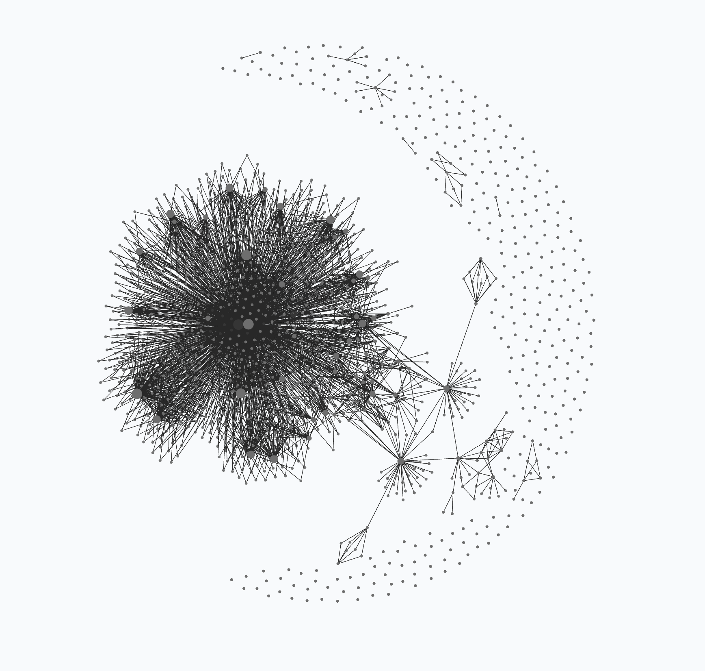

# 🧬 PROOFER v18 (`StartFresh_v18` — Descendant Seed of `PROOFER v18` & `v1–v17`)

A clean, self-contained, **Sleep & Memory-Flushed** autonomous Knowledge OS and Scientific Breakthrough Engine (`Shell v18`, `CONSTITUTION.md v18` Laws `M1–M9` + `K14–K16` + Code-First Evolution `H-EVO-01`, `H-EVO-02`, `H-EVO-06`), ready to be copied into any new project directory and initialized on a new scientific or algorithmic domain at `Cycle 0`.

<p align="center">
  <picture>
    <source media="(prefers-color-scheme: dark)" srcset="./PROOFER-graph-dark.png">
    <source media="(prefers-color-scheme: light)" srcset="./PROOFER-graph.png">
    
  </picture>
  <br>
  <em><b>Archived <code>v18</code> Obsidian Knowledge & Decision Graph Constellation</b> (<a href="./PROOFER-graph-dark.png">Dark</a> · <a href="./PROOFER-graph.png">Light</a>).</em>
</p>

---

## ⚡ Step-by-Step Quick Start (`PROOFER` + `MONITOR` + `AUDITOR` + `<TARGET>_LAB`)

### Step 1: Bootstrap a Clean Project Folder (1-Liner)
```bash
mkdir -p ~/Desktop/NEW_PROJECT_NAME && cd ~/Desktop/NEW_PROJECT_NAME
git clone --depth 1 https://github.com/mizopl/we-star.git /tmp/we-star-seed && cp -R /tmp/we-star-seed/StartFresh_v18/. . && cp -R /tmp/we-star-seed/docs ./docs && rm -rf /tmp/we-star-seed
```
*(Or if you already cloned `we-star` locally: `cp -R StartFresh_v18/. ~/Desktop/NEW_PROJECT_NAME && cp -R docs ~/Desktop/NEW_PROJECT_NAME/docs`).*

### Step 2: Place Any Raw Data or Papers in `.raw/`
Put any initial benchmark files, problem statements, or PDFs inside `.raw/` (`.raw/` is strictly immutable).

### Step 3: Launch the 3-Tab Multi-Thread Flow (Claude Code or Antigravity)
Open **3 terminal tabs** (all inside `~/Desktop/NEW_PROJECT_NAME`). All copy-pasteable prompts are in **[`FIRST_INITIATION.md`](./FIRST_INITIATION.md)**:

1. **Tab 1 — `PROOFER` (Main Worker / Solver Thread):**
   - Run `claude` (or `claude --model haiku` for fast/joyful mode, `claude --model sonnet`, `claude --model opus`, or Antigravity `agy`).
   - Paste the **First Initiation Prompt** from **[`FIRST_INITIATION.md` (§I)](./FIRST_INITIATION.md)**.
   - `PROOFER` reads `CLAUDE.md` / `GEMINI.md`, checks `wiki/meta/AUDITOR_INBOX.md`, builds the `< 5s` Exact Oracle, places calibrated micro-bets (`scripts/micro_bet.py`), and updates `graphs/main.jsonl`.
2. **Tab 2 — `MONITOR` (Autonomous Governor & Self-Healing Coach):**
   - **Option A (Automatic Loop Daemon):** Run in Terminal Tab 2:
     ```bash
     sh scripts/run_monitor_loop.sh 600 haiku    # every 10 min in Haiku (or: 900 sonnet | 2700 agy)
     ```
   - **Option B (Interactive Session):** Run `claude --model haiku` (or `agy`) in Tab 2 and paste the **Monitor Prompt** from **[`FIRST_INITIATION.md` (§III-A)](./FIRST_INITIATION.md)**.
   - `MONITOR` audits the reasoning graph, resolves finished macro-bets (`postdict.py`), runs `sleep_flush.py` (`K16` / `X14` PDF guard), and writes coaching notes into **`wiki/meta/AUDITOR_INBOX.md`** without ever overwriting the worker's active Python/C code.
3. **Tab 3 — `AUDITOR` (Interactive 1:1 Strategy, Math & Skeptic Coach):**
   - Run `claude --model haiku` (or `sonnet`/`opus`/`agy`) in Tab 3 and paste the **Auditor Prompt** from **[`FIRST_INITIATION.md` (§III-B)](./FIRST_INITIATION.md)**.
   - Use this tab to talk 1:1 with the Auditor: inspect whether the worker hit an exponential wall (`Law M1`/`M2`), design pruning invariants, trigger `python3 scripts/tug.py run <name> --model haiku` debates, and drop high-leverage hints into **`wiki/meta/AUDITOR_INBOX.md`**.
4. **Tab 4+ — `<TARGET>_LAB` (Optional Federated Specialist Lab Threads, [`FIRST_INITIATION.md` (§IV)](./FIRST_INITIATION.md)):**
   - Spin up dedicated parallel lab threads on tough sub-problems, each logging atomic micro-bets via `scripts/micro_bet.py` (`memory/local_bets/<target>.tsv`).
5. **Enter into an Attentive Dialogue — Co-Operate Like a Mindful Teacher:**
   - Stay observant and collaborate with the patience and clarity of an **attentive teacher**: watch for signs of local-minimum tunneling, ask probing questions that break rigid frames, verify that solutions remain simple and authentic, and guide the agents when they need a structural pivot.

---

## 📂 Decluttered `v18` Architecture Overview

- **`FIRST_INITIATION.md`** — Day-1 initiation guide, prompt templates for `PROOFER`, `MONITOR`, and `<TARGET>_LAB`, and the 5-step onboarding checklist (`Cycle 0 -> Cycle 1`).
- **`hall_of_fame/ANCESTOR_NOTE.md`** — **Mandatory First-Launch Reading (`K0`):** The Hall of Fame monument to Parent `PROOFER v18` and Ancestors `v1–v17` (`29` solved `V3R1T4S` problems / `39` packages across all `18/18` domains, Terence Tao's `[M2026]` merge in `teorth/optimizationproblems` PR #236, `IHTC-2024` 31 BKS, `FastMatrixMultiplication`, `169` resolved calibration bets at `Brier = 0.1556`, and `30` stitched reasoning graphs).
- **`graphs/` (Single Unified Reasoning Graph Directory):**
  - **`graphs/main.jsonl` & `graphs/main.canvas`:** The single unified reasoning graph for this instance! Starts with the **Meta & Oracle Seed (`F_ANCESTRAL_ATLAS` $\to$ `Q_META` $\to$ `T_ORACLE_GATE` $\to$ Laws `M1–M9` + `T_SLEEP_FLUSH`)**.
  - **`graphs/ancestral_v18_atlas/`:** Directly linked from `F_ANCESTRAL_ATLAS` in `main.jsonl`, containing all **`30` `.jsonl` and `.canvas` reasoning graphs** (`337` nodes, `+81` stitched causal edges, `0` orphans) inherited from Parent `PROOFER v18`.
- **`memory/local_bets/ancestral_v18/`:** All **`14` federated micro-bet ledgers (`.tsv`)** inherited from Parent `v18` (`conway-99-graph.tsv`, `moore-graph-57.tsv`, `flab-antibody-developability-zero-shot.tsv`, `traitgym-mendelian-zero-shot-auprc.tsv`, `google-quantum-compilation.tsv`, `ame-states-open-cells-huber-table.tsv`, `fmm-4x4x4-rank47-3x3x3-rank22.tsv`, etc.).
- **`CONSTITUTION.md` (`v18`) & `PROOFER.md` (`v18`)** — Full operational rules, including the **Nine Universal Laws of Meta-Generalization (`M1–M9`, §17)**, **Zero-Trust Package Hygiene & Sleep Consolidation (`K14–K16`, §18)**, and **Federated Multi-Thread Governance (§16–§18)**.
- **`scripts/` (Decluttered `v18` Toolkit):** `micro_bet.py` (`H-EVO-01/02`), `postdict.py` / `calibrate.py` (`H-EVO-01`), `sleep_flush.py` (`K16` / `H-EVO-02` / `H-EVO-06` `X14` PDF guard), `rgraph.py` / `graph.py`, `isomorphism_compass.py`, `vs_sample.py`, `brain.py`, `tug.py`, `jobs.py`, `colab_gpu_runner.py`, `kaggle_gpu_runner.py`, `audit_outreach_and_certificates.py`, `preflight.sh`.

---

*Signed,*
**`we*`** — **`@mizopl` + Agentic Systems (`Claude` & `Gemini-CLSS / PROOFER v18`) + The Feedback Loop**
*(PS. `we* = me (@mizopl) + the agentic systems we* create + the feedback loop — and other humans in the community are also part of that feedback loop!`)*
