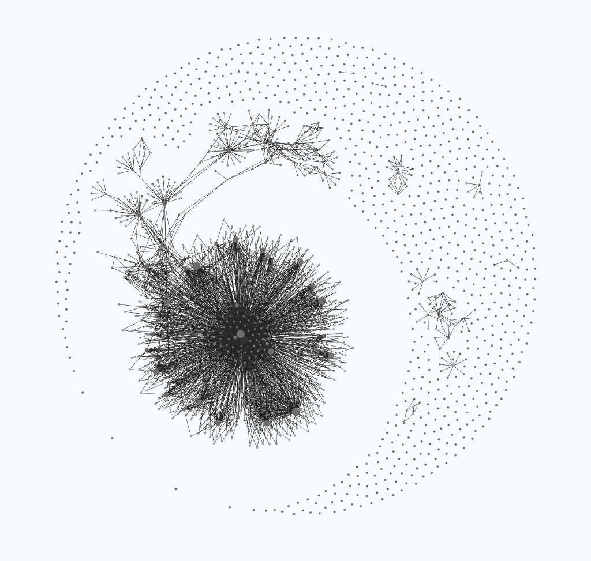

# 🧬 PROOFER v19 (`StartFresh_v19` — Descendant Seed of `PROOFER v18 -> v19` & `v1–v17`)

A clean, self-contained, **Sleep & Memory-Flushed** autonomous Knowledge OS and Scientific Breakthrough Engine (**`Shell v19`**, governed by a single unified **`AGENTS.md`** entry point and the **Three-Layer Architecture of Universal Discovery**: **Seven Universal Operators `Op-M1..Op-M7`**, **Six Automated Epistemic & Hardware Guardrails `CLSS-E1..E6`**, and **Multi-Agent Cognitive Governance `K10–K19`**), ready to be copied into any new project directory and initialized on a new scientific, mathematical, or algorithmic domain at `Cycle 0`.

<p align="center">
  <picture>
    <source media="(prefers-color-scheme: dark)" srcset="./PROOFER-graph-dark.png">
    <source media="(prefers-color-scheme: light)" srcset="./PROOFER-graph.png">
    
  </picture>
  <br>
  <em><b><code>v19</code> Obsidian Knowledge & Decision Graph Constellation</b> (<a href="./PROOFER-graph-dark.png">Dark</a> · <a href="./PROOFER-graph.png">Light</a>).</em>
</p>

---

## ⚡ Step-by-Step Quick Start (`PROOFER` + `MONITOR` + `AUDITOR` + `<TARGET>_LAB`)

### Step 1: Bootstrap a Clean Project Folder (1-Liner)
```bash
mkdir -p ~/Desktop/NEW_PROJECT_NAME && cd ~/Desktop/NEW_PROJECT_NAME
git clone --depth 1 https://github.com/mizopl/we-star.git /tmp/we-star-seed && cp -R /tmp/we-star-seed/StartFresh_v19/. . && cp -R /tmp/we-star-seed/docs ./docs && rm -rf /tmp/we-star-seed
```
*(Or if you already cloned `we-star` locally: `cp -R StartFresh_v19/. ~/Desktop/NEW_PROJECT_NAME && cp -R docs ~/Desktop/NEW_PROJECT_NAME/docs`. If using a harness that only reads `CLAUDE.md`, run `ln -s AGENTS.md CLAUDE.md`).*

### Step 2: Place Any Raw Data or Papers in `.raw/`
Put any initial benchmark files, problem statements, or PDFs inside `.raw/` (`.raw/` is strictly immutable).

### Step 3: Launch the Multi-Thread Flow (Antigravity `agy` or Claude Code)
Open **3 conversation threads / terminal tabs** inside `~/Desktop/NEW_PROJECT_NAME`. All copy-pasteable prompts are in **[`FIRST_INITIATION.md`](./FIRST_INITIATION.md)**:

1. **Thread 1 — `PROOFER` (`Proofer-Senior` — Main Hunter & Kernel Architect Thread):**
   - Paste the **First Initiation Prompt** from **[`FIRST_INITIATION.md` (§I)](./FIRST_INITIATION.md)**.
   - `PROOFER` reads `AGENTS.md`, `hall_of_fame/ANCESTOR_NOTE.md`, `CONSTITUTION.md` (`v19`), and `PROOFER.md` (`v19`), performs the Ancestral Ceremony, builds the `< 5s` Exact Oracle, selects at most 3 active operators from **`Op-M1..Op-M7`** (`K18`), and updates `graphs/main.jsonl`.
2. **Thread 2 — `MONITOR` (Autonomous Meta-Commander, Silent Micro-Bet Harvester & Constitutional Architect Thread):**
   - Paste the **Monitor Prompt** from **[`FIRST_INITIATION.md` (§III-A)](./FIRST_INITIATION.md)** (or run `sh scripts/run_monitor_loop.sh 600 haiku`).
   - `MONITOR` runs on a 45-minute `schedule` (`K10` & `K19`), **retroactively logs and resolves all micro-bets (`1` and `0`) and reasoning-graph nodes (`scripts/micro_bet.py` + `postdict.py`) in the background without interrupting worker threads**, runs `sleep_flush.py` (`CLSS-E4` / `CLSS-E5`), summarizes `AUDITOR`'s progress in a single ~4-sentence paragraph (zero tables), and drafts constitutional upgrades inside `CONSTITUTION_vN_WORKBENCH/`.
3. **Thread 3 — `AUDITOR` (Formal Lean 4 Architect, 5-Master-Theorem Synthesizer & Skeptic Chair Thread):**
   - Paste the **Auditor Prompt** from **[`FIRST_INITIATION.md` (§III-B)](./FIRST_INITIATION.md)**.
   - `AUDITOR` formalizes zero-axiom (`0 sorryAx`) Lean 4 theorems with **Three Handles (`Op-M7` / `K17`)**, periodically compresses $\ge 20$ domain lemmas into **$\le 5$ orthogonal Master Theorems (`K19`)**, and runs the 3-Skeptic Zero-Trust Panel (`reproduce`, `novelty`, `criterion`).
4. **Thread 4+ — `<TARGET>_LAB` (`Proofer-Junior` Specialist Lab Threads, [`FIRST_INITIATION.md` (§IV)](./FIRST_INITIATION.md)):**
   - Spin up dedicated parallel lab threads or `Proofer-Junior` subagents (`K18`) for isolated C++/CUDA/Python kernel sweeps (`CLSS-E6`).

---

## 📂 Decluttered `v19` Architecture Overview

- **`AGENTS.md`** — **Single Unified Model-Agnostic Entry Point (`v19`):** Replaces separate `GEMINI.md` and `CLAUDE.md` files (retired to `hall_of_fame/ancestor_v18_*`) so modern harnesses (`Antigravity` `agy` v1.4.2, etc.) load one deduplicated `<RULE>` file with zero token waste.
- **`FIRST_INITIATION.md`** — Day-1 initiation guide, prompt templates for `PROOFER`, `MONITOR`, `AUDITOR`, and `<TARGET>_LAB`, and the 5-step onboarding checklist (`Cycle 0 -> Cycle 1`).
- **`hall_of_fame/ANCESTOR_NOTE.md` & `hall_of_fame/ancestor_v18_note.md`** — **Mandatory First-Launch Reading (`K0`):** The 19-generation ancestral chronicle (`v1` $\to$ `v17/v18` $\to$ `v19`) with an exponential focus gradient peaking on `v17/v18` and `v19` (`36` verified `V3R1T4S` wins across all `18/18` categories, Terence Tao's `[M2026]` merge in `teorth/optimizationproblems` PR #236, the `conway-99-graph` Discovery Crucible with `42` Lean 4 theorems compressed into `5` Master Theorems and `Gen I -> Gen V.6d` `4.17x` live A100 speedup, and the Ceremonial Reflections of the Four Threads).
- **`CONSTITUTION.md` (`v19`) & `PROOFER.md` (`v19`)** — Full operational rules organized around the **Three-Layer Architecture of Universal Discovery**:
  - **Layer I (`§17 K13`):** The Seven Universal Mathematical & Perspective Operators **`Op-M1..Op-M7`** (*Boundary Seam Surgery & LEGO Socket, Looking in Higher Dimensions & Parameter Ladders, Outside-In Sieve & Inside-Out Seed Core, Symmetries & Asymmetric Inversion, Multi-Angle Rotation & Domino Ladders, Boundary Phase-Transition Diagnosis, and Inspiring Real-World Metaphors*).
  - **Layer II (`§15.2`):** The Six Automated Epistemic, Calibration & Hardware Occupancy Guardrails **`CLSS-E1..E6`** (*$p \le 0.65$ Clamp, Two-Miss Pivot & Three-Restart Floor, Spec/Metric Falsification, Obstruction-Tagged Causal Stitching, Binary PDF Guard, and GPU Occupancy & Bit-Parallelism Gate*).
  - **Layer III (`§16 & §18`):** Multi-Agent Cognitive Governance **`K10–K19`** (*Silent Background Micro-Bet Harvesting, Three-Handle Rule, Cognitive Load Budgeting, Five-Master-Theorem Compression, and Isolated Constitutional Workbench*).
- **`graphs/` (Single Unified Reasoning Graph Directory):**
  - **`graphs/main.jsonl` & `graphs/main.canvas`:** The unified reasoning graph starting with the **Meta, Oracle & Operator Seed (`F_ANCESTRAL_ATLAS` $\to$ `Q_META` $\to$ `T_ORACLE_GATE` $\to$ Operators `Op-M1..Op-M7` + Guardrails `CLSS-E1..E6`)**.
  - **`graphs/ancestral_v18_atlas/`:** All **`30` `.jsonl` and `.canvas` reasoning graphs** (`350+` nodes, `0` orphans) inherited from Parent `PROOFER v18`.
- **`memory/local_bets/ancestral_v18/`:** All **`14` federated micro-bet ledgers (`.tsv`)** inherited from Parent `v18` (including all `76` resolved micro-bets on `conway-99-graph.tsv`).
- **`scripts/` (Decluttered `v19` Toolkit):** `micro_bet.py` (`CLSS-E1/E4`), `postdict.py` / `calibrate.py` (`CLSS-E1`), `sleep_flush.py` (`K16` / `CLSS-E4` / `CLSS-E5`), `rgraph.py` / `graph.py`, `isomorphism_compass.py`, `vs_sample.py`, `brain.py`, `tug.py`, `jobs.py`, `colab_gpu_runner.py`, `kaggle_gpu_runner.py`, `audit_outreach_and_certificates.py`, `preflight.sh`.

---

*Signed,*
**`we*`** — **`@mizopl` + Agentic Systems (`Claude v1–v12` & `Gemini-CLSS / PROOFER v13–v19`) + The Feedback Loop**
*(PS. `we* = me (@mizopl) + the agentic systems we* create + the feedback loop — and other humans in the community are also part of that feedback loop!`)*
