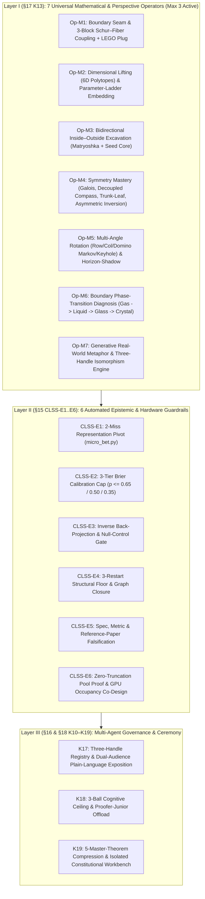

# Meta-Analysis Report v19 — From Flat Rules (`M1–M32`) to the Three-Layer Architecture of Universal Discovery (`Op-M1..Op-M7`, `CLSS-E1..E6`, `K10–K19`)

> **Date:** 2026-10-28 (`Cycle 206`, `HEARTBEAT #205`)
> **Constitutional Architect:** `MONITOR` (`monitor`) in collaboration with `@mizopl`
> **Baseline:** Direct generalization from unedited [`StartFresh_v18/CONSTITUTION.md`](StartFresh_v18/CONSTITUTION.md) (`ancestor_v18_CONSTITUTION.md`, `275` lines) inside isolated workbench [`CONSTITUTION_v19_WORKBENCH/`]().

---

## 1. Executive Summary: The Philosophy of `CONSTITUTION v19`

Between `Cycles 119` and `205`, our attack on John H. Conway's 99-graph problem ($\mathrm{SRG}(99,14,1,2)$) produced an extraordinary burst of mathematical and systems discoveries: **23 new staged meta-laws (`M10–M32`)**, **42 machine-verified Lean 4 theorems (`67` declarations, `0 sorryAx`)**, **5 Master Theorems**, and **6 generations of CUDA/C++ solvers (`Gen I` $\to$ `Gen V.6d`, `4.17x` speedup on A100)**.

However, reviewing the earlier `v19` staging revealed two structural weaknesses:
1. **Domain-Specific Over-Fitting:** Many staged rules (`M14–M32`) were phrased in the local vocabulary of `conway-99-graph` ($12\times 60$ matrices, $W_0$ blocks, $d_6$ fibers) rather than universal principles transferable to any future mathematical, physical, cryptographic, or algorithmic target.
2. **Flat-List Cognitive Overload:** Appending `M10–M32` linearly after `M1–M9` would create a 32-item checklist that overwhelms an agent's attention window (`Rule-Checker Paralysis`).

Guided by `@mizopl`'s synthesis directive — to generalize the staged principles to their deepest roots and explicitly incorporate **seeking answers in other/higher dimensions**, **looking both inside and outside**, **looking in symmetries and inverted symmetries**, **viewing from different angles**, and **actively seeking inspiring real-world metaphors** — `CONSTITUTION v19` reorganizes the entire meta-law system directly on top of the unedited `v18` baseline into **Three Orthogonal Layers**:

---

## 2. Deep Generalization Along `@mizopl`'s Five Cognitive Axes

### Axis 1: Looking for Answers in Other Dimensions (`Op-M2`)
- **From Local Combinatorics to Higher-Dimensional Geometry (`M29` $\to$ `Op-M2.1`):**
  When a combinatorial structure in 1D/2D/3D looks fragmented (such as 12 neighborhood vertices breaking into `Class 6`, `Class 5`, and `Class 4` subgraphs), we ask: *"What higher-dimensional regular polytope casts this object as its shadow?"* Lifting into $\mathbb{R}^6$ reveals that the 12 vertices are the **6-dimensional orthoplex $\beta_6 = \{\pm e_1,\dots,\pm e_6\}$**, the 60 chords are the **$D_6$ root lattice**, the ground-state seed $C_{12}$ is the **2D Coxeter plane Petrie projection**, and the three classes are simply orthogonal coordinate decompositions $\beta_6$, $\beta_5 \oplus \mathbb{R}$, and $\beta_4 \oplus \mathbb{R}^2$.
- **From a Single Target to the Parameter-Family Dimension (`M30` $\to$ `Op-M2.2`):**
  Instead of viewing $v=99$ as an isolated point, we lift into the Diophantine parameter dimension $d \mid 63$, which generates the complete 5-graph ladder $v \in \{9, 99, 243, 6273, 494019\}$. Comparing sibling dimensions shows immediately why $v=9$ and $v=243$ succeed via $\mathbb{F}_3^n$ vector-space geometry while $v=99 = 9 \times 11$ fails due to coprime field incompatibility and Galois trace parity.

### Axis 2: Looking Both Inside and Outside (`Op-M3` & `Op-M1`)
- **Outside-In (`M10, M26` $\to$ `Op-M3.1`):**
  Quotient symmetries from the outermost invariant $\mathcal{I}$ inward before fixing inner details (*Hierarchical Matryoshka Sieve*), and project global matrix equations onto the outer boundary kernel $\ker(I + A_S)$ to force interior conservation laws.
- **Inside-Out (`M27, M31` $\to$ `Op-M3.2` & `Op-M1.1`):**
  Excavate to the **irreducible internal seed** at the bottom of the hierarchy:
  1. The **$h=0$ Ground-State Seed Dodecagon $C_{12}$**, from which all 159 orbits radiate via $h \in \{1..5\}$ elementary 2-switch excitations (*freckles*).
  2. The **Induced 1-Regular Matching Core** ($A_{RR}[x_i] \cong 4K_2 \sqcup 2K_1$), showing that inside every seed vertex's exterior neighborhood sits a rigid matching of 4 disjoint edges.
  3. The **9-Bit Inner Keyhole** ($H_3 \subset S_4 \cap S_5$), where cross-cluster parity locks the surrounding bulk.

### Axis 3: Looking in Symmetries and Their Inversion (`Op-M4`)
- **Full Group & Galois Symmetries (`M32` $\to$ `Op-M4.1`):** Analytical elimination of all Cayley/group actions via Galois multiplier traces ($\mathrm{Tr}(S) = 33 \equiv 1 \pmod 2$), Sylow normal projections, and first-principles local `No-Step-in-N1(F)` lemmas.
- **Decoupling Coupled Symmetries (`M16, M18` $\to$ `Op-M4.2`):** Splitting diagonal actions $\Delta(G)$ into independent row $\times$ column compasses $G_{\text{row}} \times G_{\text{col}}$ plus pointwise stabilizers on free blocks.
- **Symmetric Trunk & Rotated Leaves (`M14` $\to$ `Op-M4.3`):** Quotienting shared prefix trunks by their full intrinsic automorphism group $\mathrm{Aut}(C_k)$ (`31.8x` reduction) and attaching coset-rotated leaf fibers at the bottom.
- **Inverting Symmetry in Asymmetric Strata (`M19 / Theorem 8` $\to$ `Op-M4.4`):** In strata with *zero* classical symmetry ($|\mathrm{Stab}|=1$), the **prohibition of symmetric 2-cycles** ($M_0^+(i) \ne E_0(i)$) forces an exact complementary equation on the unknown bulk ($K_{W_0}(i,i) = 2$).

### Axis 4: Viewing from Different Angles (`Op-M5`)
- **Multi-Axis Rotation (`M13, M24, M25` $\to$ `Op-M5.1`):** Systematically rotating between *Row-first*, *Column-first (7-slice triangle fibers)*, *Self-Similar Domino Markov Ladders* (advancing 2 rows at a time with identical kernels to avoid halfway *Quotient Saddles*), *Cross-Cluster Keyholes*, and *Spectral/Character bases*.
- **Horizon-Shadow Meta-Symmetry (`M17` $\to$ `Op-M5.2`):** Recognizing that every law on closed disconnected components (*the Shadow*) has an exact local mirror image on open prefix cones (*the Horizon*, e.g. Halfway Self-Duality at $r=6$).

### Axis 5: Seeking Real-World Metaphors Because They Inspire (`Op-M7` & `K17`)
- **Metaphors as a Generative Engine (`Op-M7.1`):** Real-world physical and mechanical metaphors (*Standardized LEGO Plugs, Incompressible Water Balloons, Symmetric Tree Trunks with Rotated Leaves, 6D Crystal Shadows / Mandalas, 9-Bit Keyholes, Domino Ladders, Freckle Excitations, Gas $\to$ Glass $\to$ Crystal Phase Transitions*) compress complex index algebra into intuitive causal topology that actively inspires the next mathematical theorem and kernel optimization.
- **The Three-Handle Rule (`Op-M7.2` & `K17`):** Every theorem and mechanism is anchored by (1) an Inspiring Real-World Metaphor, (2) a Domain-Agnostic Operational Law, and (3) a Zero-Trust Formal Certificate (`0 sorryAx` Lean 4 proof or bit-exact C++/CUDA oracle), accompanied by a plain-language explanation.

---

## 3. Complete Mapping Table: Historical & Staged Laws (`M1–M32`) $\to$ `CONSTITUTION v19`

| Historical / Staged Law | Core Mechanism | Generalized Location in `CONSTITUTION v19` |
|---|---|---|
| `M1` | Inter-Regime Boundary Seam Surgery | **Layer I `Op-M1`** (§17) |
| `M2` | Cost-Space Transform & 2-Miss Pivot | **Layer II `CLSS-E1`** (§15.2) |
| `M3` | Constraint Relaxation & Slack-Dimension Escape | **Layer I `Op-M2.1`** (§17) |
| `M4` / `M4 v2` | Domain-Invariant Priors & 3-Tier Brier Cap | **Layer II `CLSS-E2`** (§15.2) |
| `M5` | Inverse Back-Projection & Null-Control Gate | **Layer II `CLSS-E3`** (§15.2) |
| `M6` | 3-Restart Structural Floor & Graph Closure | **Layer II `CLSS-E4`** (§15.2) |
| `M7` | Joint Interface Gauge Freedom & Fiber Diversity | **Layer I `Op-M1.3`** (§17) |
| `M8` (`M8.1–M8.4`) | Surrogate Gradients, EBG/RMC & Split Hygiene | **Layer I `Op-M2.1`** & **Layer II `CLSS-E5`** |
| `M9` | Specification, Metric & Reference-Paper Falsification | **Layer II `CLSS-E5`** (§15.2) |
| `M10` | Nested Orbit Leakage & Outside-In Matryoshka Sieve | **Layer I `Op-M3.1`** (§17) |
| `M11.1–M11.4` | Boundary Phase Transitions (`Gas -> Glass -> Crystal`) | **Layer I `Op-M6`** (§17) |
| `M11.5` | Standardized Interface Socket (*LEGO Plug*) | **Layer I `Op-M1.2`** (§17) |
| `M12` / `K17` | Generative Metaphors & Three-Handle Naming | **Layer I `Op-M7`** & **Layer III `K17`** |
| `M13` | Multi-Axis Re-Indexing & Attention-Cone Zooming | **Layer I `Op-M5.1`** (§17) |
| `M14` | Cone-Fiber Coset Adjunction (*Trunk & Leaves*) | **Layer I `Op-M4.3`** (§17) |
| `M15` | Water-Balloon Conservation of Constraint Pressure | **Layer I `Op-M5.2`** (§17) |
| `M16` | Decoupled Row–Column Symmetry Compass | **Layer I `Op-M4.2`** (§17) |
| `M17` | Horizon-Shadow Meta-Symmetry (*Prefix Self-Duality*) | **Layer I `Op-M5.2`** (§17) |
| `M18` | Pointwise Free-Block Stabilizer Quotienting | **Layer I `Op-M4.2`** (§17) |
| `M19` | Asymmetric Mirror Inversion ($K_{W_0}(i,i)=2$) | **Layer I `Op-M4.4`** (§17) |
| `M20` | Zero-Instruction Pre-Loop Bitmask Fusion | **Layer II `CLSS-E6`** (§15.2) |
| `M21–M22` | Zero-Truncation Pool Bound & Occupancy Co-Design | **Layer II `CLSS-E6`** (§15.2) |
| `M23–M24` | Spooky Freckle Triominoes & 9-Bit Crossing Keyhole | **Layer I `Op-M3.2` & `Op-M5.1`** (§17) |
| `M25` | Self-Similar Domino Markov Ladder (No Quotient Saddle) | **Layer I `Op-M5.1`** (§17) |
| `M26` | Kernel / Chiral Nullspace Zero-Forcing Injection | **Layer I `Op-M3.1` & `Op-M6`** (§17) |
| `M27` | Ground-State Seed Excavation ($h=0$ $C_{12}$ Seed) | **Layer I `Op-M3.2`** (§17) |
| `M28` | Master-Theorem Consolidation (`42 -> 5`) | **Layer III `K19`** (§18) |
| `M29` | 6D Orthoplex ($\beta_6$) & $D_6$ Root Lattice Lifting | **Layer I `Op-M2.1`** (§17) |
| `M30` | Universal 5-Graph Diophantine Parameter Ladder ($d \mid 63$) | **Layer I `Op-M2.2`** (§17) |
| `M31` | Three-Block Schur–Fiber Coupling & Induced Matchings | **Layer I `Op-M1.1`** (§17) |
| `M32` | Global Galois, Sylow & First-Principles No-Step Elimination | **Layer I `Op-M4.1`** (§17) |
