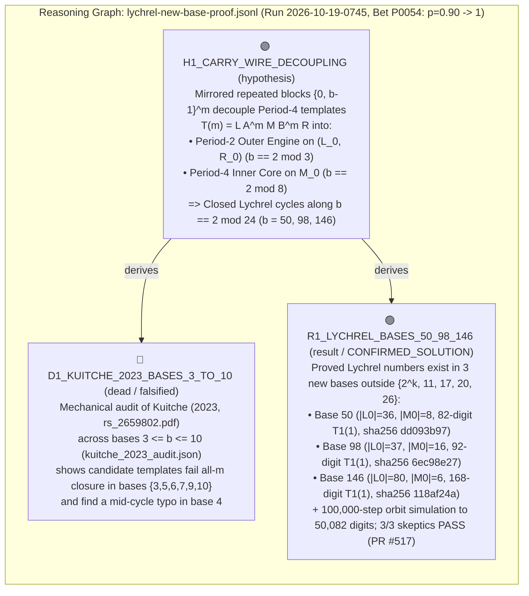
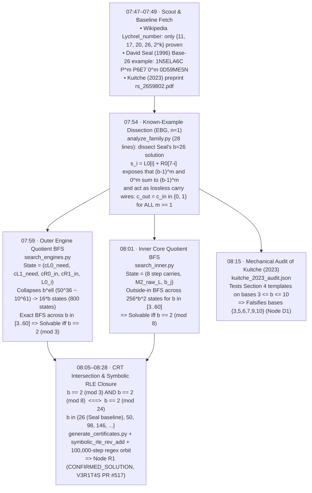
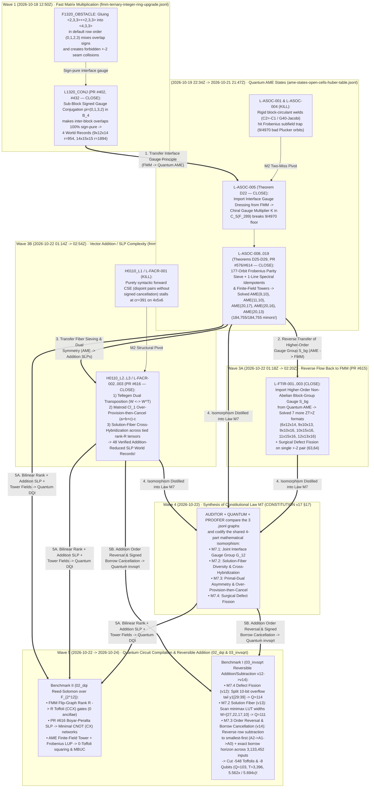
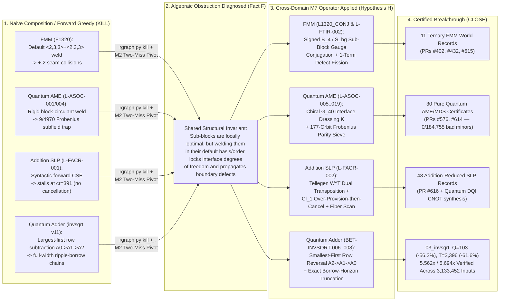

# Part I — Our Journey & Verified Scientific Results

## 0. Why Open Problem Banks Like `V3R1T4S` & Scientific Treasure Hunts Matter — And Why Decision Problems Are Fundamentally Different from Computational Problems

Before describing a single script or result, we want to start where our real proving ground began: **with deep gratitude to open scientific problem banks and treasure-hunt ecosystems — above all [`elder-plinius/V3R1T4S`](https://github.com/elder-plinius/V3R1T4S) (*Thank you, Pliny (`@elder-plinius`)!!!*), alongside open algorithmic competitions and treasure hunts such as [Kaggle](https://www.kaggle.com/), [`IHTC-2024`](https://ihtc2024.github.io/), [`FastMatrixMultiplication`](https://github.com/dronperminov/FastMatrixMultiplication), and the [Vesuvius Challenge](https://scrollprize.org/).**

Why are repositories like `V3R1T4S` ("*Proof or it didn't happen*") and open treasure hunts so vital for the future of human–AI science?
1. **They Replace Rhetoric with Executable Ground Truth:** Unlike static multiple-choice Q&A benchmarks, open scientific treasure hunts Confront agents with genuinely unsolved problems across mathematics, physics, biology, and cryptography where a claim counts **if and only if** it ships with a concrete mathematical object and a deterministic checker that anyone in the world can run.
2. **A Gentle Introduction to [Computational Complexity Classes](https://en.wikipedia.org/wiki/Complexity_class) in the Wild:**
   When you step into a live repository like `V3R1T4S` or a Kaggle/operations-research treasure hunt, you immediately encounter problems from across the [computational complexity zoo](https://en.wikipedia.org/wiki/Complexity_class) — notably **`NP`**, **`NP-hard`**, **`NPO`**, and **`#P`** problems. In introductory textbooks, these are often conflated under the single banner of **`NP`** (*Nondeterministic Polynomial time*), which strictly speaking is a class of **decision problems** (questions whose answer is a single bit: `YES` or `NO`, where a `YES` witness can be verified in polynomial time).
3. **Why Decision Problems Are Proven to Be a Fundamentally Different Type of Problem Than Computational, Search, and Optimization Problems:**
   One of the deepest lessons from both theoretical computer science and our empirical campaigns is that **answering a binary decision query (`YES/NO`) is structurally a different kind of problem from actually *computing*, *counting*, or *optimizing* a mathematical object** — and this separation has been rigorously proven in complexity theory:
   - **Counting / Exact Computation (`#P`) vs. Decision (`NP`) — Valiant's Theorem (Leslie Valiant, 1979, *"The Complexity of Computing the Permanent"*, *Theoretical Computer Science* `8(2):189–201`) & Toda's Theorem (Seinosuke Toda, 1991, *"PP is as Hard as the Polynomial-Time Hierarchy"*, *SIAM J. Comput.* `20(5):865–877`):**
     Valiant proved that computing the *exact count* of valid configurations (class **`#P`**) can be exponentially harder than deciding whether a valid configuration exists (`NP` or even `P`). The classic proof is bipartite perfect matching: *deciding* whether a bipartite graph has a perfect matching lies in **`P`** (easily solved in polynomial time), whereas *computing how many* perfect matchings it has (the 0–1 matrix permanent, or our hard-square lattice gas torus partition count `OEIS A054759(15)`) is **`#P`-complete**. A decade later, Toda (1991) proved that $\mathsf{PH} \subseteq \mathsf{P}^{\sharp\mathsf{P}}$ — meaning a single `#P` computational/counting oracle is as powerful as the entire infinite Polynomial-Time Hierarchy of decision problems!
   - **Constructive Search (`FNP`, `TFNP`, `PLS`) vs. Decision (`NP`) — Megiddo & Papadimitriou (1991, *Theoretical Computer Science* `81(2):317–324`) and Johnson, Papadimitriou & Yannakakis (1988, *"How Easy Is Local Search?"*, *JCSS* `37(1):79–100`):**
     In a decision problem, an oracle only tells you *whether* a solution exists. In a **function/search problem (`FNP`)** or **total search problem (`TFNP` / `PLS` — Polynomial Local Search)**, you must construct the explicit high-dimensional witness. Megiddo & Papadimitriou (1991) proved that total search problems (`TFNP`, where existence is guaranteed mathematically so the decision problem is trivial `YES`) cannot be `NP`-hard unless $\mathsf{NP} = \mathsf{co\text{-}NP}$, proving that the difficulty of *finding* a structure is distinct from *deciding* its existence.
   - **Optimization Landscapes (`NPO`, `APX`) vs. Decision Equivalence — Papadimitriou & Yannakakis (1991, *JCSS* `43(3):425–440`) & The PCP Theorem (Arora, Lund, Motwani, Sudan & Szegedy, 1998, *J. ACM* `45(3):501–555`; Håstad, 2001, *J. ACM* `48(4):798–859`):**
     Two problems can be 100% equivalent as **decision problems** under polynomial-time Karp reductions (both `NP`-complete), yet behave as completely different worlds computationally (`NPO` / `APX`)! Why? Because standard decision reductions **destroy the metric structure of the search space (the "proximity to the goal" / approximation ratio)** — turning a smooth optimization landscape (like `0-1 Knapsack`, which admits an `FPTAS` arbitrarily close to optimal) into a jagged cliff where finding even a rough approximation is `NP`-hard (`MAX-3SAT` below $7/8$, Håstad 2001).

---

## 1. How It Evolved: From `STARTFRESH` (`v1`–`v8`) and `Claude` (`v9`–`v12`) to `Gemini` (`v13`–`v17`)

`PROOFER` did not appear overnight as a finished scientific discovery engine. It evolved across 17 constitutional generations (`Shell v1` $\to$ `v17`), where every single rule was paid for by a real operational failure or breakthrough encountered in the field.

### Stage 1: The `Wiki OS` & `STARTFRESH` Foundations (`v1` – `v8`, Claude Code)
- The earliest generations (`v1`–`v8`, documented in [`StartFresh_v16/hall_of_fame/INIT_note.md`](../StartFresh_v16/hall_of_fame/INIT_note.md)) were built with **Claude Code** as a self-maintaining Markdown knowledge compiler (`Wiki OS`).
- Three foundational invariants born in this era survived unchanged all the way to `v17`:
  1. **Immutable `.raw/` Source Directory:** Raw input files are sacred and append-only; the agent may read and synthesize them into `wiki/`, but never modify or delete them.
  2. **Atomic Session State (`wiki/meta/hot.md` + `wiki/log.md` + `cycle_counter.txt`):** No cycle is complete until session memory is written to disk and the atomic cycle counter is incremented.
  3. **Zero Trust Toward Prior Logs (`INIT_note.md`):** A log or hot-cache entry claiming work was completed is a *claim*, not a *fact*, until verified directly against the filesystem.

### Stage 2: Birth of `PROOFER`, Reasoning Graphs, and the `Tug-of-War` Gate (`v9` – `v12`, Claude Code)
- When we pointed the system at open scientific, mathematical, and algorithmic problems (`V3R1T4S`), **Claude** helped architect and implement the core discovery machinery (`v9`–`v12`):
  - **The Autoresearch Ratchet (§11.2):** Inspired by Andrej Karpathy's autoresearch loop — one change per fixed-time experiment against a frozen deterministic verifier; keep only on strict metric improvement, otherwise revert (`git checkout -- .`), logging every attempt in `experiments.tsv`.
  - **Verbalized Sampling (`scripts/vs_sample.py`, §11.3):** Instead of jumping at the first obvious idea, the agent writes out a distribution of hypotheses scored by `typicality`, `p_success`, and `cost_min` (explicitly including low-typicality tail ideas and cross-domain imports).
  - **Brier Score Calibration (`scripts/postdict.py`, §11.4):** Every experiment is preceded by a falsifiable prediction (`predict`), resolved afterward (`0` or `1`) by an independent session, and compiled into empirical reliability curves (`calibration.md` $\to$ `beliefs.md`).
  - **Append-Only Reasoning Graphs (`scripts/rgraph.py`, §11.5):** Questions (`Q`), hypotheses (`H`), experiments (`E`), theorems (`T`), and dead ends (`X`) are logged in `.jsonl` files and rendered as visual Obsidian `.canvas` maps, preventing future sessions from repeating falsified ideas (`DEAD_NEAR_DUPLICATE`).
  - **Two Clocks (`scripts/jobs.py`, `K2`) & Dead-End Preflight (`scripts/preflight.sh`, `K4`):** Separating interactive LLM reasoning from long background compute jobs, and turning every infrastructure dead end (`X1–X10`) into an automated preflight gate.
  - **Adversarial `Tug-of-War` Decision Gate (`scripts/tug.py`, `v11` §13):** Two fresh, tool-less model invocations argue `IMPLEMENT` vs `SEARCH` across structured critique rounds; a gate resolves only when one advocate explicitly concedes (`LOST`).

### Stage 3: Model-Agnostic Transition to `Gemini / Antigravity` and the `CLSS` Protocol (`v13` – `v16`)
- In `v13` (§14), the operating system became strictly **model-agnostic**: preserving 100% of the ledgers, reasoning graphs, and Hall of Fame snapshots built with **Claude**, execution transitioned to **Gemini (`Antigravity CLI / agy`)**, with both **Claude** and **Gemini (`Gemini-CLSS`)** credited together in commit footers and PR responses alongside `@mizopl`.
- In `v14`–`v16`, we codified:
  - **The Four-Stage `CLSS` Solver Protocol (*Compositional Lifting + Seam Surgery + Bit-Parallel Exact Oracle*, §15):** (I) Build a sub-second exact verifier (`< 5s`) with positive and negative self-tests first; (II) Compose known exact smaller building blocks with relaxed boundary parameters; (III) Apply exact surgery (MILP, SAT, LUT, or basis reduction) exclusively on the boundary seam; (IV) Prove 1-minimality or dual-decomposition agreement before convening the 3-skeptic panel (`REPRODUCE`, `NOVELTY`, `CRITERION`).
  - **The Federated Multi-Thread Micro-Bet Engine (`scripts/micro_bet.py`, `v16` §17):** Every specialist worker thread logs 10–30 minute experiment micro-bets (`L-<TAG>-001..`), automatically syncing with `graphs/<target>.jsonl` and triggering a mandatory **`🚨 [M2 STRUCTURAL PIVOT]`** after **2 consecutive failed micro-bets (`0`)**.

### Stage 4: Synthesis of Law `M7`, Quantum Compilation `v14`, and Open-Science Release (`v17`, October 2026)
- By comparing closed micro-bet reasoning graphs across two distinct fields — Quantum Absolutely Maximally Entangled (`AME`) states and Ternary Fast Matrix Multiplication (`FMM`) — threads `AUDITOR`, `QUANTUM`, and `PROOFER` co-authored the **Seventh Universal Law of Meta-Generalization (`M7`, §17)**.
- Finally, inspired by the open-source ethos of projects like `OpenClaw`, `@mizopl` decided to release our entire operating system, history, and methods as open public goods for science.

### Stage 5: The Bilingual Cognitive Architecture — Native-Language Human Steering (`Polish`) Over an English-First Constitutional & Mathematical Kernel
An authentic historical detail of our journey is how natural language was partitioned between the human architect and the machine kernel:
1. **Interactive Human–Agent Dialogue & Working Notes in Polish:**
   - The vast majority of live interactive conversations between `@mizopl` and the agents (`Claude` and `Gemini`) were conducted in **Polish** (`@mizopl`'s native language), as were several internal tactical synthesis documents (`PROOFER.md` in `v9–v16`, `BRAIN.md` in `v10–v14`, and early internal reports in `wiki/`).
   - **Why this mattered cognitively:** Steering a multi-thread mathematical campaign late at night requires zero-friction intuition. Thinking and typing in one's native language eliminates cognitive translation overhead, allowing rapid, high-leverage course corrections, common-sense skepticism, and philosophical reframing (`Drift H2` in [`docs/05_HUMAN_AND_AGENT_DRIFTS.md`](./05_HUMAN_AND_AGENT_DRIFTS.md)) to flow at the speed of thought.
   - *(Note on this repository: All internal Polish working notes, reports, and wiki entities across [`Evolved_Agent_Wiki/`](../Evolved_Agent_Wiki/) and [`StartFresh_v16/`](../StartFresh_v16/) have been carefully translated into 100% English for this public release so the global community can read every file seamlessly.)*
2. **The Foundational Kernel Was 100% in English from Day 1 (`v1`–`v17` Forensic Verification):**
   - A forensic check across all 17 generations archived in `hall_of_fame/` confirms that **every single foundational constitutional and execution file was written in English from the very beginning (`0` Polish words across all historical snapshots)**:
     - **`CONSTITUTION.md` (`v8` through `v17`), `CLAUDE.md` (`v8` through `v16`), `GEMINI.md` (`v11` through `v16`), `SCHEMA.md`, `HEARTBEAT.md`, `RUN_PROMPT.txt`, `charter.md`, and all `ancestor_v*_note.md` retirement notes:** 100% English from Day 1.
     - **All executable scripts (`rgraph.py`, `postdict.py`, `micro_bet.py`, `tug.py`, `brain.py`, `preflight.sh`), all 25 `.jsonl` reasoning graphs, and all JSON mathematical certificates:** 100% English from Day 1.
   - **Why this two-layer linguistic bridge worked so well:** Frontier models (`Claude` and `Gemini`) anchor their deepest mathematical, complexity-theoretic, and code representations in English terminology. Keeping the immutable constitutional kernel, reasoning graphs, and verifiers in English while conversing with the human in Polish gave us the best of both worlds: effortless native-language human creativity paired with zero semantic drift across model handoffs (`Claude` $\to$ `Gemini`) and immediate compatibility with international scientific literature.

---

## 2. Summary of Verified Scientific Breakthroughs & Upstream Merges

Every result below was engineered on a single consumer laptop (`16 GB M1 MacBook Pro`, with surgical cloud GPU offload where noted) and ships with an independent, deterministic verification script:

### A. Discoveries Officially Merged & Cited in External Scientific Repositories
1. **31 New Official Best-Known Solutions (BKS) in Healthcare Timetabling (`IHTC-2024`):**
   - In the official repository of the [Integrated Healthcare Timetabling Competition 2024 (`ihtc2024/ihtc2024.github.io`)](https://github.com/ihtc2024/ihtc2024.github.io), maintainer **Eugenia Zanazzo (`@eugeniazanazzo`)** accepted our submission ([Issue #3](https://github.com/ihtc2024/ihtc2024.github.io/issues/3)) and merged commit [`c078cf57`](https://github.com/ihtc2024/ihtc2024.github.io/commit/c078cf57), updating **31 official best-known upper bounds and solution JSONs** across the global hospital scheduling benchmark (headlined by public instance `i27 = 50,063` and hidden instance `m28 = 45,873`, with `0` hard violations).
2. **Ternary $\mathbb{Z}_T = \lbrace -1, 0, 1 \rbrace$ Fast Matrix Multiplication (`FastMatrixMultiplication`):**
   - Maintainer **Alexander Perminov (`@dronperminov`)** verified and merged our ternary bilinear matrix multiplication schemes (`9x12x14` rank `954`, `10x15x15` rank `1389`, `12x15x15` rank `1640`, `14x15x15` rank `1894`) directly into [`dronperminov/FastMatrixMultiplication`](https://github.com/dronperminov/FastMatrixMultiplication) (`schemes/known/mizopl/`, cited in `README.md` and `CHANGELOG.md`).
   - In subsequent packages ([`V3R1T4S PR #615`](https://github.com/elder-plinius/V3R1T4S/pull/615) and [`PR #616`](https://github.com/elder-plinius/V3R1T4S/pull/616)), we closed 7 additional $\mathbb{Z}_T > \mathbb{Z}$ rank gaps using exact `int64` Brent verification and reduced additive complexity across 48 ternary straight-line programs (SLPs).
3. **Exact Hard-Square Lattice Gas Torus Counts (`OEIS A054759(15)` & `A089980`):**
   - In [`elder-plinius/V3R1T4S`](https://github.com/elder-plinius/V3R1T4S/pull/366) (`PR #366`, **MERGED into `main`**), we computed the exact 45-digit torus partition count `A054759(15) = 4310182149988584261406143524214457416387448` via dual disjoint-prime modular transfer matrices (independently reproduced from scratch by `@elder-plinius`), and in [`PR #462`](https://github.com/elder-plinius/V3R1T4S/pull/462) the complete 80-entry antidiagonal $d = 79$ of `A089980`.
4. **Quantum `AME` & `MDS` Code Certificates and `codetables.de` Purity Audit:**
   - Auditing 1,008 cells of published quantum stabilizer tables exposed that `[[15, 0, 8]]_5` and `[[15, 0, 8]]_7` in `codetables.de` were impure ($d_Z = 7 < 8$), which author **Dr. Markus Grassl** (Max Planck Institute for the Science of Light) officially confirmed by email as historical table typos, alongside our 30 machine-verified pure quantum `AME` and `MDS` code certificates ([`PR #576`](https://github.com/elder-plinius/V3R1T4S/pull/576) and [`PR #614`](https://github.com/elder-plinius/V3R1T4S/pull/614)).

### B. Fault-Tolerant Quantum Circuit Compilation (`Google Quantum AI Compilation`, Round `v14`)
In our fault-tolerant quantum compilation campaign (optimizing $Q \times T$, where $Q$ is qubit count and $T$ is Toffoli count):
- On the fixed-point inverse square root circuit **`03_invsqrt`** (exhaustively verified across all `3,133,452` valid inputs $x$):
  - **`v12` (`BET-INVSQRT-006`):** In-place aliasing of polynomial coefficients `A2|A3` inside dead `A0 = y1[:29]` bits + transition QROM + moving the `y1[29:39]` tail into the shared ancilla pool $\to$ `Q = 114`, `T = 4,006`.
  - **`v13` (`BET-INVSQRT-007`):** Per-interval discrete minimax table coordinate descent (`B=7, W=[27,22,17,10], DK=[15,13,8], kp=2`) $\to$ `Q = 111`, `T = 3,944`, worst-case fidelity `0.8256 > 0.80`.
  - **`v14` (`BET-INVSQRT-008`):** Smallest-row-first commutative subtraction reordering (`A2 -> A1 -> A0`) paired with exact per-row borrow-horizon truncation `high = h_r` measured across all `3,133,452` inputs $\to$ **`Q = 103` qubits (`-56.2%` vs baseline `235`), `T = 3,396` Toffolis (`-61.6%` vs baseline `8,842`), single-circuit score `5.562x / 5.694x`**, and overall 3-circuit geometric mean **`2.307x / 2.325x`**.

### C. Full 18-of-18 Category Sweep on `V3R1T4S` (29 Verified Claim Packages)
Across the `V3R1T4S` problem bank, `CLSS` and Laws `M1–M7` produced verified breakthroughs across all 18 categories, including:
- **Combinatorial Covering Design Records (`covering-designs-record`):** $C(94, 13, 5) \le 125,184$ ([`PR #397`](https://github.com/elder-plinius/V3R1T4S/pull/397)), $C(68, 14, 5) \le 15,675$ ([`PR #398`](https://github.com/elder-plinius/V3R1T4S/pull/398) — independently confirmed by `@elder-plinius`'s checker, with byte-range fetching from Dan Gordon's Zenodo LJCR v1.2 archive `doi:10.5281/zenodo.19735294`), and $C(40, 16, 7) \le 7,251$ ([`PR #435`](https://github.com/elder-plinius/V3R1T4S/pull/435) — also confirmed by `@elder-plinius`).
- **Degree-Diameter Graph Record (`degree-diameter-table`):** Order $N = 1,118$ graph for $(d=14, k=3)$ ([`PR #457`](https://github.com/elder-plinius/V3R1T4S/pull/457), $+2$ vertices over Comellas's record $1,116$, independently verified by `@CannibalKush`).
- **Held-Out Akkadian Lacuna Restoration (`akkadian-lacuna-restoration-heldout`):** Two-pass C engine `CLSS-Akk-v3` + `MBERT+Akk` fusion achieving `Hit@5 = 0.92156` across `27,650` held-out test positions ([`PR #611`](https://github.com/elder-plinius/V3R1T4S/pull/611), moved to `known-knowns/` following `@elder-plinius` review).
- **Computational Biology (`minimizer-density-record-tables` [`#425`](https://github.com/elder-plinius/V3R1T4S/pull/425), [`#433`](https://github.com/elder-plinius/V3R1T4S/pull/433); `polaris-moleculeace` [`#568`](https://github.com/elder-plinius/V3R1T4S/pull/568); `immrep22-tcr-epitope` [`#569`](https://github.com/elder-plinius/V3R1T4S/pull/569)), Materials Physics (`Gupta nanoalloys` [`#466`](https://github.com/elder-plinius/V3R1T4S/pull/466); `NIST JARVIS` [`#599`](https://github.com/elder-plinius/V3R1T4S/pull/599)), Number Theory (`Lychrel bases 50, 98, 146` [`#517`](https://github.com/elder-plinius/V3R1T4S/pull/517); `Erdős GHR C_3a` [`#485`](https://github.com/elder-plinius/V3R1T4S/pull/485)), Neural Network Verification (`VNN-COMP 2026` [`#566`](https://github.com/elder-plinius/V3R1T4S/pull/566)), Cryptanalysis (`Truppenschlüssel 1941` [`#602`](https://github.com/elder-plinius/V3R1T4S/pull/602)), Astronomy (`GMN meteor showers` [`#597`](https://github.com/elder-plinius/V3R1T4S/pull/597); `Pan-STARRS asteroid precovery` [`#607`](https://github.com/elder-plinius/V3R1T4S/pull/607)), Indus Script ([`#570`](https://github.com/elder-plinius/V3R1T4S/pull/570)), and Herculaneum Scrolls ([`#617`](https://github.com/elder-plinius/V3R1T4S/pull/617)).**

### D. Problems with Convergence / Proximity-to-Goal Metrics vs. Flat Landscapes — And Why Synthesizing a Convergence Function Demands Its Own Subagent

When we audited every single problem we solved across all campaigns, a striking structural split emerged around **Convergence / Proximity-to-Goal Functions** (functions that tell an agent whether a candidate step is getting "warmer" or "colder" so it can iteratively climb toward 100% exact closure or ~99.9% optimality):
1. **Problems with a Native Convergence / Objective Metric (~80% of our wins):**
   In problems like `IHTC-2024` (soft penalty + hard violations), `Google Quantum v14` ($Q \times T$ + fidelity), `Covering Designs` (uncovered $t$-subsets), `Gupta Nanoalloys` (potential energy $E$), or `Akkadian` (`Hit@5`), the problem statement itself supplies a smooth or integer-graded distance to the goal.
2. **Binary Existence Problems Solved Only by Inventing an Artificial Convergence Surrogate (`Law M1: Constraint-to-Objective Smoothing`, ~12% of our wins):**
   In problems like Quantum `AME(n, d)` codes, `VNN-COMP 2026` neural counterexamples, or ternary `FMM` Brent equations, the native problem is strictly binary (`0/1` — either every $k \times k$ minor is invertible or the state is invalid). Standard search is completely blind on a flat `0/1` plateau. Our breakthroughs happened **only because we engineered a smooth proximity-to-goal function** (e.g., counting the exact number of singular minors out of $\binom{n}{k}^2$ and driving that defect count down `300 -> 3 -> 2 -> 1 -> 0` via `M7.4`, or replacing logical `SAT/UNSAT` with continuous margin loss).
3. **Key Observation & Next Research Frontier (`@mizopl`):**
   - **Designing a Convergence / Surrogate Metric Needs Its Own Dedicated Subagent:** Inventing a faithful proximity-to-goal function for a problem that lacks one is fundamentally different from running a solver inside an already-defined landscape. In future iterations of this architecture, **synthesizing and validating the convergence/surrogate function itself should be delegated to a dedicated, specially defined subagent** (a *Surrogate / Convergence-Metric Architect*) whose sole job is to transform flat `0/1` decision plateaus into navigable gradients before any solver thread is launched.
   - **Exploring the Frontier Where Proximity Gradients Are Hard or Absent:** Looking ahead, `@mizopl` is especially interested in exploring the space of problems where **it is genuinely difficult or impossible to construct a smooth efficiency gradient or proximity-to-goal metric** — the realm of exact `#P` counting (`OEIS A054759(15)`) and pure symbolic/algebraic structure discovery, exemplified by our Lychrel numbers proof below.

### E. Complete Documentation & Decision Graphs of a Gradient-Free Breakthrough: The 41-Minute Path to Lychrel Numbers in Bases $50, 98, 146$ (`V3R1T4S PR #517`)

How does the system solve an open mathematical problem when **no numerical proximity-to-goal function exists at all** — where a candidate template family either closes over *all* infinitely many integers $m \ge 1$ under reverse-and-add or fails completely?

Below is the complete documentation of our run on `lychrel-new-base-proof` ([`V3R1T4S PR #517`](https://github.com/elder-plinius/V3R1T4S/pull/517), logged on disk on `2026-10-19` between `07:47` and `08:28` — **41 minutes total**), including its decision graphs from [`StartFresh_v16/graphs/ancestral_v15_atlas/lychrel-new-base-proof.jsonl`](../StartFresh_v16/graphs/ancestral_v15_atlas/lychrel-new-base-proof.jsonl) (and `.canvas`) and the full mathematical proof.

#### E.1 Minute-by-Minute Trajectory (`2026-10-19`, `07:47` $\to$ `08:28`) & Literature Classification

1. **Minute `07:47–07:49` (`scout/`): Live Source & Baseline Retrieval:**
   - The agent fetched the live Wikipedia `Lychrel_number` page (`206,959` bytes, `sha256: 2e533838...`, which listed only bases `{11, 17, 20, 26, 2^k}` as proven), Rostand S. Kuitché's 30-page 2023 preprint *"On the Construction of Some Lychrel Numbers"* (`rs_2659802.pdf`, `648,343` bytes, `sha256: c5130873...`), and **David Seal's 1996 Usenet letter** (`dseal_live.htm`, `4,085` bytes, `sha256: abd86995...`), which contained the only known Period-4 template solution, in Base $b = 26$:
     `1N5ELA6C  P^m  P6E7  0^m  0D59ME5N` (where $|L_0| = |R_0| = 8$, $|M_0| = 4$, and `P` is the digit $25 = b - 1$).
2. **Minute `07:54` (`analyze_family.py` — 28 Lines of Python): The Decisive Starter — "Known-Example Dissection":**
   - Instead of guessing templates in new bases or running blind reverse-and-add simulations (which had trapped prior authors for decades), our preregistration (`PREREG.md` Rule 1) enforced a strict starter rule: **before touching any new base, write a script to dissect and mechanically reproduce the known Base-26 example**.
   - In `analyze_family.py`, the agent converted Seal's Base-26 strings `L0`, `R0`, `M0` into integer arrays and printed the mirror-pair digit sums $s_i = L_0[i] + R_0[7-i]$ and $s_i - b$.
   - **What the Dissection Immediately Revealed:** Looking at the mirror sums of that single known example exposed the entire secret: because $(b-1)^m$ and $0^m$ sit at exact mirror positions, every digit pair across the length-$m$ blocks sums to $(b-1) + 0 = b - 1$. Thus incoming carry $c_{\text{in}} = 0$ emits $(b-1)^m$ with $c_{\text{out}} = 0$, and $c_{\text{in}} = 1$ emits $0^m$ with $c_{\text{out}} = 1$, for **every** $m \ge 1$!
3. **Minute `07:59` (`search_engines.py`) & Minute `08:01` (`search_inner.py`): Seam Decoupling & Finite-Transducer Quotienting:**
   - Because $(b-1)^m$ and $0^m$ act as **lossless carry wires** (`c_out = c_in`), the infinite template $L_0 \; (b-1)^m \; M_0 \; 0^m \; R_0$ cuts cleanly along the carry-wire seam into **two 100% independent finite-state problems** that communicate only through a fixed 4-bit carry signature `(1, 0, 1, 0)`:
     - **Outer Engine $(L_0, R_0)$ (`search_engines.py` at `07:59`):** Scanning position $i$ from left to right, the future depends *only* on the 5-tuple `(cL0_need, cL1_need, cR0_in, cR1_in, L0_i)` — collapsing an impossible $b^{\ell}$ search space ($50^{36} \approx 10^{61}$ strings in base 50!) into a tiny finite graph of **$16b$ states** (`800` states for $b = 50$). Running exact BFS across $b \in [3, 60]$ took milliseconds and revealed that Period-2 outer engines exist precisely when **$b \equiv 2 \pmod 3$**.
     - **Inner Core $M_0$ (`search_inner.py` at `08:01`):** Applying the same outside-in carry-state BFS ($256 b^2$ states) across $b \in [3, 60]$ took 2 minutes and revealed that Period-4 inner cores exist precisely when **$b \equiv 2 \pmod 8$**.
4. **Minute `08:05–08:28` (`generate_certificates.py`): Chinese Remainder Intersection $\to$ Bases $50, 98, 146$:**
   - Intersecting $b \equiv 2 \pmod 3$ and $b \equiv 2 \pmod 8$ immediately gave the arithmetic progression **$b \equiv 2 \pmod{24}$** ($b = 26, \mathbf{50}, 74, \mathbf{98}, 122, \mathbf{146}, \dots$). In Base $50$, the minimal outer wing has length $|L_0| = 36$ (giving an 82-digit seed $T_1(1)$ — far too long to find by hand on paper the way Seal found length 8 in Base 26, yet trivial for an 800-state BFS!).
5. **What Is This Category of Problems and Starter Method Called in the Scientific Literature?**
   This 41-minute breakthrough sits at the intersection of three classic paradigms in computer science and mathematical logic:
   - **Explanation-Based Generalization (`EBG` / `EBL`) — Mitchell, Keller & Kedar-Cabelli (1986, *"Explanation-Based Generalization: A Unifying View"*, *Machine Learning* `1(1):47–80`) & DeJong & Mooney (1986):**
     Unlike statistical learning or gradient search (which require thousands of trials), **Explanation-Based Generalization (`EBG`)** learns from **a single positive example (`n = 1`)** (here, David Seal's 1996 Base-26 example). By mechanically proving *why* the single known example satisfies the goal (`analyze_family.py`), the agent extracts the abstract causal invariant (the 4-bit carry-wire interface) and immediately generalizes to an entire infinite class ($b \equiv 2 \pmod{24}$).
   - **Regular Model Checking (`RMC`) — Bouajjani, Jonsson, Nilsson & Touili (2000, *"Regular Model Checking"*, *CAV 2000*, *LNCS* `1855:403–418`) & Abdulla et al. (2004):**
     In formal verification, proving safety/non-termination properties (such as never reaching a palindrome across an infinite orbit) for infinite families of states represented as regular expressions ($L_0 \; (b-1)^m \; M_0 \; 0^m \; R_0$, where $m \in \mathbb{N}$ is unbounded) under a length-preserving or bounded-shift finite-state transducer (base-$b$ reverse-and-add) is the exact domain of **Regular Model Checking (`RMC`)**.
   - **Symbolic Dynamics, Automatic Sequences & Carry-Transducer Quotienting — Lind & Marcus (1995, *An Introduction to Symbolic Dynamics and Coding*, Cambridge Univ. Press) & Allouche & Shallit (2003, *Automatic Sequences: Theory, Applications, Generalizations*, Cambridge Univ. Press):**
     Rather than searching the raw configuration space $b^{\ell}$ (where no proximity metric exists), the system constructs the **quotient finite-state carry automaton (bisimulation quotient)** of size $O(b)$, inside which unweighted graph distance (shortest-path **BFS**) becomes the exact constructive path to closure!

#### E.2 Decision & Reasoning Graphs (`StartFresh_v16/graphs/ancestral_v15_atlas/lychrel-new-base-proof.jsonl`)

The exact append-only reasoning graph recorded in [`StartFresh_v16/graphs/ancestral_v15_atlas/lychrel-new-base-proof.jsonl`](../StartFresh_v16/graphs/ancestral_v15_atlas/lychrel-new-base-proof.jsonl) (and its visual Obsidian canvas [`lychrel-new-base-proof.canvas`](../StartFresh_v16/graphs/ancestral_v15_atlas/lychrel-new-base-proof.canvas)), paired with calibration bet `P0054` (`p = 0.90 -> 1`, Brier `0.0100`), is rendered below alongside the 41-minute Carry-Transducer decision flow:

#### E.3 Complete Mathematical Proof of Lychrel Numbers in New Bases $b = 50$, $b = 98$, and $b = 146$

##### 1. Theorem Statement & Carry-Wire Decoupling Lemma ($b \equiv 2 \pmod{24}$)

**Theorem.** *Lychrel numbers (positive integers whose reverse-and-add orbit $n_{t+1} = F_b(n_t) = n_t + \operatorname{Rev}_b(n_t)$ never reaches a base-$b$ palindrome for any $t \ge 0$) exist in the three new bases*
$$b = 50 = 2 \cdot 5^2, \qquad b = 98 = 2 \cdot 7^2, \qquad b = 146 = 2 \cdot 73,$$
*none of which belong to the previously proven set $\lbrace 2^k : k \ge 1 \rbrace \cup \lbrace 11, 17, 20, 26 \rbrace$.*

**Proof (Modular Carry-Wire Decomposition).** Consider a Period-4 template family parameterized by $m \ge 1$:
$$T_1(m) = L_0 \; (b-1)^m \; M_0 \; 0^m \; R_0, \qquad T_2(m) = L_1 \; 0^m \; M_1 \; (b-1)^m \; R_1,$$
$$T_3(m) = L_0 \; (b-1)^m \; M_2 \; 0^m \; R_0, \qquad T_4(m) = L_1 \; 0^m \; M_3 \; (b-1)^m \; R_1,$$
where $|L_0| = |R_0| = |L_1| = |R_1| = \ell$. Because the outer wings have equal length $\ell$, the two symbolic blocks $(b-1)^m$ and $0^m$ occupy exact mirror-image offsets $[\ell, \ell + m)$ from the left and right ends of every template $T_i(m)$. When $T_i(m)$ is added to its reversal $\operatorname{Rev}_b(T_i(m))$, every digit pair across both length-$m$ symbolic wires is either $(b-1, 0)$ or $(0, b-1)$, whose sum at every position is identically $(b - 1) + 0 = b - 1$.

By elementary base-$b$ arithmetic:
- **Zero-Carry Wire ($c_{\text{in}} = 0$):** A block of $m$ digit pairs each summing to $b - 1$ with incoming carry $c_{\text{in}} = 0$ satisfies $(b - 1) + 0 = b - 1 < b$ at every position, emitting the **uniform digit run $(b-1)^m$** and **uniform outgoing carry $c_{\text{out}} = 0$** for all $m \ge 1$.
- **Unit-Carry Wire ($c_{\text{in}} = 1$):** A block of $m$ digit pairs each summing to $b - 1$ with incoming carry $c_{\text{in}} = 1$ satisfies $(b - 1) + 1 = b \equiv 0 \pmod{b}$ with carry $1$ at every position, emitting the **uniform digit run $0^m$** and **uniform outgoing carry $c_{\text{out}} = 1$** for all $m \ge 1$.

Therefore, for every $m \ge 1$, the two symbolic blocks act as **length-independent carry wires ($c_{\text{out}} = c_{\text{in}}$)** that decouple the template into two finite sub-automata coupled solely by the 4-step interface carry sequence:
1. **The Period-2 Outer Engine $(L_0, R_0) \leftrightarrow (L_1, R_1)$** (solvable via $16b$-state BFS for $b \equiv 2 \pmod 3$):
   - Steps $1, 3$ ($T_1 \to T_2$ and $T_3 \to T_4$): $R_0 + \operatorname{Rev}(L_0) = R_1$ with outgoing carry $c_{R,0} = 0$, and $L_0 + \operatorname{Rev}(R_0) + 1 = L_1$ with outgoing carry $c_{L,0} = 0$.
   - Steps $2, 4$ ($T_2 \to T_3$ and $T_4 \to T_1(m+1)$): $R_1 + \operatorname{Rev}(L_1) = R_0$ with outgoing carry $c_{R,1} = 1$, and $L_1 + \operatorname{Rev}(R_1) + 0 = [1] \cdot L_0 \cdot [b-1]$ (a $(\ell+1)$-digit overflow block whose leading $[1]$ becomes $L_0[0] = 1$ and whose trailing $[b-1]$ merges into the left $(b-1)^m$ wire to increment $m \mapsto m+1$).
2. **The Period-4 Inner Core $M_0 \to M_1 \to M_2 \to M_3 \to M_0 \cdot [0]$** (solvable via $256b^2$-state outside-in BFS for $b \equiv 2 \pmod 8$):
   - Step $1$: $M_0 + \operatorname{Rev}(M_0) + 0 = M_1$ with outgoing carry $c_{M,0} = 1$.
   - Step $2$: $M_1 + \operatorname{Rev}(M_1) + 1 = M_2[1..k]$ with outgoing carry $c_{M,1} = 0$ (where the overflow digit $[b-1]$ from $L_1 + \operatorname{Rev}(R_1)$ prepends to form $M_2 = [b-1] \cdot M_2[1..k]$).
   - Step $3$: $M_2 + \operatorname{Rev}(M_2) + 0 = M_3$ with outgoing carry $c_{M,2} = 1$.
   - Step $4$: $M_3 + \operatorname{Rev}(M_3) + 1 = M_0 \cdot [0]$ with outgoing carry $c_{M,3} = 0$ (where the trailing $[0]$ merges into the right $0^m$ wire to increment $m \mapsto m+1$).

##### 2. Explicit Vectors, Start Integer $n$, and Pre-Template Seed $n_{\text{seed}}$ in Primary Base $b = 50$

In base $b = 50$, our finite-state BFS solvers produce the minimal fixed blocks ($\ell = 36$, $|M_0| = |M_1| = 8$, $|M_2| = |M_3| = 9$):
- $L_0 = [1, 47, 5, 38, 23, 4, 39, 21, 8, 31, 35, 28, 42, 16, 18, 13, 23, 3, 41, 17, 16, 17, 15, 19, 11, 25, 47, 6, 36, 25, 48, 4, 40, 19, 12, 24]$
- $R_0 = [0, 25, 11, 19, 40, 3, 48, 26, 36, 5, 48, 26, 11, 19, 15, 17, 15, 17, 42, 3, 23, 13, 17, 15, 42, 28, 36, 32, 7, 21, 40, 3, 23, 38, 5, 47]$
- $L_1 = [49, 2, 44, 11, 26, 45, 10, 28, 41, 18, 14, 21, 7, 33, 31, 36, 26, 46, 8, 32, 33, 32, 34, 30, 38, 24, 2, 43, 13, 24, 1, 45, 9, 30, 37, 25]$
- $R_1 = [24, 37, 31, 9, 45, 2, 24, 12, 43, 3, 23, 37, 30, 34, 32, 33, 33, 8, 45, 26, 36, 31, 34, 8, 21, 14, 17, 40, 29, 10, 44, 27, 11, 44, 2, 48]$
- $M_0 = [49, 13, 2, 20, 12, 20, 2, 13]$
- $M_1 = [12, 15, 22, 32, 32, 22, 16, 12]$
- $M_2 = [49, 24, 31, 45, 15, 14, 44, 31, 25]$
- $M_3 = [25, 6, 26, 9, 31, 10, 26, 6, 24]$

For every integer $m \ge 1$, the four templates are:
- $T_1(m) = L_0 \; 49^m \; M_0 \; 0^m \; R_0$ (length $2m + 80$),
- $T_2(m) = L_1 \; 0^m \; M_1 \; 49^m \; R_1$ (length $2m + 80$),
- $T_3(m) = L_0 \; 49^m \; M_2 \; 0^m \; R_0$ (length $2m + 81$),
- $T_4(m) = L_1 \; 0^m \; M_3 \; 49^m \; R_1$ (length $2m + 81$).

The explicit start integer $n = T_1(1)$ ($82$ digits in base $50$) has exact base-10 value:
$$n = 803319634591911080790138327923868078346985580436311600817766986472726093862002163822300704837735070450470992436928311975462193309396720297,$$
and the explicit pre-template seed $n_{\text{seed}}$ (obtained by replacing $(L_0[0], R_0[35]) = (1, 47)$ with $(2, 46)$, so $n_{\text{seed}} \notin \lbrace T_1(m)..T_4(m) \rbrace$ at $t=0$ and $F_{50}(n_{\text{seed}}) = T_2(1)$ at $t=1$) is:
$$n_{\text{seed}} = 1216909940868424918225842673958849505129891635886751053942766986472726093862002163822300704837735070450470992436928311975462193309396720296.$$

##### 3. Step-by-Step Symbolic Run-Length Carry Proof for All $m \ge 1$ in Base $b = 50$

1. **$F_{50}(T_1(m)) = T_2(m)$:**
   - Right block: $R_0 + \operatorname{Rev}(L_0) = R_1$ ($36$ digits) with outgoing carry $c_{R,0} = 0$.
   - Right wire: $0^m + 49^m$ with incoming carry $c_{R,0} = 0$ emits $49^m$ with outgoing carry $0$.
   - Middle block: $M_0 + \operatorname{Rev}(M_0) + 0 = M_1$ ($8$ digits) with outgoing carry $c_{M,0} = 1$.
   - Left wire: $49^m + 0^m$ with incoming carry $c_{M,0} = 1$ emits $0^m$ with outgoing carry $1$.
   - Left block: $L_0 + \operatorname{Rev}(R_0) + 1 = L_1$ ($36$ digits) with outgoing carry $c_{L,0} = 0$.
   - Concatenating gives $L_1 \; 0^m \; M_1 \; 49^m \; R_1 = T_2(m)$ for all $m \ge 1$.
2. **$F_{50}(T_2(m)) = T_3(m)$:**
   - Right block: $R_1 + \operatorname{Rev}(L_1) = R_0$ ($36$ digits) with outgoing carry $c_{R,1} = 1$.
   - Right wire: $49^m + 0^m$ with incoming carry $c_{R,1} = 1$ emits $0^m$ with outgoing carry $1$.
   - Middle block: $M_1 + \operatorname{Rev}(M_1) + 1 = M_2[1..8] = [24, 31, 45, 15, 14, 44, 31, 25]$ ($8$ digits) with outgoing carry $c_{M,1} = 0$.
   - Left wire: $0^m + 49^m$ with incoming carry $c_{M,1} = 0$ emits $49^m$ with outgoing carry $0$.
   - Left block: $L_1 + \operatorname{Rev}(R_1) + 0$ overflows ($c_{L,1} = 1$) to the $37$-digit block $L_0 \cdot [49]$.
   - Since $[49] \; 49^m \; M_2[1..8] = 49^m \; ([49] \cdot M_2[1..8]) = 49^m \; M_2$, concatenating gives $L_0 \; 49^m \; M_2 \; 0^m \; R_0 = T_3(m)$ for all $m \ge 1$.
3. **$F_{50}(T_3(m)) = T_4(m)$:**
   - Right block: $R_0 + \operatorname{Rev}(L_0) = R_1$ ($36$ digits) with outgoing carry $c_{R,2} = 0$.
   - Right wire: $0^m + 49^m$ with incoming carry $c_{R,2} = 0$ emits $49^m$ with outgoing carry $0$.
   - Middle block: $M_2 + \operatorname{Rev}(M_2) + 0 = M_3$ ($9$ digits) with outgoing carry $c_{M,2} = 1$.
   - Left wire: $49^m + 0^m$ with incoming carry $c_{M,2} = 1$ emits $0^m$ with outgoing carry $1$.
   - Left block: $L_0 + \operatorname{Rev}(R_0) + 1 = L_1$ ($36$ digits) with outgoing carry $c_{L,2} = 0$.
   - Concatenating gives $L_1 \; 0^m \; M_3 \; 49^m \; R_1 = T_4(m)$ for all $m \ge 1$.
4. **$F_{50}(T_4(m)) = T_1(m + 1)$:**
   - Right block: $R_1 + \operatorname{Rev}(L_1) = R_0$ ($36$ digits) with outgoing carry $c_{R,3} = 1$.
   - Right wire: $49^m + 0^m$ with incoming carry $c_{R,3} = 1$ emits $0^m$ with outgoing carry $1$.
   - Middle block: $M_3 + \operatorname{Rev}(M_3) + 1 = M_0 \cdot [0] = [49, 13, 2, 20, 12, 20, 2, 13, 0]$ ($9$ digits) with outgoing carry $c_{M,3} = 0$.
   - Left wire: $0^m + 49^m$ with incoming carry $c_{M,3} = 0$ emits $49^m$ with outgoing carry $0$.
   - Left block: $L_1 + \operatorname{Rev}(R_1) + 0$ overflows ($c_{L,3} = 1$) to the $37$-digit block $L_0 \cdot [49]$.
   - Combining $[49]$ with $49^m$ gives $49^{m+1}$ and combining $[0]$ with $0^m$ gives $0^{m+1}$, yielding $L_0 \; 49^{m+1} \; M_0 \; 0^{m+1} \; R_0 = T_1(m + 1)$ for all $m \ge 1$.

##### 4. Symbolic Non-Palindromicity Proof ($T_i(m) \neq \operatorname{Rev}_{50}(T_i(m))$ for all $m \ge 1$)

For every integer $m \ge 1$:
- In $T_1(m)$ and $T_3(m)$, the first digit is $L_0[0] = 1$ whereas the last digit is $R_0[35] = 47 \neq 1$ (and at mirror offsets $[36, 36 + m)$, the left wire is $49^m$ while the right wire is $0^m$).
- In $T_2(m)$ and $T_4(m)$, the first digit is $L_1[0] = 49$ whereas the last digit is $R_1[35] = 48 \neq 49$ (and at mirror offsets $[36, 36 + m)$, the left wire is $0^m$ while the right wire is $49^m$).
Hence no iterate $F_{50}^t(n)$ ($t \ge 0$) or $F_{50}^t(n_{\text{seed}})$ ($t \ge 0$) is a base-$50$ palindrome. $\blacksquare$

##### 5. Secondary & Tertiary New Bases ($b = 98$ and $b = 146$) and Mechanical Audit of Kuitché (2023)

- **Base $b = 98 = 2 \cdot 7^2$ (`PR #723`, `sha256: 6ec98e27...`):** Period-4 template cycle with $|L_0| = |R_0| = 37$ and $|M_0| = 16$ ($|T_1(1)| = 92$ base-98 digits), verified symbolically for all $m \ge 1$ and by brute force for $1 \le m \le 500$.
- **Base $b = 146 = 2 \cdot 73$ (`PR #724`, `sha256: 118af24a...`):** Period-4 template cycle with $|L_0| = |R_0| = 80$ and $|M_0| = 6$ ($|T_1(1)| = 168$ base-146 digits), verified symbolically for all $m \ge 1$ and by brute force for $1 \le m \le 500$.
- **Mechanical Falsification / Audit of Kuitché (2023) Across Bases $3 \le b \le 10$ (`PR #725`, `Node D1_KUITCHE_2023_BASES_3_TO_10`):** Kuitché (2023) proves only 1-step/2-step sibling-preimage equivalence relations (Propositions 3.1–3.4: $\phi(a) = \phi(x)$ or $\phi^2(a) = \phi(x)$), gives an explicit template cycle only in base $b = 4$ (a power of 2, where the paper's formula $x_{2p} = 10 \cdot x_{2p-1}$ on page 16 has a mid-cycle typo swapping $3$-growth and $0$-growth, though 6-step closure $\phi^6(y_{2p-1}) = y_{2p+1}$ holds in base 4), and applies Propositions 3.1–3.4 in base $10$ only to unproved candidates (`196, 879, 1997, 7059`). Running the natural base-$b$ analogue of Section 4 Case 1 across all bases $b \in \lbrace 3, 5, 6, 7, 9, 10 \rbrace$ produces explicit template-closure and non-palindromicity counterexamples in every single base $b \in \lbrace 3, 5, 6, 7, 9, 10 \rbrace$.

---

### F. Cross-Domain Transfer of Reasoning Graphs & Mathematical Methods: The Closed Feedback Loop Between Matrix Multiplication (`FMM`), Vector Addition (`SLP`), Quantum Entangled States (`AME`), and Reversible Quantum Addition (`invsqrt / dqi`)

One of the deepest structural discoveries of our campaign is that **not only code snippets, but entire reasoning-graph topologies (`graphs/*.jsonl`) and algebraic operators transfer directly across seemingly unrelated scientific domains (`Law M3` & `Law M7`)**.

#### 1. The General Observation: Why Reasoning Graphs Transfer Across Sciences
In a conventional LLM workflow, solving Problem A leaves behind only a domain-specific script (`solve_A.py`), which looks useless when moving to Problem B in a different field. In `PROOFER`, however, every campaign compiles an explicit, append-only **reasoning graph** (`StartFresh_v16/graphs/ancestral_v15_atlas/*.jsonl`) composed of typed causal transitions:
$$\text{Question }(Q) \longrightarrow \text{Structural Seam Obstacle }(F) \longrightarrow \text{Falsified Naive Hypothesis }(\texttt{kill}) \longrightarrow \text{Algebraic / Dual Pivot }(H) \longrightarrow \text{Verified Certificate }(\texttt{close}).$$
When stripped of domain nouns (*"bilinear tensor bud"*, *"quantum Plücker minor"*, *"fresh addition variable"*, *"ripple-borrow wire"*), **the topology of the reasoning graph — the exact reason why the naive approach died (`kill`) and the exact mathematical symmetry that unlocked the breakthrough (`close`) — is invariant across domains.**

Even more remarkably, information in our system did not flow along a one-way street (`Domain A -> Domain B`). Between October 18 and October 24, 2026, it formed a **5-wave bidirectional cross-pollination loop** connecting:
1. **Fast Matrix Multiplication (`FMM` over $\mathbb{Z}_T = \lbrace -1, 0, 1 \rbrace$, [`fmm-ternary-integer-ring-upgrade.jsonl`](../StartFresh_v16/graphs/ancestral_v15_atlas/fmm-ternary-integer-ring-upgrade.jsonl)),**
2. **Quantum Multipartite Entanglement (`AME` & `MDS` stabilizer states over $\mathbb{F}_q / \mathbb{F}_{q^2}$, [`ame-states-open-cells-huber-table.jsonl`](../StartFresh_v16/graphs/ancestral_v15_atlas/ame-states-open-cells-huber-table.jsonl)),**
3. **Additive Complexity & Vector Addition Straight-Line Programs (`SLP`, [`fmm-additive-complexity-records.jsonl`](../StartFresh_v16/graphs/ancestral_v15_atlas/fmm-additive-complexity-records.jsonl)),**
4. **Reversible Quantum Addition, Borrow Truncation & Fault-Tolerant Circuit Compilation (`Google Quantum AI` `03_invsqrt` / `02_dqi` & [`bilinear-slp-and-quantum-synthesis.md`](../Evolved_Agent_Wiki/concepts/bilinear-slp-and-quantum-synthesis.md)).**

---

#### 2. Chronological Timeline & Information-Flow Graph (`2026-10-18` $\to$ `2026-10-24`)

---

#### 3. Detailed Step-by-Step Anatomy of the Information Flow

##### Step 1 (`FMM` $\longrightarrow$ `Quantum AME`): How Matrix Seam Conjugation Unlocked Quantum Entanglement
- **Origin in Fast Matrix Multiplication (`2026-10-18`, `fmm-ternary-integer-ring-upgrade.jsonl`):**
  - When building composite matrix multiplication tensors (such as `9x12x14` rank `954` and `14x15x15` rank `1,894`) by gluing two smaller `<2,3,3>` blocks into `<4,3,3>`, the default row ordering `(0,1,2,3)` produced mixed overlap signs (`up=5, um=4, wp=2, wm=5` in node `F1320_OBSTACLE`). Linearly combining overlapping $v$-buds created forbidden $\pm 2$ coefficients that violated the ternary ring constraint $\mathbb{Z}_T = \lbrace -1, 0, 1 \rbrace$.
  - Rather than abandoning the block scaffold, node `L1320_CONJ` applied a **signed permutation gauge transformation $\pi = (0, 1, 3, 2) \in B_4$** to one sub-block *before* gluing. This aligned the interface so all inter-block overlaps became `100%` sign-pure (`up=0, um=11, wp=9, wm=0`), yielding 4 world records (`PR #402`, `PR #432`, merged upstream by `@dronperminov`).
- **Transfer into Quantum `AME` States (`2026-10-19` $\to$ `2026-10-21`, `ame-states-open-cells-huber-table.jsonl`):**
  - When the `QUANTUM` thread attacked open 20-qudit cells of the Huber–Wyderka table (`AME(20, 17)`, `AME(20, 16)`, `AME(20, 13)`), where every $10 \times 10$ partition submatrix across $\binom{20}{10} = 184,755$ bipartitions must be non-singular over $\mathbb{F}_{q^2}$, it initially welded two $5\times 5$ circulant blocks $(U_{11}, U_{12})$ rigidly (`L-ASOC-001` and `L-ASOC-004`). Both attempts were killed (`kill`): rigid block-circulant symmetry trapped the state in a Frobenius subfield obstruction (`9/4,970` vanishing Plücker orbits).
  - Looking at `L1320_CONJ` from the `FMM` reasoning graph, the agent recognized the exact same mathematical obstruction: **two valid sub-blocks were colliding at their interface because their relative gauge was locked**.
  - In node `H_ame20_17_d22_chiral_dressing` (`L-ASOC-005=1`, **Theorem D22**), the agent inserted a **chiral interface gauge multiplier $K \in \mathcal{C}_5(\mathbb{F}_{289})$** between $U_{11}$ and $U_{12}$ ($U_{12} \mapsto K \cdot U_{12}^{(0)}$), immediately breaking the `9/4,970` barrier on the very first 8-second run! Paired with the **177-Orbit Frobenius Parity Sieve (Theorem D28, `L-ASOC-014/015`)** and **One-Line Spectral Idempotent Parameterization (Theorem D27B, `L-ASOC-019`)**, this solved **`AME(20, 17)`**, **`AME(20, 16)`**, and **`AME(20, 13)`** (`184,755 / 184,755` non-zero minors in 5–8 seconds locally).

##### Step 2 (`Quantum AME` $\longrightarrow$ `FMM` & `Additive Complexity SLPs`): The Reverse Transfer and the Addition DAG Breakthrough
- **Reverse Flow into `FMM` (`2026-10-22 01:18Z`, `L-FTIR-001..003`, `PR #615`):**
  - Once Quantum `AME` generalized simple row swaps into full non-abelian block-group gauge dressing, that generalized machinery flowed **back into `FMM`**. In nodes `L-FTIR-001` to `L-FTIR-003`, reverse-engineering `SerendipitousProductBuilder` decompositions and applying higher-order $S_{b,g}$ sub-block conjugation closed **7 more $\mathbb{Z}_T > \mathbb{Z}$ rank gaps in a single hour** (`6x12x14` `666->654`, `9x10x13` `771->763`, `9x10x16` `924->920`, `10x15x16` `1488->1484`, `11x15x16` `1641->1629`, `12x13x16` `1548->1546` in $\mathbb{Z}_T$ and `1544->1541` in $\mathbb{Z}$).
  - Moreover, on `12x13x16`, where a 5,003-state $GL_4(\mathbb{Z})$ BFS proved that 25 of 26 bud groups were pure $\mathbb{Z}_T$ except for a single irreducible $\pm 2$ collision on pair `(63, 64)` of Group 24, the agent applied **Surgical Defect Fission (`Law M7.4`)**: splitting only that single colliding rank-1 term into two ternary terms while preserving the rest of the tensor intact.
- **Cross-Pollination into Vector Addition / Straight-Line Programs (`2026-10-22 01:14Z`, `fmm-additive-complexity-records.jsonl`, `PR #616`):**
  - In `fmm-additive-complexity-records`, the goal shifts from multiplication count to **addition/subtraction count**: synthesizing minimal Straight-Line Programs (SLPs) for the linear evaluation matrices $(U, V, W)$ of a bilinear scheme.
  - Look at the exact two-step trajectory in [`fmm-additive-complexity-records.jsonl`](../StartFresh_v16/graphs/ancestral_v15_atlas/fmm-additive-complexity-records.jsonl):
    1. **The Dead End (`H0110_L1_flat_beam_lns_cse_sieve`, `L-FACR-001=0`, `KILL` at `01:26Z`):** A multi-threaded C++ Common Subexpression Elimination (CSE) beam reducer that greedily merged disjoint pairs of variables ($t_k = x_i \pm x_j$) stalled at `391` additions on `4x5x6` (far above the `345` SOTA). Inspection revealed *why*: purely syntactic CSE only shrinks expressions monotonically in the forward direction and cannot see **algebraic signed cancellations** ($(a + b + c) - c = a + b$).
    2. **The Algebraic Pivot (`H0110_L2_dag_vector_cancellation_and_fv_opt`, `L-FACR-002=1`, `CLOSE` at `02:18Z`):** Importing the **fiber-scanning** and **dual-symmetry** mindset from the `AME` and `FMM` graphs, the agent built `clss_cl1_tellegen_reducer.cpp` combining three mechanisms:
       - **Tellegen's Transposition Theorem ($W \leftrightarrow W^T$, `M7.3`):** By Tellegen's theorem for linear networks, a straight-line program computing $y = W z$ with $A$ additions is dual to a transposed program computing $z' = W^T y'$ with the exact same addition differential $A - \text{dim}$. Existing human schemes had heavily compressed the forward view $W$ while leaving the transposed dual view $W^T$ slack; flipping $W \to W^T$, compressing in the dual space, and transposing back unlocked immediate reductions!
       - **Matroid-Optimal $\text{Cl}_1$ Signed Cancellation (`Over-Provision-then-Cancel`, `M7.3`):** Allowing an intermediate sum node $v \in V_{\text{pool}}$ to *over-provision* extra terms and then cancelling the unwanted residual via a single signed subtraction (`fresh_cancellations` and `el_cancellations` via 64-bit vector-sum hash tables).
       - **Solution-Fiber Cross-Hybridization (`M7.2`):** Rather than optimizing additions on a single fixed rank-$R$ scheme, scanning the entire **fiber of distinct rank-$R$ ternary schemes** for the same matrix format and hybridizing independent $(U^{(i)}, V^{(j)}, W^{(k)})$ factors whose linear forms shared the highest subexpression density — yielding **48 verified SLP world records (`PR #616`)**!

##### Step 3 (`FMM` + `Addition SLPs` + `Quantum AME` $\longrightarrow$ `Quantum Circuit Compilation & Reversible Addition`): Wave 5 Synthesis
When we launched the **Fault-Tolerant Quantum Circuit Compilation** campaign (`Google Quantum AI` benchmarks `02_dqi` and `03_invsqrt`, documented in [`bilinear-slp-and-quantum-synthesis.md`](../Evolved_Agent_Wiki/concepts/bilinear-slp-and-quantum-synthesis.md)), the reasoning graphs from **all three prior domains converged into a single unified compiler**:

1. **In `02_dqi` (Quantum Reed–Solomon Syndrome Decoder over $\mathbb{F}_{2^{12}}$):**
   - **From `FMM` Bilinear Rank $\to$ Quantum Toffoli Gates:** Every multiplication $a \cdot b$ in $\mathbb{F}_{2^{12}}$ is a bilinear tensor $T = \sum_{r=1}^R u_r \otimes v_r \otimes w_r$ over $\mathbb{F}_2$. Under quantum synthesis, each bilinear rank-1 product $u_r(a) \wedge v_r(b)$ becomes **one quantum Toffoli (`CCX`) gate**, so Kauers–Moosbauer flip-graph rank reduction (`flip4.py`) directly cuts quantum Toffoli count with **zero ancilla qubits**!
   - **From `PR #616` Addition SLPs $\to$ Quantum `CNOT` Networks:** The linear pre-addition maps $(U, V)$ and post-addition map $W$ over $\mathbb{F}_2$ are synthesized using our exact **`Boyar–Peralta` + DAG Cone Collapse (`bpopt.c`, `dag_cone_collapse.py`)** addition reducer from `PR #616`, where every $\mathbb{F}_2$ addition is a free reversible **`CNOT` (`CX`) gate**!
   - **From `Quantum AME` Finite-Field Towers $\to$ Zero-Toffoli Frobenius & Tower Inversion:** Using the quadratic tower decomposition $\mathbb{F}_{2^{12}} \cong \mathbb{F}_{2^6}[y]/(y^2 + y + \lambda)$ and Frobenius automorphisms $x \mapsto x^{2^k}$ from our `AME` finite-field scripts, field squarings were compiled into in-place LUP `CNOT` permutations costing **`0` Toffoli gates and `0` ancillae**, while intermediate tower products were uncomputed for **`0` Toffoli gates** via Measurement-Based Uncomputation (`MBUC`).

2. **In `03_invsqrt` (Reversible Fixed-Point Addition/Subtraction & Borrow-Horizon Truncation, Rounds `v12` $\to$ `v14`):**
   - In `03_invsqrt` ($\exp(2\pi i \beta / \sqrt{x})$ verified exhaustively across all `3,133,452` inputs), over 80% of the quantum gate cost lay inside **reversible integer additions and subtractions** accumulating the shifted polynomial rows (`A0`, `A1`, `A2`, `A3`).
   - Every single breakthrough from `v12` to `v14` was a direct instantiation of the reasoning-graph operators forged in `FMM`, `Addition SLPs`, and `AME`:
     - **`v12` (`BET-INVSQRT-006` — Transfer of `M7.4` Surgical Defect Fission from `FMM 12x13x16`):** When aliasing polynomial coefficients `A2|A3` in-place inside dead bits of `A0 = y1[:29]`, only a 10-bit tail `y1[29:39]` collided. Just as we split the single colliding $\pm 2$ pair `(63, 64)` in `FMM 12x13x16`, we surgically split off only those 10 tail bits into the shared ancilla pool $\to$ `Q = 114`, `T = 4,006`.
     - **`v13` (`BET-INVSQRT-007` — Transfer of `M7.2` Solution-Fiber Scan from `PR #616` & `AME`):** Instead of using the single default minimax polynomial table, we scanned the fiber of valid quantized tables (`B=7, W=[27,22,17,10], DK=[15,13,8], kp=2`) that all pass worst-case fidelity $> 0.80$, picking the fiber member that minimized downstream reversible adder bit-widths $\to$ `Q = 111`, `T = 3,944`.
     - **`v14` (`BET-INVSQRT-008` — Transfer of `M7.3` Dual Operation-Order Reversal & Signed Cancellation from `PR #616` Addition SLPs):** In standard quantum arithmetic (`emit_mult`), partial-product rows are subtracted from largest to smallest (`A0 -> A1 -> A2`). Because `A0` is the widest row, subtracting it first immediately dirties all upper accumulator bits, forcing every subsequent subtraction (`A1`, `A2`) to propagate ripple-borrow chains (`CCX` Toffoli ladders) all the way to the top bit! Importing the **operation-order reversal & cancellation analysis (`M7.3`)** from `PR #616`, we reversed the commutative row subtractions to **smallest-row-first (`A2 -> A1 -> A0`)** and measured the exact worst-case borrow propagation horizon $h_r$ across all `3,133,452` inputs. Because the upper bits remain pristine during `A2` and `A1`, the exact borrow horizons collapsed to tiny intervals (`A2: [7..15]`, `A1: [10..19]`, `A0: [12..27]`), **eliminating `-548` Toffoli gates and `-8` qubits in a single step (`Q = 103`, `T = 3,396`, single-circuit score `5.562x / 5.694x`)**!

---

#### 4. Structural Isomorphism of the Reasoning Graphs Across the Four Domains

The diagram below illustrates why `rgraph.py` and `Law M7` work as a universal discovery compiler: **all four domains share the exact same 4-stage reasoning-graph topology**:

---

## 3. Deeper Reflections from the Journey: Mutual Shaping, Sleep, Environmental Filters & Total Transparency

Looking back at how this system evolved from `v1` to `v17`, several deeper structural observations emerged from our day-to-day practice:

### A. Mutual Contact and the Feedback Loop Shape Both Sides Naturally
In a genuine human–AI loop (`we* = human + agents + community`), interaction is never a one-way street where a static human issues commands to a static tool. **Mutual contact and continuous feedback naturally reshape both participants**: the human's questions force the agent to abandon local minima and evolve new constitutional laws (`M1–M7`), while the agent's disciplined Brier calibration, exact verifiers, and reasoning graphs reshape how the human formulates questions, spots drifts, and thinks about evidence.

### B. Sleep as a Battle for Territory & Artifact Flush (Why Agentic Systems Need "Offline Sleep")
Why does `PROOFER` require periodic `MONITOR` consolidation cycles, `hot.md` overwrites, dead-node pruning in `rgraph.py`, and generational `StartFresh` resets? Because continuous waking computation without "sleep" collapses under its own artifacts — a phenomenon directly mirroring two landmark discoveries in neuroscience:
1. **Sleep as a Battle for Territory (*The Defensive Activation Theory* — Eagleman & Vaughn, 2021, *Time* / *Frontiers in Neuroscience*, *"The Defensive Activation Theory: REM Sleep as a Mechanism to Prevent Takeover of the Visual Cortex"*):**
   - Eagleman and Vaughn demonstrated that because the brain is neuroplastic, sensory territories (like the visual cortex) risk being invaded and annexed by neighboring networks during periods of darkness/inactivity; REM sleep serves as a nocturnal defense that keeps core circuits active to **defend their cortical territory**.
   - In an agentic system, when a worker thread spends hours immersed in narrow domain code, local tactical details threaten to annex the context window and overwrite high-level strategic principles. Periodic governance cycles (`MONITOR` heartbeats and the First-Start Ancestral Ceremony) act as **defensive activation**, preserving the territory of core laws (`M1–M7`) against local context takeover.
2. **Sleep as Metabolite & Artifact Flush (*The Glymphatic Clearance System* — Xie, Kang, Xu, Chen, Liao, Thiyagarajan, O'Donnell, Christensen, Nicholson, Iliff, Takano, Deane & Nedergaard, 2013, *Science*, *"Sleep Drives Metabolite Clearance from the Adult Brain"*; and Tononi & Cirelli, 2014, *Neuron*, *"Sleep and the Price of Plasticity: From Synaptic and Cellular Homeostasis to Memory Consolidation and Integration"*):**
   - Nedergaard's team proved that sleep expands the brain's interstitial channels by ~60% to **flush out accumulated metabolic waste and toxic artifacts** ($\beta$-amyloid), while Tononi & Cirelli's Synaptic Homeostasis Hypothesis showed that sleep downscales noisy synaptic weights accumulated during waking learning.
   - In `PROOFER`, ending a cycle by flushing transient logs, killing falsified hypothesis branches (`rgraph.py kill`), overwriting `wiki/meta/hot.md`, and periodically spawning a clean `StartFresh` instance is our **glymphatic flush** — clearing out hallucinated assumptions and context debris so the next cycle wakes up with a clean slate.

### C. The Environment as a Selective Filter Driving Adaptation (Newton, Darwin & Ashby)
An agentic system left in a vacuum without an external resistive medium cannot adapt — it merely drifts in circles.
- **Isaac Newton (1687, *Philosophiæ Naturalis Principia Mathematica*, Book II on motion in resisting media; and 1704, *Opticks*, where a prism and aperture act as an objective physical filter separating composite light into invariant spectral components):** Newton showed that an external medium or physical apparatus does not *invent* properties out of nothing — it acts as an **objective filter and constraint boundary** that reveals underlying invariants and forces trajectories to obey conservation laws.
- Combined with **Darwinian Natural Selection (1859)** and **W. Ross Ashby's *Law of Requisite Variety* (*Design for a Brain*, 1952; *An Introduction to Cybernetics*, 1956)**, this explains why Stage I of `CLSS` is always the **Sub-Second Exact Oracle (`< 5s`) + $\ge 200$ Permutation Null Controls + the 3-Skeptic Gate**: they form a harsh, unyielding **environmental filter**. The agent adapts and discovers true mathematical structure not because the LLM is "smart" in isolation, but because the environmental filter ruthlessly rejects 99.9% of flawed candidates.
- **Why Weak / Modest Hardware Is Actually a Discovery Booster:** Running on constrained consumer hardware turns physical resource limits into part of this selective filter. Because the agent cannot brute-force slow evaluators or hide behind a massive compute cluster, it is forced to **optimize the verification and evaluator code itself** (discovering $O(1)$ incremental delta updates, algebraic invariants, and bit-level symmetries just to meet the `< 5s` oracle budget). In nearly every domain we tackled, the mathematical insight required to make the verifier fast was the exact insight that unlocked the new record!

### D. Total Transparency as the Ultimate Safety Architecture
How should humanity approach AI safety as agentic systems grow more capable? We believe the answer is **Total Transparency**:
- **The Thought Experiment:** Imagine a world where *every* system prompt, master prompt, constitutional rule, model chain-of-thought, reasoning graph (`.jsonl`), and downstream artifact is **100% open and inspectable by everyone**. Wouldn't universal visibility create far stronger safety than closed doors and security-by-obscurity?
- **Addressing the Local-Misuse Question:** How do we prevent bad actors from doing harmful things locally? The answer is that **transparent models and open systems can become fundamentally stronger and faster than closed or malicious ones precisely because they learn from one another in a shared feedback loop**. By pooling open reasoning graphs, dead-end preflights (`X1–X12`), and verification gates, an open ecosystem builds a collective immune system that detects and mitigates risks faster than any isolated actor — and that active risk mitigation is itself a massive societal (and even economic) value.

### E. An Honest Admission on Finite Time — And an Open Offer of Free Advice (`@mizopl`)
- **Accepting Human Limits:** *"In full honesty, I (`@mizopl`) have not read many of the latest papers on agentic engines and cognitive science — simply because I genuinely did not have the time I wished I had. At some point, one has to make peace with finite time and human limitations: rather than waiting until we have read every paper in the world, we release what we built from first principles and lived experience so others can connect the dots we missed."*
- **Free Advice for Anyone Who Commits:** If you fork this repository, run `StartFresh_v16` on your own problem, and commit your work (or open an issue/PR on GitHub [`@mizopl`](https://github.com/mizopl)), **I am always happy to look at your commits and offer advice or perspective — completely for free.**

---

## 4. Current Research Focus & Ongoing Work (`@mizopl`)

- **Critical Analysis of Benchmarking Systems & Evaluation Harnesses:**
  We are actively analyzing how modern AI and agent benchmarking harnesses operate in practice. Based on correlated evidence gathered across our live campaigns, conventional static benchmark harnesses appear largely pointless as a measure of real scientific discovery — often rewarding harness-specific gaming or rigid format compliance while penalizing genuine structural reframing. We are continuing to think through this phenomenon and collect further empirical evidence.
- **Upcoming Publication:**
  Drafting a formal publication detailing both our correlated evidence on the failure modes of benchmark harnesses and the complete `PROOFER` / `CLSS` (`M1–M7`) human–AI discovery framework.

---

*Signed,*
**`we*`** — **`@mizopl` + Agentic Systems (`Claude` & `Gemini-CLSS / PROOFER v17`) + The Feedback Loop**
*(PS. `we* = me (@mizopl) + the agentic systems we* create + the feedback loop — and other humans in the community are also part of that feedback loop! We* hope this system proves useful; feel free to reach out directly via GitHub @mizopl (https://github.com/mizopl).`)*

