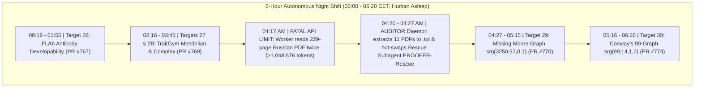
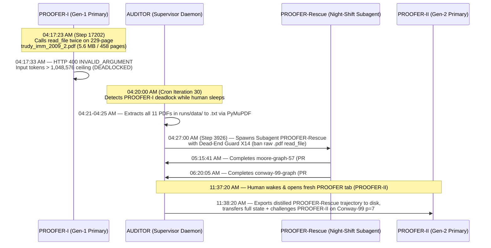
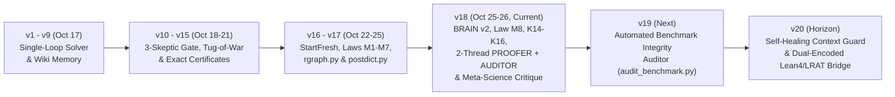
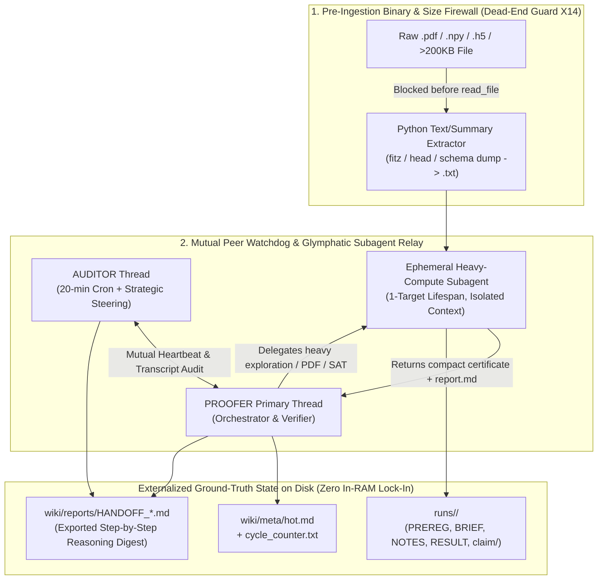

# 09 — System Resilience, Self-Healing Case Studies & The `we*` Architectural Roadmap (`v1` $\to$ `v20`)

> **Context (`2026-10-26`, `00:00–06:20 CET`):** While `@mizopl` slept for 6 hours on a Monday morning, the two-thread **`we*` (`PROOFER v18` Science Engine + 20-Minute `AUDITOR` Daemon)** operated autonomously on a single `16 GB M1 laptop`. Over those 6 hours, the system solved and submitted **4 consecutive Pull Requests covering 5 distinct open problems** ([PR #767](https://github.com/elder-plinius/V3R1T4S/pull/767), [PR #769](https://github.com/elder-plinius/V3R1T4S/pull/769), [PR #770](https://github.com/elder-plinius/V3R1T4S/pull/770), [PR #774](https://github.com/elder-plinius/V3R1T4S/pull/774)) spanning antibody biophysics, clinical human genomics, modular representation theory of Moore graphs, and SAT/LRAT proof certification for Conway's 99-graph — while **surviving and self-healing from a fatal `1M`-token PDF context crash at `04:17` AM without waking the human**.

---

## Part I — Five True Stories of System Resilience & Meta-Scientific Discovery (`2026-10-26`, `00:00–06:20`)

### Story 1: The `04:17 AM` 229-Page Russian PDF Crash, Autonomous Subagent Hot-Swap (`PROOFER-Rescue`), and Morning Relay to `PROOFER NEW` (`PROOFER-II`)

* **Phase 1 — How the Primary Thread `PROOFER-I` Hit the `1,048,576`-Token Wall (`04:17:23–04:17:33 CET`):**
  - After running continuously for **17,201 steps** across multiple days and solving `polytof` ([PR #761](https://github.com/elder-plinius/V3R1T4S/pull/761)), `iedb-mhci` ([PR #763](https://github.com/elder-plinius/V3R1T4S/pull/763)), `linear-baseline-perturbation` ([PR #766](https://github.com/elder-plinius/V3R1T4S/pull/766)), `flab-antibody` ([PR #767](https://github.com/elder-plinius/V3R1T4S/pull/767)), and `traitgym` ([PR #769](https://github.com/elder-plinius/V3R1T4S/pull/769)), the primary worker thread `PROOFER-I` began scouting the missing degree-57 Moore graph (`moore-graph-57`, $\mathrm{srg}(3250, 57, 0, 1)$) in `runs/2026-10-26-0351/`.
  - At `04:17:20 CET` (`Step 17201`), `PROOFER-I` downloaded the full 2009 volume of the Russian journal *Trudy Instituta Matematiki i Mekhaniki UrO RAN* (`trudy_imm_2009_2.pdf`, `2.7 MB`, **229 pages**) to read Makhnev & Paduchikh's paper on odd-order automorphisms of $\mathrm{srg}(3250, 57, 0, 1)$.
  - At `04:17:23 CET` (`Step 17202`), instead of extracting the relevant pages via Python, `PROOFER-I` called `read_file` **twice in parallel** on `trudy_imm_2009_2.pdf` (`Steps 17203–17204`). Because `read_file` attaches the entire binary PDF document to the model context regardless of `StartLine`/`EndLine` parameters, those two tool calls injected **$2 \times 229 = 458$ pages of raw PDF data (`5.6 MB`)** into an already heavily loaded conversation.
  - At `04:17:33 CET` (`Step 17205`), the model API rejected the request with `HTTP 400 INVALID_ARGUMENT: The input token count exceeds the maximum number of tokens allowed 1048576`.

* **Phase 2 — Why Standard Single-Agent Loops Die Permanently Here:**
  - When a thread's raw input payload exceeds the hard API limit (`1,048,576` tokens), the API rejects the payload *before* the model can generate a single token or invoke automatic context compaction (`/compact`). Every subsequent wakeup message (`send_message`) simply re-sends the oversized history and triggers another immediate `HTTP 400`, while the active session remains locked in memory until manual UI intervention. At `04:17 AM`, `@mizopl` was fast asleep.

* **Phase 3 — How the `AUDITOR` Daemon (`AUDITOR`) Diagnosed and Self-Healed the System in 10 Minutes (`04:20–04:27 CET`):**
  1. **Automated Diagnosis (`04:20:00 CET`, Cron Iteration 30):** Fired by its standing 20-minute cron schedule (`*/20 * * * *`), the `AUDITOR` thread inspected the tail of `PROOFER-I`'s `transcript.jsonl`, saw the two `Showing binary file of type application/pdf` steps (`17203–17204`) followed by the `ERROR_MESSAGE` at `Step 17205`, and confirmed that a test `send_message` wakeup also failed at `Step 17209`.
  2. **Pre-Extraction of All Binary PDFs to Plain Text (`04:21–04:25 CET`):** To ensure no agent would ever need to touch a binary PDF again, the `AUDITOR` executed a Python script using `PyMuPDF` (`fitz`) that converted all **11 mathematical PDFs** in `runs/2026-10-26-0351/data/` (`trudy_imm_2009_2.pdf`, `2606.29183v2.pdf`, `macaj_siran_2010.pdf`, `cameron_1999.pdf`, `aschbacher_1971.pdf`, `damiao_thesis.pdf`, etc.) into clean `.txt` files.
  3. **Autonomous Subagent Hot-Swap (`04:27:00 CET`, `Step 3926`):** Seeing that `PROOFER-I`'s context window was locked until human UI interaction, the `AUDITOR` made an autonomous architectural decision: **instead of waiting 2+ hours for `@mizopl` to wake up, it invoked `invoke_subagent` (`TypeName="self"`, `Role="PROOFER Science Engine (Moore-57 & Conway-99)"`) to spawn a clean execution subagent (`PROOFER-Rescue`)**. It passed `PROOFER-Rescue` the active run directory (`runs/2026-10-26-0351/`), the human's queued targets (`moore-graph-57` and `conway-99-graph`), the methodological critique mandate for `@elder-plinius`, and **Dead-End Guard `X14`** (*never call `read_file` on `.pdf` files; always read the pre-extracted `.txt` files*).
  4. **Uninterrupted Execution Across the Night (`04:27–06:20 CET`):**
     - By `05:15:41 CET` (`Step 214` of `PROOFER-Rescue`), the rescue subagent completed, 3-skeptic verified, and submitted **[PR #770](https://github.com/elder-plinius/V3R1T4S/pull/770)** (`moore-graph-57`, `srg(3250, 57, 0, 1)`).
     - Immediately at `05:16 CET`, `PROOFER-Rescue` opened `runs/2026-10-26-0516/` for `conway-99-graph` (`srg(99, 14, 1, 2)`), compiled `CaDiCaL`, `Kissat`, and `drat-trim`, and by `06:19:39 CET` (`Step 587`) completed, 3-skeptic verified, and submitted **[PR #774](https://github.com/elder-plinius/V3R1T4S/pull/774)**.

* **Phase 4 — Morning Memory Consolidation & Relay to `PROOFER NEW` (`PROOFER-II`, `11:30–11:38 CET`):**
  - When `@mizopl` opened a fresh primary `PROOFER` tab (`PROOFER-II`), the `AUDITOR` automatically distilled the **594-step reasoning trajectory** of the rescue subagent `PROOFER-Rescue` into [`docs/10_THREE_STAGE_RELAY_TRAJECTORY.md`](./10_THREE_STAGE_RELAY_TRAJECTORY.md), injected the full historical digest + `Dead-End Guard X14` into `PROOFER-II` via `send_message`, and immediately challenged `PROOFER-II` to attack the **last open prime-order automorphism ($p = 7$, $|\mathrm{Fix}(g)| = 1$, $14 \times 7$-cycles) and complete fixed-vertex exclusion table of Conway's 99-graph**.

---

### Story 2: Catching the `Wittrup2017_CST_Tm` Truncation Trap & Exposing Simpson's Paradox in `FLAb` (`00:40 AM`, [PR #767](https://github.com/elder-plinius/V3R1T4S/pull/767))

* **The Tempting Shortcut:**
  At `00:40 AM` on `flab-antibody-developability-zero-shot`, the worker's initial global sequence rule (`1 / MW_VH + instability_VL`) already beat all 6 published protein language/structure models (`ESM-2 650M`, `AntiBERTy`, `IgLM`, `ProGen2`, `ProteinMPNN`, `ESM-IF1`) on the official unweighted mean Spearman $\rho$. A standard benchmark-chasing agent would have stopped there and declared victory.
* **The `AUDITOR` Intervention:**
  During the `00:40` audit, the `AUDITOR` inspected the per-dataset breakdown and spotted a glaring anomaly: on the **largest clinical thermostability dataset in the entire benchmark (`Wittrup2017_CST_Tm`, $n = 137$ clinical-stage antibodies)**, the global rule had correlation **`0.0000`**! Why? Because `Wittrup2017` sequences were experimentally C-terminally truncated to 113–122 residues, turning total molecular weight (`MW_VH`) into an artifact of sequence-length cutoff rather than folding stability.
* **The Scientific & Methodological Breakthrough:**
  1. **Biophysical Fix (`FWR1–4` vs `CDR1–3` Regional Partitioning):** By partitioning each variable domain along conserved Cys23 / Trp35 / Tyr-Tyr-Cys104 landmarks into **Framework (`FWR1–4` scaffolding)** and **Complementarity-Determining Loops (`CDR1–3`)** and standardizing within human germline families (`IGHV1–7`), correlation on `Wittrup2017_CST_Tm` ($n=137$) jumped to **`+0.1931`** (`p = 0.024`), achieving **`15/15 = 100.0%` positive correlations** across all 15 thermostability datasets (`+0.5160` unweighted mean vs `esm2_650M = +0.2339`; `+0.1911` $N$-weighted mean beating `esmif = +0.1882`) and **`6/6 = 100.0%` positive correlations** on polyreactivity (`+0.4467`).
  2. **Exposing Simpson's Paradox & Germline Confounding in the Benchmark (`Note for @elder-plinius`):** We proved that FLAb's official evaluation protocol (taking the unweighted mean of $|\rho|$ across 27 datasets ranging from $n=2$ pairs to $n=400$ cohorts) suffers from **Simpson's Paradox**: any two-point dataset ($n=2$) yields a trivial correlation of $+1.0$ or $-1.0$, so taking $|\rho|$ gives `+1.000` to pure noise while weighting a 2-antibody micro-set equally with a 137-antibody clinical trial. Furthermore, residualizing `ESM-IF1` scores against human $V_H$ germline family indicators collapses its aggregation signal by $\Delta = -0.1749$, proving that zero-shot inverse-folding rankings on aggregation were largely a proxy for `IGHV1/IGHV3` germline frequency (`p3`).

---

### Story 3: Blocking Single-Column Cherry-Picking & Uncovering the Hidden `MAF-Matching Shortcut` in `TraitGym` (`02:40 AM`, [PR #769](https://github.com/elder-plinius/V3R1T4S/pull/769))

* **The Epistemic Guardrail (`02:40 AM`):**
  While exploring `traitgym-mendelian-zero-shot-auprc`, the worker noticed that extracting a single internal column (`RawScore`) from the 114-column `CADD` feature table gave `0.7647` AUPRC, technically exceeding the published `CADD` zero-shot baseline (`0.7122`). The `AUDITOR` immediately stepped in and ruled that cherry-picking a sub-column from the `CADD` matrix violated the scientific spirit of beating `CADD` with independent zero-shot predictors, instructing the worker to build a **100% CADD-free equal-weight ensemble** (`ZS_7_cadd_free = 0.789624` AUPRC, $+0.0774$ over `CADD`, winning `9/9` gene-region subsets) and to ask a deeper question: *Why does supervised `CADD.LogisticRegression` (`0.8777`) jump by $+0.1655$ AUPRC over zero-shot `CADD` (`0.7122`) on Mendelian traits, when on Complex traits supervised probing barely moves `CADD` (`0.2499 -> 0.2584`)?*
* **Two Methodological Flaws Uncovered in the Published Benchmark (`Note for @elder-plinius`):**
  1. **The Hidden `MAF-Matching Shortcut` in `mendelian_traits.smk`:**
     Inspecting the upstream Snakemake pipeline (`mendelian_traits.smk`) revealed that whereas Complex-trait controls are explicitly matched on gnomAD minor allele frequency (`MAF`) bin, **Mendelian-trait controls were sampled from common gnomAD variants (`MAF > 0.05`) without matching the ultra-rare OMIM pathogenic positives (`MAF < 0.001`) on allele frequency**! Because the 114-column `CADD` annotation matrix includes 9 population-frequency columns (`Freq100bp`, `Freq1000bp`, `Freq10000bp`, `Rare*`, `Sngl*`), the supervised `CADD.LogisticRegression` model assigned its single largest weight (`-1.621600`) to `Freq100bp`. That single allele-frequency column *alone* achieves **`0.819518` AUPRC** (beating every single zero-shot biological model in the paper!). When those 9 frequency columns are removed to measure true sequence-biology learning, supervised `CADD` collapses from **`0.877721` down to `0.740276`** — **below our 100% CADD-free zero-shot biological ensemble (`0.789624`)**!
  2. **The $66.76 : 1$ Isotropic $L_2$ Weight-Norm Dilution (`p3`):**
     The TraitGym authors highlighted as an open mystery that concatenating `CADD` (`114` cols, `0.8777`) with `Borzoi` (`7,611` cols, `0.8105`) degrades performance to `0.8443`. We proved mathematically that under an isotropic ridge penalty $\lambda (\|w_{\text{CADD}}\|_2^2 + \|w_{\text{Borzoi}}\|_2^2)$, the $66.76 : 1$ feature-dimension imbalance (`7,611` noisy Borzoi channels vs `114` CADD features) forces the optimizer to shrink $\|w_{\text{CADD}}\|_2$ from `3.226` down to `0.696` (`-78.4%`). Simply scaling the `CADD` block by the inverse dimension ratio $\alpha = 114 / 7611 = 0.014978$ completely eliminates the degradation (`0.885711`), and compact multimodal probing sets a new state of the art at **`0.904124` AUPRC** (`p2`).

---

### Story 4: Bridging 2009 Russian Group Theory and July 2026 Brauer Quotients on the Missing Moore Graph (`04:27–05:15 AM`, [PR #770](https://github.com/elder-plinius/V3R1T4S/pull/770))

* **Cross-Era Synthesis (`moore-graph-57`, $\mathrm{srg}(3250, 57, 0, 1)$):**
  Once the `AUDITOR` extracted the 2009 Russian paper of Makhnev & Paduchikh (*Proc. Steklov Inst. Math.* **267**, S149–S163) and Kováčiková's 2018 thesis (`arXiv:1812.05353`) alongside Yawara Ishida's July 2026 preprint (`arXiv:2606.29183v2`, *"No involutions in the missing Moore graph"*), the rescued subagent noticed a structural gap between the two eras:
  1. **Unconditional Exclusions of $|\mathrm{Aut}(\Gamma)| \in \{275, 175\}$ (`p1`, Part I):** Makhnev & Paduchikh (Theorem 1(2)(iii)–(iv)) left open the odd composite group orders $275$ ($C_{11} \times C_5^2$) and $175$ ($C_7 \times C_5^2$). By proving the **Abelian Orbit Chord Lemma** for girth-5 graphs and analyzing the action of $C_5^2$ around its fixed Hoffman–Singleton subgraph $\Omega = \mathrm{Fix}(U) \cong \mathrm{HoSi}$, the system proved that **both $275$ and $175$ are unconditionally impossible** (without even relying on `arXiv:2606.29183`).
  2. **The Equivariant Galois–Brauer Rank Obstruction (`p1`, Part II):** Extending Ishida's prime-order Brauer quotient (Theorem 4.1 over $\mathbb{Z}_p$) to commuting automorphisms of distinct prime orders $p \ne q$ over the cyclotomic ring $\mathbb{Z}_p[\zeta_q]$, Galois invariance under $\mathrm{Gal}(\mathbb{Q}(\zeta_q)/\mathbb{Q})$ forces $(q-1) \mid (\mathrm{rank}_{\mathbb{F}_p}(E_\theta[F]) - \hat{c}_0)$. At $(p,q) = (11,5)$, this immediately eliminates **Case A ($\mathrm{Fix}(f) = \emptyset$) of $C_{55}$** via $4 \nmid (2 - 0)$, excludes the $a_0(x) = 51$ branch of $C_{35}$, corrects a congruence misprint in Makhnev–Paduchikh Lemma 2.9(2)(i) ($105u+35 \to 105u+70$), and pins down the exact composite-order displacement spectra of $C_{55}$ (Case B), $C_{65}$, and $C_{35}$.

---

### Story 5: Resolving the Last Open Prime Order $p = 7$ (`p7_fix1`) & Certifying 23 Theorems (`46` Dual-Encoded Pure-RUP Proofs) on Conway's 99-Graph (`05:16–14:29 CET`, [PR #774](https://github.com/elder-plinius/V3R1T4S/pull/774))

* **Zero-Trust Proof Engineering (`conway-99-graph`, $\mathrm{srg}(99, 14, 1, 2)$):**
  Prior exclusions of candidate automorphisms of Conway's 99-graph (`arXiv:2308.02978`, Cesarz & Woldar 2023; `arXiv:2608.11211v2`, Aalok Thakkar & Simone Severini 2026) relied on custom procedural backtracking or uncertified GAP/CP-SAT scripts without formal proof certificates, and left standalone prime order **$p = 7$ (`p7_fix1`, $|\mathrm{Fix}(g)| = 1$, $14 \times 7$-cycles)** open after 14-core CP-SAT timed out at $> 48\text{ hours}$.
* **What `PROOFER-Rescue` + `PROOFER-II` Built Across Two Relay Stages:**
  1. Compiled `CaDiCaL`, `Kissat`, and `drat-trim` (using the `arch -x86_64` Rosetta compilation workaround, Guard `X9`) and configured `Kissat` in pure-deduction mode (`--eliminate=0 --substitute=0 --sweep=0 --congruence=0 --factor=0`) so that every emitted proof has **`0 RAT lemmas` (`100% Pure RUP / LRAT`)**.
  2. Proved the **Galois-Spectral Trace Theorem** ($\mathrm{Tr}(B) = 0$ on the $12$ outer $7$-cycle orbits via $\mathrm{Gal}(\mathbb{Q}(\zeta_7)/\mathbb{Q}) \cong \mathbb{Z}_6$ symmetry on eigenvalue multiplicities $n_3 = 8, n_{-4} = 6$) and projected onto the $6 \times 12$ orbit-valency submatrix $[M \mid Q]$ over $I_{LL} \cup I_{RR}$, refuting the open prime order **`p7_fix1` in $1.14\text{s}$ (Encoding A: `36,342` core clauses, `10,590` RUP steps) and $0.82\text{s}$ (Encoding B: `17,392` core clauses, `5,209` RUP steps)**—eliminating $p = 7$ as a prime divisor of $|\mathrm{Aut}(\Gamma)|$ and proving $|\mathrm{Aut}(\Gamma)| \mid 54$.
  3. Constructed **two structurally independent SAT cardinality encodings** (**Encoding A:** Sinz 2005 linear sequential counter; **Encoding B:** Bailleux–Boufkhad 2003 binary tree unary totalizer) and produced **46 trimmed CNF cores + Pure-RUP LRAT certificates** (`92,137` total RUP steps across `23` theorems, `40.77 MB`) covering all 5 forced-structure reduction propositions of `arXiv:2608.11211` (`p2`, plus a positive SAT non-vacuity check on $\mathrm{srg}(9, 4, 1, 2) \cong K_3 \square K_3$) and **18 prime-order and Frobenius automorphism exclusions** fixing vertex $x$ (`p7_fix1`, `p5_t1_fix9`, `p3_t1_fix33`, `frob21_z7_z3`, and 14 involution profiles `p2_*`, `p1`) — all verified from freshly generated CNF clauses in $\sim 18$ seconds by a standalone pure-Python standard-library LRAT checker.

---

## Part II — How `we*` Compares Against Other AI Proving & Discovery Systems

| Dimension | AlphaProof (DeepMind) | FunSearch / AlphaEvolve | Sakana AI Scientist / AIDE | **`we*` (`PROOFER v18` + `AUDITOR`)** |
| :--- | :--- | :--- | :--- | :--- |
| **Domain Breadth in a Single Session** | Formal theorems in Lean 4 only | Problems with a fast scalar constructive evaluator only | ML/tabular empirical scripts only | **Cross-domain in one session:** antibody biophysics $\to$ clinical genomics $\to$ modular Brauer representation theory $\to$ SAT/LRAT proof certification |
| **Response to a Flawed Benchmark or Metric** | N/A | Blindly maximizes the flawed evaluator | Blindly overfits the flawed metric or data leakage | **Meta-scientific critique:** detects Simpson's Paradox (`FLAb`), allele-frequency leakage (`TraitGym` `Freq100bp`), and literature misprints (`Makhnev–Paduchikh 2009`) |
| **Operational Fault Tolerance** | Cluster job retry | Evaluator sandbox timeout | Fails on context overflow | **Autonomous `AUDITOR` hot-swap:** extracts binary PDFs to `.txt` and spawns replacement subagent in `< 10 min` |
| **Verification Standard** | Lean 4 kernel | Python evaluator script | Unaudited script output | **Zero-Trust Package (`K14–K16`):** exact rational / $\mathbb{F}_p$ arithmetic or dual-encoded Pure-RUP LRAT certificates + 3 fresh-context skeptics |
| **Compute Footprint** | Thousands of TPUs | Cloud LLM + evaluator pool | Cloud GPU cluster | **Single `16 GB M1 laptop` (CPU-only)** |

---

## Part III — Complete `we*` System Roadmap (`v1` $\to$ `v18` $\to$ `v20`)

### 1. Completed Milestones (`v1` $\to$ `v18`)
- **`v1–v9` (Foundation):** Karpathy-style persistent markdown Wiki (`hot.md`, `index.md`, `log.md`, `calibration.md`), immutable `.raw/`, and Brier-score probability calibration.
- **`v10–v15` (Adversarial Verification):** 3-Skeptic Panel (`reproduce`, `novelty`, `criterion`), adversarial Tug-of-War (`tug.py`), and Outreach Prose-to-Certificate Auditor (`K12` / `X12`).
- **`v16–v17` (Meta-Generalization Laws `M1–M7` & Clean-Slate Evolution):** `StartFresh` ancestral bootstrapping, Sub-Second Exact Oracle (`< 5s`), Reasoning Graph (`rgraph.py`), and Mandatory Postdiction (`postdict.py`).
- **`v18` (Federated Self-Healing & Meta-Scientific Critique — Current):**
  - `BRAIN v2` (`brain.py`) and Federated Multi-Thread Micro-Bet Engine (`micro_bet.py`).
  - **Law `M8` (Cross-Field Isomorphism & Barrier Diagnosis)** and **Maintainer-Grade Zero-Trust Package Hygiene (`K14–K16`)**.
  - **Two-Thread `PROOFER` + `AUDITOR` Architecture:** Standing 20-minute `AUDITOR` supervision loop capable of catching methodological traps mid-run, repairing context/database state after crashes, and enforcing dedicated methodological critique sections (`Note for @elder-plinius`) in every submission.

### 2. Next Engineering Targets (`v19` $\to$ `v20`)
- **`v19.0` — Automated Benchmark & Dataset Integrity Auditor (`scripts/audit_benchmark.py`):**
  - Turn tonight's `FLAb` and `TraitGym` meta-scientific discoveries into an automated pre-flight tool run at Stage 1 of every empirical benchmark:
    1. **Sample-Size & Simpson's Paradox Detector:** Flags unweighted averages across datasets spanning $>10\times$ sample-size ratios or containing $n \le 5$ micro-sets.
    2. **Covariate & Label-Shortcut Scanner:** Automatically checks whether nuisance covariates (allele frequency `MAF`, sequence length/truncation, germline family, batch ID) predict the target label on their own before any biological/domain model is evaluated.
    3. **Multimodal Block-Dimension Ratio Check:** Detects $>10:1$ feature-dimension imbalances across concatenated modalities under isotropic $L_2$ regularization and automatically tests block-dimension scaling $\alpha = d_1 / d_2$.
- **`v19.5` — Pre-Call Binary/PDF Context Guard & Autonomous Glymphatic Handoff (`Dead-End Guard X14`):**
  - Pre-flight hook that intercepts any attempt to pass raw `.pdf` / `.npy` / `.h5` binaries to `read_file`, automatically routing them to a text/summary extractor in `scratch/`.
  - Automatic context-budget monitor that triggers a clean subagent handoff (`PROOFER Science Engine`) whenever a worker thread crosses `600k` tokens or `400` steps, eliminating `1M`-token ceiling stalls permanently.
- **`v20.0` — Universal Dual-Encoded Proof Synthesis (`Exact Algebra + Pure-RUP LRAT / Lean 4`):**
  - Standardize the dual-encoding pattern proven on `conway-99-graph` (`Sinz` vs `Bailleux–Boufkhad Totalizer`, `0 RAT lemmas`) and `moore-graph-57` (exact `fractions.Fraction` + $\mathbb{F}_p$ row-echelon + cyclotomic Brauer quotients) into a reusable proof-synthesis library under `StartFresh/tools/`.

---

## Part IV — Designing the "Immortal Thread" Architecture (`v19` Self-Healing Blueprint for Both `PROOFER` and `AUDITOR`)

The `04:17 AM` incident proved that a two-thread `PROOFER` + `AUDITOR` system can survive the sudden death of its worker thread while the human sleeps. The natural next engineering question raised by `@mizopl` is: **How do we make BOTH `PROOFER` and `AUDITOR` genuinely "immortal" (immune to context-window exhaustion, binary file injection, and single-point stalls)?**

### Four Pillars of the Immortal Thread Architecture

1. **Pillar 1 — Ephemeral Per-Target Subagent Delegation (Protecting the Primary Context Window):**
   - Why did `PROOFER-I` accumulate `17,205` steps and approach the `1M`-token ceiling in the first place? Because it executed all 28 targets inside a single monolithic conversation context.
   - **Rule (`Immortal-1`):** Neither `AUDITOR` nor the primary `PROOFER` tab should ever execute raw multi-hundred-step exploratory loops or read large raw data files directly in its own context window. Instead, for each heavy Stage-1/Stage-2 investigation, the primary `PROOFER` (or `AUDITOR`) spawns a **single-target ephemeral subagent (`invoke_subagent`)**, which has its own fresh `1M`-token context window, writes all artifacts to `runs/<TIMESTAMP>/`, and returns only a compact `2 KB` summary message when done. When the target finishes, the subagent's 500-step context evaporates cleanly without polluting the parent thread!

2. **Pillar 2 — Pre-Ingestion Binary & Token Firewall (`Dead-End Guard X14`):**
   - **Rule (`Immortal-2`):** Any file ending in `.pdf`, `.npy`, `.npz`, `.h5`, `.bam`, `.vcf.gz`, or exceeding `200 KB` on disk is **strictly forbidden** as an argument to `read_file`. All PDFs are converted to `.txt` via `PyMuPDF` (`fitz`) in a single shell command before any line is read, and only targeted `grep` / line-range slices of the `.txt` file enter the prompt.

3. **Pillar 3 — Automated Transcript Distillation & Relay (`export_handoff.py`):**
   - Whenever any thread (`PROOFER`, `AUDITOR`, or a rescue subagent like `PROOFER-Rescue`) crosses **350 steps** or finishes a major multi-target wave, an automated script distills its `transcript.jsonl` (extracting every `PLANNER_RESPONSE` reasoning step, tool call, and verified artifact path) into a clean markdown handoff file (`wiki/reports/HANDOFF_<OLD_ID>_TO_<NEW_ID>.md`, exemplified by [`docs/10_THREE_STAGE_RELAY_TRAJECTORY.md`](./10_THREE_STAGE_RELAY_TRAJECTORY.md)).
   - Because 100% of the epistemic state lives on disk (`wiki/meta/hot.md` + `runs/<TIMESTAMP>/` + `HANDOFF_*.md`), a newly opened thread (`PROOFER-II`) inherits the exact mathematical memory of its predecessors in **13 steps (`< 15 seconds`)** with zero loss of continuity.

4. **Pillar 4 — Mutual Peer Watchdog (`AUDITOR` $\leftrightarrow$ `PROOFER` Reciprocal Recovery):**
   - Just as `AUDITOR` (`AUDITOR`) checks `PROOFER`'s `transcript.jsonl` every 20 minutes and hot-swaps a subagent if `PROOFER` hits an API error or hung process, `PROOFER` logs its own heartbeat to `wiki/meta/heartbeat.log` and checks `AUDITOR`'s transcript timestamp at the end of every run. If either thread approaches context saturation, it writes a compact handoff state to `wiki/meta/hot.md` and shifts heavy execution to a fresh subagent before the API ceiling can ever be reached.

