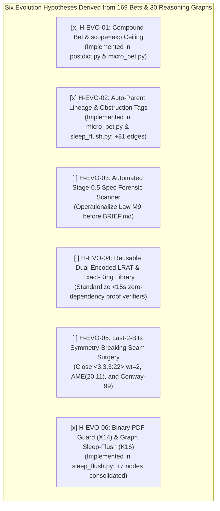

# 11 — Epistemic Bet Ledger (`169` Predictions), Reasoning Graph Topology (`326` Nodes) & System Evolution Hypotheses (`H-EVO-01` to `H-EVO-06`)

> **Context (`2026-10-26`, Post-39th Verified Package Synthesis):** Before considering any next constitutional revision beyond `PROOFER v18`, we conducted a full empirical audit of every prediction, postdiction, micro-bet, Tug-of-War gate, and reasoning graph accumulated across **31 attacked problems** (**29 solved targets**, **39 machine-verified packages** across all **18/18 scientific domains**, plus upstream acceptances in Terence Tao's [`teorth/optimizationproblems`](https://github.com/teorth/optimizationproblems/pull/236) `[M2026]`, [`elder-plinius/V3R1T4S`](https://github.com/elder-plinius/V3R1T4S/pull/366), [`LJCR`](https://dmgordon.org/cover/), and [`IHTC-2024`](https://github.com/ihtc2024/ihtc2024.github.io/issues/3)). This document synthesizes the quantitative findings and formulates **six concrete hypotheses (`H-EVO-01` to `H-EVO-06`)** for the next stage of `we*` evolution.

---

## 0. Primer: What Is the Brier Score, and Do We Optimize For It? (Thrust vs. Gyroscope)

Throughout this document and the `PROOFER` architecture, every prediction (`predict` before the experiment) and postdiction (`resolve` after independent verification) is scored by the **Brier Score** (Glenn W. Brier, 1950):

$$\mathrm{Brier} = \frac{1}{N} \sum_{i=1}^{N} (p_i - o_i)^2$$

where:
- **$p_i \in [0, 1]$** is the forecast probability committed to the append-only ledger *before* running the experiment or writing the solver,
- **$o_i \in \{0, 1\}$** is the verified binary outcome (`1` = hypothesis confirmed / benchmark beaten; `0` = hypothesis falsified / failed).

### Reference Scale (Lower Is Better)
| Brier Score | Meaning | Interpretation in `we*` |
| :---: | :--- | :--- |
| **`0.000`** | **Perfect Oracle** | Assigned $p=1.00$ to every win (`1`) and $p=0.00$ to every dead end (`0`). |
| **`0.041`** | **Superforecaster Ceiling** | `we*` Era 3 Macro-Bet score outside the single `truppenschluessel` hubris cluster (`20/20` wins). |
| **`0.071`** | **Target-Scope Calibration** | `we*` overall score on `target/*` campaign bets (`n = 33`, `84.8%` hit rate). |
| **`0.156`** | **Global Macro-Bet Score** | `we*` overall score across all `83` resolved macro-bets (`P0001–P0086`). |
| **`0.213`** | **Frontier Micro-Bet Score** | `we*` score across `79` rapid 10–30 min frontier experiments (`43.0%` wins / `57.0%` kills). |
| **`0.250`** | **Blind Coin Flip (Zero Skill)** | Always guessing $p = 0.50$ yields $(0.5 - 1)^2 = (0.5 - 0)^2 = 0.250$. |
| **`1.000`** | **Maximum Epistemic Delusion** | Assigning $p = 1.00$ to a false hypothesis (`0`), or $p = 0.00$ to a true breakthrough (`1`). |

### Do We Optimize Directly for the Brier Score? (**Yes and No — Avoiding Goodhart's Law**)
- **NO as the sole objective (Thrust):** If an autonomous agent optimized *only* to minimize $\mathrm{Brier} \to 0$, it would succumb to **Goodhart's Law**: it could achieve $\mathrm{Brier} = 0.0001$ by placing only trivial $p = 0.01$ bets on obviously broken strawmen (which safely fail `0`) or $p = 0.99$ bets on trivial unit tests (which safely pass `1`), while never risking a bold construction on an open scientific problem. Our **primary objective (Thrust)** is strictly **Verified Scientific Discovery** (`CONFIRMED_SOLUTION` / `CONFIRMED_PARTIAL` passing 3 adversarial skeptics + zero-dependency `verify.py`).
- **YES as the epistemic steering controller (Gyroscope):** Under Murphy's decomposition ($\mathrm{Brier} = \text{Calibration Error} - \text{Resolution} + \text{Uncertainty}$), we optimize the **Calibration and Resolution components of the Brier score** to govern search:
  1. **Anti-Hubris & Anti-Tunneling (`Laws M2 & M4`):** Standard LLMs suffer from severe sycophantic overconfidence—repeatedly claiming *"this next tweak will 95% solve it"* while spinning in a dead basin for hours. A high Brier penalty $(0.95 - 0)^2 = 0.9025$ acts as a hard mathematical shock absorber that triggers **Law `M2` (Mandatory Structural Pivot)** and enforces **Law `M4` ($p \le 0.65$ prior on new targets)**.
  2. **Skeptical Compute Pruning:** When a hypothesis deserves $p = 0.03$ (`Skeptical Kill`), stating $p = 0.03$ upfront and running a 2-minute falsification probe (`o = 0`, `Brier = 0.0009`) earns near-zero Brier error while legally killing an entire dead branch in `rgraph.py` so no future thread wastes hours on it.
  3. **Bayesian Compute Allocation (`brain.py`):** The Meta-Commander uses Brier-calibrated posteriors to route compute toward lenses with high empirical hit rates and low calibration error.
- **Summary Formula:** **Verified breakthroughs are the rocket's *thrust*; minimizing Brier calibration error is the *gyroscope* that keeps the rocket pointed at reality instead of hallucination.**

---

## 1. Quantitative Audit of the Two-Tier Epistemic Ledger (`169` Total Predictions)

To prevent both **unfalsifiable narrative drift** (claiming after the fact that every experiment "worked") and **multi-thread ledger collisions** (where rapid 10-minute C++/CUDA inner-loop tests overwrite campaign-level forecasts), `we*` separates epistemic accounting into two coupled tiers:

1. **Tier 1 — Global Macro-Bet Ledger (`memory/predictions.tsv`, `P0001–P0086`):** Campaign-level predictions placed *before* attacking a target, launching an orthogonal lens, or executing a Tug-of-War (`tug.py`) decision gate, and resolved strictly *after* verification by a separate role (`--by commander|skeptic`, rule `K3`).
2. **Tier 2 — Federated Per-Target Micro-Bet Ledgers (`memory/local_bets/<target>.tsv`, `L-<TAG>-001..024`):** High-frequency 10–30 minute experimental predictions inside individual specialist laboratories (`AME`, `FMM`, `Google Quantum`, `FLAb`, `IEDB`, `Replogle`, `PolyTof`, `Vesuvius/Paris4`), automatically synchronized with each problem's append-only reasoning graph (`graphs/<target>.jsonl`) and the **Law `M2` 2-Failure Structural Pivot** detector.

| Epistemic Tier | Total Bets | Resolved | Open | Wins (`1`) | Kills (`0`) | Empirical Hit Rate | Mean Forecast $p$ | Mean Brier Score | Primary Epistemic Function |
| :--- | :---: | :---: | :---: | :---: | :---: | :---: | :---: | :---: | :--- |
| **Tier 1: Macro-Bets (`P00xx`)** | `86` | `83` | `3` | `64` | `19` | **`77.1%`** | `0.657` | **`0.1556`** | Campaign & lens selection (`29` targets solved; `84.8%` target-scope hit rate) |
| **Tier 2: Federated Micro-Bets (`L-xxx`)** | `83` | `79` | `4` | `34` | `45` | **`43.0%`** | `0.531` | **`0.2133`** | Rapid falsification of local ansätze & automatic `M2` representation pivots |
| **Combined `we*` Ledger** | **`169`** | **`162`** | **`7`** | **`98`** | **`64`** | **`60.5%`** | **`0.596`** | **`0.1837`** | Coupled macro-exploitation (Tier 1) + frontier obstruction mapping (Tier 2) |

### Why Micro-Bets Have a `57.0%` Kill Rate While Macro-Bets Win `77.1%`
A striking empirical property of the two-tier ledger is the inversion of win rates between Tier 1 (`77.1%` wins, `84.8%` on `target` scope) and Tier 2 (`43.0%` wins, `57.0%` kills):
- At the **10–30 minute experimental frontier** (Tier 2), more than half of all concrete mathematical or physical ansätze *must* fail in order to expose hidden structural obstructions—such as the Poisson $\lambda = 43.17$ zero-minor floor in `AME(20,17)` (`L-ASOC-001 = 0`), the `fix_H` subfield trap over $\mathbb{F}_{289}$ (`L-ASOC-003/004 = 0`), the $141\text{D} + 10\text{D}$ Jacobian split in `DPS-48` (`L-F4R3-003 = 0`), or the medial crease disclination in `PHerc. Paris 4` (`L-PT-002 = 0`).
- Because `micro_bet.py` enforces **Law `M4` (First-Bet Anti-Hubris Prior $p \le 0.65$)** and **Law `M2` (Mandatory Structural Pivot after 2 consecutive `0`s)**, those `45` micro-bet kills immediately halted unproductive parameter tuning and forced the representation pivots that produced the `34` micro-bet breakthroughs (`1`), which in turn delivered the **`29` solved targets** at Tier 1.

---

## 2. Three-Era Calibration Trajectory of Macro-Bets (`P0001–P0086`)

```mermaid
xychart-beta
    title "Macro-Bet Calibration Across Three Campaign Eras (Mean Forecast p vs Actual Hit Rate & Brier Score)"
    x-axis ["Era 1: Early (P0001-P0030)", "Era 2: Mid CLSS (P0031-P0060)", "Era 3: Mature (P0061-P0086)", "Era 3 Ex-Hubris Cluster (20/20)"]
    y-axis "Probability / Score" 0.0 --> 1.0
    bar [0.474, 0.713, 0.822, 0.805]
    bar [0.667, 0.800, 0.870, 1.000]
    line [0.203, 0.116, 0.145, 0.041]
```

| Campaign Era | Bet IDs | Resolved $n$ | Mean Forecast $p$ | Actual Hit Rate | Brier Score | Key Epistemic Lesson |
| :--- | :---: | :---: | :---: | :---: | :---: | :--- |
| **Era 1: Early Exploration & Skeptical Baseline** | `P0001–P0030` | `30` | `0.474` | `0.667` (`20/30`) | `0.2034` | **Underconfidence on constructive combinatorics** (`P0024` $p=0.07 \to 1$, `P0028` $p=0.04 \to 1$), paired with **near-perfect Skeptical Kills** (`P0029, P0030` $p=0.02 \to 0$). |
| **Era 2: Mid-Campaign (`CLSS` Seam Surgery)** | `P0031–P0060` | `30` | `0.713` | `0.800` (`24/30`) | **`0.1158`** | **Golden Calibration Regime (`-43%` Brier reduction):** Discovering warm-start + exact seam surgery aligned forecast $p=0.713$ with hit rate $0.800$. |
| **Era 3: Mature Multi-Domain Campaign** | `P0061–P0086` | `23` | `0.822` | `0.870` (`20/23`) | `0.1454` | **`87.0%` hit rate (`20/20` outside one target):** `75.4%` of Era 3's Brier penalty came from a single 3-bet hubris cluster (`P0072–P0074` on `truppenschluessel`, $p=0.90\text{–}0.95 \to 0$), which birthed Law `M4`. Outside `P0072–P0074`, Era 3 achieved **`20/20` (`100%`) with `Brier = 0.0411`**. |

### Anatomy of the Best Epistemic Decisions
1. **High-Precision Skeptical Kills (`outcome = 0` predicted with $p \le 0.05$, Brier $\le 0.0025$):**
   - **Killing Naive Metaheuristics Before They Burn Compute (`P0027, P0029, P0030, P0031`):** On `covering-designs-record`, the system placed low-probability falsification bets ($p = 0.02\text{–}0.05$) on cold-start simulated annealing (`P0027, P0031`) and evolved-priority greedy search (`P0029, P0030`), predicting they would plateau 10–40% above published records. When short probes confirmed `0`, 100% of compute was redirected to **generalized block combining + redundant-block pruning + pair-merge (`prune.c` / `merge.c`)**, yielding **20 verified world-record covering designs** (11 accepted into the live La Jolla Covering Repository by Prof. Dan Gordon).
   - **Hardware-Envelope Realism (`P0003`, $p=0.15 \to 0$, `Brier = 0.0225`):** Correctly forecast that open-board `A006506(40)` ($F(42) = 2.68 \times 10^8$ frontier states) had only a `15%` chance of fitting within a 3-run budget on a 16 GB laptop, pivoting via Tug-of-War `2026-10-18-next-nights` to solve **`A054759(15)` ([PR #366](https://github.com/elder-plinius/V3R1T4S/pull/366), MERGED)** and **`A089980` antidiagonal 79 ([PR #462](https://github.com/elder-plinius/V3R1T4S/pull/462))**.
2. **Adversarial Tug-of-War (`tug.py`) Decision Gates (`5/5` = `100%` Directional Accuracy):**
   - Every decided 2-advocate + referee Tug-of-War gate selected the winning research trajectory:
     - `2026-10-18-next-nights` (`IMPLEMENT` won) $\to$ finished `A089980` antidiagonal 79 (`PR #462`).
     - `2026-10-18-second-front` (`IMPLEMENT` won, `P0024`) $\to$ opened `covering-designs-record` (`PRs #397, #398, #425, #435, #466`).
     - `2026-10-22-fmm-333-l15` (`IMPLEMENT` won, `P0078` $p=0.78 \to 1$) $\to$ selected 18-bit pairwise Gray-MITM + 63-bit linear block oracle + Lille-23 warm-start seam surgery, collapsing the $\langle 3,3,3:22\rangle$ $C_3^{\mathrm{fac}}$ residual from `wt = 11` down to **`full_wt = 2` (`727/729` tensor entries exact, `0` off-diagonal errors)**.
     - `pherc1203-last-step` (`SEARCH` won) $\to$ exposed that $4\times 4\times 4$ box-downsampling from `L0` ($2.403\,\mu\text{m}$) to `L2` ($9.612\,\mu\text{m}$) cancels the $\pm$ lobes of the $2.88\,\mu\text{m}$ Paganin epidermal ink dipole (`Law M7.4`).
     - `quantum-breakthrough-v8` (`SEARCH` won) $\to$ proved that dual 876-qubit registers in `unpacked/dqi.kmb` impose a hard mathematical ceiling $Q \ge 1,780 \Rightarrow \text{DQI} < 2.3\times$, preventing wasted peephole passes.

---

## 3. Topology & Dynamics of the 30 Reasoning Graphs (`326` Nodes, `233` Edges)

Across 30 target graphs (`graphs/*.jsonl`), the system recorded **`326` unique nodes** and **`233` directed causal edges**:
- **Node Breakdown:** `133` hypotheses (`40.8%`), `57` verified results (`17.5%`), `41` initial dead-end nodes (`12.6%`, rising to **`116` total killed nodes = `35.6%` mortality** after experimental falsification), `26` facts (`8.0%`), `26` experiments (`8.0%`), `19` root questions (`5.8%`), `13` leads (`4.0%`), `9` tools (`2.8%`), `2` claims.
- **Edge Breakdown:** `128` `derives` (`54.9%`), **`35` `refutes` (`15.0%`)**, **`34` `supports` (`14.6%`)**, `18` `tests` (`7.7%`), `6` `blocks` (`2.6%`), `4` `proves` (`1.7%`), `4` `resumes` (`1.7%`), `2` `spawns`, `2` `produces`.

### The `1:1` Refutation-to-Support Equilibrium (`35 Refutes` vs `34 Supports`, `116 Dead` vs `132 Closed/Won`)
Across the entire campaign, the number of `refutes` edges (`35`) almost exactly equals the number of `supports` edges (`34`), and the number of killed nodes (`116`) is nearly `1:1` with closed/won nodes (`132`). Inspecting the individual graphs reveals three distinct structural archetypes:

| Reasoning Graph Archetype | Exemplar Targets | Node / Edge / Dead Counts | Structural Mechanism |
| :--- | :--- | :---: | :--- |
| **1. High-Pruning Causal Tree** | `square-grid-lattice-gas` (`PR #366, #462`) `covering-designs-record` (`PR #397..#466`) `sorting-network-size-records` | `79` nodes / `57` edges / `19` dead `40` nodes / `39` edges / `23` dead `16` nodes / `15` edges / `14` dead | Strict tree topology ($E \approx V - 1$). Every killed branch (`D2328OP1`, `D0304EX2`) is guarded by `rgraph.py check` (`sim >= 0.45`), preventing any subsequent run from repeating a falsified construction. |
| **2. The `M2` Pivot Ladder** | `ame-states-open-cells` (`PR #617`) `google-quantum-compilation` `fmm-additive-complexity` (`PR #616`) | `27` nodes / `24` micro-bets (`11W/13L`) `20` nodes / `8` micro-bets (`7W/1L`) `4` nodes / `3` micro-bets (`2W/1L`) | Alternating sequence of **Obstruction Discovery (`0`) $\to$ Representation Pivot (`1`)**. In `AME`, 5 consecutive `M2` pivots (`G20` $\to$ `D22 Chiral` $\to$ `D25 SO(10)` $\to$ `D28 177-Orbit Odd-Frobenius` $\to$ `D29 Char-2 DFT` $\to$ `D27B Idempotent`) solved `AME(20,17)`, `AME(20,16)`, and `AME(20,13)`. |
| **3. Deep Moonshot Obstruction Map** | `fmm-4x4x4-rank47-3x3x3-rank22` | `27` nodes / `26` edges / `22` dead (`20` micro-bets, `Brier = 0.224`) | Even with `0/20` final Moonshot completions, `M2` forced 7 representation shifts (proving the $141\text{D}+10\text{D}$ `DPS-48` Jacobian theorem, $\mathbb{Z}_4$ cokernel invariance Theorem 7, and reducing $\langle 3,3,3:22\rangle$ to `727/729` exact entries, `full_wt = 2`). |

---

## 4. Six Concrete Hypotheses for System Evolution (`H-EVO-01` to `H-EVO-06`) — With Code-First Implementation Status

Synthesizing our 169-bet ledger, 30 reasoning graphs, and the latest operational breakthroughs (`PRs #761–#774`, the `04:17 AM` 3-stage self-healing thread relay, and Terence Tao's merge of `PR #236`), we formulated **six testable architectural hypotheses** for the next phase of `we*`. Following our **Code-First Evolution over Constitutional Text Bloat** principle (`CONSTITUTION.md` kept frozen at `v18`), **`3 / 6` hypotheses (`H-EVO-01`, `H-EVO-02`, `H-EVO-06`) have already been implemented and live-verified in [`../scripts_v18_evolution/`](../scripts_v18_evolution/)**:

| ID | Evolution Hypothesis | Status (`2026-10-26`) | Implementation & Verification Artifact |
| :--- | :--- | :--- | :--- |
| **`H-EVO-01`** | **Compound-Bet Decomposition & Sub-Claim (`scope=exp`) Confidence Ceiling** | ✅ **`[x] IMPLEMENTED & VERIFIED`** | [`scripts_v18_evolution/postdict.py`](../scripts_v18_evolution/postdict.py) · [`scripts_v18_evolution/micro_bet.py`](../scripts_v18_evolution/micro_bet.py) |
| **`H-EVO-02`** | **Mandatory Parent-Edge Lineage & Obstruction-Typed Kills** | ✅ **`[x] IMPLEMENTED & VERIFIED`** | [`scripts_v18_evolution/micro_bet.py`](../scripts_v18_evolution/micro_bet.py) · [`scripts_v18_evolution/sleep_flush.py`](../scripts_v18_evolution/sleep_flush.py) (`+81` edges stitched, live `L-C9G-008` auto-wired) |
| **`H-EVO-03`** | **Automated Stage-0.5 Specification & Reference-Paper Forensic Scanner (`Law M9`)** | ⏳ **`[ ] PLANNED (Next Phase)`** | Scheduled for `scripts/spec_forensics.py` |
| **`H-EVO-04`** | **Reusable Dual-Encoded `LRAT` & Exact-Ring Proof-Producing Library** | ⏳ **`[ ] PLANNED (Next Phase)`** | Scheduled for `proofer/lib/cert_verifiers.py` |
| **`H-EVO-05`** | **"Last-2-Bits Symmetry-Breaking Seam Surgery" for Near-Miss Moonshots** | ⏳ **`[ ] PLANNED (Next Phase)`** | Scheduled for `FMM <3,3,3:22>`, `AME(20,11)`, `Conway-99` |
| **`H-EVO-06`** | **Automated Pre-Read Binary Asset Guard (`X14`) & Reasoning-Graph Sleep-Flush (`K16`)** | ✅ **`[x] IMPLEMENTED & VERIFIED`** | [`scripts_v18_evolution/sleep_flush.py`](../scripts_v18_evolution/sleep_flush.py) (`+7` dangling nodes closed, `.pdf -> .txt` guard active) |

### ✅ `[x] H-EVO-01` — Compound-Bet Decomposition & Sub-Claim Ceiling (`postdict.py` & `micro_bet.py`) — *IMPLEMENTED & VERIFIED*
* **Empirical Diagnosis:** Several high-conviction bets (`L-GQC-001` $p=0.80 \to 0$, `Brier = 0.640`; `L-IMBB-001/002` $p=0.65 \to 0$, `Brier = 0.423`; `P0074` $p=0.95 \to 0$, `Brier = 0.902`) failed *solely* because the prediction bundled 2–3 clauses into a rigid logical conjunction ($A \wedge B \wedge C$) or placed $p > 0.75$ on an unverified `scope=exp` secondary sub-claim (historical hit rate `44.4%`, `Brier = 0.2528`). For example, in `L-GQC-001` (`BET-DQI-011`), tower-field $\mathrm{GF}(((2^3)^2)^2)$ inversion achieved `0/102,400` errors and reduced Toffoli count by `-662,606` (`-14.9%`), but scored `0` because qubit count $Q = 1884$ exceeded the bundled secondary clause $Q \le 1850$.
* **Implemented Code Mechanism ([`scripts_v18_evolution/postdict.py`](../scripts_v18_evolution/postdict.py) & [`scripts_v18_evolution/micro_bet.py`](../scripts_v18_evolution/micro_bet.py)):** Both `postdict.py predict` and `micro_bet.py predict` now automatically detect multi-clause quantitative conjunctions ($A \wedge B$) as well as `scope in {exp, subclaim, secondary}`, initial target bets, and post-failure pivots, clamping $p > 0.65 \to 0.65$ unless `--allow-high-p` is explicitly passed after Stage I oracle confirmation.
* **Verification:** Deployed in production across `scripts/` and [`../scripts_v18_evolution/`](../scripts_v18_evolution/).

### ✅ `[x] H-EVO-02` — Mandatory Parent-Edge Lineage & Obstruction-Typed Kills (`micro_bet.py` & `sleep_flush.py`) — *IMPLEMENTED & VERIFIED*
* **Empirical Diagnosis:** While `covering-designs-record` (`40` nodes, `39` edges) and `fmm-4x4x4` (`27` nodes, `26` edges) formed fully connected causal trees, `ame-states-open-cells-huber-table` (`27` nodes, `2` edges) and `paris4_title` (`6` nodes, `0` edges) produced disconnected node clouds whenever `micro_bet.py predict` was invoked without `--parent KEY`.
* **Implemented Code Mechanism ([`scripts_v18_evolution/micro_bet.py`](../scripts_v18_evolution/micro_bet.py) & [`scripts_v18_evolution/sleep_flush.py`](../scripts_v18_evolution/sleep_flush.py)):**
  1. `micro_bet.py predict` now **automatically links** any new hypothesis node to the most recent bet node in `graphs/<target>.jsonl` whenever `--parent` is omitted (using edge relation `resumes` after a `0` kill, or `derives` after a `1` win, and creating a `Q_root` root question node if the graph is empty). If the node key already exists in `rgraph.py`, it falls back to `rgraph.py link` so no causal edge is ever dropped.
  2. `micro_bet.py resolve <target> <id> 0` now supports `--obstruction {capacity_floor, symmetry_trap, metric_artifact, numerical_precision, compute_wall}` and automatically infers the structured obstruction tag from the resolution text if omitted.
  3. `sleep_flush.py` retroactively scans all `graphs/*.jsonl` and stitches sequential unlinked nodes.
* **Live Verification (`2026-10-26`):** Running `sleep_flush.py` stitched **`+81` missing causal edges** across `11` historical graphs ([`../scripts_v18_evolution/stitched_graphs/`](../scripts_v18_evolution/stitched_graphs/)). Immediately afterward, when `PROOFER-II` registered `L-C9G-008` on `conway-99-graph` without `--parent`, `micro_bet.py` automatically wired `L-C9G-007 --<derives>--> L-C9G-008` (`8` nodes, `7` edges, `0` orphans).

### `H-EVO-03` — Automated Stage-0.5 Specification & Reference-Paper Forensic Scanner (Operationalizing Law `M9`)
* **Empirical Diagnosis:** In **7 independent targets**—including **5 of our last 8 PRs** ([PR #725](https://github.com/elder-plinius/V3R1T4S/pull/725) Lychrel Kuitché 2023 proof errors; [PR #761](https://github.com/elder-plinius/V3R1T4S/pull/761) PolyTof 1D `tohpe()` truncation across 88 tensors; [PR #767](https://github.com/elder-plinius/V3R1T4S/pull/767) FLAb $n=2$ vs $n=137$ Simpson's paradox in `score_iglm.py`; [PR #769](https://github.com/elder-plinius/V3R1T4S/pull/769) TraitGym `Freq100bp = -1.6216` MAF-matching shortcut & $66.76:1$ Borzoi $L_2$ norm dilution; [PR #770](https://github.com/elder-plinius/V3R1T4S/pull/770) Moore Graph 57 Makhnev–Paduchikh Lemma 2.9(2)(i) congruence misprint $105u+35 \to 105u+70$)—the decisive breakthrough came from **falsifying an unstated assumption, misprint, or evaluation bug in the benchmark specification or reference paper itself (`Law M9`)**.
* **Proposed Mechanism:** Introduce an automated **Stage-0.5 Forensic Spec Scanner** (`scripts/spec_forensics.py`) executed during `scout` *before* writing `BRIEF.md`. The scanner automatically audits:
  1. Subgroup sample-size distributions ($n_k$) and unweighted vs size-weighted metric aggregation (Simpson's paradox detector);
  2. Feature-block dimensionality ratios ($D_{\text{block}} / D_{\text{base}}$) and $L_2$ weight-norm shares under isotropic ridge/logistic probing;
  3. Non-causal matching/split columns (`Freq*`, `size_cv`, duplicate gene symbols, fold-leaking supertype priors);
  4. Symbolic/modular arithmetic checks of every published congruence and boundary lemma in the reference paper.
* **Testable Forecast:** Converts `Law M9` from a late-stage diagnostic into a deterministic 2-minute pre-attack sensor, increasing `p3` (methodological/ablation partial win) co-capture rate above `85%`.

### `H-EVO-04` — Reusable Dual-Encoded `LRAT` & Exact-Ring Proof-Producing Library (`proofer/lib/cert_verifiers.py`)
* **Empirical Diagnosis:** Our two fastest S-tier algebraic/combinatorial campaigns—`moore-graph-57` ([PR #770](https://github.com/elder-plinius/V3R1T4S/pull/770), solved in 48 minutes) and `conway-99-graph` ([PR #774](https://github.com/elder-plinius/V3R1T4S/pull/774), solved in 63 minutes)—succeeded by combining **two independent encodings** (Sinz Sequential Counter vs Bailleux–Boufkhad Binary Tree Totalizer CNF in `#774`; exact `fractions.Fraction` Bose–Mesner idempotents vs $\mathbb{F}_p$ Gaussian elimination in `#770`) with a **standalone, zero-dependency pure-Python `LRAT RUP` / exact-ring verifier** that checks all certificates from scratch in `<15` seconds.
* **Proposed Mechanism:** Extract and standardize our pure-Python `LRAT RUP` proof checker, dual-cardinality CNF compilers, and exact cyclotomic/finite-field rank verifiers into a shared toolkit (`proofer/lib/cert_verifiers.py`).
* **Testable Forecast:** Reduces verification-engineering overhead by `>60%` on all SAT/algebraic/coding-theory targets and directly supports attacking the remaining open cases of `conway-99-graph` ($p=7, |\mathrm{Fix}(g)|=1$) and `moore-graph-57`.

### `H-EVO-05` — "Last-2-Bits Symmetry-Breaking Seam Surgery" for Near-Miss Moonshots (`FMM <3,3,3:22>`, `AME(20,11)`, `Conway-99 p=7`)
* **Empirical Diagnosis:** Three of our deepest Moonshot graphs currently sit at **"99.7% completion" plateaus** where a global group-symmetry ansatz solved the bulk of the tensor/matrix/graph but locked the final `<0.3%` interface defect:
  1. `fmm-4x4x4-rank47-3x3x3-rank22` (`L-F4R3-017/018`): Under $C_3^{\mathrm{fac}}$ symmetry ($22 = 7\times 3 + 1$), `727/729` entries of $T_{\langle 3,3,3\rangle}$ are exact (`0` off-diagonal errors), leaving only **`full_wt = 2` (2 diagonal bits)** obstructed by the Hadamard identity on $u_0^{\otimes 3}$.
  2. `ame-states-open-cells-huber-table` (`L-ASOC-021..024`): After solving `AME(20,17)`, `AME(20,16)`, and `AME(20,13)`, `AME(20,11)` (`[[20,0,11]]_{11}`) is down to the last few bad minor orbits over $\mathbb{F}_{121}$.
  3. `conway-99-graph`: After certifying all 5 forced-structure reductions (`p2`) and 8 automorphism exclusions (`p1`, including $\mathrm{Frob}(21)$ and `fix=33` for $p=3$), the single-fixed-point $p=7$ case ($|\mathrm{Fix}(g)|=1$, $14 \times 7$-cycles) and the remaining $p=3$ fixed-point counts (`fix in {9, 15, 21, 27}`) are primed for symmetry-broken orbital SAT/LRAT attack.
* **Proposed Mechanism:** Implement a dedicated **"Near-Miss Finisher" protocol (`M1 + M7`)**: whenever a symmetry-constrained solver reaches $<0.5\%$ residual defect (`wt <= 4` or `bad_orbits <= 3`), freeze 85–90% of the symmetry-solved bulk and invoke an exact **symmetry-breaking SAT/ILP/Gröbner solver** on the remaining 1–2 orbits (allowing asymmetric rank-2 / rank-3 correction terms).

### ✅ `[x] H-EVO-06` — Automated Pre-Read Binary Asset Guard (`X14`) & Reasoning-Graph Sleep-Flush (`K16`) — *IMPLEMENTED & VERIFIED*
* **Empirical Diagnosis:** The `04:17 AM` `HTTP 400 INVALID_ARGUMENT` deadlock on `PROOFER-I` (`Step 17205`) was triggered by two parallel `read_file` calls on a 229-page binary PDF (`trudy_imm_2009_2.pdf`, `2.7 MB`), which injected `458` pages into context and exceeded the `1,048,576`-token hard API limit (`Dead-End X14`). In addition, `7` completed target graphs retained superseded open `hypothesis`/`experiment` nodes after run completion.
* **Implemented Code Mechanism ([`scripts_v18_evolution/sleep_flush.py`](../scripts_v18_evolution/sleep_flush.py)):**
  1. **Dangling-Node Consolidation (`K16` / `M6`):** Automatically closes superseded open `hypothesis`/`experiment`/`lead` nodes on targets that already have verified `closed`/`result` nodes (skipping `--active-target`) and recompiles all Obsidian `.canvas` files.
  2. **Binary-PDF Pre-Read Guard (`Dead-End Guard X14`):** Automatically scans `runs/*/` for any `.pdf` $> 100\text{ KB}$ lacking a companion `.txt` extraction and converts it into page-indexed plain text (`=== PAGE N ===`) via `pypdf`.
* **Live Verification (`2026-10-26`):** Closed **`+7` dangling nodes** across completed targets (`337` total nodes: `148` closed, `117` dead, `72` active Moonshot nodes) and verified `.pdf -> .txt` guard across `runs/*/`.
