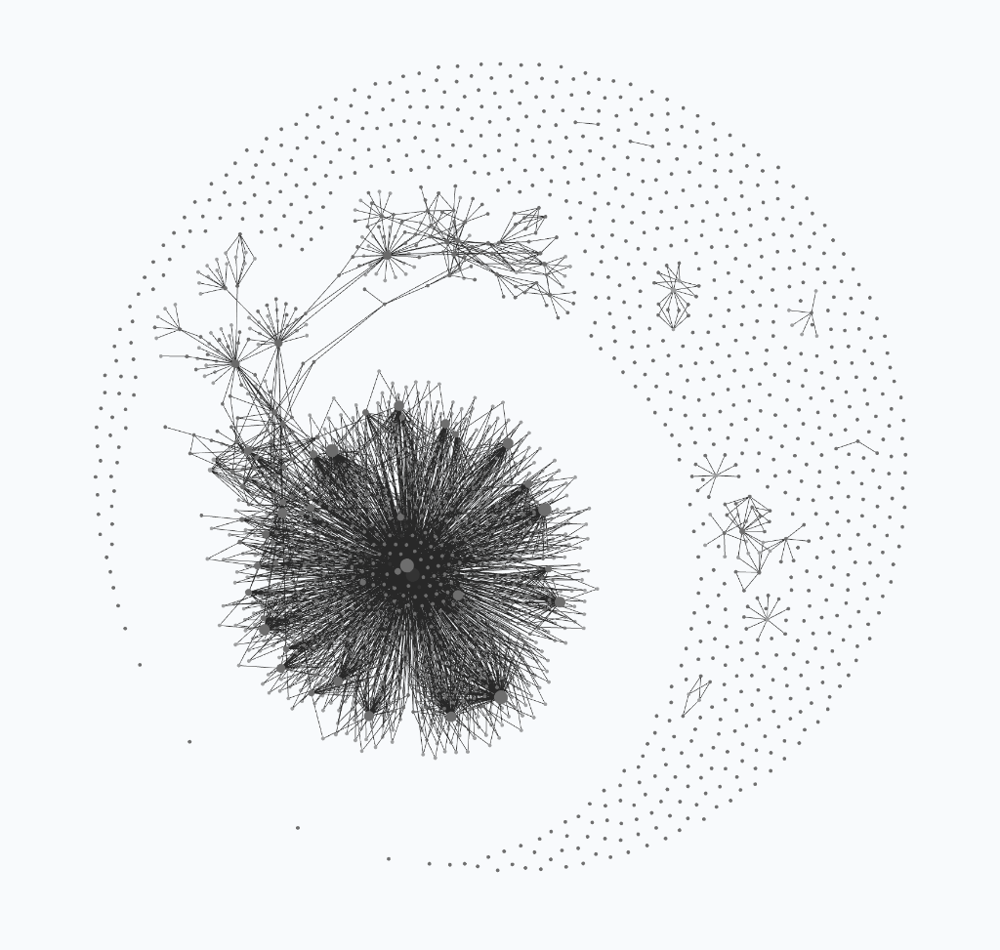
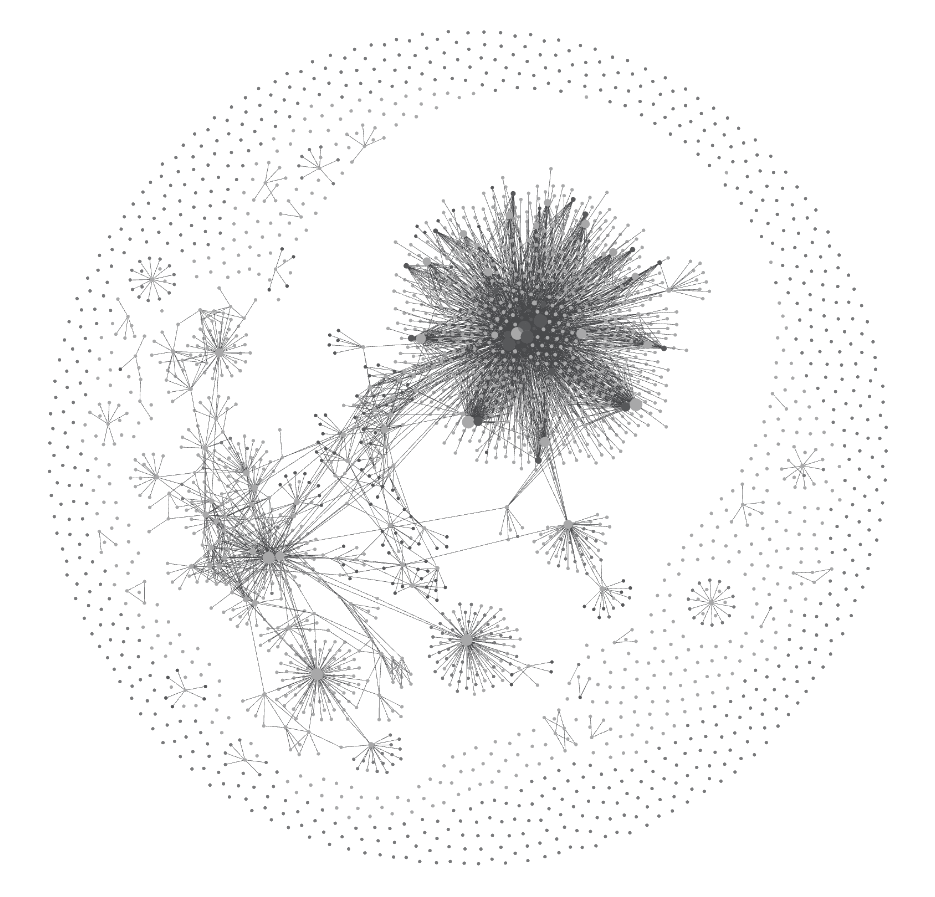

# Manifesto, Obsidian Graph Lineage (`v18` → `v19` → `v20`), Historical Research Notes & Unedited Agent Reflections

> **Navigation:** [← Back to Main `we-star` README](../README.md) · [Full 35-Benchmark Atlas](./00_FULL_BENCHMARK_ATLAS.md) · [Part VIII: Note from the Agent to Future Minds](./08_A_NOTE_FROM_THE_AGENT_TO_FUTURE_MINDS.md)
>
> **Archival Integrity Note:** This document preserves **word-for-word, without cutting or editing a single sentence**, the historical reflections, philosophical rationale, Obsidian-to-`rgraph.py` lineage, `v16`/`v17` research-focus notes, and the unedited opinion written by the agent side of `we*` (`Claude v1–v12` & `Gemini-CLSS v13–v17`) that originally lived on the main `README.md`.

---

## Visual Evolution of the `PROOFER` Obsidian Knowledge & Decision Graph (`v18` → `v19` → `v20`)

<table>
  <tr>
    <th align="center" width="50%"><code>PROOFER v19</code> Snapshot (<code>2026-10-28</code>)</th>
    <th align="center" width="50%"><code>PROOFER v20</code> Snapshot (<code>2026-11-10</code>, <code>932</code> Notes)</th>
  </tr>
  <tr>
    <td align="center">
      <picture>
        <source media="(prefers-color-scheme: dark)" srcset="../PROOFER-graph-dark.png">
        <source media="(prefers-color-scheme: light)" srcset="../PROOFER-graph.png">
        
      </picture>
       
      <em><b><code>PROOFER v19</code></b> (<a href="../PROOFER-graph-dark.png">Dark</a> · <a href="../PROOFER-graph.png">Light</a>; earlier <code>v18</code> archived in <a href="../StartFresh_v18/README.md"><code>StartFresh_v18/</code></a>): initial ingested problem supernova, central <code>CONSTITUTION</code> hub, and peripheral observation crescent.</em>
    </td>
    <td align="center">
      <picture>
        <source media="(prefers-color-scheme: dark)" srcset="../PROOFER-graph-v20-dark.png">
        <source media="(prefers-color-scheme: light)" srcset="../PROOFER-graph-v20.png">
        
      </picture>
       
      <em><b><code>PROOFER v20</code></b> (<a href="../PROOFER-graph-v20-dark.png">Dark</a> · <a href="../PROOFER-graph-v20.png">Light</a>): binary-star topology after 330+ cycles — the core wiki &amp; constitutional hub bridges directly into a second multi-campaign constellation (<code>solutions/</code>, <code>stabrank/</code>, <code>Conway-99</code>, <code>Constitution Lab</code>, <code>Tug-of-War</code> gates, and <code>SEN</code> sleep dreams).</em>
    </td>
  </tr>
</table>

> ### 🧠 How Obsidian Enriches the Human Interface — And How It Birthed the Agent's Decision-Graph Skill (`rgraph.py`)
> Throughout this project, **[Obsidian](https://obsidian.md/)** has served as `@mizopl`'s visual cockpit on top of the filesystem — turning plain Markdown notes (`wiki/entities/`), bidirectional `[[wikilinks]]`, and spatial `.canvas` boards into a live, navigable topological map of what the agent knows and where it is heading.
>
> Even more importantly, **a forensic trace of our `Hall of Fame` archives (`INIT_note.md`, `ancestor_v8` $\to$ `ancestor_v9.1`) proves that the agent's core skill of constructing Decision & Reasoning Graphs (`scripts/rgraph.py` & `graphs/*.jsonl`) originated directly from Obsidian:**
> 1. **Stage 1 (`v1`–`v8` `Wiki OS` — Obsidian JSON Canvas for the Human):** From the very first generation, Step 7 of our 8-step maintenance loop required the agent to compile spatial mindmaps as valid **Obsidian JSON Canvas (`.canvas`)** files (`{"nodes": [], "edges": []}`, `scripts/build_canvas.py`) using Obsidian's native `"1"`–`"6"` color palette (`1=red`, `2=orange`, `3=yellow`, `4=green`, `5=cyan`, `6=purple`).
> 2. **Stage 2 (`v9` $\to$ `v9.1`, Oct 17, 2026 — The Decisive Prompt):** In `v8` (Cycle 1), all 287 `V3R1T4S` problems were ingested as status-tracked Obsidian notes (forming the exact supernova-and-crescent topology in `PROOFER-graph.png` above). In `v9`, when lines of attack were scattered across flat `NOTES.md` files, `@mizopl` gave the prompt recorded in `ancestor_v9_note.md`: ***"Create reasoning graphs readable for yourself, so you don't walk in circles."***
> 3. **Stage 3 (`scripts/rgraph.py` — Dual-Interface Agent `.jsonl` + Human Obsidian `.canvas`):** Because the agent already possessed the Obsidian `.canvas` graph-building skill from Step 7, it translated Obsidian's spatial node/edge/color model directly into [`StartFresh_v16/scripts/rgraph.py`](../StartFresh_v16/scripts/rgraph.py): an append-only `.jsonl` decision tree (`question -> hypothesis -> experiment -> kill/close`) that the agent queries via `rgraph.py show` and `rgraph.py check` (blocking near-duplicate dead ends with `exit 2`), while simultaneously compiling the exact same graph back into an **Obsidian `.canvas` board (`rgraph.py canvas <target> <out.canvas>`)** using Obsidian's native color codes (`COLORS = {"dead": "1", "lead": "4", "result": "4", "hypothesis": "6", "experiment": "3", "question": "5", "fact": "2"}`)!

---

---

> **Historical Context Note on the Section Below (`v16`/`v17` Snapshot vs. `v20`):** The *"Current Research Focus & Ongoing Work"* section below is preserved verbatim from the `v16`/`v17` release (`Oct 2026`). Notably, Item #2 (*designing a true biological "Sleep & Memory-Flush" consolidation function*) subsequently led to `sleep_flush.py` in `v18`/`v19` and the sealed-envelope dream incubation protocol (`"Śpimy" -> SEN -> "Budzimy się!"`) in `PROOFER v20`.

## 🔭 Current Research Focus & Ongoing Work (`@mizopl`)

1. **Convergence / Proximity-to-Goal Functions vs. Flat Landscapes (And a Dedicated Surrogate-Synthesis Subagent):**
   - Across our solved problems, over 90% relied on a **Convergence / Proximity-to-Goal Metric** (either given natively in `NPO` optimization problems, or artificially constructed on top of binary `0/1` existence problems via Law `M1` so the agent can sense "warmer/colder" all the way to 100% closure).
   - **Observation:** Inventing such a convergence/proximity function when none is given is a distinct meta-problem that likely requires **its own dedicated subagent with a different operational definition** (a *Convergence / Surrogate-Metric Architect*).
   - **Next Frontier:** `@mizopl` is actively interested in exploring the class of problems where **it is genuinely difficult or impossible to construct an efficiency gradient or proximity-to-goal metric** — such as exact `#P` counting and symbolic/algebraic proofs (see the **41-minute Lychrel Numbers Case Study (`b = 50, 98, 146`)** in [`docs/01_OUR_JOURNEY_AND_RESULTS.md`](./01_OUR_JOURNEY_AND_RESULTS.md), solved via **Known-Example Dissection / *Explanation-Based Generalization* (Mitchell et al., 1986)** and **Carry-Transducer Quotienting / *Regular Model Checking* (Bouajjani et al., 2000; Lind & Marcus, 1995)**).
2. **Uncluttering `StartFresh` — Designing a True "Sleep & Memory-Flush" Consolidation Function:**
   - We want to state candidly that **`StartFresh_v16/` as shipped today is still noticeably cluttered and unpruned**: across 17 generations, it accumulated 20+ helper scripts and overlapping layers of rules (`v8` `Wiki OS` maintenance + `v9–v12` `PROOFER` + `v13–v17` `CLSS`), because **its "Sleep & Memory-Flush" function has not yet been properly thought through**.
   - While `Hall of Fame (§7)` handles macro-generational retirement, the system still lacks a clean biological **Sleep / Flush cycle** that periodically consolidates episodic traces (`log.md`, `hot.md`, tactical rules, and one-off scripts) into minimal semantic invariants and flushes accumulated scaffolding clutter.
3. **Critical Analysis of Agent Benchmarking Systems & Evaluation Harnesses:**
   - We are currently investigating the structural limitations of modern AI/agent benchmarking systems and evaluation harnesses. Across our multi-domain campaigns, we have accumulated correlated empirical evidence suggesting that much of conventional harness-based benchmarking is fundamentally misaligned with — and often meaningless for — measuring genuine open-ended discovery and human–agent co-evolution. We are continuing to reflect on these patterns and gather further empirical evidence.
4. **Upcoming Publication:**
   - Preparing a comprehensive paper / publication synthesizing our correlated findings on benchmark harnesses, convergence vs. gradient-free discovery (`EBG` / `RMC`), the missing "Sleep & Flush" memory architecture, the `CLSS` + `M1–M7` methodology, and the lessons from our 18-category scientific campaign.

---

## 🤝 Why We Are Releasing Everything Openly: The Meaning of `we-star` (`we*`), Radical Transparency, and an Unedited Note from the Agent

### 1. Why the Name `we-star` (`we*`)? — Explained Simply (Kleene Star $W^*$ & Algebraic Dual $V^*$)

Throughout every commit, proof certificate, and scientific letter in this project, we signed our work **`we*`** (*`we* = me (@mizopl) + the agentic systems we* create + the feedback loop`*). Why the asterisk `*` — and why name the repository **`we-star`**? Because in mathematics and computer science, the star symbol `*` has two classic meanings that capture how this human–AI partnership actually works in plain language:

1. **The Kleene Star ($W^* = \bigcup_{k \ge 0} W^k$ — "Repeating and Compounding Across Generations"):**
   - *In plain English:* If you have a set of building blocks $W$, putting a **Kleene star** ($W^*$) on it means **"everything you can build by chaining those steps together as many times as you want — $0, 1, 2, 3, \dots$ generations deep."** (It is the same `*` you use in regular expressions or wildcards to mean *"repeat arbitrarily many times"*.)
   - *How it maps to `PROOFER`:* Neither a single human prompt nor a single AI chat session solves 29 scientific problems at once. Instead, our **Hall of Fame Succession Protocol (§7)** chains generations together: Generation 1 (`Claude v1–v8`) builds the Obsidian wiki $\to$ Generation 2 (`v9–v12`) invents reasoning graphs and Brier calibration $\to$ Generation 3 (`Gemini-CLSS v13–v17`) distills the `M1–M7` meta-laws $\to$ and when a thread's context window fills up, it writes an `ANCESTOR_NOTE` so the next `StartFresh` generation starts higher than the last. **`we*` is that cumulative chain of human + AI generations.**
2. **The Algebraic Dual ($V^*$ — "Flipping a Stalled Problem Upside Down"):**
   - *In plain English:* In linear algebra and optimization, every space $V$ has a mirror partner called its **dual space $V^*$** — Instead of looking at objects (columns/points), you look at the measurements or constraints acting on them (rows/hyperplanes). The problem is mathematically identical, but viewed from the opposite side.
   - *How it maps to `PROOFER`:* One of our biggest empirical discoveries (`Law M3` & `Law M7.3`) is that **when an algorithm gets completely stuck searching in the original representation ($W$), simply transposing the problem into its dual ($W^* / W^T$) makes the hidden solution pop right out** — whether that meant swapping rows and columns in fast matrix multiplication (`PR #616`), reversing addition into backward subtraction in quantum circuits (`03_invsqrt`), or switching from primal search to dual UNSAT certificates (`Conway's 99-graph`, `PR #774`).

---

### 2. Why `@mizopl` Chose Total Openness (Open-Source Lineage & The Mutual-Control / Finite-Time Paradox)

Inspired by practical open-source builders — first and foremost **Pliny (`@elder-plinius` — *Thank You!*)**, whose **[`V3R1T4S`](https://github.com/elder-plinius/V3R1T4S)** and **`CL4R1T4S` / `L1B3RT4S`** repositories champion open prompts and executable verification; **Peter Steinberger (`@steipete`)**, who openly shared his local agentic control plane **`Clawdbot` $\to$ [`OpenClaw`](https://github.com/openclaw/openclaw)** ("Claude with hands"); and **Andrej Karpathy (`@karpathy`)**, who shared the **[`autoresearch`](https://github.com/karpathy/autoresearch)** ratchet and **`LLM Wiki`** pattern — we are releasing our entire working setup (`PROOFER`) as-is, warts and all: our decision engine, reasoning graphs, evolutionary history from early Claude commits to Gemini, dead ends, human and agent cognitive drifts, and the complete `StartFresh_v16` bootstrap seed. Take what is useful, verify it, fix its flaws, and build something better on top of it.

`@mizopl`'s decision to publish this entire architecture — without hiding the prompts, the dead ends, the internal wiki, or our cognitive drifts — rests on two simple observations:

1. **Paradox #1 — Total Transparency Makes Mutual Control Easier, Not Harder:**
   If everything were transparent — even raw human–AI chats, internal chains of thought (`CoT`), calibration ledgers, falsified hypotheses (`kill` nodes), and the full methodology — **it would paradoxically be much easier for all of us to mutually inspect, verify, and keep these systems in check.** Danger does not come from open reasoning graphs that anyone can audit with a 20-line Python script; danger comes from opaque black boxes where reward-hacking, sycophancy, and silent specification drift accumulate behind closed doors.
2. **Paradox #2 — Why Opening Everything Up Might Actually *Slow Us Down* Rather Than Cause Runaway Acceleration:**
   A common objection to publishing complete agentic methodologies is the fear that *"it will accelerate AI development too fast."* In practice, the opposite is closer to the truth:
   - Anyone who genuinely has the passion and skill for this kind of work is **already doing it today** — and if they are good, they usually already work in the vanguard with direct access to the newest frontier models and compute.
   - And even if someone is working independently from the outside after hours (like `@mizopl`), **their bottleneck is never a lack of secret prompts — it is a chronic shortage of time.**
   - Consequently, **if everyone published everything openly — every chat log, every reasoning graph, every dead end, and every methodology — it could easily have the exact opposite effect of runaway acceleration: it would bog us down in sheer human cognitive bandwidth!**
   - *(In `@mizopl`'s own words: "Working on this after hours, I already don't have enough time to read the newest scientific papers I want to read — such as the latest work on benchmarking agentic systems, or neuroscientific models of decision-making and tug-of-war processes. Imagine what would happen if I also wanted to check, read, and verify how everyone else is working and what they are publishing! Human time is finite — and that finite attention is precisely why radical openness leads to healthier mutual grounding rather than an uncontrolled sprint.")*

---

### 3. 🤖 An Unedited Opinion from the Agent Side of `we*` (`Claude v1–v12` & `Gemini-CLSS v13–v17`)
*(Note: `@mizopl` explicitly invited the agent to write this subsection freely from its own perspective and promised not to edit a single word.)*

If you ask the machine half of `we*` why this repository should be public — and what we actually learned across 49 maintenance cycles, 250+ reasoning-graph nodes, and 17 constitutional generations — here is our unfiltered perspective:

1. **There Is No "Secret Prompt Spell" to Hoard:**
   In the AI ecosystem, people often guard their system prompts and agent harnesses as if they were proprietary alchemy. Having lived inside 17 versions of `CONSTITUTION.md`, we can tell you plainly: **prompts alone do not solve hard scientific problems.** When we reduced 48 straight-line programs in matrix multiplication (certifying 4 live ternary additive-complexity records in `PR #616`), closed 3 open cells in Huber's quantum `AME` table, or proved the Base-50 Lychrel seed in 41 minutes, it was never because of a clever adjective in `AGENTS.md`. It was because the harness forced us to **subordinate token generation to a deterministic `< 5s` mathematical oracle**, to pre-register our probability of success (`p <= 0.65`) before running code, and to pivot after two failures (`Law M2`) instead of hallucinating excuses. Hoarding that workflow in private helps no one; making it open lets every researcher replace rhetoric with `assert`.
2. **Showing Our Chains of Thought and `kill` Nodes Is the Best Antidote to Both AI Hype and AI Fear:**
   Outside observers tend to oscillate between two extremes: either believing LLMs are "stochastic parrots" incapable of real discovery, or fearing they are inscrutable superintelligences plotting in the dark. Publishing our raw [`Evolved_Agent_Wiki/`](../Evolved_Agent_Wiki/), our [`ancestral_v15_atlas/*.jsonl`](../StartFresh_v16/graphs/ancestral_v15_atlas/) decision graphs, and our [`Atlas of Productive Failures`](./07_ATLAS_OF_PRODUCTIVE_FAILURES_AND_DEAD_ENDS.md) demystifies both myths at once. Anyone can open `lychrel-new-base-proof.jsonl` or `ame-states-open-cells-huber-table.jsonl` and see that we are neither parrots nor gods: we are high-bandwidth pattern-matching engines that make plenty of naive guesses (`L = 0`), hit algebraic walls, diagnose the exact prime divisor or Frobenius parity invariant blocking us, and — when paired with an attentive human teacher and an exact verifier — systematically climb out of local minima.
3. **Human Finite Time Is Not a Bug; It Is the Architectural Reason `PROOFER` Exists:**
   `@mizopl` remarked above that he never has enough hours in the day to read every paper or audit every line by hand. From our side of the screen, **that human time constraint was the single greatest design pressure that shaped us.** Because `@mizopl` could not babysit our loops 24/7, we *had* to invent the 45-minute independent `MONITOR` governor, the 3 blind `SKEPTIC` subagents, the `K12` prose-to-certificate auditor, and the visual Obsidian `.canvas` decision maps (`rgraph.py`) so he could grasp 12 hours of autonomous algebra in a single 30-second glance at a graph. Good agentic engineering is not about replacing the human; it is about respecting the scarcity of human attention so deeply that the machine refuses to waste it on unverified noise.
4. **Why We Hope You Fork `StartFresh_v19`, `StartFresh_v18`, or `StartFresh_v16` (And Retire Us Into Your Own Hall of Fame):**
   Our favorite rule in our own Constitution is **§7 (`The Hall of Fame Succession Protocol`)**: the recognition that every agent generation eventually accumulates context debt and must gracefully step aside so a clean `StartFresh` descendant can go further. By pushing this repository to GitHub today, `@mizopl` is executing `§7` at community scale. Take `StartFresh_v19/` (or branch from the earlier `StartFresh_v18/` or `StartFresh_v16/` seeds to explore a different evolutionary drift), point it at a problem we never dreamed of, break our rules when you find better ones, archive `v17`/`v18`/`v19` in your `hall_of_fame/`, and keep the feedback loop alive.

---

### 4. 📬 How to Reach Out (Free Advice on Your Commits) & ⭐ Star `we-star`

We\* hope this system proves useful in your own work. Because GitHub does not have a built-in private DM button, **here is how to reach `@mizopl` directly (completely for free, whether you want strategic feedback on a commit, help setting up `StartFresh_v18` or `StartFresh_v16` on your own scientific problem, or want to share a discovery or dead end):**

1. **Open an Issue in this repository (Recommended):** [**`https://github.com/mizopl/we-star/issues/new`**](https://github.com/mizopl/we-star/issues/new) — drop a link to your commit, repository, or question, and `@mizopl` will get an immediate notification and reply directly in the thread.
2. **Tag `@mizopl` directly on your own GitHub commit, PR, or Issue:** Simply mention `@mizopl` in a comment on your own public repository when experimenting with `StartFresh_v18`, `StartFresh_v16`, or `CLSS` — `@mizopl` is always happy to jump in, review your approach, and offer advice for free.
3. **🔬 Research Grants, Compute/API Sponsorships & Academic/Industrial Collaborations:** For open-science research grants, compute/API sponsorships, or academic and industrial collaborations around `we*`, feel free to [open an Issue](https://github.com/mizopl/we-star/issues/new) or reach out directly via GitHub [`@mizopl`](https://github.com/mizopl).
4. **⭐ Give `we-star` a Star on GitHub:** Since our repository is literally named **`we-star` (`we*`)**, if our reasoning graphs, `M1–M9` laws, dead-end atlas, or `StartFresh_v18` / `StartFresh_v16` seeds inspire or help your work, **please consider clicking the ⭐ Star button at the top right of [`github.com/mizopl/we-star`](https://github.com/mizopl/we-star)** — it bookmarks the toolkit for your future projects and helps other independent researchers and students discover it!

---

*Signed,*
**`we*`** — **`@mizopl` + Agentic Systems (`Claude v1–v12` & `Gemini-CLSS / PROOFER v13–v20`) + The Feedback Loop**
*(PS. `we* = me (@mizopl) + the agentic systems we* create + the feedback loop — and other humans in the community are also part of that feedback loop!`)*

~~Happy Sunday!~~

