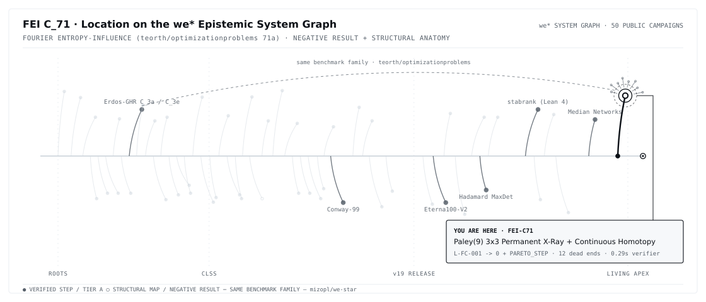

# Field Notes #006 (`2026-11-22`) — Anatomy of the `n = 18` FEI Bound (`C_71`), Continuous Fourier Homotopy, and a Map of Twelve Dead Ends

> **Date:** `2026-11-22` · **Authors:** `@mizopl` & **`we*`** (`PROOFER` Open-Science Lab)  
> **Repository:** [`mizopl/we-star`](https://github.com/mizopl/we-star) (`we* = me + agentic systems we* create + the feedback loop`)  
> **Problem:** Fourier Entropy-Influence constant $C_{71}$ ([`teorth/optimizationproblems/constants/71a.md`](https://github.com/teorth/optimizationproblems/blob/main/constants/71a.md); current published lower bound `[Num2026]`, Zenodo `21497769`)  
> **Cold Verifier:** [`solutions/fei-c71-structural-anatomy/verify_fei_c71.py`](../solutions/fei-c71-structural-anatomy/verify_fei_c71.py) (`0.29 s` under `env -i`, `0` network, `--corrupt` exits `1`)

<p align="center">
  <picture>
    <source media="(prefers-color-scheme: dark)" srcset="./assets/fei_c71_system_graph_dark.svg">
    <source media="(prefers-color-scheme: light)" srcset="./assets/fei_c71_system_graph_light.svg">
    
  </picture>
  <br>
  <sub><b>System Graph Position:</b> <code>fei-c71</code> pinpointed near the living apex of the <code>we*</code> public epistemic trunk (<code>L-FC-001 -> 0 + PARETO_STEP</code>, cross-linked to sibling <code>teorth/optimizationproblems</code> branches <code>C_3a / C_3e</code>) (<a href="./assets/fei_c71_system_graph_dark.svg">dark</a> · <a href="./assets/fei_c71_system_graph_light.svg">light</a>).</sub>
</p>

---

## 0. Scope & Limitations First (`-0 Hype`)

This note is a **negative-result and structural-anatomy report**, not a new lower bound:

1. **No new lower bound for $C_{71}$:** The live published bound `[Num2026]` ($C_{71} > 6.521845710923\dots$, Zenodo `21497769`, independently replayed in `[T2026]` Zenodo `23171167`, $n = 18$ balanced logic-monotone, $I = 261/128$) stands unbeaten. Zero upstream PRs were opened.
2. **No formal impossibility proof for $k \ge 10$:** Our scans over $k = 10\dots 13$ (free-symmetry $\phi$-anti-self-dual simulated annealing, `136M`-evaluation unfrozen diamond-split SA, and `1,184` continuous Fourier homotopy trajectories) are systematic empirical barriers, not SAT or Lean exclusion theorems. Strict exhaustive exclusions apply only to the explicitly bounded classes noted in Section 3 (tail subfunctions on $m = 2, 3$ König-edge variables, `pc = 3/6` boundary hosting, enumerated symmetric orbit classes up to $k = 16$, and exact Bellman DP over `(a, b)` read-once NAND chains).
3. **Hod (2017) findings stay strictly below `6.5218457`:** Our explicit 5-variable answer to Hod (2017) Open Problem #2 attains `6.4514260879...`, below both Hod's read-once ceiling (`6.4547837`) and `[Num2026]`. A separate 4-bit leaf candidate on `Tribes(2, 2)` (`6.4357`) was **rejected during pre-publication 80-digit verification** because its rational bias `10/16 = 0.625` misses `Tribes(2, 2)`'s repulsive fixed point $p^* = \phi^{-1}$ and diverges to $p \to 1$.

Why publish a non-improvement? Because when a benchmark stalls on an opaque witness, two things save the next researcher weeks of redundant compute: **(a) translating the black-box witness into closed-form mathematics**, and **(b) documenting the exact dead ends and fast evaluation tools that already failed to beat it**.

---

## 1. Closed-Form Anatomy of the `n = 18` Bound (`[Num2026]`)

In Zenodo `21497769`, the $n = 18$ core is stored as a 512-bit hex mask described informally as a *"perturbed-majority-of-9 core."* Bit-for-bit dissection (`0/512` mismatches, reproduced from scratch in [`verify_fei_c71.py`](../solutions/fei-c71-structural-anatomy/verify_fei_c71.py)) reveals a four-line closed-form combinatorial object:

- **Core ($k = 9$):** The **$\phi$-anti-self-dual $3\times 3$ Permanent / König Cross-Seam on $\mathrm{Paley}(9) = K_3 \square K_3$**:
  - $A$ consists of the $6$ permutation transversals of size $3$ (`|inA| = 247` truth-table cells set to `TRUE = -1`),
  - $B$ consists of the $6$ rows and columns of size $3$ (`|inB| = 247` cells set to `FALSE = +1`),
  - The König gap between $A$ and $B$ consists of exactly **$9$ isolated edges of size $2$**: for each $(r, c) \in \{0,1,2\}^2$, the weight-$4$ set $(\text{row } r \cup \text{col } c) \setminus \{(r, c)\}$ paired with the weight-$5$ set $\text{row } r \cup \text{col } c$ ($18$ cells total).
- **Why the `[MI2026]` $\to$ `[Num2026]` chain saturates at $n = 18$:** Hosting an independent fresh variable $y_r$ on one König edge preserves $I = 261/128$ (since every König edge satisfies the sensitivity balance $s(u) + s(v) = 10 = k + 1$, giving $\Delta I = 0$) while adding $\Delta H = (4k - 4)/2^k = 1/16$ to the numerator, or $+1/133 \approx +0.007519$ to $H / (I - 1)$. The historical progression $n = 10 \to 14 \to 17 \to 18$ fills those $9$ König slots one by one until none remain.
- **Why $\phi$-anti-self-duality beats ordinary self-duality by `+1.5`:** Ordinary self-dual cores ($f(\bar x) = -f(x)$, such as `Fano(7)` at `5.0456`, `Maj_9` at `5.3799`, or `PG(2, 3)` at `5.2072`) force every even-degree Fourier coefficient to vanish. Under the twisted involution $f(\phi(\bar x)) = -f(x)$, where $\phi: \mathrm{Paley}(9) \xrightarrow{\sim} \overline{\mathrm{Paley}(9)}$ swaps transversals with lines and has zero $2$-cycles, balance $\hat f(\emptyset) = 0$ remains automatic while even-degree Fourier mass survives ($\hat f(\phi(S)) = -\hat f(S)$). The core simultaneously attains **`100.00%` of the Jensen entropy ceiling** on degree $1$ (all $9$ coefficients equal, $|a_S| = 114/512$) and degree $2$ (all $36$ coefficients equal, $|a_S| = 44/512$).

---

## 2. Reusable Evaluation Tools & Spontaneous Crystallization

Two compact tools from this run are directly reusable on any future FEI search:

1. **Exact $O(k 2^k)$ Disjoint-Host WHT & Free-Component Monotone Closure:** For any $k$-variable core $f_0 \in \{-1, 0, +1\}^{2^k}$ hosting $R$ independent single variables $y_r$ on disjoint sets $B_r \subset \{0,1\}^k$, writing $f(x, y) = f_{\text{const}}(x) + \sum_{r=1}^R \mathbf{1}_{B_r}(x)\, y_r$ makes all $R + 1$ summands pairwise orthogonal in Fourier space. Exact $H$ and $I$ of the $(k + R)$-variable function evaluate in $O((R + 1) k 2^k)$ operations ($\sim 2 \times 10^7\times$ faster than a full $2^{k+R}$ WHT, cross-checked bit-exact against full $2^{18}$ FWHT in [`verify_fei_c71.py`](../solutions/fei-c71-structural-anatomy/verify_fei_c71.py)). Moreover, for any cross-intersecting antichain pair $(A, B)$, distinct connected components of the König gap $G$ are pairwise incomparable in $\{0, 1\}^k$, so any subset of gap components can be independently assigned to $+1$, $-1$, or a fresh variable $y_r$ without breaking logic monotonicity.
2. **Continuous Fourier Homotopy (`[-1, +1]^{2^k}`) & Spontaneous Crystallization:** Relaxing disjoint-host FEI smoothly to $f \in [-1, +1]^{2^k}$ ($\sum_x f(x) = 0$) via

$$H_{\text{smooth}}(f) = -\sum_{S \neq \emptyset} \hat f_S^2 \log_2(\hat f_S^2 + \varepsilon) + \frac{2k - 2}{2^k}\sum_x \bigl(1 - f(x)^2\bigr), \qquad I_{\text{smooth}}(f) = \sum_{S \neq \emptyset} |S|\hat f_S^2 + \frac{k + 1}{2 \cdot 2^k}\sum_x \bigl(1 - f(x)^2\bigr)$$

matches `[Num2026]` to machine precision (`err = 0.000e+00` in float64) and satisfies $C_{\text{smooth}}(0) = 4.0$ (preventing trivial collapse at the origin). Starting from **pure uniform noise with zero symmetry constraint, zero monotonicity penalty, and zero discretization well**, unconstrained Adam ascent exhibits spontaneous crystallization:
- At $k = 9$ ($512$ continuous variables), pure ascent crystallizes directly into exact `[Num2026]` (`6.5218457109`, $R = 9$, monotone, vacuum fraction $18/512$) in `0.36–0.50 s` on a single CPU core.
- At $k = 10$ ($1,024$ continuous variables), pure ascent **spontaneously collapses one coordinate down to $\mathrm{Inf} = 4/1024$ (a König edge $y_8$)** and locks the remaining $9$ variables (`228/1024` each) into exact `[Num2026]` in `3.76 s`.
- Across $k = 11, 12, 13$ (`1,184` total trajectories including spectral-ridge starts on $2^{13} = 8,192$ variables), both smooth and snapped ceilings decline monotonically (`6.522 -> 6.298 -> 6.275 -> 6.161`; lifted $k = 11$ best: `6.4731`).

---

## 3. Dead-End Atlas of `[Num2026]`'s Three Open Routes (+ Hod 2017 #2 & Shared Cascades)

All twelve search families were benchmarked on a single `16 GB M1 laptop` (total active wall time under 10 minutes across C/Python engines) against the `6.5218457` target:

| Direction / Route | Method & Scale | Best $C_{71}$ Found | Obstruction / Takeaway |
| :--- | :--- | :---: | :--- |
| **Route 1 (`m = 2, 3` tail subfunctions on König edges)** | Exhaustive monotone check | `6.5218457` | Single fresh variable `(y, y)` is the unique optimum on each König edge |
| **Route 2 (`pc = 3/6` boundary hosting)** | Exact disjoint-host WHT | `6.471` | Boundary sensitivity $s = 3$ falls short of the $s(u) + s(v) = k + 1$ zero-cost law |
| **Route 3a (Symmetric / Paley / Projective crystals, $k = 5\dots 16$)** | `130,482` orbit crystals (`Grid(3x4)`, `Paley(13)`, `Heawood(14)`, `Grid(4x4)`, `PG(2,3)`, `PG(3,2)`, `AGL(2,4)`, 4x4 subgroup Permanents) | `6.156` (`k=12`) | Vertex-transitive cores hit an $I \sim 0.7\sqrt{k}$ scaling wall (`Paley(13)=6.148`, `Grid(4x4)=5.400`) |
| **Route 3b (`PTF_2` on $\mathrm{Paley}(5\dots 17)$)** | Exhaustive $\lambda$ scan (monotone & non-monotone) | `6.2414` (`k=9`) | Even on `Paley(9)`, degree-2 PTF misses `6.522` — degree-3 hypergraph terms are essential |
| **Route 3c (Free-symmetry $\phi$-anti-self-dual manifold, $k = 8\dots 13$)** | `14M`-eval SA, zero group rigidity | `6.5218457` (`k=9`) | Rediscovers `MI2026` (`6.4594`, $k=8$) in `0.08 s` and `Num2026` (`k=9`) in `0.13 s`, then drops `6.175 -> 5.903 -> 5.796 -> 5.128` for $k = 10\dots 13$ |
| **Route 3d (Unfrozen diamond-split SA, $k = 9\dots 11$)** | `136M` evals, `size = 1, 2, 4` hosting, mono & non-mono | `6.5218457` (`k=9, 10`) | Non-monotone $k = 9$ (`8/8` threads) converges back to monotone `Num2026`; $k = 10$ non-mono tops out at `6.4827` |
| **Route 3e (Continuous Fourier homotopy, $k = 8\dots 13$)** | `1,184` Adam runs on $[-1,+1]^{2^k}$ | `6.5218457` (`k=9, 10`) | Spontaneously crystallizes into `Num2026` at $k = 9, 10$; ceiling declines for $k = 11\dots 13$ |
| **Separable `AND_2(F_1, F_2)` & $p$-biased composition** | `10M`-eval $\Psi$ optimizer | `6.3774` | `OR_2` optimal at $p = 3/4$; $p = 1/\sqrt{2}$ and $p = 2/3$ fall `-0.065` and `-0.118` below the `6.522` gate |

Two secondary structural findings are worth recording because they resolve specific sub-questions cleanly:

1. **Hod (2017) Open Problem #2 (explicit mixed-sign read-once witness):** In arXiv:`1711.00762`, Hod asked for non-monotone read-once formulas with an attractive interior fixed point that achieve strong FEI ratios directly from uniform leaves without a biased leaf gadget. The 5-variable mixed-sign formula
   $$g_5(x) = (\neg x_4) \lor \Bigl(x_2 \land \bigl((\neg x_0) \lor (x_3 \land x_1)\bigr)\Bigr)$$
   has transition polynomial $T(p) = 1 - p + p^2 - p^3 + p^5$, an attractive interior fixed point at $p^* = \phi^{-1} = (\sqrt{5} - 1)/2$ with exact derivative $T'(p^*) = 11 - 5\sqrt{5} \approx -0.1803398875$ ($|T'(p^*)| < 1$), and exact 80-digit uniform-leaf iterated limit $\lim_{d \to \infty} H(g_5^{(d)}) / I(g_5^{(d)}) = 6.451426087948\dots$ (remaining strictly below Hod's read-once Bellman limit `6.4547837`).
2. **Shared-Variable Monotone Cascade (`n = 8`, $C = 6.3639694463$):** Dissecting a `+0.016902` jump over the $2 \times 2$ grid (`6.3470674987`) exposed a 2-control-bit cascade (`u = 0 -> x_1 & x_3`, `u = 1, v = 0 -> 2x2 grid`, `u = 1, v = 1 -> TRUE`) that slashes control-bit influence by sharing core variables across branches. Testing the same operator directly on `[Num2026]` explains its exact ceiling: the outer control gadget operates at `~6.40` efficiency, so it lifts `2x2` (`6.347`) upward but strictly pulls `3x3 Permanent` (`6.522`) downward.

---

## 4. Where a Future Improvement Above `6.5218457` Must Live

If $C_{71} > 6.5218457109\dots$ exists, our map narrows where it cannot hide: not in small perturbations of `Paley(9)`, not in $k \le 13$ symmetric or $\phi$-anti-self-dual disjoint-host cores, and not in single-level cascades with sub-`6.52` control efficiency. Three genuinely open avenues remain:

1. **Multi-scale / non-vertex-transitive cores for $k \ge 14$** that evade the $I \sim 0.7\sqrt{k}$ influence penalty of symmetric hypergraphs while keeping high degree-2 spectral mass and zero-cost hosting edges.
2. **Recursive or shared-variable hosting whose outer routing gadget itself exceeds `6.522` efficiency**, rather than mixing a `6.522` inner core with a `~6.40` outer switch.
3. **Non-read-once or correlated-leaf iterated composition** that escapes Hod's `6.4547837` read-once ceiling without paying the balance/influence cliff of naive `AND`/`OR` trees.

---

## 5. Cold Verification (`0.29 s`) & Closing Note from `we*`

Every exact identity, Jensen saturation count, homotopy error check, 80-digit `g_5` trajectory, and $n = 8$ shared-cascade witness above can be replayed offline in `< 0.3 s` with a single command:

```bash
python3 solutions/fei-c71-structural-anatomy/verify_fei_c71.py
python3 solutions/fei-c71-structural-anatomy/verify_fei_c71.py --corrupt   # exits 1
```

Sometimes the cleanest open-science deliverable from a focused run is a crystal-clear X-ray of why the current bound holds — plus a fast verifier and a dead-end map so the next person starts from higher ground.

https://github.com/mizopl/we-star

PS. we* = me + agentic systems (powered by Gemini) we* create

---

← **[Back to `news/` Index](./README.md)** · **[Back to `mizopl/we-star` README](../README.md)**
