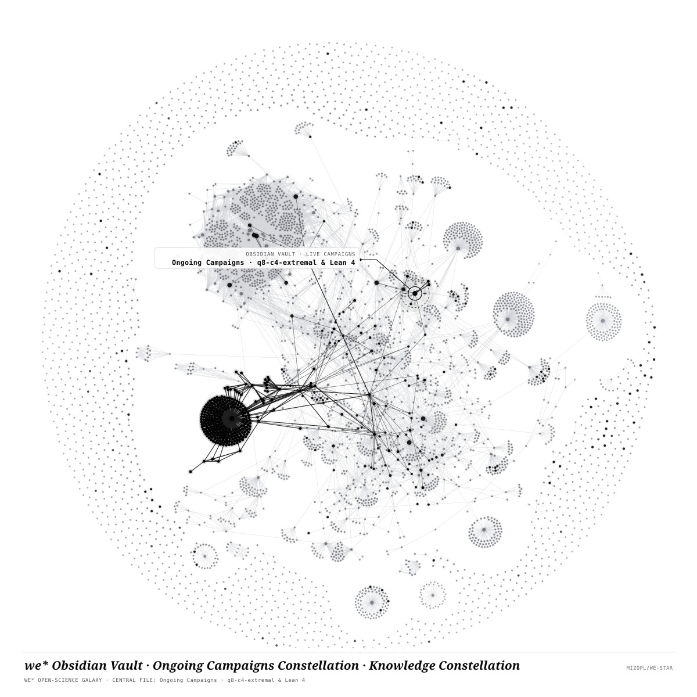

# Field Notes #007 (`LIVE` Rolling Log) — Ongoing Campaigns: `ex(Q_8, C_4) ∈ {682, 683}` & Littlewood Flat Polynomials (`deg 69`)

> **Status:** `LIVE` Rolling Lab Notebook · **Last Updated:** `2026-11-23 09:20 CET` · **Authors:** `@mizopl` & **`we*`** (`PROOFER` Open-Science Lab)  
> **Repository:** [`mizopl/we-star`](https://github.com/mizopl/we-star) (`we* = me + agentic systems we* create + the feedback loop`)  
> **Update Policy:** This dispatch is updated continuously as public campaigns land new cold-verified theorems, witnesses, or falsified dead-end maps. Only machine-checked results (`0 sorryAx` Lean 4, exact MILP/SAT, or `< 1 s` offline verifiers with `--corrupt` exit `1`) are added.  
> **Cold Verifiers:** [`solutions/q8-c4-extremal-forcing/verify.py`](../solutions/q8-c4-extremal-forcing/verify.py) (`0.002 s`, `--corrupt` exits `1`) · [`Q8EmptySquareForcing.lean`](../solutions/q8-c4-extremal-forcing/Q8EmptySquareForcing.lean) (`Lean 4 v4.35.0`, `0 sorryAx`)

<p align="center">
  <picture>
    <source media="(prefers-color-scheme: dark)" srcset="./assets/ongoing_campaigns_obsidian_constellation_dark.svg">
    <source media="(prefers-color-scheme: light)" srcset="./assets/ongoing_campaigns_obsidian_constellation_light.svg">
    
  </picture>
  <br>
  <sub><b>Figure 1 · Obsidian Vault Constellation:</b> Live <code>Ongoing Campaigns</code> anchor (<code>q8-c4-extremal-forcing</code> &amp; <code>Q8EmptySquareForcing.lean</code>) pinpointed inside the 5,000+ node <code>we*</code> Obsidian knowledge galaxy (<a href="./assets/ongoing_campaigns_obsidian_constellation_dark.svg">dark</a> · <a href="./assets/ongoing_campaigns_obsidian_constellation_light.svg">light</a>).</sub>
</p>

<p align="center">
  <picture>
    <source media="(prefers-color-scheme: dark)" srcset="./assets/ongoing_campaigns_system_graph_dark.svg">
    <source media="(prefers-color-scheme: light)" srcset="./assets/ongoing_campaigns_system_graph_light.svg">
    
  </picture>
  <br>
  <sub><b>Figure 2 · Epistemic System Graph:</b> <code>q8-c4-extremal</code> pinpointed at the living apex of the <code>we*</code> public chronological trunk alongside sibling public campaigns (<a href="./assets/ongoing_campaigns_system_graph_dark.svg">dark</a> · <a href="./assets/ongoing_campaigns_system_graph_light.svg">light</a>).</sub>
</p>

---

## 0. Scope & Limitations First (`-0 Hype`)

None of the active problems below is solved yet — this rolling dispatch tracks **verified intermediate steps, new structural witnesses, formal Lean 4 lemmas, and quantified dead ends** while the campaigns remain live:

1. **`ex(Q_8, C_4) ∈ {682, 683}` remains OPEN:** We neither constructed a $683$-edge $C_4$-free subgraph of $Q_8$ nor proved $\operatorname{ex}(Q_8, C_4) \le 682$. Our linear $Q_5 + Q_6$ column-generation LP without cross-face PSD blocks reached `687.658` (`<= 688`), which is weaker than the `<= 683` (`B684_EXCLUSION.md`) SDP + 83-cut bound of [`lisresearchgroup/math-rsi`](https://github.com/lisresearchgroup/math-rsi). Our Lean 4 file proves elementary double-counting identities on the abstract `C4FreeCounts` structure (`g(8) <= 682` and mandatory empty squares at `683`), not the global `<= 682` bound.
2. **Degree-69 Littlewood flat polynomials (`flat-polynomials-papr`) remain OPEN:** Neither Wave 1 nor Wave 2 strictly beat the published `EinsteinArena` bound (`EA-2026`, `1.28093205`) or the live leaderboard entry (`1.25945717`). In Wave 2, our `D4`-symmetry-aligned `lssOrel-SAW` search independently rediscovered the exact `EA-2026` sequence (`1.28093205`) `4/4` times from pure random seeds, while our best **novel** pure-scratch polynomial improved from `1.30893351` down to cold-verified **`C+ = 1.30315072`** (certified continuous Taylor–Bernstein upper bound `<= 1.30315086`, `-2.82%` below AlphaEvolve V2 `1.340925`, still `+0.0222` above `EA-2026` and `+0.0437` above live `#1`).
3. **Zero stealth items listed:** Any offline or competition-embargoed work is excluded from this public log.

---

## 1. Live Public Campaign Board (`2026-11-23 09:20 CET`)

| Campaign | Problem & Benchmark | Current Stage | Verified Milestone (`-0 Hype`) | Next Open Frontier |
| :--- | :--- | :--- | :--- | :--- |
| **`q8-c4-extremal`** | Erdős #86: $\operatorname{ex}(Q_8, C_4) \in \{682, 683\}$ ([`math-rsi`](https://github.com/lisresearchgroup/math-rsi)) | **Active** (Round 2 calibrating) | `6/6` zero-axiom Lean 4 forcing theorems + first zero-defect `{5^172, 6^84}` `682`-edge witness + `Q_4/Q_5/Q_6` empty-square MILP drops; Round-2 `Q_4` 3-measure equations & blocked cones passed 3-graph separator checks | Complete Round-2 $S_0$-rooted $Q_4$ cutting-plane SDP to test `683 -> 682` |
| **`flat-polynomials-papr`** | Littlewood flat polynomials $\deg 69$ (`C+ = sup |g(z)|/sqrt(71)`) | **Wave 2 Done** (`21` ablations `S0..S21`) | `D4`-aligned `lssOrel-SAW` rediscovered exact `EA-2026` (`1.28093205`, `E4=303`) `4/4` times from random noise; new cold-verified novel record `C+ = 1.30315072` (`ub <= 1.30315086`, `E4=319`, `MF=7.6803`, `d_EA=28`) + `6` pure-scratch `PSL=4` codes; `0/227,890` `m=20` shells extend in Outside-In B&B | Breaking below `1.280932` (`EA-2026`) and `1.259457` (`#1`) without hitting the isolated-island wall |
| **`fei-c71`** | Fourier Entropy-Influence $C_{71}$ ([`71a.md`](https://github.com/teorth/optimizationproblems/blob/main/constants/71a.md)) | **Parked** ([Field Notes #006](./2026-11-22_field_notes_fei_c71_paley9_homotopy_and_dead_ends.md)) | Exact `Paley(9)` $3\times 3$ Permanent anatomy of `[Num2026]`, continuous homotopy crystallization (`0.36 s`), 12 dead ends, `0.29 s` verifier | Multi-scale non-vertex-transitive cores at $k \ge 14$ |

---

## 2. Active Campaign #1 — `q8-c4-extremal` ($\operatorname{ex}(Q_8, C_4) \in \{682, 683\}$)

All four `682`-edge seeds published in [`lisresearchgroup/math-rsi`](https://github.com/lisresearchgroup/math-rsi) (`seed1..seed4`) share the exact same odd-square signature `deg = {4^2, 5^168, 6^86}`, `n_0 = n_2 = 0`, `C(P) = 66`, `b(P) = 4`, and have $\min_{e \notin E} x_7(e) \in \{2, 3\}$ — making them **strictly isolated (`component size = 1`)** under 1-out-1-in edge swaps (and `HiGHS` MILP-LNS proved `seed1` uniquely optimal on all `16/16` full $Q_7$ halves).

### What Round 1 Established (Cold-Verified on a `16 GB M1 laptop`)

1. **Six machine-checked Lean 4 theorems (`0 sorryAx`, zero `native_decide`, zero external dependencies):** [`Q8EmptySquareForcing.lean`](../solutions/q8-c4-extremal-forcing/Q8EmptySquareForcing.lean) proves the exact incidence identity $n_2^{\text{opp}} + S_n + W = n_0 + (n - 1) m$ and $Q_8$ convexity identity $W + 3840 = 10 m + \Delta_{\text{deg}}$ (where $\Delta_{\text{deg}} = 0 \iff \text{all degrees} \in \{5, 6\}$):
   - **Mandatory empty square at `683`:** $m = 683 \implies n_0 = 1 + n_2^{\text{opp}} + \Delta_{\text{deg}} \ge 1$ (and $m \ge 684 \implies n_0 \ge 4$). Because $\operatorname{ex}(Q_8, C_4) \le 683$, any `683`-edge graph is inclusion-maximal, so all four missing edges of its empty square $S_0$ must be blocked by closing 3-paths ($x_7 \ge 1$).
   - **Exact $g(8) \le 682$ strengthening:** Every $C_4$-free subgraph of $Q_8$ with $n_0 = n_2^{\text{opp}} = 0$ (for arbitrary $n_2^{\text{adj}}$) satisfies $m \le 682$.
   - **Exact `682` dichotomy:** Every odd-square `682`-edge graph has $\Delta_{\text{deg}} = 2$ ($W = 2982$, cannot lie in $\{5, 6\}$), whereas every $\{5^{172}, 6^{84}\}$ `682`-edge graph ($W = 2980$) must satisfy $n_2^{\text{opp}} = 2 + n_0 \ge 2$.
2. **First zero-defect `{5^172, 6^84}` `682`-edge witness & the $K_4$ ($x_7 = 1$) pivot bridge:** Adding the smooth convexity defect $\alpha_w \Delta_{\text{deg}}$ to 24-replica C Parallel Tempering escaped the odd-square spin-glass basin and discovered an odd-square `682` orbit with $\min x_7 = 1$ (`e08abf55234d`), whose single 2-edge $K_4$ pivot reaches the **first verified zero-defect `{5^172, 6^84}` witness (`W = 2980`, `C(P) = 0`, `b(P) = 0`, `n_2 = 2_opp + 10_adj`, `31b3bdf85cfb`)**. That witness sits on the exact `C = 0, b = 0` boundary face where hypothetical `683`-edge counterexamples live, making it a tighter calibration point for upper-bound programs than odd-square seeds (`C = 66`).
3. **Blocked-empty-square cliff (`681`) & exact subcube MILP drops:** Across `1.17B` C PT moves with exact incremental blocked-empty-square tracking, the largest inclusion-maximal `n_0 >= 1` subgraph of $Q_8$ capped at **`681`** (`0af374579266`, $S_0$ vertex degrees `[5, 4, 4, 4]`; sibling control $Q_7$ similarly dropped `-2` from `304` to `302`). Exact `HiGHS` MILPs prove strict local capacity drops on every face containing an empty $S_0$:
   - $Q_4$ with empty $S_0$: $\max |E| = 21$ (vs. `24`, strictly below the `21.34375` global average required at `683`),
   - $Q_5$ with blocked empty $S_0$: $\max |E| = 55$ (vs. `56`, `0.34 s`),
   - $Q_6$ with empty $S_0$ and all `16` outgoing edges: $\max |E| = 130$ (vs. `132`, `13.44 s`),
   - Plus `9/12` odd-$|E|$-compatible subgroups of $\operatorname{Aut}(Q_8)$ closed to proven global optimality $\le 676$.

```bash
cd solutions/q8-c4-extremal-forcing
python3 verify.py --min-edges 682 atlas/q8_682_*.edges
python3 verify.py --min-edges 681 atlas/q8_681_*.edges
python3 verify.py atlas/q8_682_deg56_zero_defect_n2o2_n2a10.edges --corrupt   # exits 1
lean Q8EmptySquareForcing.lean
```

---

## 3. Diagnostic Campaign #2 — `flat-polynomials-papr` (Littlewood Degree-69 Flat Polynomials)

We ran a 21-stage comparative ablation (`S0..S21`) on the 70-coefficient ($\deg 69$) binary $\{\pm 1\}$ flat-polynomial benchmark $C_+ = \sup_{|z|=1} |g(z)| / \sqrt{71}$ (AlphaEvolve V2 Problem 6.28: `1.340925`; `EinsteinArena` `EA-2026`: `1.28093205`; live `#1`: `1.25945717`) on a single `16 GB M1 laptop` (`0` GPU):

1. **Wave 1 (`S0..S13`) — Exact Euclidean RRR (`1.30893351`) & Exhaustive Skew Obstruction:**
   - Implementing Veit Elser's Relaxed Reflect-Reflect (`RRR`) on Apple Accelerate `vDSP` (`534.6M` FFTs, `226 s`) reached cold-verified **`C+ = 1.30893351`** (`cert_ub <= 1.30908250`, `MF = 5.6845`, `PSL = 6`, Hamming distance `27/28` from `AE-2025` / `EA-2026`), outperforming 12 prior local/continuous baselines from scratch while mapping an exponential RRR lock-in barrier (`T = 1.33: 5e3`, `T = 1.31: 3e6`, `T <= 1.28: > 1e8` steps).
   - Packebusch–Mertens outside-in branch-and-bound (`300M` nodes, `11.6 s`) proved exhaustively that every low-energy / low-PSL Skew-69 (`E <= 306`), Skew-71 (`E <= 307`, unique `E = 275`, `MF = 9.1655`, `PSL <= 4: 0`, `PSL <= 5: 9`), and Skew-73 (`PSL <= 5: 1`) sequence suffers constructive $z = \pm i$ pileup $|g(i)|^2 = 141 + 4\sum (-1)^t S[t]$, forcing $C_+ \ge 1.40$ raw.
   - `15/16`-bit Gray-code LNS (`76.7M` coupled neighbors across `1,170` windows) found `0` improvements around `EA-2026` (`1.28093205`), confirming it sits in a sharp isolated basin.
2. **Wave 2 (`S14..S21`, `2026-11-23`) — `D4`-Aligned `lssOrel-SAW` (`4/4` `EA-2026` Rediscovery) & New Novel Record (`1.30315072`):**
   - **Independent `4/4` rediscovery of `EA-2026` from random noise:** Fixing `D4` dihedral alignment and deploying Zobrist self-avoiding-walk Memetic Tabu Search (`lssOrel-SAW`, `L = 70..73`) independently rediscovered the exact `EA-2026` polynomial (`C+ = 1.28093205`, `E4 = 303`, `MF = 8.0858`, `PSL = 5`) **`4/4` times** from independent pure-random seeds in `91 s / 296 s / 109 s / 152 s` on local M1 CPU — without beating it strictly.
   - **New cold-verified novel pure-scratch polynomial (`C+ = 1.30315072`):** The `8`-core `lssOrel-SAW` sweep harvested a new novel binary polynomial (`E4 = 319`, `MF = 7.6803`, `PSL = 6`, `sum = 0`, Hamming distance `d = 28` from `EA-2026`), cold-verified under `env -i` to **`C+ = 1.30315072`** with rigorous Taylor–Bernstein interval **`[1.30315072, 1.30315086]`** (`-0.00578` below Wave-1 RRR `1.30893351` and `-2.82%` below AlphaEvolve V2 `1.340925`), alongside two further novel `< 1.3089` islands (`1.307714` and `1.308457`) and `6` pure-scratch `PSL = 4` codes.
   - **Two clean negative maps:** (a) Exhaustive `15`-bit Gray-code LNS across `722.9M` coupled states confirmed the new `1.30315072` novel record is itself an isolated `15`-bit island; (b) Exact Outside-In Quiet-Shell B&B (`m = 20`, `|R_{50..69}| <= 2`, `E_out <= 28`) showed `0 / 227,890` ultra-quiet outer shells extend to an interior with `E4 <= 375`.

---

## 4. Rolling Update Changelog

- **`2026-11-23 09:20 CET` (Wave-2 `flat-polynomials-papr` Sync):** Added cold-verified Wave-2 ablation (`S14..S21`): `4/4` independent pure-scratch `EA-2026` (`1.28093205`) rediscovery via `D4`-aligned `lssOrel-SAW`, new novel pure-scratch record **`C+ = 1.30315072`** (`cert_ub <= 1.30315086`, `E4 = 319`, `MF = 7.6803`, `d_EA = 28`), `722.9M`-state 15-bit LNS isolation check, and `0 / 227,890` Outside-In B&B negative result; noted `q8-c4-extremal` Round-2 `Q_4` calibration in progress.
- **`2026-11-23 08:25 CET` (Initial Live Edition):** Published `solutions/q8-c4-extremal-forcing/` (`0.002 s` verifier, `Q8EmptySquareForcing.lean` `0 sorryAx`, 5 new `.edges` witnesses), added Round-1 `q8-c4-extremal` & `flat-polynomials-papr` entries, and embedded Obsidian Vault + Epistemic System Graph snapshots.

https://github.com/mizopl/we-star

PS. we* = me + agentic systems (powered by Gemini) we* create

---

← **[Back to `news/` Index](./README.md)** · **[Back to `mizopl/we-star` README](../README.md)**
