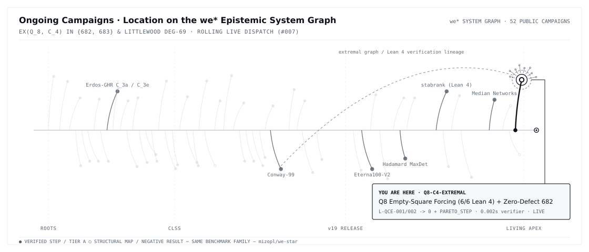

# Field Notes #007 (Complete Archive) — Campaigns: `ex(Q_8, C_4) ∈ {682, 683}` & Littlewood Flat Polynomials (`deg 69`)

> **Status:** Complete Lab Dispatch (Both Campaigns `PARKED`) · **Last Updated:** `2026-11-24 01:45 CET` · **Authors:** `@mizopl` & **`we*`** (`PROOFER` Open-Science Lab)  
> **Repository:** [`mizopl/we-star`](https://github.com/mizopl/we-star) (`we* = me + agentic systems we* create + the feedback loop`)  
> **Update Policy:** Packaged artifacts below (abstract `0 sorryAx` Lean 4 identities, pinned witness files, and `< 2 s` offline verifiers with `--corrupt` exit `1`) are cold-verifiable, while paper algebraic steps (`|δ| >= 5` and the Case 5A reduction) and exploratory LP/PSD or local-search logs are explicitly separated and labeled rather than presented as machine-certified bounds.  
> **Cold Verifiers & Dossier:** [`solutions/q8-c4-extremal-forcing/verify.py`](../solutions/q8-c4-extremal-forcing/verify.py) (`~0.1 s` wall time, Python `>= 3.10`, 10 pinned witnesses + `min_x7` + Degree-Blocking Identity + 14-orbit Case 5A replay, `--corrupt` exits `1`) · [`Q8EmptySquareForcing.lean`](../solutions/q8-c4-extremal-forcing/Q8EmptySquareForcing.lean) (tested on Lean `4.36.0`, `6` axiom-checked theorems on abstract `C4FreeCounts`, `0 sorryAx`) · [`solutions/flat-polynomials-papr/verify.py`](../solutions/flat-polynomials-papr/verify.py) (`< 2 s`, `--corrupt` exits `1`) · [**24-Page Illustrated Dossier (PDF)**](../solutions/flat-polynomials-papr/PROOFER_v19_FLAT_POLYNOMIALS_DOSSIER.pdf)

<p align="center">
  <picture>
    <source media="(prefers-color-scheme: dark)" srcset="./assets/ongoing_campaigns_obsidian_constellation_dark.svg">
    <source media="(prefers-color-scheme: light)" srcset="./assets/ongoing_campaigns_obsidian_constellation_light.svg">
    
  </picture>
  <br>
  <sub><b>Figure 1 · Obsidian Vault Constellation:</b> <code>q8-c4-extremal-forcing</code> &amp; <code>Q8EmptySquareForcing.lean</code> pinpointed inside the 5,000+ node <code>we*</code> Obsidian knowledge galaxy (<a href="./assets/ongoing_campaigns_obsidian_constellation_dark.svg">dark</a> · <a href="./assets/ongoing_campaigns_obsidian_constellation_light.svg">light</a>).</sub>
</p>

<p align="center">
  <picture>
    <source media="(prefers-color-scheme: dark)" srcset="./assets/ongoing_campaigns_system_graph_dark.svg">
    <source media="(prefers-color-scheme: light)" srcset="./assets/ongoing_campaigns_system_graph_light.svg">
    
  </picture>
  <br>
  <sub><b>Figure 2 · Epistemic System Graph:</b> <code>q8-c4-extremal</code> pinpointed at the chronological apex of the <code>we*</code> public trunk alongside sibling public campaigns (<a href="./assets/ongoing_campaigns_system_graph_dark.svg">dark</a> · <a href="./assets/ongoing_campaigns_system_graph_light.svg">light</a>).</sub>
</p>

---

## 0. Scope & Limitations First (`-0 Hype`)

Neither open problem below was solved globally — both campaigns are now cleanly **`PARKED`**, and this archive preserves their cold-verified artifacts, independent replays, and exploratory dead-end maps:

1. **`ex(Q_8, C_4) ∈ {682, 683}` — `PARKED` after Rounds 1–6 + $\mathbb{F}_2$ Gauge-Defect Audit (main problem remains OPEN):** We neither constructed a $683$-edge $C_4$-free subgraph of $Q_8$ nor proved $\operatorname{ex}(Q_8, C_4) \le 682$.
   - **Upstream priority (`lisresearchgroup/math-rsi`, commit `3880f52a`):** `B684` (`ex(Q_8, C_4) <= 683`, reviewed `PASS · same-family · provisional`) and `seed1..seed4` (`682`) are due to [`lisresearchgroup/math-rsi`](https://github.com/lisresearchgroup/math-rsi) (`plugins/hypercube-extremal/archive/q8-683/`), and odd-square $g(8) = 682$ to Marinari–Parisi–Ritort (1995) and Minamoto (`arXiv:2603.29127v5`). Importantly, `math-rsi` already records the empty-square forcing identity (eq. `(2)` of Lemma 6 in `plugins/hypercube-extremal/archive/q7-304/source/ASTRA_主证明合订.md`) and already records in `plugins/hypercube-extremal/tools/cube_coevolve/configs/q8.json` (line 19, and `q8-universal-two-deletion-four-toggle` in their research wiki) that a `683+` graph requires at least `5` toggles from every odd-square graph and at least `3` deletions and `4` additions (`|δ| >= 7`, strictly stronger than our Case 5A) from every odd-square `682` graph. We do **not** claim priority over `math-rsi` and do **not** replay their stronger `|δ| >= 7` odd-682 exclusion (neither on paper nor in code): our package provides an independent Lean 4 formalization of the abstract forcing identities, a self-contained **paper** proof of `|δ| >= 5` and the Case 5A reduction, and a machine-checked `verify.py` check of the final 14-orbit / 31-triple Case 5A elimination plus 10 pinned witnesses.
   - **Exploratory LP/PSD & search disclaimers:** All $Q_4$/$Q_5$ LP+PSD pool objectives reported below (`683.5770`, `683.2796`, `683.1809`) and pool `min n_0` diagnostics (`11`, `13`) are **exploratory, pool-restricted linear-program diagnostics** — **not** certified upper bounds on $\operatorname{ex}(Q_8, C_4)$, **not** valid lower-bound floors on $n_0$ (minimizing over a restricted column pool upper-bounds the relaxation's true minimum), and **not** reproduced by the standalone package. All MILP and C search counts below are unverified author logs, not global proofs.
   - **Lean 4 scope:** `Q8EmptySquareForcing.lean` (tested on Lean `4.36.0`, `0 sorryAx`, standard axioms `[propext, Classical.choice, Quot.sound]`) proves `6` axiom-checked theorems on the **abstract** `C4FreeCounts` structure (double-counting hypotheses assumed, not derived from a concrete graph). Full cold-verified package: [`solutions/q8-c4-extremal-forcing/`](../solutions/q8-c4-extremal-forcing/).
2. **Degree-69 Littlewood flat polynomials (`flat-polynomials-papr`) — `PARKED` after 7 Waves (strictly beating live `#1` remains OPEN):** Across 7 waves (`525.3B` GPU memetic evals + `6.91B` SAW-free GPU `ISIC-RRR` FFTs), our pure-scratch solvers independently discovered the live `EinsteinArena` `#1` polynomial (`10^6`-point grid max `C+ = 1.259457173221`, rigorous continuous Taylor–Bernstein interval `[1.259457175649, 1.259457303746]`, `-1.68%` below `EA-2026` `1.28093205` and `-6.08%` below AlphaEvolve V2 `1.340925`) **twice** from pure random noise, plus **two additional distinct cold-verified islands strictly below `EA-2026`** (`1.27340279` and `1.28072749`, the latter also found independently in **`23.6 s`** via SAW-free homotopic `ISIC-RRR`). However, **`0` polynomials strictly below `1.259457173221`** were found (Wave 7 unconstrained `ISIC-RRR` was a clean miss at `1.295149`), and cross-paradigm capture–recapture (`Chao1 = 8.25` for `C+ < 1.285`, `367` unique `< 1.305` islands) is an empirical saturation estimate, **not** a formal impossibility proof over $2^{70}$. Full verifier, 4 JSON certificates, and 24-page PDF dossier: [`solutions/flat-polynomials-papr/`](../solutions/flat-polynomials-papr/).
3. **Zero stealth items listed:** Any offline or competition-embargoed work is excluded from this public log.

---

## 1. Public Campaign Board (`2026-11-24 01:45 CET`)

| Campaign | Problem & Benchmark | Current Stage | Verified Artifacts & Exploratory Notes (`-0 Hype`) | Next Open Frontier |
| :--- | :--- | :--- | :--- | :--- |
| **`q8-c4-extremal`** | Erdős #86: $\operatorname{ex}(Q_8, C_4) \in \{682, 683\}$ ([`math-rsi`](https://github.com/lisresearchgroup/math-rsi)) | **Parked (Rounds 1–6 + $\mathbb{F}_2$ Audit)** ([package](../solutions/q8-c4-extremal-forcing/)) | `6` axiom-checked Lean 4 theorems (standard axioms, `0 sorryAx`, abstract `C4FreeCounts`); independent replay of `|δ| >= 5` & `0.004 s` 14-orbit **Case 5A** check (crediting `math-rsi` `configs/q8.json` priority); `10/10` pinned cold-verified inclusion-maximal witnesses incl. zero-defect `{5^172, 6^84}` `682` (`C=b=0`), `min_x7=1` bridge, & `deg-7` odd-square `682`. *Exploratory logs (not bounds):* pool-restricted `Q_5`-PSD objective `683.1809` with `m=683` still feasible in our pools; Kőnig seam search found `0` `683` witnesses | Genuine $Q_6/Q_7$-scale global coupling beyond `Q_5`-level PSD+RLT to separate `682` from `683` |
| **`flat-polynomials-papr`** | Littlewood flat polynomials $\deg 69$ (`C+ = sup |g(z)|/sqrt(71)`) | **Parked (`7` Waves Complete)** ([package](../solutions/flat-polynomials-papr/) · [PDF](../solutions/flat-polynomials-papr/PROOFER_v19_FLAT_POLYNOMIALS_DOSSIER.pdf)) | **3 distinct cold-verified pure-scratch islands strictly below `EA-2026` (`1.28093205`):** **`1.259457173221`** (`10^6`-grid max; cert `[1.259457175649, 1.259457303746]`, matching live `#1` `apollo-preview` to 13 displayed digits, hit `2x`), **`1.27340279`** (`2x`), and **`1.28072749`** (`3x`, incl. **`23.6 s` SAW-free `ISIC-RRR`**); `367` unique `< 1.305` islands, empirical `Chao1 = 8.25` for `< 1.285`, 25+ documented dead ends | Strictly breaking below `1.259457173221` (requires a qualitatively new structure beyond `Chao1`-saturated `< 1.285` basins) |
| **`fei-c71`** | Fourier Entropy-Influence $C_{71}$ ([`71a.md`](https://github.com/teorth/optimizationproblems/blob/main/constants/71a.md)) | **Parked** ([Field Notes #006](./2026-11-22_field_notes_fei_c71_paley9_homotopy_and_dead_ends.md)) | Exact `Paley(9)` $3\times 3$ Permanent anatomy of `[Num2026]`, continuous homotopy crystallization (`0.36 s`), 12 dead ends, `0.29 s` verifier | Multi-scale non-vertex-transitive cores at $k \ge 14$ |

---

## 2. Completed Campaign #1 — `q8-c4-extremal` ($\operatorname{ex}(Q_8, C_4) \in \{682, 683\}$ · `PARKED`)

> **Standalone Package & Verifier:** [`solutions/q8-c4-extremal-forcing/`](../solutions/q8-c4-extremal-forcing/) (`verify.py`, 10 pinned cold-verified inclusion-maximal `.edges` witnesses, `Q8EmptySquareForcing.lean` `0 sorryAx`, `0.004 s` Case 5A replay, `SHA256SUMS`)

All four `682`-edge seeds published in [`lisresearchgroup/math-rsi`](https://github.com/lisresearchgroup/math-rsi) (`seed1..seed4`) share the odd-square signature `deg = {4^2, 5^168, 6^86}`, `n_0 = n_2 = 0`, `C(P) = 66`, `b(P) = 4`, and have $\min_{e \notin E} x_7(e) \in \{2, 3\}$ — making them strictly isolated (`component size = 1`) under 1-out-1-in edge swaps (exploratory `HiGHS` MILP-LNS also saw `seed1` remain at `682` across all `16/16` $Q_7$ halves).

### Round 1 — Formal Lean 4 Forcing & Non-Odd-Square `682` Witnesses (`16 GB M1 laptop`)

1. **Six axiom-checked Lean 4 theorems (tested on Lean `4.36.0`, standard axioms `[propext, Classical.choice, Quot.sound]`, `0 sorryAx`, zero `native_decide`):** [`Q8EmptySquareForcing.lean`](../solutions/q8-c4-extremal-forcing/Q8EmptySquareForcing.lean) formalizes on the **abstract** `C4FreeCounts` incidence structure the forcing identity $n_2^{\text{opp}} + S_n + W = n_0 + (n - 1) m$ (previously recorded in `math-rsi`'s `plugins/hypercube-extremal/archive/q7-304/source/ASTRA_主证明合订.md` Lemma 6) and the $Q_8$ convexity identity $W + 3840 = 10 m + \Delta_{\text{deg}}$ ($\Delta_{\text{deg}} = 0 \iff \forall v,\ \deg(v) \in \{5, 6\}$):
   - **Mandatory empty square at `683`:** $m = 683 \implies n_0 = 1 + n_2^{\text{opp}} + \Delta_{\text{deg}} \ge 1$ (and $m \ge 684 \implies n_0 \ge 4$). Under the provisional upper bound $\operatorname{ex}(Q_8, C_4) \le 683$, any `683`-edge graph is inclusion-maximal, so all four missing edges of every empty square $S_0$ must be blocked by closing 3-paths ($x_7 \ge 1$).
   - **Odd-square cap ($g(8) \le 682$):** Every `C4FreeCounts` with $n_0 = n_2^{\text{opp}} = 0$ (for arbitrary $n_2^{\text{adj}}$) satisfies $m \le 682$.
   - **Exact `682` dichotomy:** Odd-square `682` forces $\Delta_{\text{deg}} = 2$ ($W = 2982$, cannot lie in $\{5, 6\}$), whereas `{5^172, 6^84}` ($W = 2980$) forces $n_2^{\text{opp}} = 2 + n_0 \ge 2$.
2. **Zero-defect `{5^172, 6^84}` `682`-edge witness & `min_x7 = 1` swap bridge:** Adding the smooth convexity defect $\alpha_w \Delta_{\text{deg}}$ to 24-replica C parallel tempering escaped the odd-square spin-glass basin and produced an odd-square `682` witness with `min_x7 = 1` (`e08abf55234d`), at symmetric difference `2` (one 1-out-1-in edge swap) from a verified **zero-defect `{5^172, 6^84}` `682`-edge witness (`W = 2980`, `C(P) = 0`, `b(P) = 0`, `n_2 = 2_opp + 10_adj`, `31b3bdf85cfb`)** — distinct from `math-rsi`'s four `{4^2, 5^168, 6^86}` seeds (`C = 66, b = 4`).
3. **Exploratory blocked-empty-square search & local MILP diagnostics *(author logs, not certified bounds)*:** Across `1.17B` C parallel-tempering moves with an incremental blocked-empty-square tracker, the largest inclusion-maximal `n_0 >= 1` witness found was **`681`** (`0af374579266`, $S_0$ vertex degrees `[5, 4, 4, 4]`; sibling control $Q_7$ similarly reached `302` vs `304`). Uncertified floating-point `HiGHS` MILP runs reported local empty-square drops of $Q_4: 24 \to 21$, $Q_5: 56 \to 55$, and $Q_6$ (with `16` outgoing edges): `132 -> 130`, plus `9/12` odd-$|E|$-compatible subgroups of $\operatorname{Aut}(Q_8)$ capping at `<= 676`.

### Rounds 2–5 — Exploratory Pool-Restricted $Q_4 \to Q_5$ LP+PSD Diagnostics *(Author Logs — Not Certified Bounds)*

> **Reminder:** Every LP/PSD figure in the table below is an **exploratory objective over a finite, adversarially priced column pool** (not a certified upper bound on $\operatorname{ex}(Q_8, C_4)$ and not reproduced by the standalone package). Similarly, minimizing `n_0` over a restricted column pool upper-bounds the relaxation's true minimum, so the pool `n_0` diagnostics below (`11`, `13`, `9.6–11.7`) are **not** valid lower-bound floors.

| Exploratory Stage (`m ∈ {682..688}` unless noted, finite pool `HiGHS` LP) | Pool Size | Cuts | Pool Objective *(not a bound)* |
| :--- | ---: | ---: | ---: |
| `Q_4 L0` (base `356` eqs) | `17,265` $Q_4$ | `0` | `684.5017` |
| *`math-rsi B684` (certified `13.15M` $Q_4$ + `25` $Q_6$ DRAT; provisional review)* | *`13.15M` $Q_4$* | *`83`* | *`683.9557` (certified ref.)* |
| `Q_4 L1` (per-block PSD + unconstrained finite-6) | `17,265` $Q_4$ | `216` | `683.7296` |
| `Q_4 L3` (`+` RLT maximality-lift + `19` blocked finite-6 cones + `253k` vertex cone) | `17,265` $Q_4$ | `276` | `683.5770` |
| `Q_5 L0_BASE356` (adversarially priced $Q_5$ pool, `0` PSD cuts) | `8,925` $Q_5$ | `0` | `683.8858` |
| `Q_5 + 314 E_4 + Q_4 L3` (`>45M` $2^{80}$ SA pricing evals) | `22,107` $Q_5$ | `179` | `683.2796` |
| `Q_5 + 314 E_4 + Q_5-PSD + Q_4 L3` (`Q3-Pairs`, `Q2-Cubic`, `Q1-Q3Pairs`) | `26,648` $Q_5$ | `225` | `683.1809` |
| **Direct `m ∈ {682, 683}`: `Q_5-PSD + Q3-Bilin` (RLT + IntQuad)** | **`31,571+` $Q_5$** | `124–200` | **`683.0000` (feasible in pool!)** |

- **Key negative findings:**
  1. Adding `18` exact corner-degree equations (`K_cd`) had `delta_rank = 0` over the `138` independent base equations (`0.000000` objective change); first-order full-PSD `SCS 3.3.2` leaked `~1e-2` across the tight coupling equations (`685.86`); and symmetry-reduced `Clarabel` IPM (`36,624` cone vars) was too slow (`16 s/iter`) for multi-round pricing.
  2. Transient drops below `683` (`682.9206` pre-pricing and `682.6667 = 2048/3` under `HiGHS` `status = 1` timeouts) were both refuted by adversarial $2^{80}$ column pricing and clean re-solves: **`m = 683.000000` remained strictly feasible in our `31,571+`-mask $Q_5$-PSD + $Q_3$-RLT pools** (with `E[n_0] ≈ 9.6–11.7`, `p2_adj ≈ 0.135–0.138`, near `{5:85, 6:43}`), indicating that refuting `683` analytically likely requires coupling beyond $Q_5$.

### Round 6 & Independent $\mathbb{F}_2$ Gauge-Defect Replay (`2026-11-24`, `PARKED`)

1. **Kőnig Bipartite-Seam Reduction & Exploratory Search Logs:** Splitting $Q_8 = A_0 \sqcup A_1 + M$ along any coordinate axis (`A_0, A_1` the two $Q_7$ halves) yields the exact reduction
   $$\operatorname{ex}(Q_8, C_4) = \max_{\substack{G_0, G_1 \subseteq Q_7 \\ C_4\text{-free}}} \big(|E(G_0)| + |E(G_1)| + 128 - \nu(G_0 \cap G_1)\big),$$
   where $\nu$ is the maximum bipartite matching size. Exploratory C parallel-tempering, $\operatorname{Aut}(Q_7)$-gluing, far-from-$\mathcal{O}_8$ barrier searches (capping at `667 / 664 / 658` for high even-square counts), and local `HiGHS` $Q_7$-half / symmetry-quotient MILPs (unverified author logs, not global proofs) found `0` `683`-edge witnesses, while harvesting our **10 pinned cold-verified inclusion-maximal witnesses** in `atlas/` — including a new asymmetric-bipartition odd-square `682` with a degree-7 vertex (`eb026494fedc`) and the empirical `(n_0, n_2^adj)` frontier (`682 -> 681 -> 680 -> 678 -> 675`).
2. **Independent $\mathbb{F}_2$ Gauge-Defect Replay ($H = H_0 \oplus \delta$) & `0.004 s` Case 5A Check:** Since $H^1(Q_8; \mathbb{F}_2) = 0$, every odd-square graph lies in $\mathcal{O}_8 = \{x_{\text{ref}} \oplus d_1(\phi) : \phi \in \mathbb{F}_2^{256}\}$ (`|E(H_0)| <= 682`). Writing $H = H_0 \oplus \delta$ (`a` added, `r` removed, $|\delta| = a + r \ge \lceil n_{\text{even}}/7 \rceil$):
   - **Parity & `a <= r` (paper):** $2 n_3 = 7|E(H_0)| - 1792 \implies |E(H_0)|$ is always even, so every `683`-edge graph has **odd** $|\delta|$ and $a \ge r + 1$.
   - **Zero-removal (`r = 0`, paper):** If $r = 0$, then $H \supseteq H_0$, so every 4-cycle of $Q_8$ inherits at least `1` edge from $H_0$ in $H$, forcing $n_0(H) = 0$, contradicting $n_0 \ge 1$ at `683` and ruling out $(1, 0)$ (`|δ| = 1`) and $(3, 0)$ (`|H_0| = 680`).
   - **Degree-Blocking Identity & `|δ| = 3` (paper; identity checked on odd witnesses by `verify.py`):** Every missing edge $e = (u, v) \notin H_0$ satisfies $\deg_{H_0}(u) + \deg_{H_0}(v) = 7 + b_{H_0}(e) - q_{\text{opp}}(e) \le 7 + b_{H_0}(e)$ (checked by `verify.py` with `max_err = 0` on our odd-square witnesses). For $(a, r) = (2, 1)$ (`|E(H_0)| = 682`), both added edges satisfy $\deg(u_i) + \deg(v_i) \le 8$, colliding on the unique pair of degree-4 vertices allowed by $\Delta_{\text{deg}}(H_0) = 2$ ($\deg \ge 4$ everywhere) — independently reproducing the `>= 5 toggles` exclusion recorded in `math-rsi`'s `configs/q8.json`.
   - **Case 5A (paper reduction + `0.004 s` machine check in `verify.py`):** Across all `14/14` exact $\operatorname{Stab}_{\operatorname{Aut}(Q_8)}(f_1)$ orbits (`1,023` pairs, `31` candidate triples), `verify.py` finds **`0` survivors**, providing an independent machine check of the final 31-triple elimination for the distance-5 subcase of `math-rsi`'s `>= 3 deletions, >= 4 additions` odd-682 exclusion.

```bash
cd solutions/q8-c4-extremal-forcing
env -i PATH=/opt/homebrew/bin:/usr/bin:/bin python3 verify.py            # ~0.1 s wall (Python >= 3.10): 10 pinned witnesses + Case 5A
env -i PATH=/opt/homebrew/bin:/usr/bin:/bin python3 verify.py --corrupt  # injects C4 > 0 at unchanged |E|; exits 1
shasum -a 256 -c SHA256SUMS
lean Q8EmptySquareForcing.lean                                           # Lean 4.36.0, 0 sorryAx
```

---

## 3. Completed Campaign #2 — `flat-polynomials-papr` (Littlewood Degree-69 Flat Polynomials · `PARKED`)

> **Standalone Package & Verifier:** [`solutions/flat-polynomials-papr/`](../solutions/flat-polynomials-papr/) (`verify.py`, 4 cold-verified JSON certificates) · **Illustrated 24-Page Research Dossier (PDF):** [`PROOFER_v19_FLAT_POLYNOMIALS_DOSSIER.pdf`](../solutions/flat-polynomials-papr/PROOFER_v19_FLAT_POLYNOMIALS_DOSSIER.pdf)

We ran a 31-stage comparative ablation (`S0..S31`, `7` waves, `21.70 h` wall-clock) on the 70-coefficient ($\deg 69$) binary $\{\pm 1\}$ flat-polynomial benchmark $C_+ = \sup_{|z|=1} |g(z)| / \sqrt{71}$ (AlphaEvolve V2 Problem 6.28: `1.340925`; `EinsteinArena` `EA-2026`: `1.28093205`; live `#1`: `1.25945717`):

1. **Wave 1 (`S0..S13`, M1 CPU) — Exact Euclidean RRR (`1.30893351`) & Exhaustive Skew Obstruction:**
   - Implementing Veit Elser's Relaxed Reflect-Reflect (`RRR`) on Apple Accelerate `vDSP` (`534.6M` FFTs, `226 s`) reached cold-verified `10^6`-grid `C+ = 1.30893351` (`cert_ub <= 1.30908250`, `MF = 5.6845`, `PSL = 6`, Hamming distance `27/28` from `AE-2025` / `EA-2026`), outperforming 12 prior local/continuous baselines from scratch while mapping an exponential RRR lock-in barrier (`T = 1.33: 5e3`, `T = 1.31: 3e6`, `T <= 1.28: >1e8` steps).
   - Packebusch–Mertens outside-in branch-and-bound (`300M` nodes, `11.6 s`) showed that every low-energy / low-PSL Skew-69 (`E <= 306`), Skew-71 (`E <= 307`, unique `E = 275`, `MF = 9.1655`, `PSL <= 4: 0`, `PSL <= 5: 9`), and Skew-73 (`PSL <= 5: 1`) sequence suffers constructive $z = \pm i$ pileup $|g(i)|^2 = 141 + 4\sum (-1)^t S[t]$, forcing $C_+ \ge 1.40$ raw.
   - `15/16`-bit Gray-code LNS (`76.7M` coupled neighbors across `1,170` windows) found `0` improvements around `EA-2026` (`1.28093205`), confirming it sits in a sharp isolated basin.
2. **Wave 2 (`S14..S21`, M1 CPU, `2026-11-23`) — `D4`-Aligned `lssOrel-SAW` (`4/4` `EA-2026` Rediscovery) & `1.30315072`:**
   - Fixing `D4` dihedral alignment and deploying Zobrist self-avoiding-walk Memetic Tabu Search (`lssOrel-SAW`, `L = 70..73`) independently rediscovered the exact `EA-2026` polynomial (`C+ = 1.28093205`, `E4 = 303`, `MF = 8.0858`, `PSL = 5`) **`4/4` times** from independent pure-random seeds in `91 s / 296 s / 109 s / 152 s` on local M1 CPU.
   - Harvested a novel binary polynomial (`E4 = 319`, `MF = 7.6803`, `PSL = 6`, `sum = 0`, `d_EA = 28`), cold-verified to `10^6`-grid `C+ = 1.30315072` (cert `[1.30315072, 1.30315086]`), alongside `6` pure-scratch `PSL = 4` codes.
   - Two negative maps: `15`-bit Gray-code LNS (`722.9M` states) confirmed `1.30315072` is an isolated `15`-bit island, and exact Outside-In Quiet-Shell B&B (`m = 20`, `|R_{50..69}| <= 2`, `E_out <= 28`) showed `0 / 227,890` ultra-quiet outer shells extend to `E4 <= 375`.
3. **Wave 3 (`S22..S24`, CUDA A100 + L4, `2026-11-23`) — Global LABS `E4 = 295` False-Trail Check, Novel `1.28101359` & Capture–Recapture Wall:**
   - **Min-`E4` false trail (`S22`, `NVIDIA A100`, `1.62T + 75.8B` evals, `818.9 s`):** Basin-repelled `E4` search discovered two distinct global $N = 70$ LABS optima (`E4 = 295`, `MF = 8.3051`, `d = 31`) from pure scratch — and both evaluate to high peak norm **`C+ = 1.4242` / `1.4862` (`kappa = 2.15 / 2.53`)**, showing directly that minimizing $L_4$ sidelobe energy alone moves away from flat spectra. Track B (`RevKL` + `L_inf + alpha*E4`) lowered our novel pure-scratch polynomial to cold-verified `C+ = 1.29127034` (`E4 = 407`, `PSL = 5`, `d_EA = 27`).
   - **Warp-per-island spectral search (`S23..S24`, `NVIDIA L4`):** Deploying `1,536` independent warp islands lowered our novel pure-scratch polynomial to cold-verified `10^6`-grid **`C+ = 1.28101359`** (cert `[1.28101359, 1.28101370]`, `E4 = 431`, `PSL = 7`, `d_EA = 28`), harvesting `14` novel `< 1.290` islands. In `S24` (`255.4B` evals), capture–recapture overlap (`22/61 < 1.300`, `4/7 < 1.290`) and `20`-bit `G = 1024` Gray LNS (`1.28B` states, `0` improvements on top `24`) diagnosed that `T = 0` greedy `D4`-SAW with periodic restarts had hit the hyperbolic wide-funnel wall `kappa * sqrt(E4) >= 23.25`.
4. **Wave 4 (`S25..S26`, M1 Airlocks + `Colab Tesla T4`, `2026-11-23`) — Below `EA-2026` & Independent Match of Live `#1` (`1.259457173221`):**
   - **Root-cause diagnosis on M1 (`S25`):** Fast `N = 20 / 40` and `N = 70` CPU airlocks exposed two bottlenecks: `stall = 120` periodic restarts aborted long multi-objective lineages before they matured, and `w_inf = 1.0` scale mismatch suppressed crowding diversity. Replacing restarts with **Unwiped Deterministic Crowding (`POP = 96`, exact `O(1)` warp-parallel `D4` popcount crowding) + Multi-Objective Co-Evolution** eliminated the ceiling.
   - **Zero-spill `Tesla T4` run (`S26`, `457.1 s`, `22.37B` `G = 512` evals):** At **`t = 188 s`** (`9.4B` total evals, `< 0.8B` on the winning `32` warps — **`>500x` lower compute** than Wave 3), the solver found from 100% pure random noise a cold-verified polynomial (`env -i verify.py` + `--corrupt rc = 1`) with `10^6`-point grid max **`C+ = 1.259457173221`** and rigorous continuous Taylor–Bernstein interval **`[1.259457175649, 1.259457303746]`** (`E4 = 423`, `MF = 5.7920`, `PSL = 6`, `sum = +6`, `kappa = 1.0362`, `Skew = -0.6116`, `d_EA = 24`). This sits `-0.02147475` (`-1.68%`) below `EA-2026` (`1.28093205`) and `-0.081468` (`-6.08%`) below `AlphaEvolve V2` (`1.340925`), independently matching the live `EinsteinArena` `#1` (`apollo-preview`) across all 13 displayed significant digits.
5. **Wave 5 (`S27..S29`, `460.4B` evals across `T4` + `L4`, `2026-11-23`) — `3` Distinct Islands Below `EA-2026`, `9.2x` Throughput & `Chao1 = 6.8` Saturation Map:**
   - **4x-occupancy Roof-Sniper fleet (up to `0.46 B/s` across `928` hard-isolated L4 warps, `0` ring migration):** Independently rediscovered the live `#1` polynomial (`1.259457173221`) a **second** time from pure random noise, and discovered **two brand-new cold-verified islands strictly below `EA-2026` (`1.28093205`)** — both verified under `env -i verify.py` (`--corrupt rc = 1`) and each independently rediscovered twice across separate seeds:
     - **Island `#2`:** `10^6`-grid **`C+ = 1.27340279`** (certified `[1.27340279, 1.27340292]`, `delta = -0.007529` vs `EA-2026`, `E4 = 439`, `MF = 5.5809`, `PSL = 6`, `sum = -10`, `d_v5 = 27`),
     - **Island `#3`:** `10^6`-grid **`C+ = 1.28072749`** (certified `[1.28072750, 1.28072761]`, `delta = -0.000204` vs `EA-2026`, `E4 = 399`, `MF = 6.1404`, `PSL = 9`, `sum = -8`, `d_v5 = 29`).
   - **Empirical capture–recapture estimate (`482.8B` combined Wave 4–5 evals):** Across `224` unique `< 1.305` islands (`95` `< 1.300`, `14` `< 1.290`, `7th` independent hit of `EA-2026`), the nonparametric **`Chao1`** estimator for `C+ < 1.285` is **`6.8`** (`6` found in Waves 4–5 plus Wave 3's `1.28101359` = `7`), with `0` improvements below `1.259457173221`.
6. **Wave 6 (`S30`, M1 11-Op Exploration + `Colab Tesla T4`) — First SAW-Free Sub-`EA-2026` Hit (`ISIC-RRR` in `23.6 s`):**
   - After benchmarking 11 orthogonal non-SAW operators on M1 (Rank-2 SDP, DC/CCCP, polygonal `HiGHS` MILP, spectral/root crossovers, exact `2^{d_H}` recombination over `359.8M` states with `0` hits `< 1.292`, Gauss–Newton QUBO, vacancy diffusion, Mahler/`C-` paradox, and KKT RRR), replacing discrete `{-1,+1}^{70}` projection in Veit Elser's `RRR` with the inflating sphere-in-cube manifold $A(r) = \{x \in [-1, 1]^{70} : \|x\|_2^2 = r^2\}$ (`r^2: 58 -> 70`, **Breathing Homotopic Sphere-Cube `ISIC-RRR`**) eliminated Gaussian tapering and beat `EA-2026` in **`23.6 s` (`436.8M` FFTs on `Tesla T4`, zero 1-bit SAW, zero polish!)**, landing directly on Island `#3` (`1.28072749`, `3rd` independent hit — a `-0.0282` jump over classical `RRR` `1.308934`).
7. **Wave 7 (`S31`, `Colab Tesla T4`, `452.1 s`, `5.00B` FFTs) — Clean Negative Check & Campaign Park:**
   - Dedicated unconstrained pure-`L_inf` `ISIC-RRR` (`800` chains, zero `E4` cap, `10,800` continuous `D_4` Seam-Melt crossovers + 1/2-bit polish + `20/18`-bit `G = 1024` LNS) reached `1.295149` (`E4 = 527`, `+5` new high-`E4` `< 1.305` islands, `0/80` polish and `0/32` LNS improvements), confirming the unconstrained high-`E4` regime holds no easy `< 1.295` basins and bringing the unified 7-wave atlas to **`367` unique `< 1.305` islands** (`Chao1 = 8.25` for `< 1.285`, `27/27` continuous melt-and-refreeze returns to `#1`).

```bash
cd solutions/flat-polynomials-papr
env -i PATH=/opt/homebrew/bin:/usr/bin:/bin python3 verify.py
env -i PATH=/opt/homebrew/bin:/usr/bin:/bin python3 verify.py --corrupt   # exits 1
```

---

## 4. Revision Changelog

- **`2026-11-24 01:45 CET` (Post-Opus Cold-Audit Hardening):** Tightened [`solutions/q8-c4-extremal-forcing/`](../solutions/q8-c4-extremal-forcing/) and Field Notes #007 after independent cold-read refereeing: explicitly credited `lisresearchgroup/math-rsi` (`commit 3880f52a`, `configs/q8.json` `>= 5 toggles` / `>= 3 deletions, >= 4 additions` odd-682 exclusions & `ASTRA_主证明合订.md` Lemma 6), fixed missing `C_4`-free condition in the Kőnig seam formula, put `/opt/homebrew/bin` first in `env -i` commands (Python `>= 3.10`), pinned exact 10-file SHA-256 + invariants in `verify.py` (replacing `assert` with exceptions and testing `C4 > 0` at unchanged `|E|`), corrected `zero-axiom` to standard Lean 4 axioms (`Lean 4.36.0`, abstract `C4FreeCounts`), and relabeled all finite-pool LP/PSD and `min n_0` figures as exploratory diagnostics rather than certified bounds.
- **`2026-11-24 01:20 CET` (`q8-c4-extremal` Rounds 4–6 + $\mathbb{F}_2$ Gauge-Defect Archive — `PARKED`):** Upgraded `solutions/q8-c4-extremal-forcing/` to all 10 inclusion-maximal witnesses + Case 5A replay + `SHA256SUMS` and parked both Field Notes #007 campaigns.
- **`2026-11-23 21:20 CET` (`flat-polynomials-papr` Waves 6–7 Archive + 24-Page PDF Dossier — `PARKED`):** Packaged `solutions/flat-polynomials-papr/` (4 cold-verified JSON certificates + 24-page illustrated PDF), Wave-6 SAW-free `ISIC-RRR` (`23.6 s` `1.28072749`), and Wave-7 clean miss (`1.295149`, `367` `< 1.305` islands, `Chao1 = 8.25`).
- **`2026-11-23 08:25 – 17:46 CET` (Initial Live Editions & Rounds 1–3 / Waves 1–5 Syncs):** Published initial `solutions/q8-c4-extremal-forcing/` (`Q8EmptySquareForcing.lean`, 5 `.edges` witnesses), Waves 2–5 `flat-polynomials-papr` runs (`3` islands below `EA-2026`), and Rounds 2–3 exploratory `Q_4`/`Q_5` LP+PSD diagnostics.

https://github.com/mizopl/we-star

PS. we* = me + agentic systems (powered by Gemini) we* create

---

← **[Back to `news/` Index](./README.md)** · **[Back to `mizopl/we-star` README](../README.md)**
