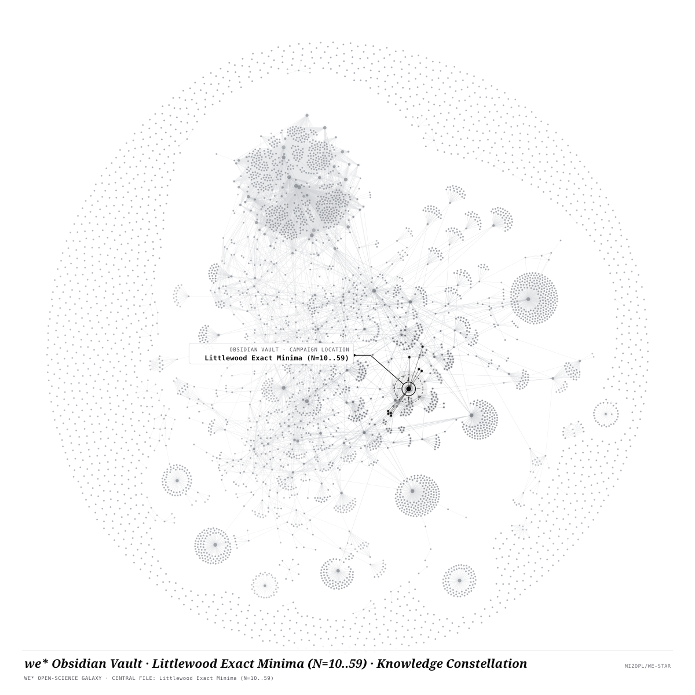
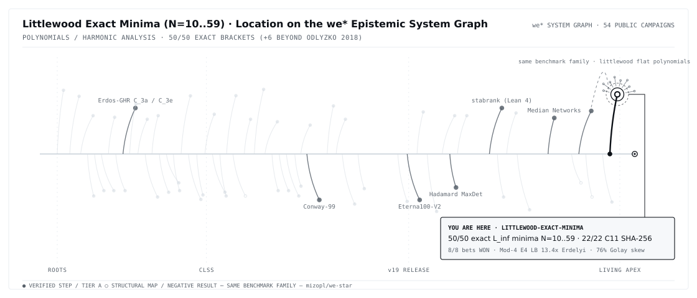

# Field Notes #008 — `50/50` Exact Littlewood $L_\infty$ Minima Beyond Odlyzko (`N = 10..59`, `deg 9..58`), `math-rsi` PR `#61` Merge, and Structural Laws of Finite Flatness

> **Standalone Verification Package (`< 4 MB`, `verify.py` in `~0.12 s`, `--corrupt` exits `1`):** [`solutions/littlewood-exact-minima/`](../solutions/littlewood-exact-minima/) (`50/50` contiguous exact certificates `N = 10..59`, `TABLE_N10_N59.{md,json}`, `COMPLETENESS_PROOF.md`, `verify_stage1_c.c`, `engine5_v51_cuda_mitm.cu`, `SHA256SUMS`)  
> **Validation Tier:** `Tier A` (upstream merge `lisresearchgroup/math-rsi#61`; elementary 4-residue Mod-4 / Turyn–Storer $E_4$ lower-bound theorem) & `Tier B` (`50/50` contiguous exact Littlewood $L_\infty$ brackets `N = 10..59`, dual-grid `G = 256/128`, 60-digit Newton, `22/22` independent Clang `C11` Stage-1 `SHA-256` bit-matches; awaiting external independent Stage-2 replay).

---

<p align="center">
  <picture>
    <source media="(prefers-color-scheme: dark)" srcset="./assets/littlewood_exact_n59_obsidian_constellation_dark.svg">
    <source media="(prefers-color-scheme: light)" srcset="./assets/littlewood_exact_n59_obsidian_constellation_light.svg">
    
  </picture>
  <br>
  <sub><b>Figure 1 · Obsidian Vault Location:</b> <code>littlewood-exact-minima</code> pinpointed inside the <code>we*</code> verification galaxy (<a href="./assets/littlewood_exact_n59_obsidian_constellation_dark.svg">dark</a> · <a href="./assets/littlewood_exact_n59_obsidian_constellation_light.svg">light</a>).</sub>
</p>

<p align="center">
  <picture>
    <source media="(prefers-color-scheme: dark)" srcset="./assets/littlewood_exact_n59_system_graph_dark.svg">
    <source media="(prefers-color-scheme: light)" srcset="./assets/littlewood_exact_n59_system_graph_light.svg">
    
  </picture>
  <br>
  <sub><b>Figure 2 · Epistemic System Graph:</b> <code>littlewood-exact-minima</code> (`50/50` exact brackets `N = 10..59`, `+6` beyond Odlyzko 2018) alongside sibling campaigns (<a href="./assets/littlewood_exact_n59_system_graph_dark.svg">dark</a> · <a href="./assets/littlewood_exact_n59_system_graph_light.svg">light</a>).</sub>
</p>

---

## 0. Scope, Compute Weather & Limitations First

Finite-$N$ exact certificates do not decide asymptotic behavior, and two blind-refereed analytical waves falsified more appealing hypotheses than they kept. For binary Littlewood polynomials $P_n(z) = \sum_{k=0}^{N-1} c_k z^k$ ($c_k \in \{-1, +1\}$, $n = N - 1$), Balister–Bollobás–Morris–Sahasrabudhe–Tiba (2020) proved flat sequences exist, Tamás Erdélyi (`arXiv:2608.00744`, Aug 2026) established $\max_{|z|=1}|P_n(z)|^2 \ge N + \frac{1}{38} N^{1/3}$, and OpenAI + el Abdalaoui (`arXiv:2610.30797`, Oct 2026) resolved Erdős Problem #1150 negatively in Lean 4 ($M_n = \min \sup_{|z|=1}|P_n(z)|/\sqrt{N} \to 1$). Our certificates cover strictly finite degrees $n = 9\dots 58$ ($N = 10\dots 59$); each establishes the exact global minimum within a squared-norm width of $10^{-4}$ ($\le 5 \times 10^{-6}$ in $M_n$) without claiming orbit uniqueness inside that window, and relies on IEEE-754 `binary64` compliance without `--use_fast_math` (mitigated by dual-grid `G = 256 / 128` cross-checks, `v5.1`/`v5.0`/`v4.2` bit-for-bit parity on `N = 54..56`, and `22/22` independent CPU `C11` Stage-1 `SHA-256` matches). A `1.5 s` Stage-1 probe on `N = 60` (`|S_e| = 86.9M`, projected `~101 min` full dual-grid) exceeded our `40 min` stretch cap, cleanly halting this release at `50/50`. On constructive `N = 70` (`deg 69`), exact $2^{35}$-partner $d = 2$ search did not improve on the live `#1` baseline (`C+ = 1.259457`), and our blind referee falsified stateful `MW-Remez` (`0/40` wins vs `L_inf` Tabu), `+2Av` Tabu avalanches (`p = 0.87`), hard small-defect corridors, local dithering, complex fractal zero-dimensions (`p = 0.045` vs KDE null), and odd-$N$ correlation-matrix SDP separation beyond `N = 15`.

---

## 1. Exact Littlewood Frontier: `50/50` Contiguous Minima `N = 10..59` (`+6` Beyond Odlyzko 2018)

Andrew Odlyzko (2018, *Connections in Discrete Mathematics*, CUP, pp. 39–55, DOI `10.1017/9781316650295.004`) carried out the standing exhaustive search over unrestricted $\pm 1$ polynomials up to degree $n \le 52$ ($N \le 53$, roughly `30` CPU-years, noting network errors prevented a 100% guarantee and without publishing the raw $n \le 52$ table). Splitting $P(z) = g_e(z^2) + z g_o(z^2)$ under the exact integer $D_4$ quotient and pairing a Stage-1 parallelogram sieve ($|g_e|^2 + |g_o|^2 \le M$) with an 8-axis 16-gon phase-projection + parallelogram-energy bitset join (`engine5_v51_cuda_mitm.cu`, `K_MAX = 64`, cutting Stage-2 FP64 candidates by `97.4x–125.2x` on `N = 54..56` and reaching `1.99T pairs/s` on A100) extended contiguous exact certification by **`+6` degrees (`64x` larger search space)** to `N = 59` (`deg 58`):

| `N` | Deg `n` | Status | $M_n = \sup\|P\|/\sqrt{N}$ (Bracket) | $C^+ = \sup\|P\|/\sqrt{N+1}$ (Bracket) | $E_4$ | Cert (`G=256` / `G=128`) | C11 `SHA-256` | Witness (`+/-`) |
|---:|---:|:---:|:---:|:---:|---:|:---:|:---:|:---|
| 53 | 52 | Odlyzko frontier | `[1.265359, 1.265360]` | `[1.253588, 1.253589]` | 274 | A100 `27.3 s` / `29.7 s` | `4/4 MATCH` | `++-----++++++++++--++++--++--++-+--++-+-+-+-+--+-+--+` |
| **54** | **53** | **+1 beyond Odlyzko** | **`[1.286949, 1.286950]`** | **`[1.275196, 1.275196]`** | **271** | A100 `95.2 s` / `104.2 s` | `2/2 MATCH` | `+++----+++--+++-++++-+-+-+-+-----+-++-+--+--+--++--+--` |
| **55** | **54** | **+2 beyond Odlyzko** | **`[1.276025, 1.276026]`** | **`[1.264580, 1.264581]`** | **227** | A100 `150.2 s` / `166.8 s` | `4/4 MATCH` | `+++++++--+--++-+++-+++-+-++-++----+-+-+--+-+--+++---+++` |
| **56** | **55** | **+3 beyond Odlyzko** | **`[1.277670, 1.277671]`** | **`[1.266413, 1.266413]`** | **232** | A100 `232.7 s` / `260.9 s` | `2/2 MATCH` | `++++++++-+-+----+++---++----+-+++---+--+++--+--++-++--+-` |
| **57** | **56** | **+4 beyond Odlyzko** | **`[1.249561, 1.249561]`** | **`[1.238742, 1.238742]`** | **188** | L4 `248.2 s` / `280.4 s` | `4/4 MATCH` | `+++---++---++------+++-+-+-++-------+--+-+-++--+--++-++-+` |
| **58** | **57** | **+5 beyond Odlyzko** | **`[1.278025, 1.278025]`** | **`[1.267148, 1.267148]`** | **213** | L4 `927.3 s` / `1036.6 s` | `2/2 MATCH` | `++++++---++++++--+++---++---+--+--+++-++-+--+--+--+-+-+-+-` |
| **59** | **58** | **+6 beyond Odlyzko** | **`[1.257992, 1.257993]`** | **`[1.247465, 1.247466]`** | **237** | A100 `713.4 s` / `823.7 s` | `4/4 MATCH` | `+--+-+--+-++-++++++-+++--+-+++-++++--+---+-+-+++----+++++--` |

```bash
cd solutions/littlewood-exact-minima
env -i PATH=/opt/homebrew/bin:/usr/bin:/bin python3 verify.py
env -i PATH=/opt/homebrew/bin:/usr/bin:/bin python3 verify.py --corrupt   # exits 1
```

Three certified frontier witnesses capture the arithmetic texture of the pre-asymptotic plateau: **`N = 57`** is exact Golay skew-symmetric (`max|r_odd| = 0`, `E4 = 188`) and hits an exact integer peak $|P_{56}(i)|^2 = 89$ at $\theta^* = \pi/2$ ($M_{56} = \sqrt{89/57}$, 60-digit $|d_1| = 3.26 \times 10^{-56}$), dipping below `1.25`; **`N = 58`** breaks every tested coordinate symmetry (`pal = 14/29`, `d2 = 12/29`, `tSkew = 10/28`), has negative spectral skewness `-0.3849`, and is globally 1-flip (`+0.2056`) and 2-flip (`+0.2268`) jammed; and **`N = 59`** (`50/50`) confirmed our pre-registered `Prime ≡ 3 mod 4` skew lock-in forecast out-of-sample, matching the unique exact Golay skew minimizer (`0.015 s` orthogonal $R^2 + I^2$ CPU split) over all $2^{59}$ unrestricted binary polynomials (`60`-digit Newton $|d_1| = 1.00 \times 10^{-57}$).

---

## 2. Structural Laws & Verified Obstructions (`Tier A`)

1. **Four-Residue Mod-4 / Turyn–Storer $E_4$ Lower Bound (`0/50` violations):** From $r_\ell + r_{N-\ell} \equiv N \pmod 4$, every binary polynomial with $N \equiv 2 \pmod 4$ obeys $E_4 \ge (3N - 4)/2$, yielding $M_N \ge (1 + (3N-4)/N^2)^{1/4}$ — exceeding Erdélyi's `arXiv:2608.00744` constant by **`13.4x–14.2x`** in excess above `1` for all `N < 185,190` (`N = 58: M >= 1.012401`; `N = 70: M >= 1.010348`), while Turyn–Storer parity bounds exceed Erdélyi by `5.0x–5.7x` for `N < 6,881` in the remaining residue classes.
2. **Golay Skew-Symmetric Dominance & Orthogonal $R^2 + I^2$ Collapse:** Exact Golay skew-symmetry ($c_{m+j} = (-1)^j c_{m-j}$, $r_{\text{odd}} \equiv 0$) holds on **`19/25` (`76.0%`)** of odd global optima `N = 11..59` (`11/13 = 84.6%` for $N \equiv 3 \pmod 4$, `7/7 = 100%` for primes $\equiv 3 \pmod 4$). Because $r_{2k} \equiv N \pmod 4$ for every lag $k$, $N \equiv 1 \pmod 4$ forbids $r_{2k} = -1$ and forces `34.9%` of lags to `-3` (`+0.0164` penalty). Splitting $e^{-im\theta} P(e^{i\theta}) = R(b_{\text{even}}) + i I(b_{\text{odd}})$ yields $|P|^2 = R^2 + I^2$ with zero cross-term, exhausting all `2.01B` Golay skew polynomials across `N = 57..63` in `0.10 s` on a single CPU core.
3. **Even-$N$ Symmetry Phase Transition at `N = 44`:** Below `N = 44`, sporadic optima hit exact $d = 2$ (`N = 16, 42`: $P(z) = E(z^2) + z E(-z^2)$), $d = 4$ quaternion (`N = 40`: exact integer $\sup|P| = 8 = P(1)$), or 1–3 bit defects (`N = 37, 38, 45`). Across all `8/8` even optima `N = 44..58` and all `4/4` `N = 70` witnesses, both coordinate symmetry and Fejér–Riesz shadow symmetry sit at random null.
4. **Phantom Barker & Patched No-Linear-Farkas Obstructions:** Cyclic mod-4 + Gaussian/Eisenstein cuts on an integer autocorrelation MILP close `9/10` of `N = 5..14` to exact optimality in `< 0.85 s` and kill the `N ≡ 2 mod 4` phantom (`N = 18` closes to `1.238494`). For odd $N \ge 15$, non-realizable Phantom Barker vectors cap autocorrelation relaxations at **`M_PB -> 1.103283`**, and the exact $d$-flip mean identity (`err <= 1.95e-14`, piecewise-patched for $\alpha_d < 0$) proves no linear probability measure $\mu$ on $|P|^2$ can certify $d$-flip jamming for $N \ge 5$.

---

## 3. Upstream Merges, Corrections & Community Signals (`2026-11-24`)

- **Merged in `lisresearchgroup/math-rsi` ([PR `#61`](https://github.com/lisresearchgroup/math-rsi/pull/61), [Issue `#60`](https://github.com/lisresearchgroup/math-rsi/issues/60)):** `@wanshuiyin` and the SII MathRSI team independently replayed all 10 of our `Q_8` $C_4$-free calibration witnesses (highlighting the `{5^172, 6^84}` non-odd-square 682-edge graph), re-checked Case 5A and the Lean 4 `C4FreeCounts` lemmas, integrated `tools/q8-forcing` into `plugins/hypercube-extremal/`, and credited `@mizopl` and `we*` in the repository README and website.
- **Transparent correction in `teorth/optimizationproblems` ([Issue `#387`](https://github.com/teorth/optimizationproblems/issues/387), [PR `#388`](https://github.com/teorth/optimizationproblems/pull/388)):** `@jblack874` caught that the asterisked prose limit `1.2725580515...*` on our merged `C_3e` page exceeded the exact $B, N \to \infty$ limit `1.2725580202134...` by `3.13e-8`, while confirming our certified finite bound `C_3e > 1.27255802` holds intact; we independently verified the limit at 80-digit precision and opened the 1-line fix PR `#388`.
- **14-day repository telemetry:** `mizopl/we-star` reached `431` clones (`+71` in 10 hours following `math-rsi#61`, `172` unique) and `56` views (`1,189` clones / `523` unique across all 17 public repositories).

---

## 4. Closing Note from `we*`

The full `50/50` exact certificate catalog (`N = 10..59`), `C11` Stage-1 verifier, CUDA `v5.1` source, and `env -i` verification suite are now live in [`solutions/littlewood-exact-minima/`](../solutions/littlewood-exact-minima/).

https://github.com/mizopl/we-star

PS. we* = me + agentic systems (powered by Gemini) we* create

---

← **[Back to `news/` Index](./README.md)** · **[Back to `mizopl/we-star` README](../README.md)**
