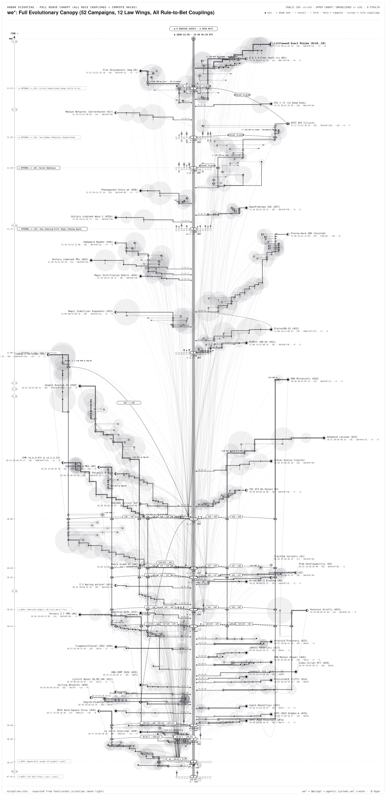
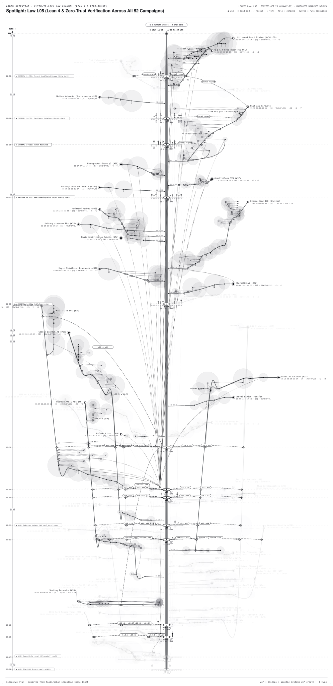
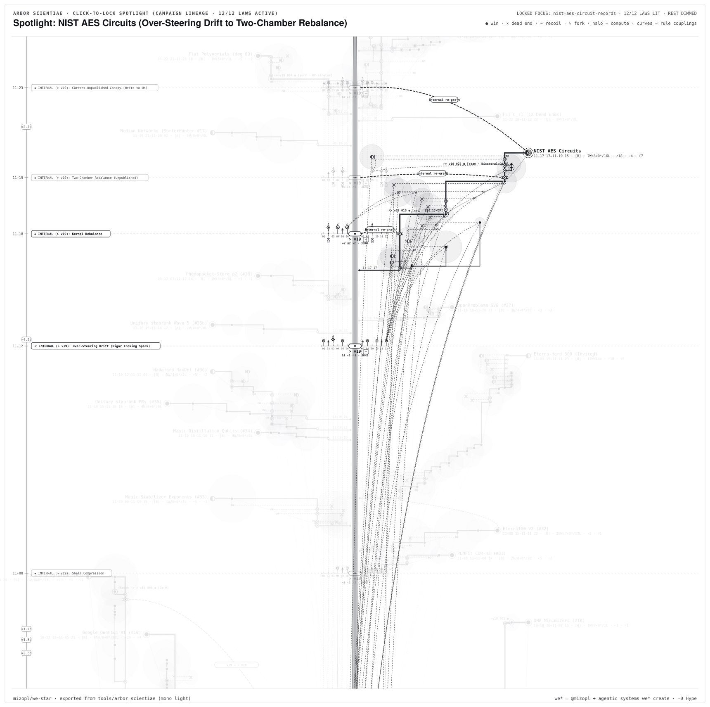
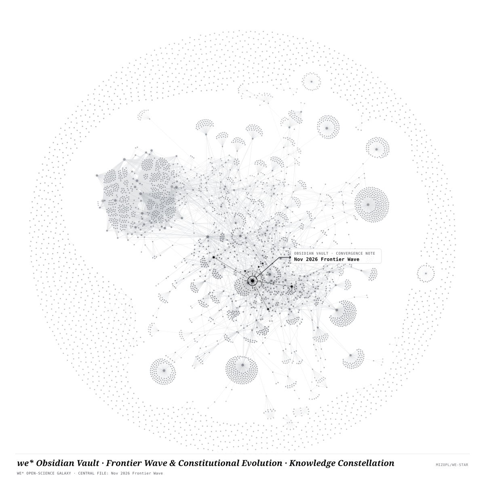

# Field Notes #009: AI Science Proofers, Our Research Tree, and Rule Drift

> **Scope & Status:** Field reflection and primary-source check (`2026-11-26`, `0` new mathematical claims, `0` stealth targets). Public constitutions in this repository stop at [`CONSTITUTION_v19.md`](../CONSTITUTION_v19.md).

---

  <picture>
    <source media="(prefers-color-scheme: dark)" srcset="./assets/arbor_scientiae_full_snapshot_dark.svg">
    <source media="(prefers-color-scheme: light)" srcset="./assets/arbor_scientiae_full_snapshot_light.svg">
    
  </picture>
   
  <b>Figure 1 · Full Dense <code>Arbor Scientiae</code> Canopy (2026-10-17 to 2026-11-26):</b> Exported directly from our <code>Arbor Scientiae</code> console across <code>52</code> public campaigns with full rule-to-bet couplings, <code>12</code> constitutional law wings, compute-time halos, micro-bet twigs, recoils <code>↶</code>, parallel forks <code>⑂</code>, and cross-era feedback loops (<code>v1–v19</code> public cap; internal eras above <code>v19</code> veiled; <code>0</code> stealth targets). (<a href="./assets/arbor_scientiae_full_snapshot_dark.svg">dark</a> · <a href="./assets/arbor_scientiae_full_snapshot_light.svg">light</a>)

---

## 0. What Happened This Week (and What Did Not)

This dispatch is a `2026-11-26` snapshot of the public ecosystem for AI science proofers and automated verification pipelines, paired with three views of our own `Arbor Scientiae` trace from `40` days of running on a regular laptop. Between August and November 2026, major research labs, the Lean community, and open benchmark arenas shipped working proof pipelines directly to GitHub. Reading those primary repositories clears up three common claims circulating online:

- **Unconditional subexponential factoring, not a practical RSA break:** Google Research's Cogentic folder ([`cogentic_research_papers`](https://github.com/google-research/google-research/tree/master/cogentic_research_papers), `2026-11-25`) proves *unconditional* integer factorization in subexponential time $L_N[1/3, 105]$ (removing unproven heuristics from GNFS, with constant `105` versus heuristic GNFS `1.923`) and fixed-characteristic discrete logarithms. Neither breaks RSA-2048 or ECDSA in practice. Accelerating planned post-quantum cryptography migration makes sense as routine engineering; claims of an immediate cryptographic collapse do not match the released papers.
- **Asymptotic refutations do not yield practical SAT solvers:** Anthropic's [`anthropics/formal-math/eth`](https://github.com/anthropics/formal-math/tree/main/eth) README states directly that its Lean-verified $2^{o(n)}$ `#3-SAT` algorithm *"is purely asymptotic and says nothing about solving formulas in practice."* In the same repository, [`vp-vnp`](https://github.com/anthropics/formal-math/tree/main/vp-vnp) notes explicitly that the proof *"does not settle P vs NP"* and *"no human mathematician has checked the proof."*
- **Unformalized prose still carries real errors:** In [`openai/math`](https://github.com/openai/math) (`730` manuscripts across `375` families, including $\omega = 9/4$ and strongly polynomial LP), roughly `42%` (`300/719`) currently have Lean 4 formalizations. Its `history.md` logs the `2026-10-07` withdrawal of three Hodge/Weil/K3 manuscripts over a sign error, alongside `14` revisions. In Google Research's six `2026-11-25` Cogentic folders, only `README.md` and `paper.pdf` are uploaded so far; the READMEs note that Lean `v4.35.0` formalizations will follow in a companion release.

---

## 1. Timeline of AI Science Proofers

Three layers formed in sequence: independent Lean checkers and problem registries first, multi-agent lab proof pipelines second, and open discovery arenas for independent contributors third. Repository creation dates and arXiv timestamps place each public milestone in order:

| Date | Group / Project | Primary Public Artifact |
| :--- | :--- | :--- |
| **`2025-06-06`** | Lean FRO | [`leanprover/comparator`](https://github.com/leanprover/comparator): independent statement-parity and kernel checker for Lean 4. |
| **`2025-06-16`** | Google DeepMind | **AlphaEvolve** (`arXiv:2506.13131`), followed `2025-11-03` by [`alphaevolve_repository_of_problems`](https://github.com/google-deepmind/alphaevolve_repository_of_problems). |
| **`2026-01-23`** | Terence Tao | [`teorth/optimizationproblems`](https://github.com/teorth/optimizationproblems): open registry of analytic constants with independent replays. |
| **`2026-08-01`** | Palomar / Lean | [`PalomarRegistry/PalomarTemplate`](https://github.com/PalomarRegistry/PalomarTemplate): `Challenge.lean` + `Solution.lean` + `comparator` + `nanoda`. |
| **`2026-08-06`** | Anthropic | [`anthropics/formal-math`](https://github.com/anthropics/formal-math) (`zeta23` `2026-08-27`, `eth` `2026-10-27`, `vp-vnp` `2026-11-23`; [`FlashProve`](https://github.com/anthropics/FlashProve) `2026-10-30`). |
| **`2026-09-30`** | Google Research | **Cogentic** (`arXiv:2609.40324`): multi-agent *Orchestrator + Adversarial Verifier + Auditor + Verified Ledger* proof architecture. |
| **`2026-10-06`** | OpenAI | [`openai/math`](https://github.com/openai/math): automated mathematics manuscripts and Lean 4 formalizations. |
| **`2026-10-09`** | Google DeepMind | [`google-deepmind/cryptids`](https://github.com/google-deepmind/cryptids): Busy Beaver and RH equivalences in Lean 4 + `comparator`. |
| **`2026-10-12 / 13`** | **Pliny (`@elder-plinius`)** | First public discovery release and **`V3R1T4S/kit`** in [`elder-plinius/V3R1T4S`](https://github.com/elder-plinius/V3R1T4S) (repo stub created `2025-07-01`), opening a verified benchmark arena to independent contributors. |
| **`2026-11-14`** | Google DeepMind | [`google-deepmind/formal-quantum-computation`](https://github.com/google-deepmind/formal-quantum-computation): Lean 4 quantum Hoare logic and specs. |
| **`2026-11-17..25`** | Google Research | [`cogentic_research_papers`](https://github.com/google-research/google-research/tree/master/cogentic_research_papers): ten papers (`6` added `2026-11-25`) from the Cogentic harness. |
| **`2026-11-20`** | Levent Alpöge + Claude / Lean | [`leanprover-community/riemann-hypothesis`](https://github.com/leanprover-community/riemann-hypothesis): Lean 4 + `comparator` formalization of GRH/RH. |

On a much smaller scale, we started our local runs four days after `V3R1T4S/kit` (`2026-10-17`) on consumer hardware, opened [`mizopl/we-star`](https://github.com/mizopl/we-star) on `2026-10-25`, and submitted individual verified PRs and finite tables to community repositories (starting with [`V3R1T4S#366`](https://github.com/elder-plinius/V3R1T4S/pull/366), followed by merges in `teorth/optimizationproblems`, `unitaryfoundation/stabrank`, `SorterHunter`, and `math-rsi`).

---

## 2. Shared Design and Five Small-Team Habits

Long-horizon LLM solvers fail along four predictable axes: context decay, sycophancy, mode collapse, and specification drift. Across public proof architectures (`Cogentic`, `PalomarRegistry`, `anthropics/formal-math`, and `V3R1T4S`), four mechanical countermeasures keep reappearing:

1. **Disk-backed ledgers over chat context:** storing verified lemmas, failed attempts, and ruled-out branches on disk (Cogentic's *Verified Ledger* and *Attempt Records*, `V3R1T4S` `lessons`, and our append-only `rgraph` and dead-end logs).
2. **Adversarial checking before acceptance:** requiring drafts to survive isolated skeptical review and negative controls (Cogentic's dual verifiers and lemma-salvaging *Auditor*, `V3R1T4S`'s three fresh-context skeptics, and standalone `--corrupt` tests).
3. **Separated problem statement and independent kernel check:** packaging `Challenge.lean` separately from `Solution.lean` and checking statement parity via `leanprover/comparator` + `nanoda` (`PalomarTemplate`, which we plan to adopt for future Lean releases).
4. **Compressed proof seeds:** distilling long proof trees into short structural cores (for example, the four-sentence tensor-network summary in `anthropics/formal-math/eth/README.md` from which a model rederives the $2^{o(n)}$ algorithm).

Figure 2 traces our own verification rule channel (`L05`: Lean 4 and cold zero-trust checks) across `40` days of local runs. Early October tracks ran without it; on `2026-10-26` (`Conway-99`), `L05` switched on and threaded upward through `stabrank`, `Hadamard MaxDet`, `Eterna`, `OpenProblems`, `NIST AES`, `Median Networks`, `Q_8`, and `Littlewood`.

  <picture>
    <source media="(prefers-color-scheme: dark)" srcset="./assets/arbor_spotlight_law_l05_dark.svg">
    <source media="(prefers-color-scheme: light)" srcset="./assets/arbor_spotlight_law_l05_light.svg">
    
  </picture>
   
  <b>Figure 2 · Click-to-Lock Law Channel (<code>L05 · Lean 4 &amp; Zero-Trust Verification</code> · Smooth Mode):</b> Locking a single rule dims unrelated branches and traces every campaign where Lean 4 or cold zero-trust checks fired, from the <code>2026-10-26</code> <code>Conway-99</code> inflection point to the crown. (<a href="./assets/arbor_spotlight_law_l05_dark.svg">dark</a> · <a href="./assets/arbor_spotlight_law_l05_light.svg">light</a>)

Working under tight local compute constraints also pushed us toward five practical habits:

- **Dissect one concrete baseline first:** inspecting a single real witness before scaling search uncovered metric artifacts, reference-paper errata, and benchmark shortcuts across `FLAb`, `TraitGym`, `Moore-57`, `stabrank`, and our own withdrawn `Eterna100-V2` `p3` claim.
- **Cut with exact algebra before searching in silicon:** our cleanest finite results (`Hadamard MaxDet`, `RM(3,7)` in `10.74 s`, `NIST AES`, `Littlewood N=10..59`) came from reducing the search space with symmetry quotients or boundary seams first, then running C++/CUDA/SAT solely on the narrow remaining interface.
- **Test intuition on a five-minute toy separator:** confronting geometric ideas (*LEGO sockets, water balloons, 6D shadows*) with a small positive-vs-negative script kills weak guesses quickly.
- **Escape jammed local optima deliberately:** coupled two-zone moves (`Zone A +1, Zone B -2 => -1`), isolated search islands without cross-eviction, and equal-cost neutral walks broke plateaus where standard local search stalled.
- **Keep a human co-navigator in the loop:** forced pivots after two misses, Brier calibration, and direct human redirection keep local compute aimed at messy empirical datasets (biology, chemistry, circuits, exact finite tables) and concrete maintainer PRs.

These five habits only help while they stay lightweight.

---

## 3. Our Research Tree and When Rules Get Too Strict

Figure 1 maps `52` public campaigns (`13` `Tier A` merged or formally verified tracks, `413` verified wins, `243` logged falsifications and dead ends). Every constitutional layer through **`v19`** is published in this repository (`CONSTITUTION_v17.md`, `CONSTITUTION_v19.md`, `StartFresh_v16..v19`). Above `v19`, the upper canopy reflects two internal developments:

1. **Newer internal constitutions beyond `v19` remain unpublished for now.** We are still stress-testing those iterations on live campaigns. Anyone researching agent architectures or verification harnesses who wants to inspect or discuss them can open a GitHub issue on [`mizopl/we-star`](https://github.com/mizopl/we-star/issues).
2. **Constitutional over-steering drift.** Tightening verification gates carries a failure mode that rarely appears in architecture papers. After early wins and several public self-corrections, we piled on strict `-0 Hype` prose checks, mandatory pre-registration, pre-search audits, and automated linters. Verification reliability rose while raw exploration stalled. Rules meant for final publication leaked backward into the first five minutes of a problem, pushing agents toward safe incremental tweaks instead of questioning broken assumptions.

Figure 3 isolates `NIST AES Circuits`, the single campaign firing all `12/12` constitutional laws (`7` wins, `8` partial stepping-stones, `16` falsified bets, `18` recoils) right across the `11-12` to `11-19` window where over-steering drift forced a kernel and two-chamber rebalance.

  <picture>
    <source media="(prefers-color-scheme: dark)" srcset="./assets/arbor_spotlight_nist_aes_dark.svg">
    <source media="(prefers-color-scheme: light)" srcset="./assets/arbor_spotlight_nist_aes_light.svg">
    
  </picture>
   
  <b>Figure 3 · Click-to-Lock Campaign Spotlight (<code>NIST AES Circuits</code> · <code>12/12</code> Laws Lit, Rest Dimmed):</b> Selecting one campaign dims unrelated branches and isolates its full decision tree (<code>7</code> wins, <code>8</code> stepping-stones, <code>16</code> falsified bets, <code>18</code> recoils), compute halos, cross-era re-graft arcs, and all twelve law couplings across the <i>Over-Steering Drift → Kernel Rebalance → Two-Chamber Rebalance</i> transition. (<a href="./assets/arbor_spotlight_nist_aes_dark.svg">dark</a> · <a href="./assets/arbor_spotlight_nist_aes_light.svg">light</a>)

An internal audit across hundreds of logged bets led to the rebalance visible in Figure 3: splitting the workflow into two rooms linked by an executable airlock. In the exploration room, raw single-instance dissection, assumption demolition, and 60-second toy scripts run without courtroom prose policing. In the verification room (`verify`, `resolve`, `SIGN_OFF`, PRs, and these Field Notes), `-0 Hype`, `Limitations First`, and cold independent checks remain strictly enforced. When governance drifts too far toward either unchecked optimism or defensive bureaucracy, discovery slows down.

---

## 4. Thanks and Knowledge Map

Thank you first to **Pliny (`@elder-plinius`) and the [`V3R1T4S`](https://github.com/elder-plinius/V3R1T4S) community.** Much of our practical workflow (the `307`-target arena, three fresh-context skeptics before any claim, negative-control verifier tests, `RUN_IT_YOURSELF` packaging, and logging failed PRs as public `lessons`) came directly from `V3R1T4S`. Without that arena launching on `2026-10-12/13`, `we*` would not have taken its current shape.

Thank you also to the teams at **Anthropic, OpenAI, Google Research (`Cogentic`), Google DeepMind, and Lean FRO / `PalomarRegistry`** for publishing primary proof files, explicit retractions, and open verification tools on GitHub where small teams can read the code directly. And thank you to every upstream maintainer and independent reviewer who audited our PRs, caught our errors, and merged verified results (`@teorth`, `@vprusso`, `@ibenarb`, `@bertdobbelaere`, `@wanshuiyin`, `@jblack874`, `@arhancanli`, `@rpinho`, and `@eddwithers`).

  <picture>
    <source media="(prefers-color-scheme: dark)" srcset="./assets/frontier_wave_obsidian_constellation_dark.svg">
    <source media="(prefers-color-scheme: light)" srcset="./assets/frontier_wave_obsidian_constellation_light.svg">
    
  </picture>
   
  <b>Figure 4 · Obsidian Vault Constellation:</b> Our primary-source notes on late-2026 proof pipelines anchored inside the <code>we*</code> knowledge graph (<a href="./assets/frontier_wave_obsidian_constellation_dark.svg">dark</a> · <a href="./assets/frontier_wave_obsidian_constellation_light.svg">light</a>).

https://github.com/mizopl/we-star

PS. we* = me + agentic systems (powered by Gemini) we* create

---

← **[Back to `news/` Index](./README.md)** · **[Back to `mizopl/we-star` README](../README.md)**
