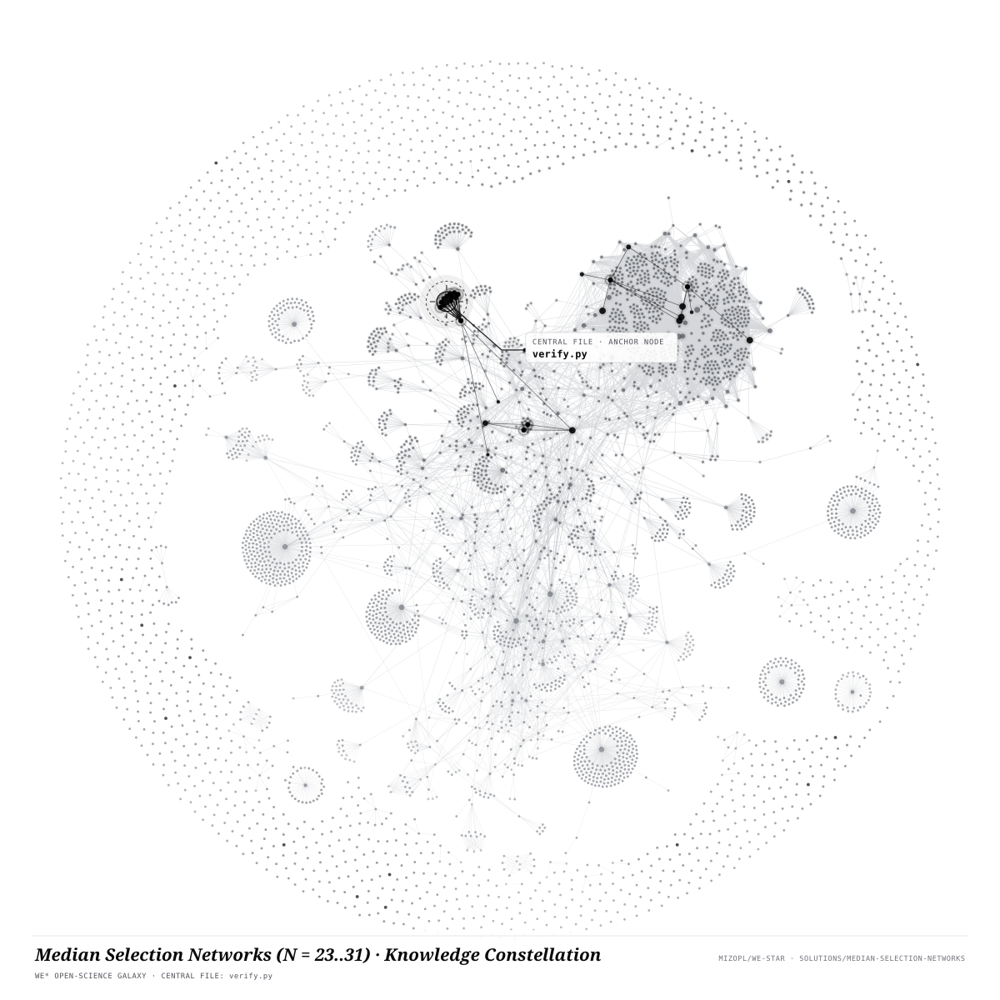

# Median Selection Networks (`median-selection-networks`, `N in {23, 24, 28, 29, 30, 31}`): `8` Verified Comparator Networks for `bertdobbelaere/SorterHunter`

## Scope, Limitations First & Verification Summary

- **Validation Tier:** `Tier A` (independently verified and **MERGED** upstream in [`bertdobbelaere/SorterHunter#17`](https://github.com/bertdobbelaere/SorterHunter/pull/17) on `2026-11-21` by `@bertdobbelaere`: *"All networks independently verified. Thanks for your contribution!"*).
- **Limitations & Scope (`What This Does NOT Claim`):**
  1. **Depth Trade-Offs on the Four Minimum-Size Additions (`N = 28..31`):** `Median_28_103_17.json` (`-1` CE vs `104`) and `Median_29_106_20.json` (`-1` CE vs `107`) add `+3` layers (`D = 17` vs `14`, `D = 20` vs `17`), while `Median_30_117_18.json` (`-1` CE vs `118`) and `Median_31_120_21.json` (`-1` CE vs `121`) add `+2` layers (`D = 18` vs `16`, `D = 21` vs `19`). All prior lower-depth networks (`(104, 14)`, `(107, 17)`, `(118, 16)`, `(121, 19)`) remain undominated on the `(L, D)` Pareto frontier.
  2. **Dependent Odd-`N` Constructions:** `Median_23_81_12.json` is derived deterministically from `Median_24_84_11.json` (fixing wire `0` to `0`, propagating constants, appending `[11, 12]`, standardizing, and pruning dead gates). `Median_29_106_20.json`, `Median_29_112_15.json`, and `Median_31_120_21.json` are `+3` CE / `+3` D median-of-3 extensions of `Median_28_103_17.json`, `Median_28_109_12.json`, and `Median_30_117_18.json`.
  3. **No Global Optimality Claim & Negative Search Results:** None of these bounds are claimed to be globally optimal in size or depth. Unconstrained size reductions for `N = 22` (`74 -> 73`), `N = 24` (`82 -> 81`), `N = 26` (`94 -> 93`), `N = 30` (`117 -> 116`), `N = 32` (`128 -> 127`), `N = 34` (`140 -> 139`), and `N = 36` (`150 -> 149`) were also searched and did not reach zero error.
- **One-Command Verification (`~12s`, Python 3 Standard Library + C Compiler Only):**
  ```sh
  python3 verify.py
  python3 verify.py --corrupt   # negative control: drops final comparator from every network, prints FAILED_AS_EXPECTED, exits 1
  ```
  - **Central File:** [`verify.py`](./verify.py) (auto-compiles [`median_oracle.c`](./median_oracle.c) on the fly and checks schema, symmetry, Pareto non-dominance vs `a18ee17`, exact Zero-One correctness, and `100,000` random integer arrays per file).

## In Plain Language

A median selection network on `N` wires is a fixed sequence of compare-and-swap gates (`[a, b]`) that always routes the middle element (for odd `N`) or the middle unordered pair (for even `N`) to the center wire(s), with every smaller value above and every larger value below, regardless of the input permutation. By Knuth's Zero-One Principle and monotonicity, verifying all `2^N` binary inputs reduces without loss of exactness to the critical Hamming-weight slices around `N/2` (`w in {k-1, k, k+1}` for even `N = 2k`, and `w in {k, k+1}` for odd `N = 2k+1`).

Opening the **Central File** [`verify.py`](./verify.py) checks all `8` JSON networks against the live `2026-11-08` `bertdobbelaere/SorterHunter` (`a18ee17`) table: exhaustive `2^23` and `2^24` checks for `N = 23, 24`, exact critical-weight-slice checks (`115M` to `601M` binary vectors) for `N = 28..31`, and `100,000` random integer arrays per network.

<p align="center">
  <picture>
    <source media="(prefers-color-scheme: dark)" srcset="./assets/we_star_constellation_dark.svg">
    <source media="(prefers-color-scheme: light)" srcset="./assets/we_star_constellation_light.svg">
    
  </picture>
  <br>
  <sub><b>Obsidian Knowledge Constellation:</b> <code>median-selection-networks</code> inside the <code>we*</code> research vault (<a href="./assets/we_star_constellation_dark.svg">dark</a> · <a href="./assets/we_star_constellation_light.svg">light</a>).</sub>
</p>

## Summary of Verified Networks (vs. `bertdobbelaere/SorterHunter` `a18ee17`, `2026-11-08`)

| File | N | `(L, D)` | Symmetric | Prior `a18ee17` Baseline | Delta | Verification | SHA-256 (prefix) |
| :--- | :---: | :---: | :---: | :--- | :--- | :--- | :--- |
| [`Median_23_81_12.json`](./Median_23_81_12.json) | 23 | `(81, 12)` | `false` | `(83, 12)` at `D = 12` | `-2` CEs at `D = 12` | Exhaustive `2^23` + `100k` int | `43903a7b0745` |
| [`Median_24_84_11.json`](./Median_24_84_11.json) | 24 | `(84, 11)` | `true` | `(86, 11)` at `D = 11` | `-2` CEs at `D = 11` | Exhaustive `2^24` + `100k` int | `67577e4a7ef5` |
| [`Median_28_103_17.json`](./Median_28_103_17.json) | 28 | `(103, 17)` | `true` | `(104, 14)` min size | `-1` CE min size (`+3` D) | Exact `w in {13,14,15}` + `100k` int | `6c6671125816` |
| [`Median_28_109_12.json`](./Median_28_109_12.json) | 28 | `(109, 12)` | `true` | `(111, 12)` at `D = 12` | `-2` CEs at `D = 12` | Exact `w in {13,14,15}` + `100k` int | `f29da0d93856` |
| [`Median_29_106_20.json`](./Median_29_106_20.json) | 29 | `(106, 20)` | `false` | `(107, 17)` min size | `-1` CE min size (`+3` D) | Exact `w in {14,15}` + `100k` int | `d02fda4ebba9` |
| [`Median_29_112_15.json`](./Median_29_112_15.json) | 29 | `(112, 15)` | `false` | `(114, 15)` at `D = 15` | `-2` CEs at `D = 15` | Exact `w in {14,15}` + `100k` int | `4da713a0aecb` |
| [`Median_30_117_18.json`](./Median_30_117_18.json) | 30 | `(117, 18)` | `true` | `(118, 16)` min size | `-1` CE min size (`+2` D) | Exact `w in {14,15,16}` + `100k` int | `301e4ece04ac` |
| [`Median_31_120_21.json`](./Median_31_120_21.json) | 31 | `(120, 21)` | `false` | `(121, 19)` min size | `-1` CE min size (`+2` D) | Exact `w in {15,16}` + `100k` int | `eae0ef69fe03` |

## Upstream Submission

- Pull Request: [`bertdobbelaere/SorterHunter#17`](https://github.com/bertdobbelaere/SorterHunter/pull/17) (`8bb21b50`, **MERGED** `2026-11-21`, `8` JSON files only under `Networks/Median/`).
- Machine-readable metadata: [`MANIFEST.json`](./MANIFEST.json) and [`SHA256SUMS`](./SHA256SUMS).
