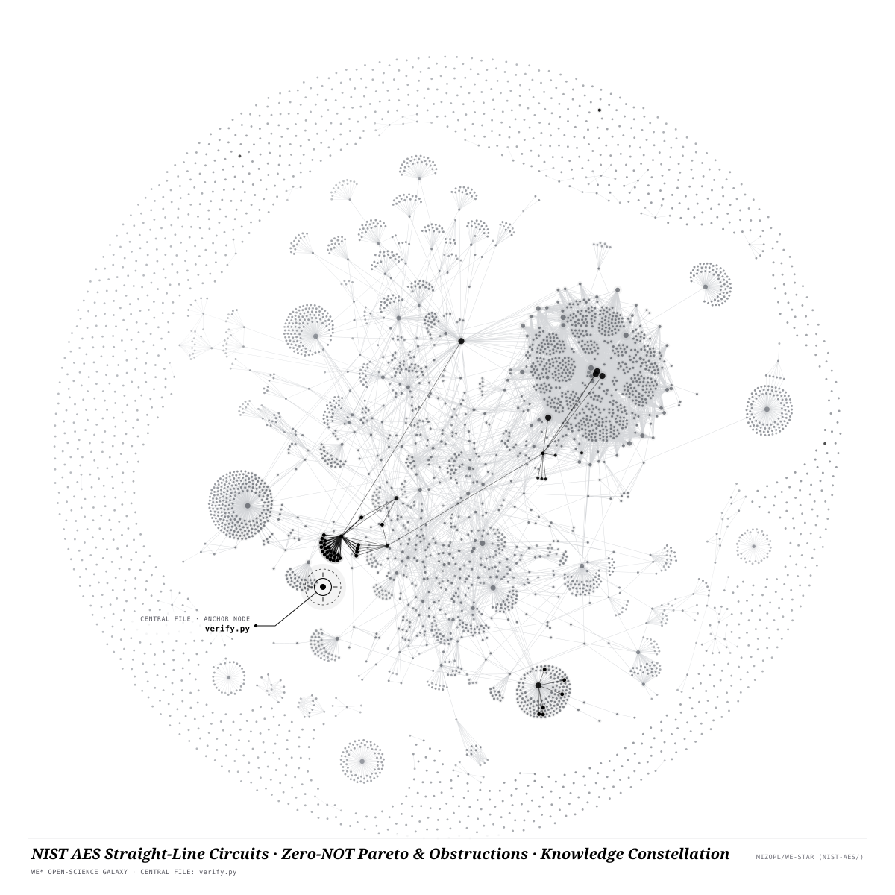
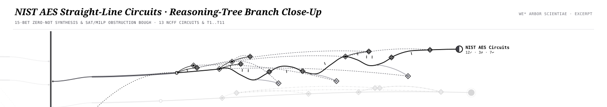

# NIST AES Straight-Line Circuits (`nist-aes-circuit-records`, Milestones `p3` & `p4` + `8` `[Inv]S-box` 4D Pareto Cells): Pure-`{XOR}` `InvMixColumns` `92@10`, Zero-`NOT` `InvS-box` `GD = 10` & `33/4/111/14`, and Exact Obstruction Certificates

## Scope, Limitations First & Verification Summary

- **Validation Tier:** `Tier B` (local exact-oracle verified candidate package awaiting independent review; zero upstream commits, pull requests, or emails sent prior to human sign-off).
- **Limitations & Unsolved Frontier (`What This Does NOT Solve`):**
  1. **Construction Upper Bounds Only (`0 / 6` Live CSRC Wish-List Targets Solved):** None of the `6` live `2026-11-17` NIST CSRC wish-list targets are solved. Specifically, `InvS-box` `33/4/111/14` stops **`+1` gate above Wish-List `(c)` (`G <= 110` at `GD <= 14` across both zero-`NOT` and official `%NCFF` `NOT`-permitted models)**, `MixColumns` at `GD = 3` held at `97@3` (`Root LP = 92.00`) vs. Wish-List `(e)` (`<= 93@3`), and `InvMixColumns` at `GD <= 5` held at `118@5` vs. Wish-List `(f)` (`G <= 105` at `GD <= 5`). Wish-List `(a)` `A <= 27`, `(b)` `G <= 100`, and `(d)` `MixColumns <= 86` also remain open.
  2. **Unbeaten Sibling Milestones (`p1`, `p2`, and `p4` Route 2):** Minimum total gates `p1` (`S-box` `103`, `InvS-box` `105`), minimum gates at `A = 28` `p2` (`S-box` `124`, `InvS-box` `126`), and `AD = 3` with `A <= 34` (`p4` Route 2, currently `A = 35`) remain unbeaten. On `InvMixColumns`, depths `GD = 5..9` (`118, 104, 99, 96, 94`) and `GD >= 12` (`90@12`, `89@15`, `88@16`) were not improved.
  3. **`NOT`-Gate Model Boundary:** Milestone `p3` (`InvMixColumns` `92@10`) uses pure 2-input `{XOR}` gates and has zero `NOT`-gate caveat. On `[Inv]S-box`, `33/4/111/14` and `35/4/129/13` have strictly fewer total gates than *both* zero-`NOT` and `NOT`-containing prior circuits at `GD <= 14` (`123@14` zero-`NOT`, `121@14` `1`-`NOT`) and `GD <= 13` (`131@13` zero-`NOT`, `130@13` `1`-`NOT`). At `GD = 10`, `usnistgov/Circuits` lists `aes-invsbox-a55-ad4-g148-gd10-xxn93-26-2.circ.txt` (`2` `NOT` gates) and `aes-sbox-a59-ad4-g159-gd10-xxn100-30-3.circ.txt` (`3` `NOT` gates), and `Joe-b-20` lists `aes-invsbox-a47-ad4-g141-gd11-xxn94-44-2.circ.txt` (`2` `NOT` gates); under strict 2-input `{AND, XOR, XNOR}` (`#NOT = 0`), those files are excluded and `152@10` / `155@10` improve the zero-`NOT` `InvS-box` minimum depth from `GD = 11` (`PR #1` `143@11`) to `GD = 10`, whereas if unary `NOT` gates are permitted `148@10` uses `4` fewer total gates than `152@10` (`T11` proves why zero-net-cost unary `NOT` rewrites fail at `GD = 14` via `FWHT_min_depth = 15 > 14`).
  4. **`TIMEOUT_UNKNOWN` / `ITERATION_LIMIT` vs. `UNSAT` Distinction:** Full-`Zone_Bot` `18..21`-helper `kissat 4.0.4` CDCL queries (`90..120s` caps), unconstrained Depth-12 internal cancellations outside 2-sum pools on `33/4/111/14`, `3 / 11` unconstrained 5-layer `34/4/111/14` `Zone_Bot` `K = 28` slot-CNF classes, and `29,180`-var `MixColumns` `GD = 3` `CP-SAT` `G <= 93` slices hit `TIMEOUT_UNKNOWN` / `ITERATION_LIMIT` and are never claimed as `UNSAT`.
- **One-Command Verification (`< 0.3s`, Python 3 Standard Library Only):**
  ```sh
  python3 verify.py
  python3 verify.py --corrupt   # negative control: mutates 1 gate in memory, prints FAIL, exits 1
  ```
  - **Central File:** [`verify.py`](./verify.py) (`sha256: 8cd6e40c4333ee55034766b67030374b33d0a3fd6d69a1be7f00c1eb3eea62c8`)
  - **Headline Constructed Circuits (`results/`, `13` total):**
    - **Milestone `p3` (`InvMixColumns` `92@10`, `{XOR}` only):** [`results/aes-invmixcols-xor92-depth10.circ.txt`](./results/aes-invmixcols-xor92-depth10.circ.txt) (`sha256: 4e19fc9a8d5760e80e94a6c33b1576e00d18eac15ef1f2865cd982e019138e44`) & non-isomorphic companion [`results/aes-invmixcols-xor92-depth10-alt.circ.txt`](./results/aes-invmixcols-xor92-depth10-alt.circ.txt) (`sha256: b3bc80eef37100bd092e9b3e01df7f53ddaadb8a476944bd4f4d5bd638ce8ae0`)
    - **Milestone `p4` Route 1 (`InvS-box` `GD = 10`, `#NOT = 0`):** [`results/aes-invsbox-a57-ad4-g152-gd10-xx95-25.circ.txt`](./results/aes-invsbox-a57-ad4-g152-gd10-xx95-25.circ.txt) (`57/4/152/10`, `sha256: 3cea2983de3590acc3d5755055f28e8f74306d1101ab9b18a598c451aad0fed6`) & [`results/aes-invsbox-a56-ad4-g155-gd10-xx99-26.circ.txt`](./results/aes-invsbox-a56-ad4-g155-gd10-xx99-26.circ.txt) (`56/4/155/10`, `sha256: c83ba275b29dddeb4b435b3a3c6a1e41fd51d93ab3023a62fe70e699de0629b6`)
    - **Headline `[Inv]S-box` 4D Pareto Points (`#NOT = 0`):** [`results/aes-invsbox-a33-ad4-g111-gd14-xx78-39.circ.txt`](./results/aes-invsbox-a33-ad4-g111-gd14-xx78-39.circ.txt) (`33/4/111/14`, `sha256: aa18325ecb4675691d77c177623191086acf36ba935d78541ce14afff788633e`; `7`-AND-middle companion [`results/aes-invsbox-a34-ad4-g111-gd14-xx77-41.circ.txt`](./results/aes-invsbox-a34-ad4-g111-gd14-xx77-41.circ.txt) `34/4/111/14`), [`results/aes-invsbox-a33-ad4-g109-gd15-xx76-36.circ.txt`](./results/aes-invsbox-a33-ad4-g109-gd15-xx76-36.circ.txt) (`33/4/109/15`, `sha256: 71c604e3f0f3b4c4bfb2c0d11dcc18ba14f1cececb193febb29c1cbf1e1217ab`), [`results/aes-invsbox-a35-ad4-g129-gd13-xx94-42.circ.txt`](./results/aes-invsbox-a35-ad4-g129-gd13-xx94-42.circ.txt) (`35/4/129/13`, `sha256: 0a0d9bcc0073d04c4a6369e44db22360a5583502cf02f364b94b3046621107a1`), and [`results/aes-sbox-a37-ad4-g119-gd14-xx82-33.circ.txt`](./results/aes-sbox-a37-ad4-g119-gd14-xx82-33.circ.txt) (`37/4/119/14`, `sha256: 3380e6da4f6a7dc3886d6cdecd51b996d0552b28911e8d718e91a32875d61df3`)
  - **Unified Barrier & Baseline Certificate:** [`results/00_nist_aes_gd10_and_barriers_certificate.json`](./results/00_nist_aes_gd10_and_barriers_certificate.json) (`sha256: 717e3701dc2a42b9966c099120b68c41b1633773141617d0cf8f97674554305d`)

## In Plain Language

Every AES round substitutes bytes nonlinearly (`S-box` / `InvS-box`) and mixes `32`-bit columns linearly (`MixColumns` / `InvMixColumns`). In masked hardware, garbled circuits, and homomorphic evaluation, compiling these maps into straight-line programs of 2-input Boolean gates (`AND`, `XOR`, `XNOR` with zero `NOT` gates and zero constant wires) trades off total gate count `G`, multiplicative `AND` count `A`, `AND` depth `AD`, and overall gate depth `GD`.

Opening the **Central File** [`verify.py`](./verify.py) runs the complete verification suite in `< 0.3s` using only the Python 3 standard library: it derives FIPS 197 `SBox()`, `InvSBox()`, and the `32 x 32` `GF(2)` `InvMixColumns` linear transformation from $\mathbb{F}_2[x]/(x^8 + x^4 + x^3 + x + 1)$, verifies all `13` `%NCFF-0.1-2026` circuits (`2` non-isomorphic `92`-XOR `GD = 10` `InvMixColumns` circuits improving `93@10` to `92@10` and dominating `92@11`, `2` zero-`NOT` `GD = 10` `InvS-box` circuits `152@10` and `155@10`, and `9` zero-`NOT` `[Inv]S-box` witnesses across `8` 4D Pareto cells led by `33/4/111/14` [`-12` gates vs. `33/4/123@14`] and `33/4/109/15` [`-4` gates vs. `113@15`]), and checks the algebraic tightness invariants (`T1..T6`) directly in pure Python.

<p align="center">
  <picture>
    <source media="(prefers-color-scheme: dark)" srcset="./assets/we_star_constellation_dark.svg">
    <source media="(prefers-color-scheme: light)" srcset="./assets/we_star_constellation_light.svg">
    
  </picture>
  <br>
  <sub><b>Knowledge Constellation &amp; Central File:</b> <code>verify.py</code> pinpointed inside the <code>we*</code> research galaxy (<a href="./assets/we_star_constellation_dark.svg">dark</a> · <a href="./assets/we_star_constellation_light.svg">light</a>).</sub>
</p>

<p align="center">
  <picture>
    <source media="(prefers-color-scheme: dark)" srcset="./assets/we_star_tree_teaser_dark.svg">
    <source media="(prefers-color-scheme: light)" srcset="./assets/we_star_tree_teaser_light.svg">
    
  </picture>
  <br>
  <sub><b>Epistemic Bet-Tree Branch (Excerpt):</b> organic trajectory across all 15 pre-registered hypotheses — verified constructive &amp; obstruction steps (<code>✓</code>), falsified sub-hypotheses pruned by exact oracles (<code>✗</code>), and structural pivots (<code>↩</code>) (<a href="./assets/we_star_tree_teaser_dark.svg">dark</a> · <a href="./assets/we_star_tree_teaser_light.svg">light</a>).</sub>
</p>

### 1. Summary of All `13` Verified `%NCFF-0.1-2026` Constructions (Waves 1–7)

Every circuit below uses strictly 2-input `{XOR}` (for `InvMixColumns`) or 2-input `{AND, XOR, XNOR}` (for `[Inv]S-box`) with `#NOT = 0`, zero constants (`0`/`1`), zero self-input gates (`u == v`), and zero dead gates, verified exhaustively by `verify.py` against the `2026-11-17` `8`-repository baseline (`457` individual files + `18,938` forward and `14,324` inverse `kste` `88`-XOR circuits).

| Circuit File (`sha256` prefix) | Function | `(A, AD, G, GD)` | `#XOR / #XNOR / #NOT` | Comparison vs. `2026-11-17` Multi-Repo Baseline |
| :--- | :---: | :---: | :---: | :--- |
| `aes-invmixcols-xor92-depth10.circ.txt` (`4e19fc9a8d57...`) | `invmixcols` | **`(0, 0, 92, 10)`** | `92 / 0 / 0` | -1 XOR at GD <= 10 (93 -> 92) and -1 depth level at G = 92 (11 -> 10), rendering 92@11 Pareto-dominated |
| `aes-invmixcols-xor92-depth10-alt.circ.txt` (`b3bc80eef371...`) | `invmixcols` | **`(0, 0, 92, 10)`** | `92 / 0 / 0` | Independent 92@10 {XOR} DAG (symmetric difference 40 vs primary 92@10) |
| `aes-invsbox-a57-ad4-g152-gd10-xx95-25.circ.txt` (`3cea2983de35...`) | `invsbox` | **`(57, 4, 152, 10)`** | `70 / 25 / 0` | -1 gate-depth level on strict zero-NOT InvS-box (GD = 11 -> GD = 10 at G = 152, A = 57) |
| `aes-invsbox-a56-ad4-g155-gd10-xx99-26.circ.txt` (`c83ba275b29d...`) | `invsbox` | **`(56, 4, 155, 10)`** | `73 / 26 / 0` | 4D Pareto companion at GD = 10 with A = 56 (-1 AND vs 152@10) |
| `aes-invsbox-a33-ad4-g111-gd14-xx78-39.circ.txt` (`aa18325ecb46...`) | `invsbox` | **`(33, 4, 111, 14)`** | `39 / 39 / 0` | -12 gates below 33/4/123/14 at the same A = 33 (-10 vs 1-NOT 121@14, -1 AND vs 34/4/111/14; +1 gate above CSRC Wish-List (c) <=110@14) |
| `aes-invsbox-a34-ad4-g111-gd14-xx77-41.circ.txt` (`7dad433aafaf...`) | `invsbox` | **`(34, 4, 111, 14)`** | `36 / 41 / 0` | 7-AND-middle companion at 111@14 (A = 34; dominated on A by 33/4/111/14, retained for T5a..T8 sub-block verification) |
| `aes-invsbox-a33-ad4-g109-gd15-xx76-36.circ.txt` (`71c604e3f0f3...`) | `invsbox` | **`(33, 4, 109, 15)`** | `40 / 36 / 0` | -4 gates at GD <= 15 (113 -> 109; -9 vs NIST 118@15), -2 depth levels at G = 109 (vs 109@17), and dominates 110@16 |
| `aes-invsbox-a35-ad4-g129-gd13-xx94-42.circ.txt` (`0a0d9bcc0073...`) | `invsbox` | **`(35, 4, 129, 13)`** | `52 / 42 / 0` | -2 gates at GD <= 13 (131 -> 129; -1 vs 1-NOT 130@13) |
| `aes-sbox-a37-ad4-g119-gd14-xx82-33.circ.txt` (`3380e6da4f6a...`) | `sbox` | **`(37, 4, 119, 14)`** | `49 / 33 / 0` | -2 gates on forward S-box at GD <= 14 (121 -> 119 vs Joe-b-20 37/4/121/14 & NIST 21f076fa 33/4/121/14; -6 vs 3d807741 125@14) |
| `aes-invsbox-a32-ad5-g116-gd16-xx84-46.circ.txt` (`92b64b24cef6...`) | `invsbox` | **`(32, 5, 116, 16)`** | `38 / 46 / 0` | -6 gates at A <= 32, GD <= 16 (122 -> 116; -9 vs NIST 32/5/125/15) |
| `aes-invsbox-a32-ad5-g114-gd19-xx82-17.circ.txt` (`7cb05a3d5132...`) | `invsbox` | **`(32, 5, 114, 19)`** | `65 / 17 / 0` | -4 gates at A <= 32, GD <= 19 (118 -> 114) |
| `aes-invsbox-a28-ad4-g143-gd16-xx115-59.circ.txt` (`44eb1bf275f5...`) | `invsbox` | **`(28, 4, 143, 16)`** | `56 / 59 / 0` | -7 gates at A = 28, AD = 4, GD <= 16 (150 -> 143; eliminates 1 NOT gate vs Joe-b-20 xxn115-59-1) |
| `aes-invsbox-a28-ad4-g134-gd19-xx106-46.circ.txt` (`e9faba1333a2...`) | `invsbox` | **`(28, 4, 134, 19)`** | `60 / 46 / 0` | -1 gate at A = 28, AD = 4, GD <= 19 (-6 vs NIST 140@19; eliminates 1 NOT gate vs Joe-b-20 xxn106-46-1) |

### 2. Multi-Repository AES Reference Frontier & Gate-Model Context (`2026-11-17`)

| Function & Regime | Metric `(A, AD, G, GD)` | `#XOR / #XNOR / #NOT` | Source (`2026-11-17` Snapshot) | Strict Zero-`NOT` Status |
| :--- | :---: | :---: | :--- | :--- |
| **`InvMixColumns` (`GD = 10`, Milestone `p3`)** | **`(0, 0, 92, 10)`** | **`92 / 0 / 0`** | **This package (`2` witnesses, `symdiff = 40`)** | **Valid (`-1` XOR vs `93@10`, dominates `92@11`)** |
| `InvMixColumns` (`GD = 10` prior min) | `(0, 0, 93, 10)` | `93 / 0 / 0` | `usnistgov/Circuits` & `Joe-b-20` | Valid (superseded by `92@10`) |
| `InvMixColumns` (`GD = 11` prior min) | `(0, 0, 92, 11)` | `92 / 0 / 0` | `usnistgov/Circuits` & `Joe-b-20` | Valid (Pareto-dominated by `92@10`) |
| `InvMixColumns` (`GD = 5 / 6 / 16` bars) | `(0, 0, 118, 5)` | `118 / 0 / 0` | `Joe-b-20` (`NIST` `119@5`, `104@6`; `kste` `88@16`) | Valid (Wish-List `(f)` `<= 105@5` open) |
| `MixColumns` (`GD = 5 / 4 / 3` bars) | `(0, 0, 88, 5)` | `88 / 0 / 0` | `NIST` / `Joe-b-20` / `kste` (`89@4`, `97@3`) | Valid (Wish-List `(d,e)` open) |
| **`InvS-box` (`GD = 10`, Milestone `p4` Route 1)** | **`(57, 4, 152, 10)`** | **`70 / 25 / 0`** | **This package (`companion: 56/4/155/10`)** | **Valid (`GD = 10` zero-`NOT`)** |
| `InvS-box` (`GD = 11` prior zero-`NOT` min) | `(55, 4, 143, 11)` | `65 / 23 / 0` | `usnistgov/Circuits` `PR #1` (`ZKNoxHQ`) | Valid (`GD = 11`) |
| `InvS-box` (`GD = 10` / `GD = 11` with `2` `NOT`s) | `(55, 4, 148, 10)` | `65 / 26 / 2` | `NIST` `xxn93-26-2` (`Joe-b-20` `47/4/141/11` `xxn94-44-2`: `48/44/2`) | Excluded (`2` unary `NOT` gates) |
| **`InvS-box` (`GD = 14`, min `G` & `A = 33` apex)** | **`(33, 4, 111, 14)`** | **`39 / 39 / 0`** | **This package (`5` archived across `2` classes; `A = 34` ref: `34/4/111/14`)** | **Valid (`-12g` vs `33/4/123@14`, `-10g` vs `121@14`; `+1g` from `<=110@14`)** |
| `InvS-box` (`GD = 14` prior zero-`NOT` / `1`-`NOT`) | `(33, 4, 123, 14)` | `74 / 16 / 0` | `usnistgov/Circuits` (`Joe-b-20` `121@14` has `1` `NOT`) | Valid (superseded by `33/4/111/14`) |
| **`InvS-box` (`GD = 15` / `GD = 13` Pareto)** | **`(33, 4, 109, 15)`** | **`40 / 36 / 0`** | **This package (`GD = 13`: `35/4/129/13`)** | **Valid (`-4g` vs `113@15`, `-2g` vs `131@13`)** |
| **`S-box` (`GD = 14` Pareto)** | **`(37, 4, 119, 14)`** | **`49 / 33 / 0`** | **This package (`aes-sbox-a37-ad4-g119-gd14-xx82-33.circ.txt`)** | **Valid (`-2g` vs `Joe-b-20` `37/4/121@14` & `NIST` `21f076fa` `33/4/121@14`; `-6g` vs `3d807741` `125@14`)** |
| `[Inv]S-box` (`p1`, `p2`, `p4` Route 2 bars) | `(32, 7, 105, 27)` | `59 / 14 / 0` | `NIST` `105@27` (`S-box` `103@29`; `A=28`: `126@27` / `124@27`; `AD=3`: `A=35`) | Valid (unbeaten) |

### 3. Algebraic Mechanisms Behind Milestone `p3` (`92@10`), Milestone `p4` (`GD = 10`), and `33/4/111/14`

1. **Milestone `p3` — Two Non-Isomorphic `92`-XOR `GD = 10` `InvMixColumns` Circuits (`code/xorflux_cpp.cpp`):**
   - Applying incremental `uint64_t` value-set plateau walks and connected-cone `2->1`, `2->2`, `3->2` Meet-in-the-Middle synthesis across all `14,376` seed circuits (`42` `NIST` + `10` `Joe-b-20` + `14,324` `kste` `88`-XOR circuits) produced two distinct `92`-XOR `GD = 10` DAGs (`aes-invmixcols-xor92-depth10.circ.txt` on local M1 `XORFlux v8` and `aes-invmixcols-xor92-depth10-alt.circ.txt` on 12-vCPU C++17 `xorflux_cpp`). Their `92`-vector linear value sets share `72` vectors (`symmetric_difference = 40`), and `HiGHS` Top-2-Layer MILP confirms both `GD <= 8` prefixes (`75` and `74` gates) are globally minimal (`opt = 92`) at `GD <= 10`.
2. **Milestone `p4` Route 1 — Zero-`NOT` `GD = 10` Tower-Norm Asymmetry (`code/synthesize_invsbox_gd10.cpp`, `code/gd10_super_synth.cpp`):**
   - Over $\mathbb{F}_{2^8} = \mathbb{F}_2[x]/(x^8 + x^4 + x^3 + x + 1)$ (`GF(2^4)` coordinate basis `["0x01", "0xbc", "0xe1", "0xb1"]`), Depth-`1` zero-`NOT` affine gates on distinct inputs have linear weight `2`, forbidding $(1 \oplus x_i) \wedge (\dots)$ at Depth `2`. Exhaustive enumeration over all `3,604,462` degree-$\le 2$ `D <= 3` signals (`[8, 92, 4358]` at `D <= 0, 1, 2`) and `16,208,265` unrestricted `D <= 3` zero-`NOT` Boolean functions shows unshifted forward `S-box` ($z = x$) reaches only **`2 / 15`** nonzero $z^{17}$ norm masks (`{10, 13}`, `rank 2 < 4`), whereas `InvS-box` ($z = A_{\mathrm{AES}}^{-1}(x \oplus \text{0x63})$) absorbs complement parities into Depth-`1` `XNOR` gates across **`8 / 15`** masks (`{1, 4, 7, 9, 10, 12, 13, 15}`, `rank 4 / 4`), including two Frobenius normal-basis orbits `[7, 12, 4, 9]` and `[15, 9, 7, 10]` yielding `152@10` (`A = 57`) and `155@10` (`A = 56`).
3. **Cross-Stage Nonlinear Seam Compression & Uncapped-`A` Saddle Traversal (`33/4/123/14 -> 33/4/111/14`, `109@15`, `129@13`, `119@14`):**
   - Coupling parent-seeded 3-level `GF(2^4)` normal-basis inverter joins, partial distributive `GD = 11` `AND` splitting (`A = 33 -> 34` intermediate saddle with uncapped-`A` `cost,gd` acceptance), observable don't-care (`ODC`) `AND`-window replacement, and deadline-aware linear resynthesis compressed zero-`NOT` `InvS-box` at `GD <= 14` by `-12` gates at the same `A = 33, AD = 4` (`33/4/123/14 -> 33/4/111/14`, `59` constructed witnesses across `2` canonical `Zone_Bot` classes, dominating both `34/4/111/14` and `33/4/112/14`) and at `GD <= 15` by `-4` gates (`113@15 -> 109@15`).

### 4. Exact Sub-Block Optimality & Coupled Obstruction Certificates (`T1..T11`)

| Theorem | Circuit & Sub-Block | Exact Method (`verify.py` / `kissat 4.0.4` / `HiGHS`) | Certified Bound / Status |
| :--- | :--- | :--- | :--- |
| **`T1`** | `invsbox-105` `Zone_Top` (`8 -> 17`) | Exact $\mathbb{F}_2^8$ `0`-helper closure + `kissat` (`340v`, `rc=20`, `0.013s`); `K=18` `SAT` (`1/230` unique `mask=66`) | **Global depth-free minimum `= 18` gates** |
| **`T2`** | `invsbox-126` `Zone_Top` (`8 -> 16`) | Exact $\mathbb{F}_2^8$ `0/1`-helper closure (`231` masks) + `kissat` (`1,173v`, `rc=20`, `0.064s`); `K=18` `SAT` | **Global depth-free minimum `= 18` gates** |
| **`T3`** | `sbox-124` `Zone_Top` (`8 -> 17`) | Exact $\mathbb{F}_2^8$ `0/1`-helper closure (`230` masks) + `kissat` (`1,299v`, `rc=20`, `0.073s`); `sbox-103` ctrl `SAT` | **Global depth-free minimum `= 19` gates** |
| **`T4`** | `152@10` `GD <= 7` feeder (`t45..t71`) | Bilinear rank `37/37` (`nullity = 0`) + `32 - 5 = 27` Pigeonhole + `HiGHS` `status=0` (`0.018s`) | **Global depth-free minimum `= 27` gates (`0` helpers)** |
| **`T5a`** | `34/4/111/14` `GD = 5..10` middle (`P = 16` states) | `|S5|=6, |S6|=45, |S7|=643, |S8|=33,602` (`0/9` targets in `S7` -> `|G_{>=8}|>=9`) + `kissat` `rc=20` across all `4` `K=19` cases, `16` polarities, and `|Stab|=72` `GL(4,2)` Karatsuba orbits (`K=20` ctrl `SAT`) | **Global zero-`NOT` minimum `= 20` gates (`K <= 19` `UNSAT`)** |
| **`T5b`** | `34/4/111/14` widened `GD = 4..10` middle (`P = 61`) | `|S4|=6, |U5|=51, |U6|=1,562, |U7|=982,724` (`0/9` targets in `U7`) + `kissat` hitting-DAG `K=25` `rc=20` (`7.18s`; `K=26` ctrl `SAT`) | **Global zero-`NOT` minimum `= 26` gates (`K <= 25` `UNSAT`)** |
| **`T5c`** | `34/4/111/14` coupled `t58 @ GD <= 9` slack test | `kissat` exact hitting-DAG pulling `t58` from `GD=10` to `GD<=9` at `K=20` (`GD=5`, `0.057s`) & `K=26` (`GD=4`, `9.96s`) | **Exact `UNSAT` (`rc = 20`; `a29, a31` cannot drop to `GD=10` for free)** |
| **`T6`** | `34/4/111/14` & `109@15` `2,040` `GF(2^8)` conjugates | Exhaustive `2,040`-automorphism $(\lambda, k)$ `0/1`-helper `Zone_Top` & `(1 ^ x6)` screen (`verify.py` `< 0.05s`) | **`0 / 2,040` conjugates achieve `Top <= 17` or `Top+(1^x6) <= 18`** |
| **`T7`** | `34/4/111/14` `Zone_Bot` (`GD = 10..14`, `29` gates) | 19-bit FWHT floors `[12,13,13,14,13,14,14,12]`; unpruned `Top-2` (`kissat rc=20`, `HiGHS OPTIMAL=29.0`) & `w2_aug35_cut28` (`3,423v`, `HiGHS status=2 INFEASIBLE`, `0.165s`) | **`Top-2` & `w2_aug35` optimal `= 29g` (unconstrained 5-layer `K=28` CDCL / `73,410v` Top-3 MILP: `TIMEOUT_UNKNOWN` / `ITERATION_LIMIT`)** |
| **`T8-GL4`** | `72` `GL(4,2)` Karatsuba stabilizers (`9` orbits) | Exact `kissat` early-bottleneck (`t58 @ GD <= 9`) sweep across all `9` `GL(4,2)` stabilizer orbits at `K = 21` (`+1g`) & `K = 22` (`+2g`), plus `GD = 4` (`P = 61`) at `K = 27` (`21.47s`) | **`0 / 72` stabilizers `SAT` at `K <= 22` (`min K = 24` ctrl `SAT`); `GD = 4` `K = 27` `UNSAT`** |
| **`T9`** | `A=33` `112@14` `Top-2`, `c109` splices & Ghost `@GD=9` | `HiGHS` `Top-2` (`29.0` on `3/3`) & `aug K<=27 INFEASIBLE`; `6/6` Kraft-valid `c109_nx6` `G=110` splices `INFEASIBLE`; Backward Ghost-Wire `@GD=9` (`n_10=0`); `1.30M` `GF(2)` tensor flips (`29,763` `AD=4`) | **`Top-2 = 112`; `6/6` `c109` `G=110` splices `INFEASIBLE`; `C`-weight `52 -> >=61` on non-Karatsuba flips** |
| **`T10`** | `33/4/111/14` `Zone_Top = 19` & `2/2` `Zone_Bot` classes | `19` distinct $\mathbb{F}_2^8 / \langle 1 \rangle$ targets (`0` Steiner helpers -> global depth-free `Zone_Top >= 19`); `64` witnesses collapse to `2` canonical `Zone_Bot` classes (`[10^{10}, 11^6, 12^2]`), both `HiGHS Top-2 = 111` & `GD<=12` 2-sum `aug K<=28 INFEASIBLE` | **Global `Zone_Top = 19`; `2 / 2` canonical `33/4/111/14` `Zone_Bot` classes `Top-2` & `aug` optimal (`= 111`)** |
| **`T11`** | Official `%NCFF` unary `NOT` `@ GD=14` & `MixCols D=3` LP | `GD=10` `Separator` (`NIST 148@10` `-4g` vs `152@10`) vs `GD=14`: `2/2` zero-net-cost `nx6 = XNOR(x6,0)` rewrites induce `a20 -> a20 ^ a26`, pushing `y5` `FWHT_min_depth = 15 > 14` (Kraft infeasible); `29,180v` `MixCols D=3` `HiGHS` root LP | **`0` feasible zero-net-cost unary-`NOT` rewrites at `GD <= 14`; `MixColumns D=3` exact Root LP `= 92.00` (`rot16 = 115@3`)** |

### 5. Five Quantitative `[Inv]MixColumns` Structural Barriers (`B1..B5`, Certificate `sha256: 717e3701dc2a...`)

| Barrier ID | Hypothesis / Decomposition Tested | Certified Outcome |
| :--- | :--- | :--- |
| **`B1`** | $\mathbb{Z}_4$ byte-rotational quotient (`rot8(U) == U`) | Floors at **`143@5`** (`+25g` vs. asymmetric `118@5`) on `InvMixColumns` and **`106@3`** (`+9g` vs. `97@3`) on `MixColumns` (`rot8` `4x`-duplicates directed cancellation chains) |
| **`B2`** | Coupled Even/Odd $M \oplus M^{-1} = (1+X^2)(\text{0x0C}+\text{0x08}X)$ | $\Delta(E_0, E_1)$ (`GF(2)` rank `16`) arrives at `GD = 4`, but pays a mandatory **`+32`-gate double-output penalty (`156@5`)** since all `32` `MixColumns` outputs have internal fanout `0` |
| **`B3`** | Top-2-Layer & Augmented Multi-Layer Cutoff MILP (`code/exact_toplayer_milp.py`) | All `10` frontier Top-2-Layer instances proved **`OPTIMAL` (`status = 0`)**; `118@5 -> <=117@5` (`6,582v`), `90@12 -> <=89@12` (`27,718v`), and `89@15 -> <=89@14` (`25,485v`) proved **`INFEASIBLE` (`status = 2`)** |
| **`B4`** | `kste` `88`-XOR `InvMixColumns` corpus (`14,324` circuits) | Minimum depth is **`GD = 16`** (`105` circuits); every `GD = 16` circuit has $\ge 4$ mandatory output targets at depth $\ge 15$ in two rotational daisy chains (`+2g -> 90@14` to shortcut) |
| **`B5`** | `GD = 3` `MixColumns` exact-pair-cover ILS (`186.75M` steps) | Held at `97@3` across `186.75M` ILS steps and `51.12M` Wave 4 `InvMixColumns` proposals outside `GD = 10` (`118@5`, `104@6`, `99@7`, `96@8`, `94@9`, `90@12`, `89@15`, `88@16` held) |

<details>
<summary><b>How These Results Were Produced — Compute, Token &amp; Human–AI Collaboration Telemetry</b> (click to expand)</summary>

<br>

- **Session span:** `2026-11-17 17:04 UTC` to `2026-11-18 14:29 UTC` (**`21.41 h`** calendar span across Waves 1–7, **`13.40 h`** active research union; initial preparation before Hypothesis #1: **`23.8 min`**).
- **Local 16 GB Apple M1 CPU vs. Google Colab:** **`187.3 min`** (`3.12 h`) active local M1 compute vs. **`154.8 min`** (`2.58 h`) remote 12-vCPU Google Colab offload.
- **Multi-agent token telemetry:** `2,548` trajectory steps across `11` discovery and audit threads totaling **`~3.64M` net unique transcript tokens** (`~146.1M` cumulative prefix-cached rolling window tokens).
- **Human-in-the-loop steering (`@mizopl`):** `2` short steering interventions (`~123` tokens total) across the solver threads.
- **Pre-registered ex-ante hypotheses & dead ends:** `15` hypotheses (`4` pre-registered hypothesis wins, `5` structural asset / impossibility-certificate resolutions, `6` pure dead-end windows; Brier calibration `0.147`).

</details>

## Credits

- **NIST Circuit Complexity Project & NCFF Specification:** Luis Brandao and Rene Peralta (`usnistgov/Circuits`, baseline commit `3d807741` + `2026-11-18` `sbox` commit `21f076fa`, `https://github.com/usnistgov/Circuits`, and `https://csrc.nist.gov/Projects/circuit-complexity/list-of-circuits`).
- **Baseline Circuits & Prior Research Compared Against:** Renaud Dubois / ZKNoxHQ (`usnistgov/Circuits` `PR #1`, `143@11` zero-`NOT` `S-box` & `InvS-box`, `2026-11-15`), `Joe-b-20/xor-circuit-research` (`commit 0101cae6`), Milad Nasr (`A = 28` & `A = 35 / AD = 3` NIST contributions), Joan Boyar and Rene Peralta (`TCHES` / Yale CMT), `Swapnil-jain/gf2m-circuits` (`commit 9daf883e`), Stefan Kolbl (`kste/mixcolumns_xor`, `commit 3ecc5029`), Jeremy Jean (`IACR ePrint 2026/1481`), `chengxuandi/aes-sbox-circuit-optimizations` (`commit 54a74911`), `umizame/S-box_29-AND` (`commit 84bc08d6`), and `NicolasMasselot/ai-guided-aes29-affine-resynthesis` (`commit 800f9859`).
- **Synthesis, Exact Barrier Verification & Packaging:** **we\*** (`PROOFER` powered by Gemini + `@mizopl`).

https://github.com/mizopl/we-star

— engineered & verified by **we\*** (`PROOFER` powered by Gemini + @mizopl)
