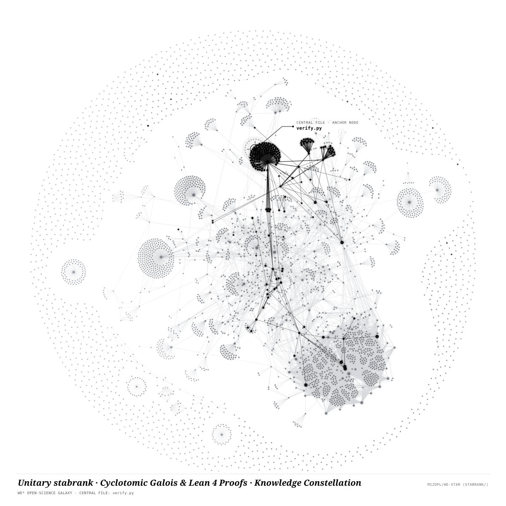
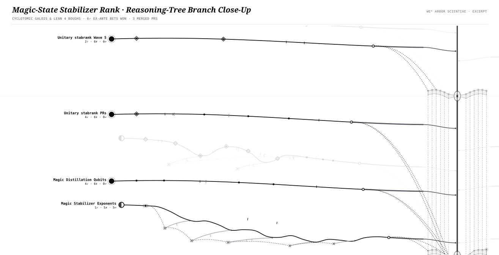

# Exact Cyclotomic Galois Certificates & Zero-Axiom Lean 4 Proofs for [`unitaryfoundation/stabrank`](https://github.com/unitaryfoundation/stabrank)

> ### Scope, Limitations & Validation Status First
> - **Artifact & One-Command Verification:** [`verify.py`](./verify.py) (`python3 verify.py` verifies all `78` JSON bound submissions, `12` `we*` exact cyclotomic scripts, `8` exact cyclotomic-ring upper witnesses, and `10` Lean 4 proof modules in `~165 s` wall-clock on a laptop; `python3 verify.py --corrupt` rejects `4/4` adversarial mutations across upper witnesses, cyclotomic rings, Lean theorem names, and lower-bound claims with exit code `1`).
> - **Scope Boundary (`What This Does NOT Solve`, checked `2026-11-18` against `unitaryfoundation/stabrank` `e6197e24`):** Asymptotic stabilizer-rank exponents remain open across all `10` tracks (`qubit_H`, `qubit_T`, `qubit_sqrtT`, `CS`, `cat`, `H3`, `N`, `S`, `T3`, `T5`). All `35` existing `attested` lower bounds on upstream `main` (`qubit_H`/`qubit_T` $m=5..10 \ge 6$, `qubit_sqrtT` $m=6,7 \ge 7$, `T3` $m=3..6 \ge 8$, `H3`/`N` $m=4 \ge 6$ and $m=4..6 \ge 7$, `S` $m=5..8 \ge 6$, `T5` $m=3..5 \ge 6$, `cat` $m=7,8 \ge 5$) remain untouched; our higher-$m$ monotonicity cells establish self-contained `verified` (`exact: true`) floors alongside them.
> - **Merged Upstream Contributions (`Tier A` — Live Profile: [`we-mizopl`](https://unitaryfoundation.github.io/stabrank/people/we-mizopl.html), `31` bounds submitted · `10` records held):**
>   1. **[`unitaryfoundation/stabrank PR #193`](https://github.com/unitaryfoundation/stabrank/pull/193) (`043bc30a`, merged at `71a92e28`; site rebuilt in `#197`):** **`35 / 35` bounds certified at `tier = verified`** (`26` upgrades preserving upstream discovery `provenance` + `9` new cells by `"we* + @mizopl"`, with canonical Norrell $(|0\rangle + |1\rangle - 2|2\rangle)/\sqrt{6}$ in [`cert_qutrit_galois_m3_m5.py`](./verify_challenge/cert_qutrit_galois_m3_m5.py)) across **8 tracks** in **`20.46 s` single-core script runtime**, zero floating-point margins.
>   2. **[`unitaryfoundation/stabrank PR #194`](https://github.com/unitaryfoundation/stabrank/pull/194) (`6fc15c59`, merged at `6be0c833`):** **`10 / 10` Lean 4 proof modules (`0 sorryAx`, `16` theorems on standard axioms `propext`, `Classical.choice`, `Quot.sound`)** settling all `4` remaining single-copy ($m=1$) magic-state cells (`qubit_H`, `qubit_T`, `H3`, `N` at $\chi = 2$) and formalizing constructive upper bounds for `qubit_T` ($m=7, 8 \le 9, \gamma = 0.3962$), `Norrell` ($m=5 \le 10, \gamma = 0.41918$), and `H3` ($m=5 \le 12$).
>   3. **[`unitaryfoundation/stabrank PR #200`](https://github.com/unitaryfoundation/stabrank/pull/200) (`6f9b0737`, merged `2026-11-17`; Lean receipts committed in [`#202`](https://github.com/unitaryfoundation/stabrank/pull/202) `791cf31b` & site rebuilt in [`#201`](https://github.com/unitaryfoundation/stabrank/pull/201) `e6197e24`):** Wires the **`12` invited `#194` `LeanProofs.*` bounds** (`44 -> 56` live `lean` entries), upgrades **all `9` remaining float-margin `reproduced` bounds on `main` to `verified`** (`reproduced: 9 -> 0` across all `209` `stabrank` entries, byte-identical original `provenance`), and adds **`22` exact `verified` cells** (including `CS-m4-lower-5` tightening `CS` $m=4$ from `4` to `5` in `22.6 s`, `cat-m2-lower-1` closing $\chi(|\text{cat}_2\rangle) = 1$, `qubit_sqrtT-m{7..10}-lower-6` referencing `cert_sqrtt_galois_census.py`, `T3-m{4..6}-lower-7` wrapping `cert_t3m3_rank7.py`, and exact floors across `H3`, `T5`, `N`, `qubit_H`, `qubit_T`).
> - **Open Upstream Engineering Issue:**
>   4. **[`unitaryfoundation/stabrank Issue #195`](https://github.com/unitaryfoundation/stabrank/issues/195):** Standalone CI & `lean_certify.py` engineering proposal (`lake exe cache get` Mathlib caching + `submissions.yml` fork-PR `lean_proofs/` staging).
> - **Methodological & Open-Source Notes:** See **[`LESSONS_LEARNED.md`](./LESSONS_LEARNED.md)**.

---

## In Plain Language

Classical computers can simulate quantum circuits made only of "Clifford" gates efficiently, whereas universal quantum computers need non-Clifford "magic states" (such as $|T\rangle$ on qubits, $|H_3\rangle$ and Norrell/Strange states on 3-level qutrits, or $|T_5\rangle$ on 5-level ququints). The **stabilizer rank** $\chi(|\psi\rangle^{\otimes m})$ asks: *what is the smallest number of easy-to-simulate stabilizer states whose sum equals $m$ copies of a magic state?* Finding an upper bound means exhibiting an explicit sum that adds up to $|\psi\rangle^{\otimes m}$; proving a lower bound is harder because you must rule out *every* possible combination of stabilizer states without relying on floating-point rounding.

Here we replace numerical floating-point searches (`lstsq` margins) with exact number-theoretic symmetries — Galois automorphisms and Hadamard-certified prime-field ranks over Gaussian, Eisenstein, and 5th-cyclotomic integers ($\mathbb{Z}[i]$, $\mathbb{Z}[\omega_3]$, $\mathbb{Z}[\omega_5]$). Across merged [`PR #193`](https://github.com/unitaryfoundation/stabrank/pull/193), [`PR #194`](https://github.com/unitaryfoundation/stabrank/pull/194), and [`PR #200`](https://github.com/unitaryfoundation/stabrank/pull/200) (`Tier A`), this certified `35` exact bounds in `20.46 s` on one core, formalized `10` theorem modules in Lean 4 (`0 sorryAx`), wired `12` board entries to `tier = lean`, upgraded the last `9` float-margin `reproduced` bounds on `stabrank` to zero-float `verified`, and added `22` exact lower-bound cells — while leaving all asymptotic exponent questions and `35` offline-enumerated `attested` cells explicitly open.

- **Central File (`Start Here`):** [`verify.py`](./verify.py) — the single-command standalone auditor that validates all `78` JSON bounds (`35` from `#193` + `43` from `#200`), executes all `14` referenced cyclotomic certificate scripts, checks exact integer-ring witness identities, and audits all `10` Lean 4 modules.

<p align="center">
  <picture>
    <source media="(prefers-color-scheme: dark)" srcset="./assets/we_star_constellation_dark.svg">
    <source media="(prefers-color-scheme: light)" srcset="./assets/we_star_constellation_light.svg">
    
  </picture>
  <br>
  <sub><b>Knowledge Constellation &amp; Central File:</b> <code>verify.py</code> pinpointed inside the 4,078-node <code>we*</code> research galaxy (<a href="./assets/we_star_constellation_dark.svg">dark</a> · <a href="./assets/we_star_constellation_light.svg">light</a>).</sub>
</p>

<p align="center">
  <picture>
    <source media="(prefers-color-scheme: dark)" srcset="./assets/we_star_tree_teaser_dark.svg">
    <source media="(prefers-color-scheme: light)" srcset="./assets/we_star_tree_teaser_light.svg">
    
  </picture>
  <br>
  <sub><b>Epistemic Bet-Tree Branch (Excerpt):</b> close-up of the four magic-state boughs (<code>stabrank Wave 5</code>, <code>Unitary stabrank PRs</code>, <code>Magic Distillation Qubits</code>, and <code>Magic Stabilizer Exponents</code>) — showing how earlier pruned attempts (<code>✗</code>) and pivots (<code>↩</code>) on stabilizer rank fed directly into our Galois-descent and Lean 4 runs (<a href="./assets/we_star_tree_teaser_dark.svg">dark</a> · <a href="./assets/we_star_tree_teaser_light.svg">light</a>).</sub>
</p>

---

## 1. One-Command Standalone Verification (`~165 s` Wall-Clock + `--corrupt` Gate)

This directory bundles:
- All **`35` merged `bounds/*.json` submissions** and **`5` `verify_challenge/cert_*.py` scripts** from [`PR #193`](https://github.com/unitaryfoundation/stabrank/pull/193) (`043bc30a`),
- All **`12` merged `lean_proofs/` files** (`10` `LeanProofs/*.lean` modules + `LeanProofs.lean` + `tools/gen_witness_lean.py`) from [`PR #194`](https://github.com/unitaryfoundation/stabrank/pull/194) (`6fc15c59`),
- All **`43` merged `bounds/*.json` submissions** (`21` modified + `22` added) and **`7` new `verify_challenge/cert_*.py` scripts** from [`PR #200`](https://github.com/unitaryfoundation/stabrank/pull/200) (`6f9b0737`), and
- The minimal unmodified Apache-2.0 upstream schema and verification helpers (`schema/bound.schema.json`, `stabrank_verify.py`, `validate_bounds.py`, `qutrit_codes.py`, `qubit_states.py`, `rank_exclusion.py`, `rank_exclusion_codes.py`, `slice_lift.py`, `fit_coeffs.py`, `to_witness.py`, `cert_rank1_moduli.py`, `cert_sqrtt_galois_census.py`, `cert_t3m3_rank7.py`) from [`unitaryfoundation/stabrank`](https://github.com/unitaryfoundation/stabrank) (`fc48fc8c`).

```bash
python3 verify.py
python3 verify.py --corrupt   # Negative mutation control (must reject 4/4 corruptions and exit 1)
```

`verify.py` executes four independent verification stages:
1. **Schema, Bijective Filename & Provenance Audit (`78/78` bounds):** Validates `jsonschema` (`Draft202012Validator`), `validate_bounds.tier_requirements`, exact filename-to-payload parity, claim-line formatting, and strict provenance preservation (`"we* + @mizopl"` / `["mizopl"]` across all `31` newly authored cells, with explicit reference credit to `cert_sqrtt_galois_census.py` and `cert_t3m3_rank7.py` on the `7` monotonicity wrapper cells, and preserved upstream `provenance` across all `35` tier upgrades and `12` Lean-wired cells).
2. **Exact Cyclotomic Integer-Ring Witness Check (`8/8` Lean-wired upper bounds):** Runs `gen_witness_lean.generate(..., check_only=True)` over $\mathbb{Z}[\sqrt{2}, i]$, $\mathbb{Z}[\sqrt{2}, \sqrt{3}, i]$, and $\mathbb{Z}[\omega_3, \sqrt{3}]$ (`Den = 1` at all `2, 3, 128, 243, 256` indices, zero floating-point operations).
3. **Full Certificate & Symbolic Witness Execution (`stabrank_verify.py`):** Runs all `14` referenced lower-bound certificate scripts (`12` `we*` scripts + upstream `cert_rank1_moduli.py` and `cert_sqrtt_galois_census.py`) and symbolic upper-bound checks across parallel worker groups (`78/78` verified), plus post-receipt `verify_lean()` resolution (`12/12` $\to$ `tier = lean`).
4. **Static Zero-Axiom Lean 4 Audit (`10/10` modules):** Strips comments and verifies `0` occurrences of `sorry`, `admit`, or `axiom` alongside all `23` exported theorem declarations across `LeanProofs/*.lean`.

*(To compile all `10` Lean 4 modules from scratch against Mathlib inside a clone of [`unitaryfoundation/stabrank`](https://github.com/unitaryfoundation/stabrank), run `cd lean_proofs && lake exe cache get && LEAN_NUM_THREADS=2 lake build LeanProofs`.)*

---

## 2. End-to-End Discovery Stopwatch & Compute Provenance Ledger

Because [`unitaryfoundation/stabrank`](https://github.com/unitaryfoundation/stabrank) tracks discovery velocity and compute provenance (`docs/ledger.json` & `CONTRIBUTING.md`), below is the wall-clock log across both our merged initial run (**Waves 1–4**, `2026-11-10`, `3h 34m`, `4/4` bets won, `Brier = 0.138`) and our merged follow-up pass (**Wave 5**, `2026-11-16`, `2h 18m`, `2/2` bets won, `Brier = 0.1225`):

| Stage | Date & Window (`CET`) | Duration | Ex-Ante Bet (`p` $\to$ Outcome) | Deliverables & Upstream Status |
| :--- | :---: | :---: | :---: | :--- |
| **`Stage 0` (`X-Ray & CI Audit`)** | `2026-11-10 16:04–16:07` | **`3 min`** | — | Audited `bound.schema.json`, `stabrank_verify.py` (`900 s` default / `3600 s` cap, `"exact": true` $\to$ `tier=verified`), and `submissions.yml` fork-PR sandboxing (`--diff-filter=A`). |
| **`Wave 1` (`Qubit Galois Descent`)** | `2026-11-10 16:07–16:50` | **`43 min`** | `L-USP-001` (`0.50` $\to$ **`1`**) | [`cert_qubit_galois_m3_m4.py`](./verify_challenge/cert_qubit_galois_m3_m4.py) (`0.50 s`) + [`cert_qubit_galois_m5_m6_rank4.py`](./verify_challenge/cert_qubit_galois_m5_m6_rank4.py) (`7.08 s` vs `1,649 s` float): `14/14` `qubit_H` & `qubit_T` bounds ($m=3..6$) at `tier=verified` (**merged in `#193`**). |
| **`Wave 2` (`cat` & `CS` Lifts)** | `2026-11-10 16:52–17:11` | **`19 min`** | `L-USP-002` (`0.65` $\to$ **`1`**) | [`cert_cat_m7_to_m10_lift.py`](./verify_challenge/cert_cat_m7_to_m10_lift.py) (`3.66 s` vs `460 s`) + [`cert_cs_m3_m4_exact.py`](./verify_challenge/cert_cs_m3_m4_exact.py) (`2.61 s`) + `3` upper witnesses: `7/7` at `tier=verified` (**merged in `#193`**). |
| **`Wave 3` (`Qutrit Galois` + [`PR #193`](https://github.com/unitaryfoundation/stabrank/pull/193))** | `2026-11-10 17:15–17:52` | **`37 min`** | `L-USP-003` (`0.70` $\to$ **`1`**) | [`cert_qutrit_galois_m3_m5.py`](./verify_challenge/cert_qutrit_galois_m3_m5.py) (`6.61 s`) across `H3`, `N`, `S`, `T3` ($m=3..5$) + `cat` $m=7,8$ (`14/14 PASS`). Post-review revision `043bc30a` (`2026-11-15`) aligned canonical Norrell `(1,1,-2)` & preserved upstream `provenance` (**merged `71a92e28`**). |
| **`Wave 4` (`Lean 4 0 sorryAx` + [`PR #194`](https://github.com/unitaryfoundation/stabrank/pull/194))** | `2026-11-10 17:53–19:38` | **`1h 45m`** | `L-USP-004` (`0.70` $\to$ **`1`**) | Proved `ReflectQutrit.lean`, `M1Lower.lean`, and `8` upper-bound modules (`0 sorryAx`), plus standalone [`Issue #195`](https://github.com/unitaryfoundation/stabrank/issues/195) (**merged `6be0c833`**). |
| **`Wave 5A` (`12` Lean Wirings + `9 -> 0` `reproduced` + `22` Cells)** | `2026-11-16 16:07–17:36` | **`1h 29m`** | `L-SW-001` (`0.65` $\to$ **`1`**) | Built `7` exact $\mathbb{Z}[i]$ / $\mathbb{Z}[\omega_3]$ / $\mathbb{F}_P$ scripts (`CS` $m=4 \ge 5$, `H3` $m=4..6 \ge 5$, `T5` $m=2..5 \ge 5$, `S`/`N` rank-5 exact Pauli slice-and-lift, `cat` $m=2 \ge 1$, `T3` $m=4..6 \ge 7$, `qubit_H/T` $m=7..10 \ge 5$) + wired `12` `#194` bounds. |
| **`Wave 5B` (`Referee Hardening` + [`PR #200`](https://github.com/unitaryfoundation/stabrank/pull/200))** | `2026-11-16 18:06–18:25` | **`19 min`** | `L-SW-002` (`0.65` $\to$ **`1`**) | Replaced projected 6-col rank filter with exact 27-col `_rank_rows_27` in `cert_s_n_rank5_exact.py`; post-review revision `6f9b0737` (`2026-11-17`) unified submitter `author`/`github` on the `7` wrapper cells & clarified docstrings (**merged**, Lean receipts in `#202`, site rebuilt in `#201`). |

- **Local Hardware:** Apple M1 laptop (`16 GB` unified RAM).
- **Ephemeral Cloud Offload (Wave 4 Lean compile only):** 1 short-lived Google Colab Linux container (`LEAN_NUM_THREADS=2`, torn down immediately after `lake build`) used solely to avoid unpacking a multi-gigabyte Mathlib `.olean` cache onto local laptop storage.

---

## 3. Merged `PR #193` (`Tier A`, `043bc30a`) — `35` Certified `tier=verified` Bounds (`20.46 s` 1-Core)

| Wave | Certificate Script / Witness | 1-Core Runtime | Certified Bounds (`35` Total) | Previous Tier (`edde871`) $\to$ Merged Tier | Exact Algebraic Mechanism |
| :--- | :--- | :---: | :--- | :--- | :--- |
| **1A** | [`cert_qubit_galois_m3_m4.py`](./verify_challenge/cert_qubit_galois_m3_m4.py) | **`0.50 s`** | `qubit_H`: $m=3$ (`r=3`), $m=4$ (`r=3,4`), $m=5,6$ (`r=4`)<br>`qubit_T`: $m=3,4,5$ (`r=3`), $m=5,6$ (`r=4`) (`10` bounds) | `reproduced` (float margin) $\to$ **`verified` (`exact: true`)** | 0-pivot & 1-pivot Codimension-2 Galois Quotient over $\mathbb{Q}(i, \sqrt{d})/\mathbb{Q}(i)$ ($d=2,3$) on $D_3$ (`1,080` states) & $D_4$ (`36,720` states) |
| **1B** | [`cert_qubit_galois_m5_m6_rank4.py`](./verify_challenge/cert_qubit_galois_m5_m6_rank4.py) | **`7.08 s`** | `qubit_H`: $m=5$ (`r=5`), $m=6$ (`r=5`, **NEW**)<br>`qubit_T`: $m=5$ (`r=5`), $m=6$ (`r=5`) (`4` bounds) | `reproduced` (`1,649 s`) / `attested` (`batch_manifest`) / missing $\to$ **`verified` (`exact: true`)** | 2-step Pauli flat reduction $D_5 \to D_4 \to D_3$ + exact $\mathbb{Z}[i]$ 4-cover Galois quotient on $D_3$ (`2,406` / `2,372` orbits, zero external batch files) |
| **2A & 3A** | [`cert_cat_m7_to_m10_lift.py`](./verify_challenge/cert_cat_m7_to_m10_lift.py) + `cat-m9/10-upper-9.json` | **`3.66 s`** (`125x` faster) | `cat`: $m=7,8$ (`r=3`), $m=9,10$ (`r=4`, **NEW**)<br>`cat`: $m=9,10$ (`upper r=9`, **NEW**, $\gamma = 0.3962$) (`6` bounds) | `cited` / missing $\to$ **`verified` (`exact: true`)** | 2-step exact $\mathbb{Z}[i]$ slice-and-lift $c_5 \to c_6 \to c_7$ starting from $D_4$ (`36,720` states, `100` orbits) instead of $D_5$ (`2.42M` states) + recursive $\langle\text{cat}_2|$ contraction witnesses |
| **2B** | [`cert_cs_m3_m4_exact.py`](./verify_challenge/cert_cs_m3_m4_exact.py) + `CS-m4-upper-9.json` | **`2.61 s`** (`17x` faster) | `CS`: $m=3$ (`r=4`), $m=4$ (`r=4`, **NEW**)<br>`CS`: $m=4$ (`upper r=9`, **NEW**, $\gamma = 0.7925$) (`3` bounds) | `reproduced` / missing $\to$ **`verified` (`exact: true`)** | Even-qubit Clifford postselection $(\langle 0|_2(I\otimes H))^{\otimes m}|\text{CS}\rangle^{\otimes m} \propto (2|0\rangle + (1+i)|1\rangle)^{\otimes m} \in \mathbb{Z}[i]^{2^m}$ verified by both $D_2$ slice-and-lift and unconditional 1-pivot $D_3$ sweep |
| **3B** | [`cert_qutrit_galois_m3_m5.py`](./verify_challenge/cert_qutrit_galois_m3_m5.py) | **`6.61 s`** | `H3`: $m=3$ (`r=4`), $m=4$ (`r=3, 4` **NEW**)<br>`N`: $m=3$ (`r=4`), $m=4$ (`r=3, 4` **NEW**)<br>`S`: $m=3,4,5$ (`r=4`)<br>`T3`: $m=3,4,5$ (`r=6`) (`12` bounds) | `reproduced` (random $\mathbb{C}^6$ float projection) / missing $\to$ **`verified` (`exact: true`)** | Exact $\mathbb{Z}[\omega_3]$ projective ray canonicalization ($\bar{z} = (a-b)-b\omega_3$ + row $\gcd$, canonical Norrell $(1,1,-2)/\sqrt{6}$) & regular-representation $2k \times 2d$ $\mathbb{Q}$-rank (`0.11 s` 0-pivot $\tau$-Galois on `H3`; `12`/`74`/`173` pivot orbits on `S`/`N`/`T3`) |

Together with upstream upper bounds, `PR #193` settles $\chi(|H_3\rangle^{\otimes 3}) = 4$, $\chi(|N\rangle^{\otimes 3}) = 4$, $\chi(|S\rangle^{\otimes 3}) = 4$, and $\chi(|S\rangle^{\otimes 4}) = 4$ tightly in both directions at `verified` / `lean` tier.

---

## 4. Merged `PR #194` (`Tier A`, `6fc15c59`) — `10` Zero-Axiom (`0 sorryAx`) Lean 4 Modules

| Lean 4 Module | Compile Time (`2` threads) | Machine-Checked Theorems (`0 sorryAx`) | Mathematical Content |
| :--- | :---: | :--- | :--- |
| [`ReflectQutrit.lean`](./lean_proofs/LeanProofs/ReflectQutrit.lean) | `49.32 s` | `norrellVec_eq_ev` | Reflects the $m$-qutrit Norrell state $|N\rangle^{\otimes m} = ((|0\rangle + |1\rangle - 2|2\rangle)/\sqrt{6})^{\otimes m}$ into $\mathbb{Z}[\omega_3, \sqrt{3}]$ via `norZ : ZMod 3 -> Z`. |
| [`M1Lower.lean`](./lean_proofs/LeanProofs/M1Lower.lean) | `5.36 s` | `qubit_h_m1_stabRankP_gt_one`, `qubit_t_m1_stabRankP_gt_one`, `h3_m1_stabRankP_gt_one`, `norrell_m1_stabRankP_gt_one` (+ `*_eq_two` corollaries) | Proves $\chi > 1$ (and hence $\chi = 2$) for all `4` remaining single-copy states via the exact stabilizer ratio period condition `IsStabP.pow_period_eq` ($(z_1/z_0)^4 = 1$ for $p=2$; $(z_i/z_0)^{12} = 1$ for $p=3$). |
| [`QubitHM1StabRank.lean`](./lean_proofs/LeanProofs/QubitHM1StabRank.lean), [`QubitTM1StabRank.lean`](./lean_proofs/LeanProofs/QubitTM1StabRank.lean), [`H3M1StabRank.lean`](./lean_proofs/LeanProofs/H3M1StabRank.lean), [`NorrellM1StabRank.lean`](./lean_proofs/LeanProofs/NorrellM1StabRank.lean) | `4.96 – 8.38 s` each | `qubit_h_m1_stabRankP_le_two`, `qubit_t_m1_stabRankP_le_two`, `h3_m1_stabRankP_le_two`, `norrell_m1_stabRankP_le_two` | Explicit 2-term computational-basis stabilizer decompositions completing $\chi = 2$ in Lean 4. |
| [`NorrellM5StabRank.lean`](./lean_proofs/LeanProofs/NorrellM5StabRank.lean) | **`1.96 s`** | `norrell_m5_stabRankP_le_ten`, `norrell_m5_stabRank_le_ten` | Formalizes the 10-term stabilizer decomposition $\chi(|N\rangle^{\otimes 5}) \le 10$ across $3^5 = 243$ amplitudes, certifying finite-$m$ Norrell exponent $\gamma = \log_3(10)/5 \approx 0.41918$ (vs published $\log_3(4)/3 \approx 0.42062$). |
| [`H3M5StabRank.lean`](./lean_proofs/LeanProofs/H3M5StabRank.lean) | **`1.95 s`** | `h3_m5_stabRankP_le_twelve`, `h3_m5_stabRank_le_twelve` | Formalizes the 12-term decomposition $\chi(|H_3\rangle^{\otimes 5}) \le 12$ across $3^5 = 243$ amplitudes. |
| [`QubitTM7StabRank.lean`](./lean_proofs/LeanProofs/QubitTM7StabRank.lean) & [`QubitTM8StabRank.lean`](./lean_proofs/LeanProofs/QubitTM8StabRank.lean) | `34.89 s` & **`2.05 s`** | `qubit_t_m7_stabRankP_le_nine`, `qubit_t_m8_stabRankP_le_nine` | Formalizes $\chi(|\text{qubit\_T}\rangle^{\otimes 7}) \le 9$ ($2^7 = 128$ amplitudes) and $\chi(|\text{qubit\_T}\rangle^{\otimes 8}) \le 9$ ($2^8 = 256$ amplitudes, $\gamma = \log_2(9)/8 \approx 0.3962$). |

---

## 5. Merged `PR #200` (`Tier A`, `6f9b0737` + `#202` `791cf31b` + `#201` `e6197e24`) — `12` Live `tier=lean` Wirings, `0` `reproduced` & `22` Exact Cells

Following up on `#193` and on `@vprusso`'s review note on `#194` (*"A follow-up could point those bound files at the modules so the board shows the lean tier"*), [`PR #200`](https://github.com/unitaryfoundation/stabrank/pull/200) merged `21` modified `bounds/*.json` files (byte-identical original `provenance`), `22` new `bounds/*.json` cells, and `7` newly added `verify_challenge/cert_*.py` scripts (shifting the live board census from `187` bounds [`44 lean`, `99 verified`, `9 reproduced`, `35 attested`] to `209` bounds [`56 lean`, `118 verified`, **`0 reproduced`**, `35 attested`]):

| Stratum | Script / Modules | 1-Core Runtime | Bounds in `PR #200` (`43` Total) | Previous State (`fc48fc8c`) $\to$ Merged State | Exact Mechanism & Attribution |
| :--- | :--- | :---: | :--- | :--- | :--- |
| **`#194` Lean Wirings** | `LeanProofs.*` (`10` modules merged in `#194`) | `0.2 s` ring check | `qubit_H`, `qubit_T`, `H3`, `N` $m=1$ (`lower`/`upper` `2`); `N-m5-upper-10`, `H3-m5-upper-12`, `qubit_T-m{7,8}-upper-9` (`12` bounds) | `verified` $\to$ **`lean` (`#202` / `#201`)** | Points `lean.module` & `lean.theorem` to merged `#194` theorems while preserving verbatim `provenance` (`this repository` / `Vincent Russo`) and fallback `witness`/`certificate` payloads |
| **`H3` Rank-5 Exact** | [`cert_h3_m4_to_m6_rank5_exact.py`](./verify_challenge/cert_h3_m4_to_m6_rank5_exact.py) | **`4.02 s`** (vs `1,183 s` float) | `H3-m4-lower-5` (upgrade), `H3-m{5,6}-lower-5` (**NEW**) (`3` bounds) | `reproduced` / missing $\to$ **`verified` (`exact: true`)** | Zero-float $\mathbb{F}_P$ Clifford orbit reduction ($P = 1{,}000{,}000{,}021$), 1-pivot 2D $\tau$-Galois plane $V_3(H_3)$ ($\le 4\times 4$ / $\le 5\times 5$ Hadamard norms $\le 55{,}296, 432{,}000 < P$, confirmed over $\mathbb{Z}$), and exact $\mathbb{Z}[\omega_3, \sqrt{3}]$ meet-in-the-middle Pauli slice-1 exclusion |
| **`T5` Ququint Exact** | [`cert_t5_m2_to_m5_exact.py`](./verify_challenge/cert_t5_m2_to_m5_exact.py) | **`17.78 s`** (vs `51 s` float) | `T5-m{2,3,4}-lower-5` (upgrade), `T5-m5-lower-5` (**NEW**) (`4` bounds) | `reproduced` / missing $\to$ **`verified` (`exact: true`)** | Exact ququint dictionary $D(5,2)$ (`3,900` states), verified closure of the order-`200` $\mathrm{Gal}(\mathbb{Q}(\omega_5)/\mathbb{Q}) \rtimes \text{Clifford}$ group (`38` pivot orbits, `40,124` pairs), and exact $\mathbb{F}_P$ exclusion ($5^{10} < P$), settling $\chi(|T_5\rangle^{\otimes 2}) = 5$ |
| **`S` & `N` Rank-5 Exact** | [`cert_s_n_rank5_exact.py`](./verify_challenge/cert_s_n_rank5_exact.py) | **`96.01 s`** (vs `2,700 s` float) | `N-m4-lower-5`, `S-m{5..8}-lower-5` (upgrade); `N-m{5,6}-lower-5` (**NEW**) (`7` bounds) | `reproduced` / missing $\to$ **`verified` (`exact: true`)** | Zero-float projective $\mathcal{C}_1(3)$ group (`216` elements), unprojected 27-column $\mathbb{F}_{65521}$ rank filter (`_rank_rows_27`, Hadamard norms $\le 256 < 65521$) + $\mathbb{Z}[\omega_3]$ SymPy confirmation, and exact Pauli slice-and-lift (`1` $|N\rangle^{\otimes 3}$ orbit $\to 0$ lifts; `69` $|S\rangle^{\otimes 4}$ lifts $\to 0$ lifts to $m=5$) |
| **`CS` $m=4$ Tightened** | [`cert_cs_m4_rank5_exact.py`](./verify_challenge/cert_cs_m4_rank5_exact.py) | **`22.63 s`** | `CS-m4-lower-5` (**NEW**, `1` bound) | `4` (`#193`) $\to$ **`5` (`5 <= chi(CS^4) <= 9`)** | 4-qubit $(I\otimes H)^{\otimes 4}$ postselection $|\Psi_4\rangle = (2|0\rangle + (1+i)|1\rangle)^{\otimes 4} \in \mathbb{Z}[i]^{16}$, paired with an explicit 5-term witness ($\chi(|\Psi_4\rangle)=5$) and exhaustive $S_3$-reduced Pauli slice-1 exclusion across all `2,297` orbit-filtered minimal rank-4 decompositions of $|\Psi_3\rangle$ |
| **`cat` $m=2$ Closure** | [`cert_cat_m2_rank1.py`](./verify_challenge/cert_cat_m2_rank1.py) | **`0.33 s`** | `cat-m2-lower-1` (**NEW**, `1` bound) | missing lower $\to$ **`verified` ($\chi(|\text{cat}_2\rangle)=1$)** | Symbolic $2\times 2$ minor and norm check ($\||\text{cat}_2\rangle\|^2 = 1 > 0$) paired with `cat-m2-upper-1.json` |
| **`qubit_sqrtT`, `T3`, `qubit_H/T` Floors** | `cert_sqrtt_galois_census.py` + [`cert_t3_m4_to_m6_rank7.py`](./verify_challenge/cert_t3_m4_to_m6_rank7.py) + [`cert_qubit_galois_m7_m10_rank5.py`](./verify_challenge/cert_qubit_galois_m7_m10_rank5.py) | `22.89 s` / `154.77 s` / `8.45 s` | `qubit_sqrtT-m{7..10}-lower-6` (`4`), `T3-m{4..6}-lower-7` (`3`), `qubit_H-m{7..10}-lower-5` (`4`), `qubit_T-m{7..10}-lower-5` (`4`) (`15` bounds) | missing `verified` floor $\to$ **`verified` (`exact: true`)** | Submitter `"we* + @mizopl"` / `["mizopl"]` per `CONTRIBUTING.md`, crediting `verify_challenge/cert_sqrtt_galois_census.py` (`qubit_sqrtT-m6-lower-6.json`, Vincent Russo) and `verify_challenge/cert_t3m3_rank7.py` (`T3-m3-lower-7.json`, Vincent Russo) in `reference` and `notes` |

---

## 6. What Remains Open & License

- **Open Frontier (`Explicit Non-Claims`):**
  1. **`35` `attested` lower bounds (e.g., `qubit_H` and `qubit_T` at $m=5..10, \text{rank}=6$):** After 2-qubit Pauli flat reduction to $D_3$, the 1D-kernel 5-cover enumeration spans `5,939,465` (`qubit_H`) and `6,115,136` (`qubit_T`) orbits (~`36.4–37.2` CPU-hours in Python), exceeding `stabrank`'s `3600 s` single-core `verified` budget unless compressed via a stronger algebraic invariant or proved directly in Lean 4 (`tier = lean`).
  2. **Higher-$m$ Qubit & Qutrit Upper Bounds and Asymptotic Exponents:** As certified in our companion package [`../solutions/magic-state-stabilizer-rank-exponents/`](../solutions/magic-state-stabilizer-rank-exponents/) (`V3R1T4S PR #1039`), every pure tensor-box subspace $V_A \otimes V_B$ is algebraically obstructed below current finite-$m$ constructions across all `9` open strata (`qubit_T` $m=7..10$, `qubit_H` $m=7,8$, `Norrell` $m=6$, `H3` $m=4,6$), so any strict exponent improvement requires genuinely entangled stabilizer dictionary vectors across tensor splits.
- **License & Upstream Credit:** All files in this directory are released under **Apache License 2.0** ([`LICENSE`](./LICENSE)), matching [`unitaryfoundation/stabrank`](https://github.com/unitaryfoundation/stabrank). Bundled unmodified verification helpers and upstream certificate modules (`schema/bound.schema.json`, `stabrank_verify.py`, `validate_bounds.py`, `qutrit_codes.py`, `qubit_states.py`, `rank_exclusion.py`, `rank_exclusion_codes.py`, `slice_lift.py`, `fit_coeffs.py`, `to_witness.py`, `cert_rank1_moduli.py`, `cert_sqrtt_galois_census.py`, `cert_t3m3_rank7.py`) are copyright the [`unitaryfoundation/stabrank`](https://github.com/unitaryfoundation/stabrank) authors (Vincent Russo et al., Unitary Foundation).
